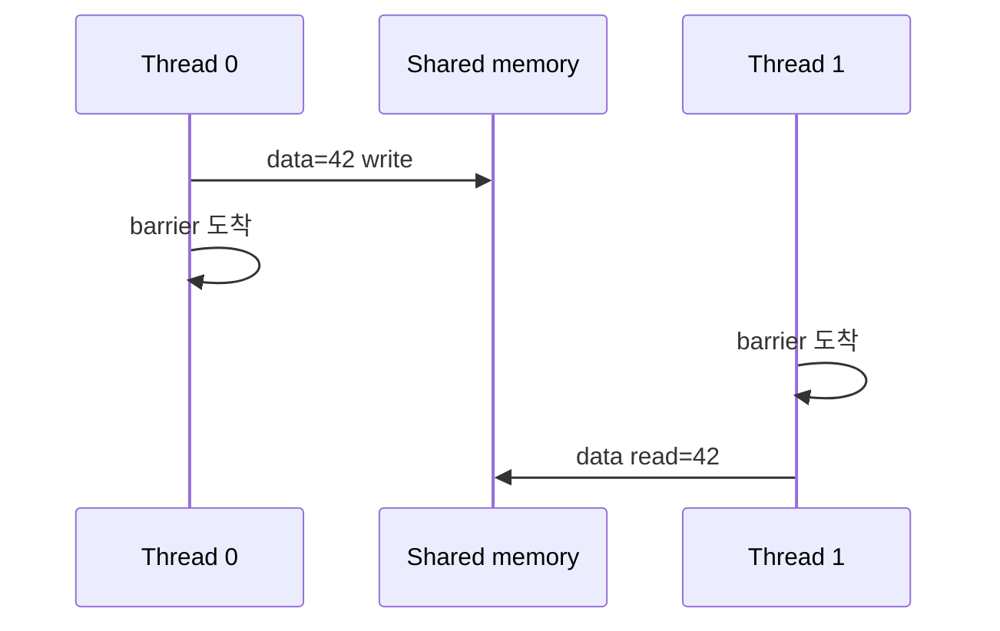

# 04. Synchronization과 Memory Order

[이전: 03. Memory](03-registers-global-and-shared-memory.md) · [목차](README.md) · [다음: 05. 주소 효율](05-coalescing-alignment-and-bank-conflicts.md)

Synchronization은 참여자와 범위를 정해 순서·가시성을 만든다.



## 1. Race

두 실행이 같은 memory location에 접근하고 적어도 하나가 write이며 적절한 synchronization이 없으면 data race가 될 수 있다.

## 2. `__syncthreads()`

Block barrier다. 참여 block thread가 barrier에 도달한 뒤 진행하고, shared/global memory visibility에 관련한 block 범위 보장을 제공한다.

## 3. 참여 조건

Barrier가 조건 branch 안에 있다면 block의 모든 thread가 같은 조건으로 참여해야 안전하다.

```text
if threadIdx.x < 16: barrier
```

64-thread block에서 16개만 도달하면 나머지를 기다릴 수 있다.

## 4. Barrier는 계산을 대신하지 않는다

Barrier 전 thread 3이 tile[3]을 쓰지 않았다면 barrier 뒤에도 값은 준비되지 않는다. 올바른 write와 boundary fill이 필요하다.

## 5. Warp 가정

같은 warp lane이 lockstep처럼 보여도 memory communication에는 명시된 warp primitive와 mask를 사용한다. Independent thread scheduling을 고려한다.

## 6. Warp mask

Warp sync/shuffle primitive는 참여 lane mask가 중요하다. Inactive lane의 값을 읽는 가정은 피한다.

## 7. Atomic

같은 location의 read-modify-write를 indivisible하게 만든다. 예: counter increment.

32 thread가 `counter++`를 일반 load/add/store로 하면 update를 잃을 수 있다. Atomic add면 최종 32를 기대할 수 있다.

## 8. Atomic은 전체 algorithm barrier가 아니다

Counter 값이 32가 되었다고 다른 모든 unrelated write가 원하는 scope에 보인다는 뜻은 memory order 계약에 달렸다.

## 9. Scope

Thread, block, device, system 같은 scope는 어떤 observer와 synchronization하는지 구분한다.

Device-scope atomic을 host와 다른 GPU까지 자동 system synchronization으로 확대하지 않는다.

## 10. Memory order

Relaxed, acquire, release, sequentially consistent 등은 atomic ordering 관계를 표현한다. Operation atomicity와 주변 memory ordering은 같은 질문이 아니다.

## 11. Producer-consumer

Producer가 data를 쓰고 release 방식으로 ready flag를 publish, consumer가 acquire로 flag를 본 뒤 data를 읽는 pattern을 생각한다.

Flag만 atomic이고 data ordering이 없으면 consumer가 오래된 data를 볼 위험이 있다.

## 12. Fence

Fence는 memory operation ordering/visibility에 쓰인다. 다른 thread를 실행 지점에서 모두 기다리는 barrier와 같지 않다.

## 13. Block 합계 예제

Shared `[1,2,3,4]`에서 stride 2:

```text
thread0: s[0]=1+3=4
thread1: s[1]=2+4=6
barrier
thread0: s[0]=4+6=10
```

첫 단계와 둘째 사이 barrier가 없으면 thread0이 s[1]=2를 읽어 6을 만들 수 있다.

## 13.1 조건부 data와 무조건 barrier

n=3인데 block thread가 4개면 thread 3은 input을 읽지 못한다. 그렇다고 barrier 전에 return하지 않는다.

| Thread | Shared write | Barrier | Reduction 참여 |
| ---: | --- | --- | --- |
| 0 | s[0]=1 | 도달 | 합산 |
| 1 | s[1]=2 | 도달 | 합산 |
| 2 | s[2]=3 | 도달 | 합산 |
| 3 | s[3]=0 identity | 도달 | 값 영향 없음 |

모든 thread가 shared slot을 유효 값 또는 identity로 채우고 barrier에 온다. 결과는 6이다.

## 13.2 Atomic flag protocol 반례

Producer가 global `data=42`를 일반 store하고 `ready=1`을 atomic relaxed store했다고 하자. Consumer가 ready 1을 봤어도 data 42의 ordering이 연결되지 않을 수 있다.

Release store와 acquire load처럼 해당 scope의 happens-before 관계를 만드는 계약이 필요하다. 구체 API와 지원 order를 CUDA memory model에서 확인한다.

Atomicity는 ready 값이 찢어지지 않는 성질이고, ordering은 data write가 consumer에 보이는 관계다.

## 14. Grid synchronization

일반 kernel의 block 사이 global barrier를 임의로 구현하면 residency deadlock 위험이 있다. Kernel 경계, cooperative launch 등 지원 계약을 사용한다.

## 15. Kernel boundary

같은 stream에서 앞 kernel completion 뒤 다음 kernel이 실행되는 ordering을 활용할 수 있다. Stream이 다르면 event dependency 등이 필요하다.

## 16. Host synchronization

Host가 device result를 읽기 전에 copy/kernel completion을 확인한다. Async API 반환은 completion이 아니다.

## 17. Atomic contention

모든 thread가 한 counter에 atomic add하면 정확하지만 serialization 병목이 될 수 있다. Block local reduction 뒤 atomic 한 번으로 줄일 수 있다.

## 18. Determinism

Atomic floating add 순서가 실행마다 달라 rounding 결과가 달라질 수 있다. Race와 합법적인 비결정적 순서를 구분한다.

## 19. 반례

`volatile`만 붙이면 inter-thread synchronization이 완성된다고 생각하면 안 된다. CUDA memory model primitive를 사용한다.

Barrier가 있으면 block 밖 observer까지 자동 synchronization된다는 생각도 틀리다.

## 문제와 해설

**문제 1.** 64-thread block에서 even thread만 barrier에 오면 안전한가?

**해설.** 아니다. 조건부 barrier 참여가 일치하지 않아 위험하다.

**문제 2.** Atomic add로 counter가 맞으면 주변 array write도 자동 system-visible인가?

**해설.** 아니다. Scope와 memory order를 별도로 설계한다.

**문제 3.** Fence와 barrier 차이는?

**해설.** Fence는 memory ordering, barrier는 참여 실행 주체의 도착을 함께 다룬다.

## 공식 자료

- [CUDA C++ memory model](https://docs.nvidia.com/cuda/cuda-programming-guide/05-appendices/cuda-cpp-memory-model.html)
- [CUDA synchronization functions](https://docs.nvidia.com/cuda/cuda-programming-guide/05-appendices/cpp-language-extensions.html)
