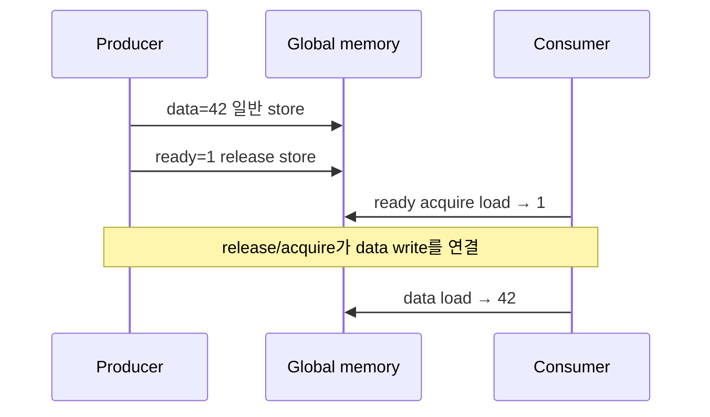
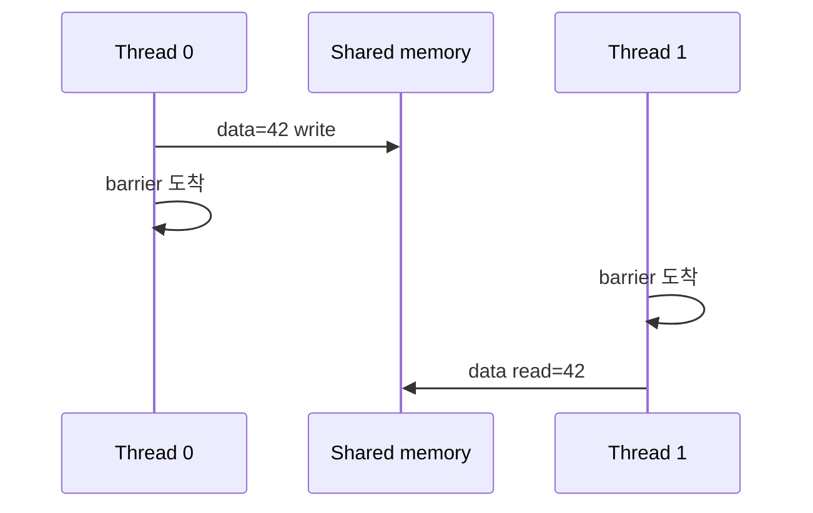

# 04. Synchronization과 Memory Order

[이전: 03. Memory](03-registers-global-and-shared-memory.md) · [목차](README.md) · [다음: 05. 주소 효율](05-coalescing-alignment-and-bank-conflicts.md)

Synchronization은 참여자와 범위를 정해 순서·가시성을 만든다.

## 다섯 성질을 한 단어로 합치지 않는다

**barrier(배리어)**는 정해진 참여자가 모두 특정 지점에 도착할 때까지 진행을 막는다. Block barrier는 같은 block thread의 rendezvous다. **fence(펜스)**는 호출 thread의 memory operation 순서와 가시성 범위를 다루지만 다른 thread가 같은 코드 지점에 도착하기를 기다리는 장치는 아니다.

**atomic(원자 연산)**은 특정 memory location의 read-modify-write가 다른 경쟁 연산과 중간 상태로 섞이지 않게 한다. **scope(범위)**는 어떤 observer까지 그 동기화 관계에 참여하는지 정한다. Block, device, system 범위를 필요 이상으로 넓히면 비용이 늘 수 있고 너무 좁히면 reader와 연결되지 않는다.

**ordering(순서 보장)**은 한 thread의 data write와 다른 thread의 read 사이 관측 순서를 만든다. **visibility(가시성)**는 observer가 그 write를 볼 수 있게 되는 성질이다. **happens-before(선행 관계)**는 program order와 synchronization이 연결되어 한 사건이 다른 사건보다 논리적으로 앞선다는 관계다. 실제 벽시계 시간만 빠르다고 happens-before가 생기지 않는다.



## 수치 시간표 1: race로 update가 사라진다

Counter가 0이고 thread A와 B가 일반 `counter++`를 한다. t0에 A가 0 load, t1에 B도 0 load, t2에 A가 1을 store, t3에 B도 1을 store하면 최종값은 1이다. 두 증가를 수행했지만 한 update가 사라졌다. 실행 순서가 우연히 A 전체 뒤 B 전체면 2가 나와 bug가 숨을 수 있다.

Atomic add를 쓰면 두 read-modify-write가 하나의 순서로 직렬화되어 반환 old value가 0과 1, 최종 counter가 2가 된다. 그러나 A가 다른 배열 `data[A]=42`를 썼다는 사실이 counter atomic만으로 모든 scope에 자동 publish되는지는 memory order 계약을 따로 확인해야 한다.

## 수치 시간표 2: barrier, fence, atomic의 역할

네 thread가 shared `[1,2,3,4]`를 합친다. t0~t1에 각 slot을 쓰고, t2에 네 thread 모두 barrier에 도착한다. t3에 thread 0이 네 값을 읽으면 10이다. Thread 3이 조건문에서 t2 barrier를 건너뛰면 나머지 세 thread는 도착하지 않는 참여자를 기다릴 수 있다.

Fence만 t2에 넣으면 thread 0이 다른 thread의 도착을 기다리는 것은 아니다. Atomic counter로 “도착 수 4”를 만들려면 data store의 release와 counter 관측의 acquire, 마지막 observer의 범위를 포함한 완전한 protocol이 필요하다. 단순 barrier가 가능한 block 내부 문제를 복잡한 spin protocol로 바꿀 이유가 없다.

## Race, deadlock, divergence를 구분한다

**race(경쟁 오류)**는 실행 순서에 따라 같은 주소 결과가 달라지는 문제다. **deadlock(교착)**은 참여자들이 서로의 진행을 기다려 아무도 나아가지 못하는 상태다. **divergence(발산)**는 warp lane들이 서로 다른 제어 경로를 실행하는 현상으로 느릴 수 있지만 그 자체가 항상 오류는 아니다.

조건부 branch 양쪽이 계산 후 재결합하면 divergence다. Branch 한쪽만 block barrier에 들어가면 참여 불일치로 deadlock 또는 정의되지 않은 동작 위험이 생긴다. 두 lane이 같은 output을 일반 store하면 data race다. 세 현상은 한 코드에서 함께 나타날 수 있지만 진단 질문이 다르다.

## Scope가 맞아야 연결된다

같은 block의 producer와 consumer는 block-scope primitive로 충분할 수 있다. 다른 block이 읽으면 device-scope 관계가 필요하다. Host나 peer device가 observer면 system 범위와 API completion 계약을 검토한다. 좁은 release와 넓은 acquire를 임의로 섞는다고 자동 연결되지 않는다.

같은 stream의 kernel A 뒤 kernel B는 stream ordering으로 A completion 뒤 B가 시작한다. 다른 stream B에는 event wait를 연결해야 한다. Kernel 경계가 모든 host memory까지 자동 동기화하는 것은 아니며 copy와 host wait 계약을 지킨다.

## Warp 참여 mask

Warp shuffle이나 sync는 어떤 lane이 참여하는지 mask로 표현한다. 마지막 partial warp에서 존재하지 않는 lane의 값을 읽거나 branch로 빠진 lane을 mask에 포함하면 결과가 정의되지 않을 수 있다. Active lane 0~7만 합칠 때는 그 집합을 나타내는 mask와 width 조건을 사용한다.

Warp가 같은 instruction issue 단위라는 사실을 memory ordering으로 확대하지 않는다. Independent thread scheduling이 있는 architecture에서 명시적 warp sync 없이 “lane 0이 먼저 썼을 것”이라 가정하지 않는다.

## 비동기 pipeline의 happens-before

Producer warp가 shared slot 0에 TMA copy를 시작한 사건과 copy 완료 사건은 다르다. Consumer는 완료를 나타내는 barrier 상태를 기다린 뒤 slot 0을 읽는다. Consumer 완료가 slot-free 상태를 publish한 뒤에야 producer가 다음 tile로 덮는다. 이 두 방향 관계가 있어야 ping-pong buffer 수명이 겹치지 않는다.

CUDA Graph replay에서도 주소와 dependency edge가 기록된 조건을 만족해야 한다. 동적 요청이 이전 graph의 buffer보다 길거나 주소가 바뀌면 그대로 replay하지 않고 맞는 graph variant 또는 일반 launch를 선택한다. Graph는 잘못된 dependency를 고쳐 주지 않고 동일한 잘못을 빠르게 반복할 수 있다.

## 반례

`volatile`은 compiler 접근 성질과 관련될 수 있지만 thread 간 완전한 synchronization protocol이 아니다. Atomic counter 최종값이 맞아도 주변 payload가 준비됐다는 보장은 별도다. 모든 곳에 device-wide fence를 넣어도 barrier 참여 오류나 out-of-bounds를 고치지 못한다.

## 다섯 문제를 단계별로 푼다

**문제 1.** 두 thread의 일반 increment 뒤 counter가 1이 될 수 있는 이유는?

**해설.** 둘 다 old 0을 읽고 각각 1을 store하면 마지막 store가 앞 store를 덮는다. Atomic read-modify-write가 필요하다.

**문제 2.** Fence와 barrier의 핵심 차이는?

**해설.** Fence는 호출 thread의 memory ordering·visibility를 다루고, barrier는 정해진 참여자의 도착까지 기다린다. 필요한 범위도 함께 지정한다.

**문제 3.** 64-thread block에서 0~31만 barrier에 오면?

**해설.** 참여 조건이 일치하지 않아 나머지를 기다리며 멈출 수 있다. 조건부 data를 identity로 채우고 barrier는 모두 통과하게 설계한다.

**문제 4.** Release ready store와 acquire ready load 뒤 payload를 읽는 이유는?

**해설.** Producer의 payload write를 flag publish보다 앞에 두고, consumer의 flag 관측 뒤 payload read와 happens-before 관계를 만들기 위해서다.

**문제 5.** Floating atomic 합 결과가 실행마다 조금 다른 것은 모두 race인가?

**해설.** 합법적인 atomic 순서가 달라 부동소수점 반올림이 달라질 수 있다. Update 유실 race와 구분하고 허용 오차·결정성 요구를 정한다.



## 1. Race

두 실행이 같은 memory location에 접근하고 적어도 하나가 write이며 적절한 synchronization이 없으면 data race가 될 수 있다.

## 2. `__syncthreads()`

Block barrier다. 참여 block thread가 barrier에 도달한 뒤 진행하고, shared/global memory visibility에 관련한 block 범위 보장을 제공한다.

## 3. 참여 조건

Barrier가 조건 branch 안에 있다면 block의 모든 thread가 같은 조건으로 참여해야 안전하다.

```text
if threadIdx.x < 16: barrier
```

64-thread block에서 16개만 도달하면 나머지를 기다릴 수 있다.

## 4. Barrier는 계산을 대신하지 않는다

Barrier 전 thread 3이 tile[3]을 쓰지 않았다면 barrier 뒤에도 값은 준비되지 않는다. 올바른 write와 boundary fill이 필요하다.

## 5. Warp 가정

같은 warp lane이 lockstep처럼 보여도 memory communication에는 명시된 warp primitive와 mask를 사용한다. Independent thread scheduling을 고려한다.

## 6. Warp mask

Warp sync/shuffle primitive는 참여 lane mask가 중요하다. Inactive lane의 값을 읽는 가정은 피한다.

## 7. Atomic

같은 location의 read-modify-write를 indivisible하게 만든다. 예: counter increment.

32 thread가 `counter++`를 일반 load/add/store로 하면 update를 잃을 수 있다. Atomic add면 최종 32를 기대할 수 있다.

## 8. Atomic은 전체 algorithm barrier가 아니다

Counter 값이 32가 되었다고 다른 모든 unrelated write가 원하는 scope에 보인다는 뜻은 memory order 계약에 달렸다.

## 9. Scope

Thread, block, device, system 같은 scope는 어떤 observer와 synchronization하는지 구분한다.

Device-scope atomic을 host와 다른 GPU까지 자동 system synchronization으로 확대하지 않는다.

## 10. Memory order

Relaxed, acquire, release, sequentially consistent 등은 atomic ordering 관계를 표현한다. Operation atomicity와 주변 memory ordering은 같은 질문이 아니다.

## 11. Producer-consumer

Producer가 data를 쓰고 release 방식으로 ready flag를 publish, consumer가 acquire로 flag를 본 뒤 data를 읽는 pattern을 생각한다.

Flag만 atomic이고 data ordering이 없으면 consumer가 오래된 data를 볼 위험이 있다.

## 12. Fence

Fence는 memory operation ordering/visibility에 쓰인다. 다른 thread를 실행 지점에서 모두 기다리는 barrier와 같지 않다.

## 13. Block 합계 예제

Shared `[1,2,3,4]`에서 stride 2:

```text
thread0: s[0]=1+3=4
thread1: s[1]=2+4=6
barrier
thread0: s[0]=4+6=10
```

첫 단계와 둘째 사이 barrier가 없으면 thread0이 s[1]=2를 읽어 6을 만들 수 있다.

## 13.1 조건부 data와 무조건 barrier

n=3인데 block thread가 4개면 thread 3은 input을 읽지 못한다. 그렇다고 barrier 전에 return하지 않는다.

| Thread | Shared write | Barrier | Reduction 참여 |
| ---: | --- | --- | --- |
| 0 | s[0]=1 | 도달 | 합산 |
| 1 | s[1]=2 | 도달 | 합산 |
| 2 | s[2]=3 | 도달 | 합산 |
| 3 | s[3]=0 identity | 도달 | 값 영향 없음 |

모든 thread가 shared slot을 유효 값 또는 identity로 채우고 barrier에 온다. 결과는 6이다.

## 13.2 Atomic flag protocol 반례

Producer가 global `data=42`를 일반 store하고 `ready=1`을 atomic relaxed store했다고 하자. Consumer가 ready 1을 봤어도 data 42의 ordering이 연결되지 않을 수 있다.

Release store와 acquire load처럼 해당 scope의 happens-before 관계를 만드는 계약이 필요하다. 구체 API와 지원 order를 CUDA memory model에서 확인한다.

Atomicity는 ready 값이 찢어지지 않는 성질이고, ordering은 data write가 consumer에 보이는 관계다.

## 14. Grid synchronization

일반 kernel의 block 사이 global barrier를 임의로 구현하면 residency deadlock 위험이 있다. Kernel 경계, cooperative launch 등 지원 계약을 사용한다.

## 15. Kernel boundary

같은 stream에서 앞 kernel completion 뒤 다음 kernel이 실행되는 ordering을 활용할 수 있다. Stream이 다르면 event dependency 등이 필요하다.

## 16. Host synchronization

Host가 device result를 읽기 전에 copy/kernel completion을 확인한다. Async API 반환은 completion이 아니다.

## 17. Atomic contention

모든 thread가 한 counter에 atomic add하면 정확하지만 serialization 병목이 될 수 있다. Block local reduction 뒤 atomic 한 번으로 줄일 수 있다.

## 18. Determinism

Atomic floating add 순서가 실행마다 달라 rounding 결과가 달라질 수 있다. Race와 합법적인 비결정적 순서를 구분한다.

## 19. 반례

`volatile`만 붙이면 inter-thread synchronization이 완성된다고 생각하면 안 된다. CUDA memory model primitive를 사용한다.

Barrier가 있으면 block 밖 observer까지 자동 synchronization된다는 생각도 틀리다.

## 문제와 해설

**문제 1.** 64-thread block에서 even thread만 barrier에 오면 안전한가?

**해설.** 아니다. 조건부 barrier 참여가 일치하지 않아 위험하다.

**문제 2.** Atomic add로 counter가 맞으면 주변 array write도 자동 system-visible인가?

**해설.** 아니다. Scope와 memory order를 별도로 설계한다.

**문제 3.** Fence와 barrier 차이는?

**해설.** Fence는 memory ordering, barrier는 참여 실행 주체의 도착을 함께 다룬다.

## 공식 자료

- [CUDA C++ memory model](https://docs.nvidia.com/cuda/cuda-programming-guide/05-appendices/cuda-cpp-memory-model.html)
- [CUDA synchronization functions](https://docs.nvidia.com/cuda/cuda-programming-guide/05-appendices/cpp-language-extensions.html)
