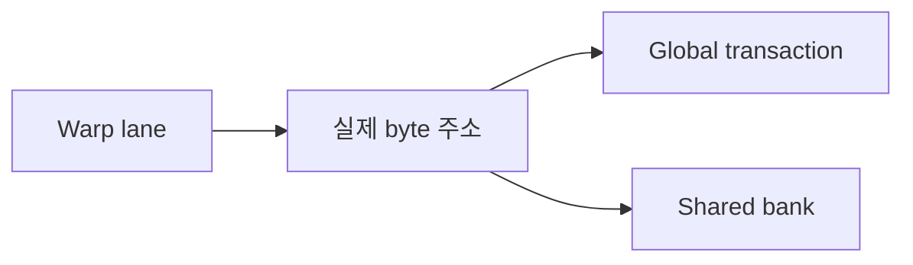

# 05. Coalescing·Alignment·Bank Conflict

## 주소를 세기 전에 필요한 기초

CPU와 GPU는 데이터를 이름이 아니라 **주소(address)**로 찾는다. 주소는 메모리 안에서 어느 byte부터 읽거나 쓸지를 나타내는 숫자다. **Byte(바이트)**는 보통 8 bit를 묶은 주소 지정 단위다. 32-bit `float` 하나는 4 byte이므로 시작 주소가 100이면 그 값은 주소 100, 101, 102, 103의 네 byte를 차지한다. 다음 연속 `float`는 주소 104에서 시작한다.

CPU 프로그램에서 보는 pointer와 GPU kernel이 사용하는 device pointer는 같은 숫자처럼 표시될 수 있지만, 항상 같은 물리 메모리를 뜻하지 않는다. Runtime과 driver가 process의 virtual address, GPU context의 device address, 실제 RAM 또는 VRAM 위치를 연결한다. 이 장의 `base=0`은 계산을 단순하게 만든 교육용 상대 주소다. 실제 프로그램이 물리 주소 0을 읽는다는 뜻이 아니다.

GPU kernel은 많은 **thread(스레드)**가 같은 함수 본문을 서로 다른 data index에 실행한다. CUDA에서 thread들은 block으로 묶이고, block은 GPU의 SM에 배치된다. **Warp(워프)**는 SM이 명령을 함께 내리는 thread 묶음이며, 이 장의 모형은 32개 thread를 lane 0부터 lane 31로 부른다. **Lane(레인)**은 warp 안에서 한 thread가 차지하는 번호다. `lane i가 a[i]를 읽는다`는 말은 각 lane이 자기 번호로 주소를 계산한다는 뜻이다.

메모리 공간도 위치와 공유 범위가 다르다.

| 공간 | 실제 위치와 접근 범위 | 대략적인 수명 | 이 장의 질문 |
|---|---|---|---|
| register | SM 내부의 thread별 저장소 | 해당 thread 실행 동안 | 주소 결합 대상이 아니라 각 lane의 임시 값 |
| shared memory | SM 내부, 같은 block thread가 공유 | block 실행 동안 | 어떤 bank로 매핑되는가 |
| global memory | GPU의 큰 device memory | 할당부터 해제까지, 여러 block 접근 가능 | warp 주소가 몇 sector를 요구하는가 |
| host memory | CPU가 사용하는 RAM | host 할당 수명 | GPU 전송 전에 pinned 여부와 DMA 경로 고려 |

**Global memory**는 모든 kernel block이 장치 주소를 통해 접근할 수 있는 큰 공간이지만 SM에서 멀어 latency와 전송량이 중요하다. **Shared memory**는 한 block만 공유하는 작고 빠른 on-chip 공간이다. Global coalescing과 shared bank conflict는 서로 다른 공간의 문제다. 한쪽이 좋다는 사실로 다른 쪽을 판단할 수 없다.

### lane 주소에서 memory 요청까지

Kernel의 각 lane은 먼저 자기 load/store 주소를 만든다. Warp의 active lane들이 같은 명령에 도달하면 하드웨어는 그 주소들이 걸친 cache line 또는 sector를 보고 필요한 memory request로 묶는다. **Coalescing(병합)**은 여러 lane의 global-memory 접근을 적은 수의 전송 단위로 처리할 수 있는 주소 모양을 뜻한다. 소스 코드의 thread 번호가 연속이어도 pointer가 흩어진 node를 가리키면 실제 byte 주소는 연속이 아니므로 병합이 좋지 않을 수 있다.

이 책의 **32-byte 교육용 sector**는 주소가 어느 전송 구간에 들어가는지 세기 위한 모형이다. 주소 `a`에서 `n` byte를 읽을 때 첫 sector는 `floor(a/32)`, 마지막 sector는 `floor((a+n-1)/32)`다. 한 접근이 경계를 가로지르면 그 lane 하나도 sector 두 개에 걸칠 수 있다. 실제 GPU가 DRAM까지 몇 byte를 보냈는지는 cache hit, cache line 상태, architecture의 요청 결합 규칙에 따라 달라진다.

**Alignment(정렬)**은 객체 시작 주소가 특정 byte 경계의 배수에 놓이는 성질이다. `base=0`은 32의 배수지만 `base=4`는 아니다. 같은 128 byte의 유효 data도 sector 경계를 어디서 시작하느냐에 따라 네 sector 또는 다섯 sector를 요구할 수 있다. 정렬은 자료형에 맞게 올바르게 접근하는 문제와 전송 효율 문제를 모두 가질 수 있다. 언어와 API가 요구하는 정렬보다 어긋난 pointer는 단순 성능 저하를 넘어 잘못된 접근이 될 수 있다.

### shared bank, conflict, broadcast

Shared memory는 여러 **bank(뱅크)**로 나뉜다. Bank는 같은 시점에 서로 다른 경로로 값을 제공할 수 있게 만든 물리적 분할이다. 교육용으로 32 bank, 4-byte word를 가정하면 word index `k`는 `k mod 32` bank로 간다. 여러 lane이 서로 다른 bank를 읽으면 병렬로 서비스하기 쉽다.

**Bank conflict**는 같은 warp의 lane들이 서로 다른 shared 주소를 요구하지만 그 주소들이 같은 bank의 같은 서비스 기회에 몰리는 경우다. 하드웨어가 요청을 여러 차례로 나누므로 serialization이 생길 수 있다. **Broadcast**는 여러 lane이 똑같은 shared 주소의 같은 값을 읽을 때 한 번 읽은 값을 여러 lane에 전달하는 경우다. 모두 bank 0이라는 표만 보고 stride 32의 서로 다른 주소와 `shared[0]`의 동일 주소를 같은 conflict라고 부르면 안 된다.


## 먼저 낯선 단어를 실제 위치에 놓기

**source(소스)**는 커널이 읽는 원본 배열이고 **destination(목적지)**은 결과를 쓰는 배열이다. 둘 다 이 장의 예에서는 GPU의 전역 메모리에 있다. **memory(메모리)**는 값을 보관하는 공간 전체를 가리키며, 레지스터·공유 메모리·전역 메모리처럼 위치와 수명이 다른 종류가 있다. 커널 안의 스레드가 주소를 만들고, GPU의 메모리 장치가 그 주소에 해당하는 데이터를 옮긴다.

**transaction(트랜잭션)**은 여기서는 데이터베이스의 커밋 단위가 아니라 GPU가 메모리 계층에 보내는 한 번의 전송 요청이다. **sector(섹터)**는 캐시 라인을 더 작게 나눈 실제 전송 단위다. 이 책의 손계산은 32바이트 섹터를 사용한다. “32레인 × 레인당 4바이트 = 128바이트”는 필요한 유효 데이터의 크기이고, 실제 전송은 그 주소들이 걸친 32바이트 섹터 네 개 이상으로 이해해야 한다. 128바이트 정렬 모형은 경계를 눈으로 익히는 설명이며, 현대 CUDA 장치의 실제 요청을 언제나 단일 128바이트 트랜잭션 하나라고 단정하는 규칙이 아니다.

**float**는 보통 32비트, 즉 4바이트 부동소수점 자료형이다. **alignment(정렬)**은 값의 시작 주소가 자료형이나 전송 단위의 경계에 맞는 성질이다. **pitch(피치)**는 2차원 배열에서 한 행의 시작부터 다음 행의 시작까지의 바이트 거리다. 행의 실제 원소 바이트 수보다 클 수 있는데, 런타임이 다음 행의 정렬을 위해 여백을 둘 수 있기 때문이다.

**shared-memory bank(공유 메모리 뱅크)**는 한 SM 안의 공유 메모리를 여러 경로로 나눈 장치 구조다. 서로 다른 레인이 서로 다른 주소를 읽는데 그 주소가 같은 뱅크로 몰리면 요청을 나누어 처리하는 **serialization(직렬화)**이 생길 수 있다. 반대로 여러 레인이 같은 주소를 읽는 경우에는 한 값을 여러 레인에 전달하는 broadcast가 가능하므로 “같은 뱅크”라는 사실만으로 항상 충돌은 아니다. **register(레지스터)**는 각 스레드의 작은 작업 값을 두는 SM 내부 저장소이며 공유 메모리 뱅크와 별개다.

## 32레인의 연속 float 읽기를 섹터로 추적하기

워프의 레인 `i`가 `base + 4i`를 읽는다고 하자. base가 0이면 레인 0은 주소 0~3, 레인 7은 28~31, 레인 8은 32~35, 레인 31은 124~127을 읽는다.

| 레인 묶음 | 시작 주소 | 끝 주소 | 32바이트 섹터 번호 |
|---|---:|---:|---:|
| 0~7 | 0 | 31 | 0 |
| 8~15 | 32 | 63 | 1 |
| 16~23 | 64 | 95 | 2 |
| 24~31 | 96 | 127 | 3 |

유효 데이터는 `32 × 4 = 128바이트`, 섹터도 정확히 네 개다. base가 4이면 주소 4~131이 되어 섹터 0, 1, 2, 3, 4의 다섯 개가 걸린다. 필요한 유효 데이터는 여전히 128바이트지만 섹터 기준 이동 범위는 `5 × 32 = 160바이트`다. 캐시 적중과 재사용은 실제 외부 메모리 트래픽을 바꿀 수 있으므로 이 표는 주소가 요구하는 섹터를 세는 모형이다.

### 32개 lane의 주소를 한 줄도 생략하지 않고 보기

아래 표는 각 lane이 4-byte float 하나를 읽을 때의 시작~끝 byte와 교육용 sector 번호다. Misaligned 열은 base를 4 byte 옮겼다.

| lane | base=0 byte | sector | base=4 byte | sector |
|---:|---:|---:|---:|---:|
| 0 | 0~3 | 0 | 4~7 | 0 |
| 1 | 4~7 | 0 | 8~11 | 0 |
| 2 | 8~11 | 0 | 12~15 | 0 |
| 3 | 12~15 | 0 | 16~19 | 0 |
| 4 | 16~19 | 0 | 20~23 | 0 |
| 5 | 20~23 | 0 | 24~27 | 0 |
| 6 | 24~27 | 0 | 28~31 | 0 |
| 7 | 28~31 | 0 | 32~35 | 1 |
| 8 | 32~35 | 1 | 36~39 | 1 |
| 9 | 36~39 | 1 | 40~43 | 1 |
| 10 | 40~43 | 1 | 44~47 | 1 |
| 11 | 44~47 | 1 | 48~51 | 1 |
| 12 | 48~51 | 1 | 52~55 | 1 |
| 13 | 52~55 | 1 | 56~59 | 1 |
| 14 | 56~59 | 1 | 60~63 | 1 |
| 15 | 60~63 | 1 | 64~67 | 2 |
| 16 | 64~67 | 2 | 68~71 | 2 |
| 17 | 68~71 | 2 | 72~75 | 2 |
| 18 | 72~75 | 2 | 76~79 | 2 |
| 19 | 76~79 | 2 | 80~83 | 2 |
| 20 | 80~83 | 2 | 84~87 | 2 |
| 21 | 84~87 | 2 | 88~91 | 2 |
| 22 | 88~91 | 2 | 92~95 | 2 |
| 23 | 92~95 | 2 | 96~99 | 3 |
| 24 | 96~99 | 3 | 100~103 | 3 |
| 25 | 100~103 | 3 | 104~107 | 3 |
| 26 | 104~107 | 3 | 108~111 | 3 |
| 27 | 108~111 | 3 | 112~115 | 3 |
| 28 | 112~115 | 3 | 116~119 | 3 |
| 29 | 116~119 | 3 | 120~123 | 3 |
| 30 | 120~123 | 3 | 124~127 | 3 |
| 31 | 124~127 | 3 | 128~131 | 4 |

Base 0에서는 sector 0이 lane 0~7, sector 1이 8~15, sector 2가 16~23, sector 3이 24~31을 담는다. 집합은 `[0,1,2,3]`이고 요구 범위는 128 byte다. Base 4에서는 lane 0~6까지 sector 0, lane 7~14는 sector 1, lane 15~22는 sector 2, lane 23~30은 sector 3, 마지막 lane 31은 주소 128~131로 sector 4에 들어간다. 집합은 `[0,1,2,3,4]`이고 sector 합은 160 byte다.

Stride 2이면 lane `i`의 시작 주소는 `8i`다. Lane 0~3은 sector 0, 4~7은 sector 1처럼 sector마다 유효 float 네 개만 있다. 마지막 lane 31의 주소 248~251은 sector 7이므로 touched sector는 `[0,1,2,3,4,5,6,7]`, 여덟 개다. 유효 data는 여전히 128 byte지만 256 byte 범위의 절반만 사용한다.

### Python 주소 모형의 입력·상태·출력

`examples/coalescing_model.py`는 GPU를 실행하지 않는다. `lane_addresses(base, lanes=32, element_bytes=4, stride=1)`가 각 lane의 **시작 주소** 목록을 만들고, `touched_sectors`가 각 접근의 첫 sector부터 마지막 sector까지 집합에 넣는다. `access_bytes-1`을 더하는 이유는 4-byte 접근의 마지막 byte까지 포함하기 위해서다.

```text
aligned input: base=0, lanes=32, element_bytes=4, stride=1
addresses: 0,4,...,124
마지막 접근 범위: 124~127
sector set: 0,1,2,3
출력: aligned base=0: addresses 0..127, sectors=4

misaligned input: base=4
addresses: 4,8,...,128
마지막 접근 범위: 128~131
sector set: 0,1,2,3,4
출력: misaligned base=4: addresses 4..131, sectors=5

stride input: base=0, stride=2
addresses: 0,8,...,248
sector set: 0~7
출력: stride=2: sectors=8
```

이 모델은 sector 번호만 센다. Cache hit, memory controller 병합, 실제 DRAM byte, latency, bandwidth를 측정하지 않는다. 따라서 출력의 `sectors=5`를 “실제 실행 시간이 정확히 5/4배”라고 바꾸면 안 된다. 다음 warp가 첫 sector를 cache에서 재사용하거나 architecture가 다른 정책을 쓰면 실측 관계가 달라질 수 있다.

### 32 lane shared-bank 주소 표를 읽는 공식

Lane `i`가 `shared[i×stride]`의 4-byte word를 읽는다면 word index는 `i×stride`, bank는 `(i×stride) mod 32`다.

- stride 1: bank가 0,1,...,31로 모두 다르다.
- stride 2: bank가 0,2,...,30 뒤 다시 0,2,...,30이므로 bank마다 서로 다른 주소 두 개가 온다.
- stride 16: bank 0과 16에 각각 서로 다른 주소 16개가 모인다.
- stride 32: 모든 lane이 bank 0의 서로 다른 word를 읽는다.
- stride 0: 모든 lane이 word 0, bank 0의 **같은 주소**를 읽어 broadcast 후보가 된다.

2차원 shared tile `tile[row][col]`이 row-major이고 한 행이 32 word이면 한 column을 내려가는 word index 간격은 32다. 그래서 column 접근이 같은 bank로 몰릴 수 있다. 행 길이를 33으로 padding하면 간격이 33이고 bank 번호가 매 행 1씩 이동한다. 그러나 padding은 shared capacity를 더 쓰고, 실제 자료형·bank width·access instruction이 모형과 다르면 결과도 달라진다.


## stride가 공유 메모리 뱅크를 바꾸는 과정

설명용으로 32개 뱅크와 4바이트 단어를 가정하면 단어 인덱스 `k`의 뱅크는 `k mod 32`다. 레인 `i`가 `shared[i × stride]`를 읽을 때 앞의 네 레인을 계산해 보자.

| stride | 레인 0,1,2,3의 단어 인덱스 | 뱅크 | 결과 |
|---:|---|---|---|
| 1 | 0,1,2,3 | 0,1,2,3 | 서로 다른 뱅크 |
| 2 | 0,2,4,6 | 0,2,4,6 | 32레인 전체에서는 뱅크당 두 주소 |
| 16 | 0,16,32,48 | 0,16,0,16 | 두 뱅크에 여러 주소 집중 |
| 32 | 0,32,64,96 | 0,0,0,0 | 모두 다른 주소지만 같은 뱅크 |
| 0 | 0,0,0,0 | 0,0,0,0 | 같은 주소 읽기이므로 broadcast 가능 |

stride 32와 stride 0은 뱅크 번호만 보면 같지만 결과가 다르다. 전자는 서로 다른 주소라 충돌 가능성이 있고 후자는 같은 주소 읽기라 broadcast가 가능하다. 쓰기, 자료형 크기, 장치 세대에 따라 세부 동작이 달라지므로 최종 판단은 대상 GPU의 공식 문서와 프로파일러 지표로 확인한다. **partial write(부분 쓰기)**와 **write allocate** 같은 캐시 정책 용어도 모든 장치에 같은 비용으로 적용된다고 가정하지 않는다. 프로파일러는 하드웨어 계수기를 읽는 도구이지 원인을 자동으로 판결하는 도구가 아니다.

### 이 설명이 실패하는 조건

- 구조체를 읽으면 필드 크기와 정렬 때문에 레인당 주소 간격이 단순한 4바이트가 아닐 수 있다.
- 2차원 배열의 다음 행 주소를 `열 수 × 원소 크기`로만 계산하면 pitch 여백을 놓친다.
- 벡터 자료형을 썼다는 사실만으로 정렬과 결합이 보장되지는 않는다. 실제 시작 주소와 컴파일된 접근 폭을 확인해야 한다.

[이전: 04. 동기화](04-synchronization-and-memory-order.md) · [목차](README.md) · [다음: 06. Reduction·Scan](06-reductions-scans-and-atomics.md)

Memory 효율은 source index 모양이 아니라 warp lane의 실제 byte 주소로 판단한다.




## 1. Coalescing

Warp lane의 global memory 요청을 적은 memory transaction으로 묶는 성질이다. Architecture의 transaction 규칙과 cache line/sector를 확인한다.

## 2. 연속 float

Base 주소 0, float 4 byte, lane l이 `a[l]`을 읽으면 주소는 `4l`이다.

Lane 0~7 주소는 0,4,8,12,16,20,24,28이다. 연속 범위다.

## 3. Stride 2

Lane l이 `a[2l]`이면 주소는 `8l`: 0,8,16,...이다. 사용 byte 사이에 건너뛴 byte가 있어 transaction utilization이 낮아질 수 있다.

## 4. Misalignment

Base가 4 byte 이동해 lane 주소가 4,8,...가 되면 alignment segment 경계를 더 건널 수 있다.

무조건 두 배 transaction이라고 고정하지 말고 architecture와 실제 주소를 본다.

## 5. 구조체

AoS에서 lane이 구조체의 한 field만 읽으면 stride가 구조체 크기다. SoA는 같은 field를 연속 배열로 만들어 coalescing에 유리할 수 있다.

AoS는 Array of Structures, SoA는 Structure of Arrays다.

## 6. 2D pitch

Row 시작 alignment를 맞추기 위해 pitch가 width bytes보다 클 수 있다. Row index는 pitch를 사용해야 한다.

## 7. Shared bank

Shared memory는 여러 bank로 나뉘어 동시 접근을 제공한다. Lane들이 서로 다른 주소인데 같은 bank에 몰리면 bank conflict로 serialization될 수 있다.

## 8. Bank mapping 모형

32 bank, 4-byte word, bank=`word_index mod 32`라 단순화한다.

Lane l이 shared[l]을 읽으면 bank l이다. Conflict가 없다.

## 9. Stride 32 conflict

Lane l이 shared[32*l]을 읽으면 word index 32l, 모두 bank 0이다. 서로 다른 주소의 같은 bank라 conflict다.

## 10. Broadcast

모든 lane이 같은 shared 주소 shared[0]을 read하면 같은 주소 read broadcast로 처리될 수 있다. 서로 다른 주소 같은 bank와 구분한다.

Write broadcast는 같은 방식으로 일반화하지 않는다.

## 11. Padding

2D tile `[32][32]`의 column 접근이 bank conflict면 두 번째 dimension을 33으로 padding해 bank mapping을 바꿀 수 있다.

Padding은 shared 사용량을 늘린다.

## 12. 손 추적

Bank 4개 단순 모형에서 word index `[0,1,2,3]`은 bank `[0,1,2,3]`이다.

Index `[0,4,8,12]`는 모두 bank 0, 네 방향 conflict다.

Index `[5,5,5,5]`는 같은 주소 read라 broadcast 사례다.

## 12.1 32 lane 표를 구간으로 읽는다

Float 연속 주소는 lane 0~7이 sector 0, 8~15가 sector 1, 16~23이 sector 2, 24~31이 sector 3에 들어간다.

| Lane 범위 | Byte 시작 주소 | 32-byte sector |
| --- | ---: | ---: |
| 0..7 | 0..28 | 0 |
| 8..15 | 32..60 | 1 |
| 16..23 | 64..92 | 2 |
| 24..31 | 96..124 | 3 |

각 float가 4 byte이므로 마지막 lane 31은 byte 124~127을 사용한다. 총 128 byte다.

128-byte 정렬 범위 하나라는 교육 그림과 실제 32-byte sector 네 개라는 관찰 단위를 함께 적는다. Architecture에 따라 cache transaction 결합 세부는 달라진다.

## 12.2 Bank stride 표

Bank 8개 단순 모형에서 lane 0~7의 index와 bank를 본다.

| Pattern | Word index | Bank |
| --- | --- | --- |
| 연속 | 0,1,2,3,4,5,6,7 | 0,1,2,3,4,5,6,7 |
| stride 2 | 0,2,4,6,8,10,12,14 | 0,2,4,6,0,2,4,6 |
| stride 8 | 0,8,16,24,32,40,48,56 | 모두 0 |

Stride 2는 일부 bank에 두 주소, stride 8은 한 bank에 여덟 주소가 몰린다.

## 13. Vectorized access

한 lane이 여러 element를 vector load하면 alignment와 register 사용을 확인한다. Vector type 사용만으로 coalescing이 자동 개선되지는 않는다.

## 14. Transaction waste

요청한 useful byte와 실제 이동 byte 비율을 생각한다. Profiler의 requested/actual throughput 지표는 version별 정의를 확인한다.

## 15. Store

Load뿐 아니라 store 주소도 warp pattern을 가진다. Partial write와 write allocate/cache 정책은 architecture에 따라 본다.

## 16. 반례

Thread index가 연속이어도 pointer가 linked node를 가리키면 실제 주소는 흩어질 수 있다.

Shared bank conflict가 없다고 global coalescing도 좋은 것은 아니다. Memory 공간이 다르다.

## 문제와 해설

**문제 1.** Float base 1000에서 lane 3 주소는?

**해설.** 연속 access면 `1000+3*4=1012`다.

**문제 2.** 32 bank 모형에서 index 0과 32는?

**해설.** 서로 다른 주소지만 둘 다 bank 0이라 conflict 가능성이 있다.

**문제 3.** 모든 lane이 shared[7] read면 32-way conflict인가?

**해설.** 같은 주소 read는 broadcast 경로와 구분한다.

**문제 4.** Base 28에서 lane 하나가 8 byte 값을 읽는다. 32-byte sector는 몇 개이며 번호는 무엇인가?

**해설.** 접근 byte는 28~35다. 첫 sector는 `floor(28/32)=0`, 마지막은 `floor(35/32)=1`이므로 sector 0과 1 두 개다. Lane 하나여도 접근 폭이 경계를 넘으면 둘에 걸친다. 실제 DRAM 요청 수나 시간은 cache와 architecture 조건을 더 알아야 한다.

**문제 5.** 32 lane이 base 0에서 `a[2*lane]`의 float를 읽는다. 유효 byte, touched sector 수, sector 기준 byte와 활용률을 구하라.

**해설.** Lane마다 4 byte이므로 유효 byte는 `32×4=128`이다. 시작 주소는 0,8,...,248이고 마지막 접근은 248~251이다. Sector 0~7, 총 8개이므로 sector 기준 byte는 `8×32=256`이다. 이 주소 모형의 활용률은 `128/256=50%`다. Cache 재사용을 포함한 전체 kernel bandwidth 효율이라고 일반화하지 않는다.

**문제 6.** 32×32 row-major shared tile에서 lane `i`가 `tile[i][0]`을 읽는다. 32-bank, 4-byte-word 모형의 bank와, 두 번째 차원을 33으로 바꾼 결과를 계산하라.

**해설.** 폭 32에서는 word index가 `32i`, bank는 `(32i) mod 32=0`이므로 서로 다른 32개 주소가 bank 0에 몰린다. 폭 33에서는 index가 `33i`, bank는 `i mod 32`이므로 lane 0~31이 bank 0~31로 분산된다. 이 결론은 교육용 bank 수와 word 폭, row-major layout 가정 아래 성립한다. 같은 주소 read라면 broadcast이고, 자료형이나 장치가 달라지면 공식도 확인해야 한다.

### 스스로 분석하는 순서

먼저 lane별 실제 시작 주소와 접근 byte 폭을 쓴다. 다음으로 첫·마지막 sector를 계산해 집합을 만든다. Shared memory라면 byte 주소를 word index로 바꾸고 bank 번호뿐 아니라 주소가 같은지도 확인한다. 마지막에 architecture, cache hit, instruction 폭, active mask라는 현실 조건을 붙인다. “thread 번호가 연속이다”나 “bank 번호가 같다”만으로 결론을 내리지 않는다.

Load와 store도 따로 본다. Load는 필요한 값을 가져오고 store는 결과 byte를 갱신한다. 일부 byte만 쓰는 store는 cache 정책과 write combining에 따라 읽기·수정·쓰기 성격을 가질 수 있다. 그래서 같은 주소 표라도 read와 write의 계수기가 같다고 가정하지 않는다. 분석 보고서에는 GPU 모델, 자료형, 명령 폭, cache 상태와 profiler 버전을 함께 기록한다.


## 공식 자료

- [CUDA device memory access](https://docs.nvidia.com/cuda/cuda-programming-guide/05-appendices/cpp-language-extensions.html)
- [CUDA Best Practices memory optimizations](https://docs.nvidia.com/cuda/cuda-c-best-practices-guide/)
