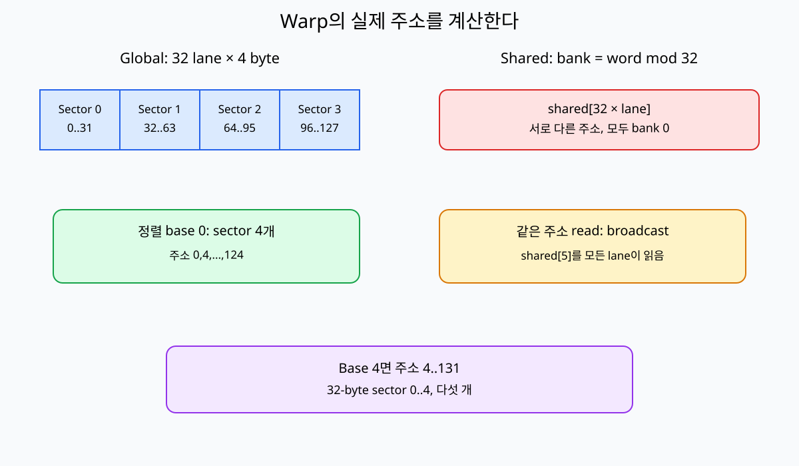
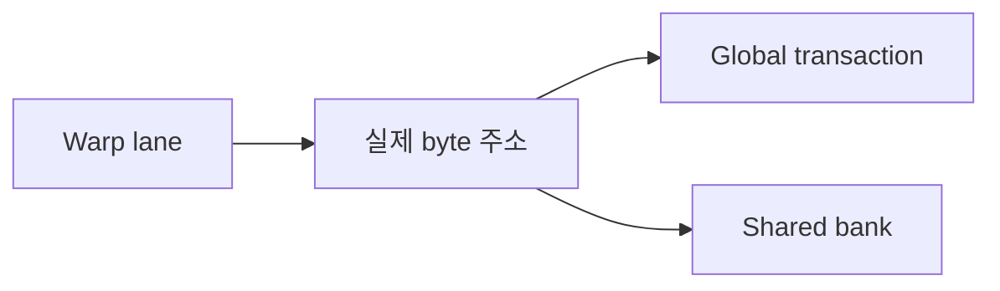

# 05. Coalescing·Alignment·Bank Conflict

## 먼저 낯선 단어를 실제 위치에 놓기

**source(소스)**는 커널이 읽는 원본 배열이고 **destination(목적지)**은 결과를 쓰는 배열이다. 둘 다 이 장의 예에서는 GPU의 전역 메모리에 있다. **memory(메모리)**는 값을 보관하는 공간 전체를 가리키며, 레지스터·공유 메모리·전역 메모리처럼 위치와 수명이 다른 종류가 있다. 커널 안의 스레드가 주소를 만들고, GPU의 메모리 장치가 그 주소에 해당하는 데이터를 옮긴다.

**transaction(트랜잭션)**은 여기서는 데이터베이스의 커밋 단위가 아니라 GPU가 메모리 계층에 보내는 한 번의 전송 요청이다. **sector(섹터)**는 캐시 라인을 더 작게 나눈 실제 전송 단위다. 이 책의 손계산은 32바이트 섹터를 사용한다. “32레인 × 레인당 4바이트 = 128바이트”는 필요한 유효 데이터의 크기이고, 실제 전송은 그 주소들이 걸친 32바이트 섹터 네 개 이상으로 이해해야 한다. 128바이트 정렬 모형은 경계를 눈으로 익히는 설명이며, 현대 CUDA 장치의 실제 요청을 언제나 단일 128바이트 트랜잭션 하나라고 단정하는 규칙이 아니다.

**float**는 보통 32비트, 즉 4바이트 부동소수점 자료형이다. **alignment(정렬)**은 값의 시작 주소가 자료형이나 전송 단위의 경계에 맞는 성질이다. **pitch(피치)**는 2차원 배열에서 한 행의 시작부터 다음 행의 시작까지의 바이트 거리다. 행의 실제 원소 바이트 수보다 클 수 있는데, 런타임이 다음 행의 정렬을 위해 여백을 둘 수 있기 때문이다.

**shared-memory bank(공유 메모리 뱅크)**는 한 SM 안의 공유 메모리를 여러 경로로 나눈 장치 구조다. 서로 다른 레인이 서로 다른 주소를 읽는데 그 주소가 같은 뱅크로 몰리면 요청을 나누어 처리하는 **serialization(직렬화)**이 생길 수 있다. 반대로 여러 레인이 같은 주소를 읽는 경우에는 한 값을 여러 레인에 전달하는 broadcast가 가능하므로 “같은 뱅크”라는 사실만으로 항상 충돌은 아니다. **register(레지스터)**는 각 스레드의 작은 작업 값을 두는 SM 내부 저장소이며 공유 메모리 뱅크와 별개다.

## 32레인의 연속 float 읽기를 섹터로 추적하기

워프의 레인 `i`가 `base + 4i`를 읽는다고 하자. base가 0이면 레인 0은 주소 0~3, 레인 7은 28~31, 레인 8은 32~35, 레인 31은 124~127을 읽는다.

| 레인 묶음 | 시작 주소 | 끝 주소 | 32바이트 섹터 번호 |
|---|---:|---:|---:|
| 0~7 | 0 | 31 | 0 |
| 8~15 | 32 | 63 | 1 |
| 16~23 | 64 | 95 | 2 |
| 24~31 | 96 | 127 | 3 |

유효 데이터는 `32 × 4 = 128바이트`, 섹터도 정확히 네 개다. base가 4이면 주소 4~131이 되어 섹터 0, 1, 2, 3, 4의 다섯 개가 걸린다. 필요한 유효 데이터는 여전히 128바이트지만 섹터 기준 이동 범위는 `5 × 32 = 160바이트`다. 캐시 적중과 재사용은 실제 외부 메모리 트래픽을 바꿀 수 있으므로 이 표는 주소가 요구하는 섹터를 세는 모형이다.

## stride가 공유 메모리 뱅크를 바꾸는 과정

설명용으로 32개 뱅크와 4바이트 단어를 가정하면 단어 인덱스 `k`의 뱅크는 `k mod 32`다. 레인 `i`가 `shared[i × stride]`를 읽을 때 앞의 네 레인을 계산해 보자.

| stride | 레인 0,1,2,3의 단어 인덱스 | 뱅크 | 결과 |
|---:|---|---|---|
| 1 | 0,1,2,3 | 0,1,2,3 | 서로 다른 뱅크 |
| 2 | 0,2,4,6 | 0,2,4,6 | 32레인 전체에서는 뱅크당 두 주소 |
| 16 | 0,16,32,48 | 0,16,0,16 | 두 뱅크에 여러 주소 집중 |
| 32 | 0,32,64,96 | 0,0,0,0 | 모두 다른 주소지만 같은 뱅크 |
| 0 | 0,0,0,0 | 0,0,0,0 | 같은 주소 읽기이므로 broadcast 가능 |

stride 32와 stride 0은 뱅크 번호만 보면 같지만 결과가 다르다. 전자는 서로 다른 주소라 충돌 가능성이 있고 후자는 같은 주소 읽기라 broadcast가 가능하다. 쓰기, 자료형 크기, 장치 세대에 따라 세부 동작이 달라지므로 최종 판단은 대상 GPU의 공식 문서와 프로파일러 지표로 확인한다. **partial write(부분 쓰기)**와 **write allocate** 같은 캐시 정책 용어도 모든 장치에 같은 비용으로 적용된다고 가정하지 않는다. 프로파일러는 하드웨어 계수기를 읽는 도구이지 원인을 자동으로 판결하는 도구가 아니다.

### 이 설명이 실패하는 조건

- 구조체를 읽으면 필드 크기와 정렬 때문에 레인당 주소 간격이 단순한 4바이트가 아닐 수 있다.
- 2차원 배열의 다음 행 주소를 `열 수 × 원소 크기`로만 계산하면 pitch 여백을 놓친다.
- 벡터 자료형을 썼다는 사실만으로 정렬과 결합이 보장되지는 않는다. 실제 시작 주소와 컴파일된 접근 폭을 확인해야 한다.

[이전: 04. 동기화](04-synchronization-and-memory-order.md) · [목차](README.md) · [다음: 06. Reduction·Scan](06-reductions-scans-and-atomics.md)

Memory 효율은 source index 모양이 아니라 warp lane의 실제 byte 주소로 판단한다.

## 1. Coalescing

Warp lane의 global memory 요청을 적은 memory transaction으로 묶는 성질이다. Architecture의 transaction 규칙과 cache line/sector를 확인한다.

## 2. 연속 float

Base 주소 0, float 4 byte, lane l이 `a[l]`을 읽으면 주소는 `4l`이다.

Lane 0~7 주소는 0,4,8,12,16,20,24,28이다. 연속 범위다.

## 3. Stride 2

Lane l이 `a[2l]`이면 주소는 `8l`: 0,8,16,...이다. 사용 byte 사이에 건너뛴 byte가 있어 transaction utilization이 낮아질 수 있다.

## 4. Misalignment

Base가 4 byte 이동해 lane 주소가 4,8,...가 되면 alignment segment 경계를 더 건널 수 있다.

무조건 두 배 transaction이라고 고정하지 말고 architecture와 실제 주소를 본다.

## 5. 구조체

AoS에서 lane이 구조체의 한 field만 읽으면 stride가 구조체 크기다. SoA는 같은 field를 연속 배열로 만들어 coalescing에 유리할 수 있다.

AoS는 Array of Structures, SoA는 Structure of Arrays다.

## 6. 2D pitch

Row 시작 alignment를 맞추기 위해 pitch가 width bytes보다 클 수 있다. Row index는 pitch를 사용해야 한다.

## 7. Shared bank

Shared memory는 여러 bank로 나뉘어 동시 접근을 제공한다. Lane들이 서로 다른 주소인데 같은 bank에 몰리면 bank conflict로 serialization될 수 있다.

## 8. Bank mapping 모형

32 bank, 4-byte word, bank=`word_index mod 32`라 단순화한다.

Lane l이 shared[l]을 읽으면 bank l이다. Conflict가 없다.

## 9. Stride 32 conflict

Lane l이 shared[32*l]을 읽으면 word index 32l, 모두 bank 0이다. 서로 다른 주소의 같은 bank라 conflict다.

## 10. Broadcast

모든 lane이 같은 shared 주소 shared[0]을 read하면 같은 주소 read broadcast로 처리될 수 있다. 서로 다른 주소 같은 bank와 구분한다.

Write broadcast는 같은 방식으로 일반화하지 않는다.

## 11. Padding

2D tile `[32][32]`의 column 접근이 bank conflict면 두 번째 dimension을 33으로 padding해 bank mapping을 바꿀 수 있다.

Padding은 shared 사용량을 늘린다.

## 12. 손 추적

Bank 4개 단순 모형에서 word index `[0,1,2,3]`은 bank `[0,1,2,3]`이다.

Index `[0,4,8,12]`는 모두 bank 0, 네 방향 conflict다.

Index `[5,5,5,5]`는 같은 주소 read라 broadcast 사례다.

## 12.1 32 lane 표를 구간으로 읽는다

Float 연속 주소는 lane 0~7이 sector 0, 8~15가 sector 1, 16~23이 sector 2, 24~31이 sector 3에 들어간다.

| Lane 범위 | Byte 시작 주소 | 32-byte sector |
| --- | ---: | ---: |
| 0..7 | 0..28 | 0 |
| 8..15 | 32..60 | 1 |
| 16..23 | 64..92 | 2 |
| 24..31 | 96..124 | 3 |

각 float가 4 byte이므로 마지막 lane 31은 byte 124~127을 사용한다. 총 128 byte다.

128-byte 정렬 범위 하나라는 교육 그림과 실제 32-byte sector 네 개라는 관찰 단위를 함께 적는다. Architecture에 따라 cache transaction 결합 세부는 달라진다.

## 12.2 Bank stride 표

Bank 8개 단순 모형에서 lane 0~7의 index와 bank를 본다.

| Pattern | Word index | Bank |
| --- | --- | --- |
| 연속 | 0,1,2,3,4,5,6,7 | 0,1,2,3,4,5,6,7 |
| stride 2 | 0,2,4,6,8,10,12,14 | 0,2,4,6,0,2,4,6 |
| stride 8 | 0,8,16,24,32,40,48,56 | 모두 0 |

Stride 2는 일부 bank에 두 주소, stride 8은 한 bank에 여덟 주소가 몰린다.

## 13. Vectorized access

한 lane이 여러 element를 vector load하면 alignment와 register 사용을 확인한다. Vector type 사용만으로 coalescing이 자동 개선되지는 않는다.

## 14. Transaction waste

요청한 useful byte와 실제 이동 byte 비율을 생각한다. Profiler의 requested/actual throughput 지표는 version별 정의를 확인한다.

## 15. Store

Load뿐 아니라 store 주소도 warp pattern을 가진다. Partial write와 write allocate/cache 정책은 architecture에 따라 본다.

## 16. 반례

Thread index가 연속이어도 pointer가 linked node를 가리키면 실제 주소는 흩어질 수 있다.

Shared bank conflict가 없다고 global coalescing도 좋은 것은 아니다. Memory 공간이 다르다.

## 문제와 해설

**문제 1.** Float base 1000에서 lane 3 주소는?

**해설.** 연속 access면 `1000+3*4=1012`다.

**문제 2.** 32 bank 모형에서 index 0과 32는?

**해설.** 서로 다른 주소지만 둘 다 bank 0이라 conflict 가능성이 있다.

**문제 3.** 모든 lane이 shared[7] read면 32-way conflict인가?

**해설.** 같은 주소 read는 broadcast 경로와 구분한다.

## 공식 자료

- [CUDA device memory access](https://docs.nvidia.com/cuda/cuda-programming-guide/05-appendices/cpp-language-extensions.html)
- [CUDA Best Practices memory optimizations](https://docs.nvidia.com/cuda/cuda-c-best-practices-guide/)
