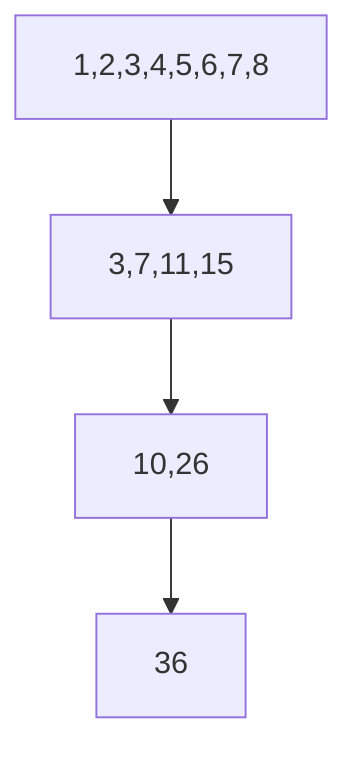

# 06. Reduction·Scan·Atomic

[이전: 05. 주소 효율](05-coalescing-alignment-and-bank-conflicts.md) · [목차](README.md) · [다음: 07. Matrix tiling](07-matrix-multiplication-and-tiling.md)

## 결과 하나를 만들기 전에 객체를 놓기

**Reduction(리덕션, 축약)**은 여러 입력을 같은 결합 연산으로 합쳐 더 적은 출력, 흔히 하나의 합이나 최댓값으로 만드는 계산이다. 입력 배열은 보통 global memory에 있고, 각 GPU thread는 자기 원소를 register로 읽은 뒤 같은 block의 thread들과 shared memory를 통해 부분 결과를 합칠 수 있다. Block마다 만든 **partial result(부분 결과)**는 global array에 쓰고 다음 kernel이 다시 합치거나 atomic 연산으로 최종 위치에 더한다.

**Sum reduction**은 합을 만들고 **max reduction**은 최댓값을 만든다. 연산 순서를 바꿔도 수학 결과가 같은 성질을 **associativity(결합법칙)**라고 한다. 정수 덧셈을 overflow가 없다고 가정하면 `(a+b)+c=a+(b+c)`이지만, 부동소수점 덧셈은 반올림 때문에 bit 단위로 성립하지 않을 수 있다. 병렬 tree가 순차 반복과 다른 순서로 더하면 작은 차이가 생길 수 있는 이유다.

**Identity(항등원)**는 연산에 넣어도 다른 값을 바꾸지 않는 값이다. 합의 항등원은 0이고 최댓값의 항등원은 표현 가능한 가장 작은 값에 해당한다. Boundary 때문에 입력이 없는 lane을 채울 때 identity가 필요하다. Max 입력이 모두 음수인데 빈 lane을 0으로 채우면 존재하지 않는 0이 결과가 되어 틀린다.

**Barrier(배리어)**는 같은 block의 참여 thread들이 모두 특정 지점에 도착할 때까지 다음 단계를 시작하지 못하게 하는 동기화 지점이다. Barrier 자체가 값을 더하지는 않는다. 한 단계의 shared write가 다음 단계의 read 전에 끝나게 하는 실행 순서를 만든다. 조건문 때문에 일부 thread만 block-wide barrier에 도착하면 나머지는 영원히 기다리거나 동작이 정의되지 않을 수 있다.

## 여덟 lane 합과 최댓값을 저장 위치까지 추적하기

입력은 `[3,1,7,0,4,1,6,2]`이고 한 block의 lane 0~7이 하나씩 담당한다고 하자. 정답 합은 24, 최댓값은 7이다. 먼저 각 lane이 global input을 register `x`로 읽고 `shared[lane]=x`를 쓴다.

| lane | global input index | register x | shared에 쓴 위치 |
|---:|---:|---:|---:|
| 0 | 0 | 3 | shared[0]=3 |
| 1 | 1 | 1 | shared[1]=1 |
| 2 | 2 | 7 | shared[2]=7 |
| 3 | 3 | 0 | shared[3]=0 |
| 4 | 4 | 4 | shared[4]=4 |
| 5 | 5 | 1 | shared[5]=1 |
| 6 | 6 | 6 | shared[6]=6 |
| 7 | 7 | 2 | shared[7]=2 |

이 load 뒤 첫 barrier가 있어야 lane 0이 shared[1]을 읽을 때 lane 1의 write가 완료되었다고 block 수준에서 보장할 수 있다.

### 합 reduction tree

첫 단계 offset 1에서는 짝수 lane이 바로 오른쪽 값을 더한다. 홀수 lane은 값을 쓰지 않지만 다음 barrier에는 참여한다.

| 단계 | 쓰는 lane과 계산 | barrier 뒤 shared의 의미 있는 값 |
|---|---|---|
| load | 모든 lane이 자기 값 저장 | `[3,1,7,0,4,1,6,2]` |
| pair | L0=`3+1=4`, L2=`7+0=7`, L4=`4+1=5`, L6=`6+2=8` | `[4,_,7,_,5,_,8,_]` |
| 4개 묶음 | L0=`4+7=11`, L4=`5+8=13` | `[11,_,_,_,13,_,_,_]` |
| 전체 | L0=`11+13=24` | `[24,_,_,_,_,_,_,_]` |

밑줄 위치는 더 이상 결과로 읽지 않는다는 뜻이며 실제 byte가 자동으로 지워진다는 뜻은 아니다. 각 단계에서 활성 lane이 shared 값을 쓴 뒤 모든 block thread가 barrier를 지나야 다음 offset read가 안전하다. 마지막에 lane 0만 global `partials[blockIdx]`에 24를 쓴다.

### max reduction tree

같은 주소와 barrier 순서에서 덧셈 대신 `max`를 적용한다.

```text
start: [3,1,7,0,4,1,6,2]
pair:  [3,_,7,_,4,_,6,_]
four:  [7,_,_,_,6,_,_,_]
final: [7,_,_,_,_,_,_,_]
```

합과 최댓값은 tree 구조를 재사용할 수 있지만 항등원과 연산, overflow·NaN 규칙은 다르다. Floating max는 NaN을 어떻게 처리하는지 사용하는 API 계약을 확인해야 한다.

## barrier가 필요한 두 가지 서로 다른 이유

첫 barrier는 **producer-consumer** 관계를 보호한다. Lane 1이 shared[1]을 생산하고 lane 0이 그것을 소비하므로, 소비 전에 생산이 끝나야 한다. 단계 사이 barrier는 lane 0이 이전 단계의 shared[2]를 읽기 전에 lane 2가 pair 결과를 썼음을 보장한다.

또 다른 barrier는 shared scratch를 다음 phase가 덮는 일을 막는다. 어떤 lane이 현재 값을 아직 읽는데 빠른 lane이 다음 input을 같은 위치에 쓰면 두 phase가 섞인다. “모든 write 뒤 barrier 하나”라는 암기 대신, 어떤 read가 어느 write를 기다리고 어느 write가 이전 read 완료를 기다리는지 적는다.

다음 구조는 위험하다.

```text
if lane < active_count:
    shared[lane] += shared[lane + offset]
    barrier()
```

`active_count` 밖의 lane은 barrier에 오지 않는다. Block-wide barrier라면 모든 non-exited thread가 동일한 동적 barrier에 참여해야 한다. 안전한 교육용 구조는 조건 안에서 계산만 하고 barrier를 조건 밖에 둔다.

```text
if lane < active_count:
    shared[lane] += shared[lane + offset]
barrier()
```

Barrier가 있어도 index가 잘못되면 안전하지 않다. `lane+offset`이 배열 밖이면 out-of-bounds이고, 두 lane이 같은 shared 위치에 동기화 없이 쓰면 write race다. Barrier는 잘못된 주소나 한 단계 내부의 경쟁을 자동으로 고치지 않는다.


Reduction은 여러 값을 하나로, scan은 각 prefix의 결과로 만든다.



## 1. Reduction

합, 최댓값처럼 associative operation으로 값을 결합한다. Floating add는 수학적으로 associative해 보여도 rounding 때문에 bitwise associative가 아니다.

## 2. Tree 합계

입력 1~8:

| 단계 | 상태 |
| --- | --- |
| 시작 | 1,2,3,4,5,6,7,8 |
| Pair | 3,7,11,15 |
| Pair | 10,26 |
| 결과 | 36 |

깊이는 log₂8=3이다.

## 3. Shared reduction

Thread가 element를 shared에 load하고 단계별로 결합한다. 각 단계 사이 필요한 barrier를 둔다.

## 4. Non-power-of-two

n=6이면 빈 lane을 identity 0으로 채우거나 경계를 검사한다. 값을 버리면 합이 틀린다.

## 5. Identity

합의 identity는 0, 곱은 1, max는 type의 최소값 성격이다. 빈 slot을 임의 0으로 채우면 max가 모두 음수일 때 틀릴 수 있다.

## 6. Warp reduction

Shuffle primitive로 lane 값을 교환할 수 있다. Active mask와 lane 유효성을 지킨다.

Warp synchronization 가정을 primitive 없이 쓰지 않는다.

## 7. Block→grid 합계

각 block partial sum을 global array에 쓰고 두 번째 kernel로 합치거나 atomic add를 쓸 수 있다.

Block 4개 partial `[10,20,30,40]`의 최종은 100이다.

### 입력 열 개를 두 kernel로 합치는 전체 흐름

입력 `[1,2,3,4,5,6,7,8,9,10]`을 block당 8 lane으로 처리한다고 하자. Grid에는 block 0과 block 1이 있다. Block 0은 index 0~7을 읽고, block 1의 lane 0과 1은 index 8과 9를 읽는다. 나머지 lane에는 합의 identity 0을 넣는다.

```text
block 0 shared start: [1,2,3,4,5,6,7,8] -> partial 36
block 1 shared start: [9,10,0,0,0,0,0,0] -> partial 19
global partials: [36,19]
second kernel: 36+19 = 55
```

객체 수명은 단계마다 다르다. Block 0의 shared scratch는 block 0 안에서만 보이고 그 block이 끝나면 사라진다. Block 1은 별도 shared scratch를 가진다. `partials`는 global memory allocation이므로 두 block 종료 뒤에도 살아 있고 다음 kernel이 읽을 수 있다. 첫 kernel과 둘째 kernel을 같은 stream에 순서대로 넣으면 stream 순서가 선행 kernel 완료 뒤 다음 kernel 실행을 만든다. 다른 stream에 넣으면 event 같은 dependency가 필요하다.

두 번째 kernel을 너무 일찍 실행하면 아직 쓰이지 않은 `partials[1]`을 읽을 수 있다. Block 안의 `__syncthreads()`는 다른 block이나 다음 kernel을 동기화하지 않는다. Block barrier, kernel completion, stream dependency는 적용 범위가 다른 기작이다.

Max reduction에서 같은 boundary를 0으로 채우면 입력이 `[-9,-10]`일 때 block 1 partial이 0이 되어 틀린다. 해당 dtype의 가장 작은 값 또는 “유효 lane인가”를 함께 추적해야 한다. 부동소수점의 음의 무한대를 identity로 쓸 수 있는지는 NaN 처리와 API 규칙까지 확인한다.

### Warp primitive도 active lane을 알아야 한다

Shuffle은 warp lane의 register 값을 다른 lane이 읽도록 하는 GPU primitive다. Shared load와 block-wide barrier를 줄일 수 있지만, 모든 32 lane이 항상 유효하다고 가정하면 마지막 부분 warp에서 잘못된 값을 읽을 수 있다. **Active mask**는 현재 primitive에 참여하는 lane 집합이다. Lane 0~5만 실제 input을 가진다면 offset 4 단계에서 source lane이 유효한지 확인해야 한다.

Warp 내부 실행이 과거 특정 장치에서 우연히 같은 순서로 보였다는 사실을 일반 동기화 규칙으로 쓰지 않는다. 사용하는 shuffle·warp synchronization primitive의 mask와 memory ordering 계약을 따른다. Block 전체 reduction이라면 warp별 partial을 shared에 쓰고, 한 warp가 그 partial들을 다시 줄이는 계층형 구성이 흔하지만 block 크기와 warp 수 boundary를 검증해야 한다.

### 잘못된 결과가 한 번 맞는 이유

Race가 있는 kernel도 특정 실행 순서에서는 기대값을 낼 수 있다. Lane 2가 old shared[1]=2를 읽은 뒤 lane 1이 3을 쓰면 Hillis-Steele offset 1 결과는 우연히 맞는다. 다음 실행에서 scheduler 순서가 달라 lane 2가 새 값 3을 읽으면 6이 된다. 테스트 1회 성공은 happens-before 관계를 증명하지 않는다.

반대로 barrier를 무조건 많이 넣는 것도 해결책이 아니다. Barrier는 block의 모든 thread가 기다리는 비용을 만들고, global atomic의 순서를 block barrier로 제어할 수 없다. 각 shared read가 어느 write를 기다리는지, 같은 주소를 누가 쓰는지, 동기화 scope가 어디까지인지 표로 증명한다.


## 8. Atomic contention

### 두 단계 reduction의 객체 위치

첫 kernel에서 각 block은 자기 shared memory에 input을 합치고 global `partials[blockIdx]`에 한 값을 쓴다. Shared partial은 block 종료와 함께 사라지고 global partial array는 다음 kernel까지 살아 있다.

| 단계 | 객체 | 위치 | 값 예 |
| --- | --- | --- | --- |
| Block 0 reduction | shared scratch | Block 0 | 10 |
| Block 1 reduction | shared scratch | Block 1 | 20 |
| Partial publish | partials | Global | [10,20,30,40] |
| Final kernel | accumulator | Register/shared | 100 |

첫 kernel completion 전에 둘째 kernel이 partial을 읽지 않도록 같은 stream 순서나 dependency를 둔다.

### Scan 중간 상태를 old/new로 나눈다

Hillis-Steele offset 1에서 lane 2는 old[2]=3과 old[1]=2를 읽어 new[2]=5를 만든다. 같은 array를 race로 갱신해 lane 3이 이미 바뀐 5를 읽으면 step 의미가 달라진다.

Double buffer 또는 step barrier와 올바른 read-before-write 구조가 필요하다.

```text
old: 1,2,3,4
new: 1,3,5,7
swap old/new
```

1024 thread가 한 global counter에 atomic add하면 정확하지만 한 location 경쟁이 크다. Block당 한 번이면 atomic 4회로 줄일 수 있다.

## Scan은 “각 위치까지의 결과”를 모두 남긴다

**Prefix(접두 구간)**는 배열의 처음부터 현재 위치까지의 구간이다. 입력 `[a,b,c,d]`에서 index 2의 inclusive prefix는 `[a,b,c]`이고, exclusive prefix는 현재 원소를 제외한 `[a,b]`다. **Inclusive scan**은 각 위치에 자기 자신까지의 결과를 쓰므로 `[1,2,3,4]→[1,3,6,10]`이다. **Exclusive scan**은 자기 앞까지만 쓰므로 `[1,2,3,4]→[0,1,3,6]`이다. 첫 위치의 exclusive 결과가 0인 이유는 합의 항등원을 쓰기 때문이다.

Scan은 마지막 합 하나만 필요하지 않다. 모든 lane이 서로 다른 prefix 결과를 받아야 하므로 reduction의 중간값을 버리는 방식만으로 끝나지 않는다. Stream compaction의 output 위치, radix sort의 bucket offset, 병렬 메모리 할당 위치를 계산할 때 쓰인다.

### Hillis-Steele inclusive scan의 여덟 lane 단계표

입력 `[1,2,3,4,5,6,7,8]`을 old buffer에 둔다. 각 단계 offset이 1, 2, 4로 두 배가 된다. Lane `i`는 `i>=offset`이면 `old[i]+old[i-offset]`, 아니면 `old[i]`를 new에 쓴다.

| 단계 | offset | lane별 new 결과 |
|---|---:|---|
| 시작 | - | `[1,2,3,4,5,6,7,8]` |
| 1 | 1 | `[1,3,5,7,9,11,13,15]` |
| 2 | 2 | `[1,3,6,10,14,18,22,26]` |
| 3 | 4 | `[1,3,6,10,15,21,28,36]` |

Offset 1 뒤 lane 3의 7은 원래 3과 4의 합이다. Offset 2에서 lane 3은 **이전 단계**의 lane 3 값 7과 lane 1 값 3을 읽어 10을 만든다. 현재 단계에서 lane 2가 새로 쓴 6을 읽는 것이 아니다. Double buffer라면 모든 lane이 old만 읽고 new만 쓴 뒤 barrier 후 buffer 역할을 바꾼다.

한 배열에서 in-place로 구현하려면 해당 primitive의 동기화와 읽기 순서를 엄밀히 보장해야 한다. 다음과 같은 잘못된 순서가 가능하다고 하자.

```text
offset 1 시작 old = [1,2,3,4]
lane 1이 shared[1] = 2+1 = 3으로 먼저 갱신
lane 2가 shared[1]의 새 값 3을 읽어 shared[2] = 3+3 = 6
```

올바른 offset 1의 lane 2 결과는 원래 `3+2=5`다. 6은 같은 단계의 새 값을 너무 일찍 읽은 race 결과다. 시작과 끝 barrier만으로도 각 lane의 read/write instruction 사이 interleaving을 모두 해결하지 못할 수 있으므로, old/new buffer나 검증된 warp primitive를 사용한다.

### Work와 depth를 같이 세기

여덟 원소 Hillis-Steele은 세 parallel step이지만, 더하는 횟수는 offset 1에서 7회, offset 2에서 6회, offset 4에서 4회로 총 17회다. 순차 scan의 7회보다 work가 많다. **Depth(깊이)**는 의존 단계 수이고 **work(일량)**는 전체 연산 수다. GPU에서 step 수가 적다는 것과 총 연산·memory traffic이 적다는 것은 다르다.

Work-efficient scan은 up-sweep에서 tree partial을 만들고 down-sweep에서 prefix를 전파해 O(n) 덧셈을 목표로 한다. 구현은 index 계산과 barrier가 더 복잡하다. 작은 n에서는 단순 Hillis-Steele이 나을 수 있고, 큰 n에서는 work와 global-memory 계층까지 고려한다. 어느 알고리즘이 빠른지는 block 크기, primitive, GPU와 input 규모를 측정해야 한다.

## Atomic은 한 주소 갱신을 잃지 않게 하지만 경쟁을 없애지 않는다

**Atomic operation(원자 연산)**은 정해진 관찰 범위에서 read-modify-write를 하나의 분리되지 않는 갱신처럼 처리한다. 두 thread가 같은 counter에 atomic add 1을 하면 한 갱신이 다른 갱신을 덮어써 결과가 1이 되는 lost update를 막는다. 그러나 같은 주소를 많은 lane이 갱신하면 memory system이 그 갱신들을 조정해야 하므로 contention이 커질 수 있다.

예를 들어 1024 thread가 모두 global counter 하나에 `atomicAdd(...,1)`을 하면 정확한 최종값 1024를 만들 수 있지만 같은 위치에 1024번 경쟁한다. 256-thread block 네 개가 각자 shared reduction으로 256을 만든 뒤 block당 한 번만 global atomic add를 하면 global 경쟁은 네 번으로 줄어든다. Shared reduction 자체의 barrier와 boundary를 올바르게 구현해야 하며, 작은 입력에서는 준비 비용이 이득보다 클 수 있다.

Atomic add가 다른 메모리의 visibility를 모두 보장하는 범용 barrier라는 뜻도 아니다. **Scope(범위)**는 어떤 관찰자 사이에서 atomicity와 순서가 필요한지를 말한다. Block 안에서만 공유하면 block scope가 충분할 수 있고, 모든 GPU thread가 같은 global 값을 보면 device scope가 필요하다. Host나 다른 GPU까지 포함하려면 API와 memory model의 더 넓은 계약을 확인한다.

Floating atomic add의 최종 수학 합이 맞는 범위 안에 있어도 bitwise 결과는 실행마다 달라질 수 있다. 먼저 도착한 순서에 따라 `(a+b)+c`와 `a+(b+c)`의 반올림 경로가 달라지기 때문이다. Reproducibility가 필요하면 고정된 reduction tree, 더 넓은 accumulator, compensated summation 같은 별도 설계를 검토한다.


## 9. Scan

Inclusive scan `[1,2,3,4]→[1,3,6,10]`이다. Exclusive scan은 `[0,1,3,6]`이다.

## 10. Up-sweep/down-sweep

Tree로 partial sum을 만들고 아래로 prefix를 전파한다. Barrier와 index 계산이 필요하다.

## 11. Hillis-Steele 모형

각 step offset 1,2,4를 사용한다.

```text
start 1,2,3,4
offset1 1,3,5,7
offset2 1,3,6,10
```

같은 step의 old 값을 읽어야 한다. In-place race를 막을 buffer/barrier가 필요하다.

## 12. Work efficiency

Parallel step 수만 적다고 총 operation 수가 최선인 것은 아니다. Work O(n log n) scan과 O(n) work-efficient scan을 구분한다.

## 13. Histogram

각 input이 bin counter에 atomic add한다. Skewed input이 한 bin에 몰리면 contention이 크다.

Block-private histogram 뒤 merge를 검토한다.

## 14. Atomic scope

Block partial에 block scope, device global에 device scope 등 observer 범위를 맞춘다. Multi-GPU/host visibility를 자동 가정하지 않는다.

## 15. Overflow

8-bit 값 255를 많이 합치면 accumulator type이 overflow할 수 있다. Input type보다 넓은 accumulator를 고려한다.

## 16. Numerical order

`1e20 + (-1e20) + 1`과 `1e20 + ((-1e20)+1)`의 floating 결과가 다를 수 있다. Tree 순서를 기록한다.

첫 괄호 순서는 `1e20+(-1e20)=0`, 이어서 `0+1=1`을 만든다. 둘째 괄호에서 `(-1e20)+1`은 제한된 정밀도 때문에 작은 1이 사라져 다시 `-1e20`로 반올림될 수 있고, 마지막 합은 0이 된다. 수학의 실수 덧셈이라면 같은 식이지만 floating 값은 유한한 bit로 근사한다. 그래서 CPU 순차 기준값과 GPU tree 값의 bitwise equality 대신 허용 오차를 쓰기도 한다. 허용 오차는 입력 규모, dtype, 합산 순서와 응용의 정확도 요구에서 정해야 하며 임의의 큰 값으로 테스트를 통과시키면 안 된다.

## 17. 반례

Barrier 없이 shared reduction을 실행해 한 번 맞았다고 race가 없는 것이 아니다.

Atomic을 사용했다고 floating result가 매 실행 bitwise 동일한 것은 아니다.

## 문제와 해설

**문제 1.** `[2,4,6,8]` inclusive scan은?

**해설.** `[2,6,12,20]`이다.

**문제 2.** Max reduction의 빈 lane identity를 0으로 두면 언제 틀리는가?

**해설.** 모든 유효 값이 음수면 0이 잘못 최댓값이 된다.

**문제 3.** Block 8개가 partial sum을 하나씩 만들면 최종 atomic 횟수는?

**해설.** Block당 한 번 전략이면 8회다.

**문제 4.** 입력 `[3,1,7,0,4,1,6,2]`을 pair tree로 합하고 최댓값을 구하라. 각 단계 상태를 쓰라.

**해설.** 합은 `[3,1,7,0,4,1,6,2]→[4,7,5,8]→[11,13]→[24]`다. 최댓값은 `[3,1,7,0,4,1,6,2]→[3,7,4,6]→[7,6]→[7]`이다. 실제 shared 배열에서는 결과가 lane 0,2,4,6처럼 떨어진 위치에 남을 수 있고 표는 의미 있는 값만 압축해 썼다. 각 단계의 producer write와 다음 read 사이에 barrier가 필요하다.

**문제 5.** `[1,2,3,4,5,6,7,8]` Hillis-Steele inclusive scan의 offset 1, 2, 4 상태와 전체 덧셈 수를 구하라.

**해설.** Offset 1은 `[1,3,5,7,9,11,13,15]`이고 7회 더한다. Offset 2는 `[1,3,6,10,14,18,22,26]`이고 6회, offset 4는 `[1,3,6,10,15,21,28,36]`이고 4회 더한다. 총 17회다. 각 단계는 이전 단계의 old 값만 읽어야 하며 새 값을 같은 단계에서 읽으면 prefix가 중복된다.

**문제 6.** 1,024개 thread가 하나의 counter에 atomic add하는 방식과, 256-thread block 네 개가 shared reduction 뒤 block당 한 번 atomic add하는 방식을 비교하라.

**해설.** 첫 방식은 global 같은 주소에 1,024번 atomic 경쟁이 있다. 둘째는 각 block 안에서 256개 값을 합치는 shared 연산과 barrier를 수행한 뒤 global atomic은 4회다. 정확한 합은 둘 다 만들 수 있지만 둘째가 항상 빠르다는 결론은 낼 수 없다. Shared 준비 비용, input 크기, atomic 하드웨어, occupancy를 포함해 측정해야 한다. Floating 합은 atomic 도착 순서에 따라 bitwise 값이 달라질 수 있다.

## 문제를 풀 때 쓰는 네 칸 표

1. **값**: 각 단계에서 어떤 수가 남는가.
2. **위치**: register, block shared, global partial 중 어디에 있는가.
3. **주체**: 어느 lane·block·kernel이 쓰고 읽는가.
4. **순서**: barrier, stream dependency, atomic 중 어떤 계약이 read-before-write를 막는가.

Reduction 결과 숫자만 맞춰서는 동시 실행이 안전한지 알 수 없다. 이 네 칸을 모두 채우면 잘못된 분기 barrier, scope가 좁은 동기화, non-power-of-two boundary와 누적 dtype 문제를 따로 찾을 수 있다.


## 공식 자료

- [CUDA atomic functions](https://docs.nvidia.com/cuda/cuda-programming-guide/05-appendices/cpp-language-extensions.html)
- [CUDA samples](https://github.com/NVIDIA/cuda-samples)
