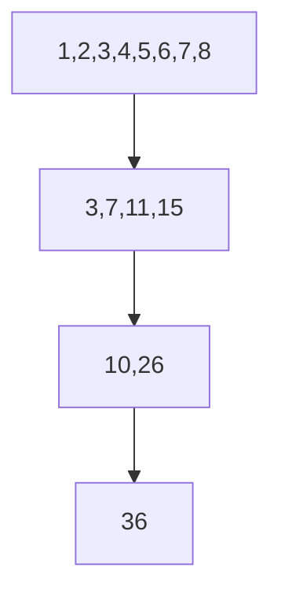

# 06. Reduction·Scan·Atomic

[이전: 05. 주소 효율](05-coalescing-alignment-and-bank-conflicts.md) · [목차](README.md) · [다음: 07. Matrix tiling](07-matrix-multiplication-and-tiling.md)

Reduction은 여러 값을 하나로, scan은 각 prefix의 결과로 만든다.



## 1. Reduction

합, 최댓값처럼 associative operation으로 값을 결합한다. Floating add는 수학적으로 associative해 보여도 rounding 때문에 bitwise associative가 아니다.

## 2. Tree 합계

입력 1~8:

| 단계 | 상태 |
| --- | --- |
| 시작 | 1,2,3,4,5,6,7,8 |
| Pair | 3,7,11,15 |
| Pair | 10,26 |
| 결과 | 36 |

깊이는 log₂8=3이다.

## 3. Shared reduction

Thread가 element를 shared에 load하고 단계별로 결합한다. 각 단계 사이 필요한 barrier를 둔다.

## 4. Non-power-of-two

n=6이면 빈 lane을 identity 0으로 채우거나 경계를 검사한다. 값을 버리면 합이 틀린다.

## 5. Identity

합의 identity는 0, 곱은 1, max는 type의 최소값 성격이다. 빈 slot을 임의 0으로 채우면 max가 모두 음수일 때 틀릴 수 있다.

## 6. Warp reduction

Shuffle primitive로 lane 값을 교환할 수 있다. Active mask와 lane 유효성을 지킨다.

Warp synchronization 가정을 primitive 없이 쓰지 않는다.

## 7. Block→grid 합계

각 block partial sum을 global array에 쓰고 두 번째 kernel로 합치거나 atomic add를 쓸 수 있다.

Block 4개 partial `[10,20,30,40]`의 최종은 100이다.

## 8. Atomic contention

### 두 단계 reduction의 객체 위치

첫 kernel에서 각 block은 자기 shared memory에 input을 합치고 global `partials[blockIdx]`에 한 값을 쓴다. Shared partial은 block 종료와 함께 사라지고 global partial array는 다음 kernel까지 살아 있다.

| 단계 | 객체 | 위치 | 값 예 |
| --- | --- | --- | --- |
| Block 0 reduction | shared scratch | Block 0 | 10 |
| Block 1 reduction | shared scratch | Block 1 | 20 |
| Partial publish | partials | Global | [10,20,30,40] |
| Final kernel | accumulator | Register/shared | 100 |

첫 kernel completion 전에 둘째 kernel이 partial을 읽지 않도록 같은 stream 순서나 dependency를 둔다.

### Scan 중간 상태를 old/new로 나눈다

Hillis-Steele offset 1에서 lane 2는 old[2]=3과 old[1]=2를 읽어 new[2]=5를 만든다. 같은 array를 race로 갱신해 lane 3이 이미 바뀐 5를 읽으면 step 의미가 달라진다.

Double buffer 또는 step barrier와 올바른 read-before-write 구조가 필요하다.

```text
old: 1,2,3,4
new: 1,3,5,7
swap old/new
```

1024 thread가 한 global counter에 atomic add하면 정확하지만 한 location 경쟁이 크다. Block당 한 번이면 atomic 4회로 줄일 수 있다.

## 9. Scan

Inclusive scan `[1,2,3,4]→[1,3,6,10]`이다. Exclusive scan은 `[0,1,3,6]`이다.

## 10. Up-sweep/down-sweep

Tree로 partial sum을 만들고 아래로 prefix를 전파한다. Barrier와 index 계산이 필요하다.

## 11. Hillis-Steele 모형

각 step offset 1,2,4를 사용한다.

```text
start 1,2,3,4
offset1 1,3,5,7
offset2 1,3,6,10
```

같은 step의 old 값을 읽어야 한다. In-place race를 막을 buffer/barrier가 필요하다.

## 12. Work efficiency

Parallel step 수만 적다고 총 operation 수가 최선인 것은 아니다. Work O(n log n) scan과 O(n) work-efficient scan을 구분한다.

## 13. Histogram

각 input이 bin counter에 atomic add한다. Skewed input이 한 bin에 몰리면 contention이 크다.

Block-private histogram 뒤 merge를 검토한다.

## 14. Atomic scope

Block partial에 block scope, device global에 device scope 등 observer 범위를 맞춘다. Multi-GPU/host visibility를 자동 가정하지 않는다.

## 15. Overflow

8-bit 값 255를 많이 합치면 accumulator type이 overflow할 수 있다. Input type보다 넓은 accumulator를 고려한다.

## 16. Numerical order

`1e20 + (-1e20) + 1`과 `1e20 + ((-1e20)+1)`의 floating 결과가 다를 수 있다. Tree 순서를 기록한다.

## 17. 반례

Barrier 없이 shared reduction을 실행해 한 번 맞았다고 race가 없는 것이 아니다.

Atomic을 사용했다고 floating result가 매 실행 bitwise 동일한 것은 아니다.

## 문제와 해설

**문제 1.** `[2,4,6,8]` inclusive scan은?

**해설.** `[2,6,12,20]`이다.

**문제 2.** Max reduction의 빈 lane identity를 0으로 두면 언제 틀리는가?

**해설.** 모든 유효 값이 음수면 0이 잘못 최댓값이 된다.

**문제 3.** Block 8개가 partial sum을 하나씩 만들면 최종 atomic 횟수는?

**해설.** Block당 한 번 전략이면 8회다.

## 공식 자료

- [CUDA atomic functions](https://docs.nvidia.com/cuda/cuda-programming-guide/05-appendices/cpp-language-extensions.html)
- [CUDA samples](https://github.com/NVIDIA/cuda-samples)
