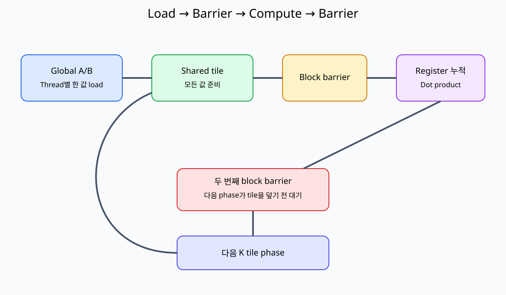
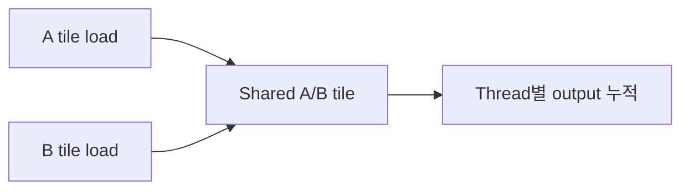

# 07. Matrix Multiplication과 Tiling

[이전: 06. Reduction](06-reductions-scans-and-atomics.md) · [목차](README.md) · [다음: 08. Tensor Core](08-tensor-cores-and-numerical-precision.md)

행렬 곱은 같은 입력 값을 여러 output이 재사용하는 대표 계산이다.





## 1. 문제 정의

A가 M×K, B가 K×N이면 C는 M×N이다.

`C[row,col]=Σ A[row,k]*B[k,col]`이다.

## 2. 2×2 손 계산

```text
A = [[1,2],     B = [[5,6],
     [3,4]]          [7,8]]
```

| C element | 계산 | 결과 |
| --- | --- | ---: |
| C00 | 1×5+2×7 | 19 |
| C01 | 1×6+2×8 | 22 |
| C10 | 3×5+4×7 | 43 |
| C11 | 3×6+4×8 | 50 |

## 3. Naive thread mapping

Thread `(row,col)` 하나가 C element 하나를 계산한다. K loop 동안 A row와 B column을 global에서 읽는다.

여러 thread가 같은 A·B 값을 반복 load한다.

## 4. Tile

큰 행렬을 작은 직사각형 block으로 나눈 조각이다. CUDA thread block과 data tile은 관련되지만 같은 객체가 아니다.

Storage block이나 filesystem block이라는 말과도 구분한다. 여기서 block은 CUDA 실행 thread 집합이다.

## 5. 4×4, tile 2

C의 output tile 2×2를 block thread 4개가 맡는다. K dimension도 2씩 두 phase다.

Phase 0은 A columns 0~1, B rows 0~1, phase 1은 2~3을 load한다.

## 6. Load 주체

Thread `(ty,tx)`가 `As[ty][tx]=A[row][phase*2+tx]`, `Bs[ty][tx]=B[phase*2+ty][col]`을 load한다.

각 thread가 한 값씩 협력해 shared tile을 채운다.

## 7. Barrier 위치

```text
global→shared load
__syncthreads()
shared tile multiply loop
__syncthreads()
다음 phase load
```

첫 barrier는 모든 tile 값 준비, 둘째는 다른 thread가 tile을 덮기 전 현재 계산 완료를 보장한다.

## 8. Phase 손 추적

A row0 `[1,2,3,4]`, B col0 `[1,10,100,1000]`이면 C00은:

| phase | shared 값 | partial |
| ---: | --- | ---: |
| 0 | 1×1, 2×10 | 21 |
| 1 | 3×100, 4×1000 | 4300 |
| 최종 | 21+4300 | 4321 |

## 8.1 2×2 thread가 shared를 채우는 순서

Thread 좌표 `(ty,tx)` 네 개가 다음 값을 load한다고 하자.

| Thread | As[ty][tx] | Bs[ty][tx] |
| --- | --- | --- |
| (0,0) | A00=1 | B00=5 |
| (0,1) | A01=2 | B01=6 |
| (1,0) | A10=3 | B10=7 |
| (1,1) | A11=4 | B11=8 |

Barrier 뒤 thread (0,1)은 C01을 계산하며 `As[0][0]*Bs[0][1] + As[0][1]*Bs[1][1]`, 즉 `1*6+2*8=22`를 누적한다.

Thread (0,1)이 자기 load 두 값만 사용하는 것이 아니다. 다른 thread가 load한 As[0][0]와 Bs[1][1]도 읽으므로 첫 barrier가 필요하다.

K=4이면 첫 phase 계산 뒤 같은 As/Bs storage를 다음 K tile로 재사용한다. 느린 thread가 첫 phase 값을 아직 읽는데 빠른 thread가 새 값을 쓰면 partial이 섞인다. 둘째 barrier가 현재 phase shared read 완료를 만든다.

## 9. Boundary tile

M,N,K가 tile 크기의 배수가 아니면 out-of-range load를 0으로 채운다. Thread 자체를 barrier 전에 return시키면 block barrier 참여가 깨질 수 있다.

## 10. 잘못된 early return

```text
if row>=M or col>=N: return
load
barrier
```

일부 thread가 return하고 나머지가 barrier에 오면 위험하다. Load만 조건화하고 모든 block thread가 barrier에 참여하게 설계한다.

## 11. Reuse 수

Tile 크기 T에서 A tile 값 하나를 같은 block의 여러 output column thread가 사용할 수 있다. B도 output row 방향으로 재사용한다.

Global load 감소와 shared 용량·barrier 비용을 비교한다.

## 12. Arithmetic intensity

Tile이 커질수록 한 load당 multiply-add가 늘 수 있다. 그러나 register/shared 사용량도 늘어 occupancy를 낮출 수 있다.

## 13. Bank conflict

Shared tile의 column access가 bank conflict를 만들 수 있어 padding을 검토한다. Layout과 access를 실제 bank mapping으로 본다.

## 14. Coalesced load

Warp lane의 x가 연속 column을 load하면 A row와 B row 접근을 연속으로 만들기 쉽다. B column을 직접 global에서 읽는 naive pattern은 stride가 클 수 있다.

## 15. Accumulator

Thread는 output partial을 register에 유지한다. Accumulator type precision과 overflow를 input type과 분리한다.

## 16. Transpose와 layout

Row-major/column-major, leading dimension을 API와 맞춘다. 수학적 shape만 맞고 memory stride가 틀리면 결과가 잘못된다.

## 17. Tiling이 항상 이득인가

2×2 초소형 행렬은 launch·barrier 비용이 더 클 수 있다. Library가 architecture-specific kernel을 제공할 수 있다.

## 18. 검증

작은 integer matrix는 exact 비교, floating은 reference와 오차 bound를 사용한다. Shape mismatch와 padding 영역도 검사한다.

## 19. 반례

첫 barrier만 있고 둘째가 없으면 빠른 thread가 다음 phase 값을 써서 느린 thread가 tile 혼합을 읽을 수 있다.

Tile을 shared에 load했지만 각 값 한 번만 쓰면 재사용 이득이 작다.

## 문제와 해설

**문제 1.** 위 2×2 C11은?

**해설.** `3×6+4×8=18+32=50`이다.

**문제 2.** K=5, tile=2이면 phase 수는?

**해설.** 올림해 3 phase다. 마지막 phase의 범위 밖 값은 0으로 채운다.

**문제 3.** 두 번째 barrier가 필요한 이유는?

**해설.** 모든 thread가 현재 tile 계산을 끝내기 전에 다음 phase load가 shared를 덮지 못하게 한다.

## 공식 자료

- [CUDA matrix multiplication example](https://docs.nvidia.com/cuda/cuda-programming-guide/03-advanced/advanced-kernel-programming.html)
- [CUDA samples matrixMul](https://github.com/NVIDIA/cuda-samples)
