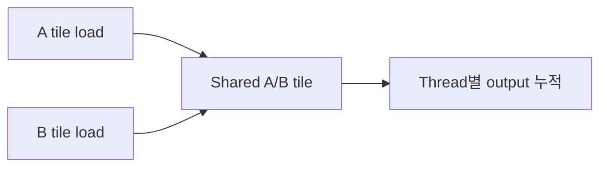

# 07. Matrix Multiplication과 Tiling

[이전: 06. Reduction](06-reductions-scans-and-atomics.md) · [목차](README.md) · [다음: 08. Tensor Core](08-tensor-cores-and-numerical-precision.md)

행렬 곱은 같은 입력 값을 여러 output이 재사용하는 대표 계산이다.

## 행렬을 처음 보는 독자를 위한 좌표와 주소

**Matrix(행렬)**는 숫자를 행과 열로 놓은 2차원 배열이다. 행은 가로줄이고 열은 세로줄이다. `A[i,j]`에서 `i`는 몇 번째 행인지, `j`는 몇 번째 열인지 나타낸다. 이 장은 0부터 세므로 4×4 행렬의 유효한 `i`,`j`는 0,1,2,3이다.

CPU나 GPU 메모리는 종이처럼 2차원이 아니라 byte가 이어진 공간이다. **Row-major(행 우선)** 배치에서는 한 행의 원소들을 연속으로 놓은 뒤 다음 행을 놓는다. 열 수가 `K`이고 원소가 4 byte이면 `A[i,k]`의 상대 byte 주소는 `(i*K+k)*4`다. 실제 library는 행 사이 간격인 leading dimension이 논리 열 수보다 클 수 있으므로 API 인자를 확인한다.

**Matrix multiplication(행렬 곱)**은 A의 한 행과 B의 한 열을 짝지어 C 원소 하나를 만든다. A shape가 `M×K`, B가 `K×N`이면 C는 `M×N`이다.

```text
C[i,j] = A[i,0]*B[0,j]
       + A[i,1]*B[1,j]
       + ...
       + A[i,K-1]*B[K-1,j]
```

`i`는 만들 output의 행, `j`는 output의 열, `k`는 A 행과 B 열에서 같은 위치끼리 곱해 더하는 내부 축이다. 두 vector의 대응 원소 곱을 모두 더하는 연산을 **dot product(내적)**라고 한다. 따라서 C의 각 원소는 A의 `i`번째 행과 B의 `j`번째 열의 dot product다.

**Accumulator(누산기)**는 곱셈 결과를 차례로 더해 두는 값이다. GPU thread 하나가 C 원소 하나를 맡는 단순 kernel이라면 accumulator는 그 thread의 register에 놓일 수 있다. 시작값은 합의 항등원 0이고, `k=0..K-1` 동안 `acc += A[i,k]*B[k,j]`를 반복한 뒤 global memory의 `C[i,j]`에 한 번 쓴다.

## 왜 naive 행렬 곱은 같은 값을 반복해서 읽는가

4×4 C에는 16개 output이 있다. 각 output은 K=4번 곱하므로 총 64번의 scalar multiply가 있다. C의 같은 행에 있는 네 thread는 모두 A의 같은 행 원소들을 필요로 한다. 예를 들어 `A[0,0]`은 C[0,0], C[0,1], C[0,2], C[0,3] 계산에 네 번 쓰인다. B[0,0]도 C[0,0], C[1,0], C[2,0], C[3,0]에 쓰인다.

각 thread가 매번 global memory에서 독립적으로 읽으면 cache가 일부를 재사용할 수 있어도 source code 수준에서는 중복 요청이 많다. **Tile(타일)**은 큰 행렬을 작은 직사각형 조각으로 나눈 data 단위다. Thread block이 A와 B tile을 global에서 shared memory로 협력해 한 번 적재하고, 같은 block의 여러 thread가 그 값을 재사용한다.

Data tile과 CUDA thread block은 관련 있지만 같은 객체가 아니다. Tile은 숫자 영역이고 thread block은 함께 실행되고 shared memory와 barrier를 공유하는 thread 집합이다. 설계는 “어느 thread가 어느 tile 원소를 적재하고 어느 output을 계산하는가”를 mapping한다.

## Tile phase의 네 가지 상태

K축도 tile 크기만큼 나누어 처리하는 한 구간을 **phase(단계)**라고 하자. Tile 크기 2, K=4면 k=0~1인 phase 0과 k=2~3인 phase 1이 있다.

1. 각 thread가 A와 B의 global 원소를 shared tile에 적재한다.
2. 첫 barrier가 모든 tile 원소 준비를 보장한다.
3. 각 thread가 shared A 행과 shared B 열을 읽어 자기 register accumulator에 더한다.
4. 둘째 barrier가 모든 현재-phase read 완료를 보장한 뒤 같은 shared storage를 다음 phase가 덮게 한다.

첫 barrier가 없으면 느린 thread가 값을 쓰기 전에 다른 thread가 미완성 tile을 읽을 수 있다. 둘째 barrier가 없으면 빠른 thread가 다음 phase 값을 써서 느린 thread가 두 phase가 섞인 tile을 읽을 수 있다. Barrier는 block 안에만 적용되며 다른 block의 shared memory는 보이지 않는다.




## 1. 문제 정의

A가 M×K, B가 K×N이면 C는 M×N이다.

`C[row,col]=Σ A[row,k]*B[k,col]`이다.

## 2. 2×2 손 계산

```text
A = [[1,2],     B = [[5,6],
     [3,4]]          [7,8]]
```

| C element | 계산 | 결과 |
| --- | --- | ---: |
| C00 | 1×5+2×7 | 19 |
| C01 | 1×6+2×8 | 22 |
| C10 | 3×5+4×7 | 43 |
| C11 | 3×6+4×8 | 50 |

## 3. Naive thread mapping

Thread `(row,col)` 하나가 C element 하나를 계산한다. K loop 동안 A row와 B column을 global에서 읽는다.

여러 thread가 같은 A·B 값을 반복 load한다.

## 4. Tile

큰 행렬을 작은 직사각형 block으로 나눈 조각이다. CUDA thread block과 data tile은 관련되지만 같은 객체가 아니다.

Storage block이나 filesystem block이라는 말과도 구분한다. 여기서 block은 CUDA 실행 thread 집합이다.

## 5. 4×4, tile 2

C의 output tile 2×2를 block thread 4개가 맡는다. K dimension도 2씩 두 phase다.

Phase 0은 A columns 0~1, B rows 0~1, phase 1은 2~3을 load한다.

## 6. Load 주체

Thread `(ty,tx)`가 `As[ty][tx]=A[row][phase*2+tx]`, `Bs[ty][tx]=B[phase*2+ty][col]`을 load한다.

각 thread가 한 값씩 협력해 shared tile을 채운다.

## 7. Barrier 위치

```text
global→shared load
__syncthreads()
shared tile multiply loop
__syncthreads()
다음 phase load
```

첫 barrier는 모든 tile 값 준비, 둘째는 다른 thread가 tile을 덮기 전 현재 계산 완료를 보장한다.

## 8. Phase 손 추적

A row0 `[1,2,3,4]`, B col0 `[1,10,100,1000]`이면 C00은:

| phase | shared 값 | partial |
| ---: | --- | ---: |
| 0 | 1×1, 2×10 | 21 |
| 1 | 3×100, 4×1000 | 4300 |
| 최종 | 21+4300 | 4321 |

## 4×4 행렬 전체를 손으로 곱하기

기존 C00 예제를 모든 행과 열로 확장한다.

```text
A = [[ 1,  2,  3,  4],
     [ 5,  6,  7,  8],
     [ 9, 10, 11, 12],
     [13, 14, 15, 16]]

B = [[   1,    2,    3,    4],
     [  10,   20,   30,   40],
     [ 100,  200,  300,  400],
     [1000, 2000, 3000, 4000]]
```

C00은 A의 행 0 `[1,2,3,4]`와 B의 열 0 `[1,10,100,1000]`의 내적이다.

```text
C00 = 1*1 + 2*10 + 3*100 + 4*1000
    = 1 + 20 + 300 + 4000
    = 4321
```

C01은 같은 A 행과 B의 열 1을 사용한다.

```text
C01 = 1*2 + 2*20 + 3*200 + 4*2000
    = 2 + 40 + 600 + 8000
    = 8642
```

나머지도 같은 `i,j,k` 규칙으로 계산한다.

| C 원소 | 네 곱의 합 | 결과 |
|---|---|---:|
| C00 | `1*1+2*10+3*100+4*1000` | 4,321 |
| C01 | `1*2+2*20+3*200+4*2000` | 8,642 |
| C02 | `1*3+2*30+3*300+4*3000` | 12,963 |
| C03 | `1*4+2*40+3*400+4*4000` | 17,284 |
| C10 | `5*1+6*10+7*100+8*1000` | 8,765 |
| C11 | `5*2+6*20+7*200+8*2000` | 17,530 |
| C12 | `5*3+6*30+7*300+8*3000` | 26,295 |
| C13 | `5*4+6*40+7*400+8*4000` | 35,060 |
| C20 | `9*1+10*10+11*100+12*1000` | 13,209 |
| C21 | `9*2+10*20+11*200+12*2000` | 26,418 |
| C22 | `9*3+10*30+11*300+12*3000` | 39,627 |
| C23 | `9*4+10*40+11*400+12*4000` | 52,836 |
| C30 | `13*1+14*10+15*100+16*1000` | 17,653 |
| C31 | `13*2+14*20+15*200+16*2000` | 35,306 |
| C32 | `13*3+14*30+15*300+16*3000` | 52,959 |
| C33 | `13*4+14*40+15*400+16*4000` | 70,612 |

따라서 전체 결과는 다음과 같다.

```text
C = [[ 4321,  8642, 12963, 17284],
     [ 8765, 17530, 26295, 35060],
     [13209, 26418, 39627, 52836],
     [17653, 35306, 52959, 70612]]
```

### Output tile (행 0~1, 열 0~1)의 두 phase

Thread `(ty,tx)` 네 개가 각각 C00, C01, C10, C11을 맡는다. Phase 0은 k=0,1 값만 shared에 올린다.

```text
As phase0 = [[1,2],
             [5,6]]
Bs phase0 = [[1,2],
             [10,20]]
```

Barrier 뒤 각 accumulator는 다음 상태가 된다.

| thread | output | phase 0 계산 | partial |
|---|---|---|---:|
| (0,0) | C00 | `1*1+2*10` | 21 |
| (0,1) | C01 | `1*2+2*20` | 42 |
| (1,0) | C10 | `5*1+6*10` | 65 |
| (1,1) | C11 | `5*2+6*20` | 130 |

모두 읽은 뒤 둘째 barrier를 지나 phase 1 값이 같은 shared 배열을 덮는다.

```text
As phase1 = [[3,4],
             [7,8]]
Bs phase1 = [[100,200],
             [1000,2000]]
```

각 thread는 기존 register partial에 새 곱을 더한다.

| output | 기존 partial | phase 1 증가분 | 최종 |
|---|---:|---:|---:|
| C00 | 21 | `3*100+4*1000=4300` | 4,321 |
| C01 | 42 | `3*200+4*2000=8600` | 8,642 |
| C10 | 65 | `7*100+8*1000=8700` | 8,765 |
| C11 | 130 | `7*200+8*2000=17400` | 17,530 |

A 원소 하나는 같은 output tile의 두 열 계산에서 재사용되고 B 원소 하나는 두 행 계산에서 재사용된다. 예를 들어 phase 0의 `A[0,0]=1`은 C00과 C01에 쓰이고 `B[0,0]=1`은 C00과 C10에 쓰인다. Shared tile의 목적은 이 재사용을 global load 반복 없이 block 내부에서 제공하는 것이다.


## 8.1 2×2 thread가 shared를 채우는 순서

Thread 좌표 `(ty,tx)` 네 개가 다음 값을 load한다고 하자.

| Thread | As[ty][tx] | Bs[ty][tx] |
| --- | --- | --- |
| (0,0) | A00=1 | B00=5 |
| (0,1) | A01=2 | B01=6 |
| (1,0) | A10=3 | B10=7 |
| (1,1) | A11=4 | B11=8 |

Barrier 뒤 thread (0,1)은 C01을 계산하며 `As[0][0]*Bs[0][1] + As[0][1]*Bs[1][1]`, 즉 `1*6+2*8=22`를 누적한다.

Thread (0,1)이 자기 load 두 값만 사용하는 것이 아니다. 다른 thread가 load한 As[0][0]와 Bs[1][1]도 읽으므로 첫 barrier가 필요하다.

K=4이면 첫 phase 계산 뒤 같은 As/Bs storage를 다음 K tile로 재사용한다. 느린 thread가 첫 phase 값을 아직 읽는데 빠른 thread가 새 값을 쓰면 partial이 섞인다. 둘째 barrier가 현재 phase shared read 완료를 만든다.

## Python tile 모형의 입력·상태·출력

`examples/tiled_matmul_model.py`는 Python list로 tile load와 계산 phase를 분리한다. GPU thread, shared memory, barrier를 실제로 실행하지 않는다. `tile_a`와 `tile_b`는 한 phase의 shared tile을 흉내 낸 지역 list이고, `accum`은 한 output tile의 thread별 register accumulator를 흉내 낸 2차원 list다.

첫 입력은 다음과 같다.

```text
A=[[1,2],[3,4]]
B=[[5,6],[7,8]]
tile_size=2
```

Output tile은 하나이고 K phase도 하나다. `tile_a=A`, `tile_b=B`가 된 뒤 세 겹 loop가 네 accumulator를 계산해 `[[19,22],[43,50]]`을 만든다. `trace_two`에는 `(row_base=0,col_base=0,k_base=0,tile_a,tile_b)` 한 tuple만 들어가므로 길이가 1이다.

Tile size 1이면 output 위치가 네 개이고 각 위치마다 K축 phase가 두 개다. Trace tuple 수는 `2 row bases × 2 col bases × 2 k bases = 8`이다. 결과 숫자는 같지만 tile 1은 한 tile 값을 같은 phase의 여러 output에서 재사용하지 못한다. 이 trace 수를 GPU kernel launch 수라고 해석하면 안 된다. Python 함수의 loop 기록 수일 뿐이다.

### 3×3 boundary zero-fill

두 번째 입력은 다음 3×3 행렬을 자기 자신과 곱한다.

```text
A=B=[[1,2,3],
     [4,5,6],
     [7,8,9]]
tile_size=2
```

수학 결과는 다음과 같다.

```text
[[ 30,  36,  42],
 [ 66,  81,  96],
 [102, 126, 150]]
```

Tile 크기 2이므로 row base와 column base는 각각 0,2 두 개이고 output tile은 네 개다. K base도 0,2 두 phase다. 마지막 phase 또는 마지막 output tile은 index 3을 요구하지만 유효 범위는 0~2다. Code는 `if row < rows and col < inner` 같은 검사에 실패한 위치를 초기값 0으로 남긴다.

C22를 추적하면 phase 0은 A의 `[7,8]`과 B column 2의 `[3,6]`을 곱해 `7*3+8*6=69`를 만든다. Phase 1은 실제 값 9와 padding 0, B의 9와 padding 0을 사용해 `9*9+0*0=81`을 더한다. 최종은 150이다. Padding 0은 합의 항등원이라 결과를 바꾸지 않는다.

실제 CUDA kernel에서 boundary thread를 barrier 전에 `return`시키면 안 된다. Output `row`나 `col`이 범위 밖인 thread도 block-wide barrier에는 참여하게 두고, global load만 조건부로 하여 shared 위치에 0을 쓴다. 마지막 global store도 유효 output thread만 수행한다.

```text
A load: row<M && k<K ? A[row,k] : 0
B load: k<K && col<N ? B[k,col] : 0
barrier
tile multiply
barrier
마지막 store: row<M && col<N일 때만 C[row,col]=acc
```

K boundary와 M/N boundary는 다른 조건이다. Output은 유효해도 마지막 K tile의 일부 source만 범위 밖일 수 있다. 세 조건을 하나의 early return으로 합치면 올바른 output 계산이나 barrier 참여를 잃을 수 있다.

## 부동소수점 accumulator와 연산 순서

Python model은 작은 정수를 사용해 exact equality로 검증한다. 실제 AI 행렬곱은 FP16, BF16, FP32 같은 dtype을 쓰며 input 곱과 accumulator dtype이 다를 수 있다. 낮은 정밀도 input을 더 넓은 accumulator에 더하면 누적 오차와 overflow 위험을 줄일 수 있지만, API와 하드웨어가 어떤 mode를 쓰는지 확인해야 한다.

Tiling은 `k` 항을 더하는 순서를 바꿀 수 있다. 실수 수학에서는 dot product의 괄호 순서가 결과를 바꾸지 않지만 floating은 반올림 때문에 bitwise 값이 달라질 수 있다. Fused multiply-add는 곱과 덧셈을 한 명령에서 반올림해 분리 연산과 다른 마지막 bit를 만들 수 있다. 그래서 integer toy의 정확 일치와 floating kernel의 허용 오차 검증을 구분한다.

허용 오차는 임의로 크게 두지 않는다. Reference dtype, K 길이, 값의 크기, 누적 방식, 응용이 허용하는 품질 변화를 기록한다. 빠른 kernel이 유한값 대신 NaN이나 inf를 만들지 않는지, boundary와 transpose shape에서도 맞는지 함께 검사한다.


## 9. Boundary tile

M,N,K가 tile 크기의 배수가 아니면 out-of-range load를 0으로 채운다. Thread 자체를 barrier 전에 return시키면 block barrier 참여가 깨질 수 있다.

## 10. 잘못된 early return

```text
if row>=M or col>=N: return
load
barrier
```

일부 thread가 return하고 나머지가 barrier에 오면 위험하다. Load만 조건화하고 모든 block thread가 barrier에 참여하게 설계한다.

## 11. Reuse 수

Tile 크기 T에서 A tile 값 하나를 같은 block의 여러 output column thread가 사용할 수 있다. B도 output row 방향으로 재사용한다.

Global load 감소와 shared 용량·barrier 비용을 비교한다.

4×4 예제를 source-level load로 단순 계산해 보자. Naive 방식은 output 16개가 K=4번마다 A와 B를 하나씩 읽으므로 scalar load 표현이 `16×4×2=128`개다. Tile 2 방식은 output tile 4개, K phase 2개마다 A tile 네 값과 B tile 네 값을 읽으므로 `4×2×(4+4)=64`개다. 각 적재 값이 같은 block에서 두 output에 재사용되어 절반이 된 모형이다.

이 128 대 64를 실제 DRAM transaction 수라고 부르면 안 된다. Naive 접근도 hardware cache가 값을 재사용할 수 있고, tiled 접근은 shared load·store와 barrier를 추가한다. 반대로 큰 tile은 더 많은 재사용을 만들지만 shared memory와 register를 많이 차지해 동시에 머무는 block 수를 줄일 수 있다. Arithmetic intensity는 이동 byte당 계산량을 보는 관점이며, 최적 tile은 shape와 dtype, GPU 자원, library kernel에 따라 달라진다.

## 12. Arithmetic intensity

Tile이 커질수록 한 load당 multiply-add가 늘 수 있다. 그러나 register/shared 사용량도 늘어 occupancy를 낮출 수 있다.

## 13. Bank conflict

Shared tile의 column access가 bank conflict를 만들 수 있어 padding을 검토한다. Layout과 access를 실제 bank mapping으로 본다.

## 14. Coalesced load

Warp lane의 x가 연속 column을 load하면 A row와 B row 접근을 연속으로 만들기 쉽다. B column을 직접 global에서 읽는 naive pattern은 stride가 클 수 있다.

## 15. Accumulator

Thread는 output partial을 register에 유지한다. Accumulator type precision과 overflow를 input type과 분리한다.

## 16. Transpose와 layout

Row-major/column-major, leading dimension을 API와 맞춘다. 수학적 shape만 맞고 memory stride가 틀리면 결과가 잘못된다.

## Matrix tile에서 FlashAttention-3까지 이어지는 원리

Transformer attention의 핵심에도 두 번의 matrix-like 계산이 있다. 먼저 Q와 K의 내적으로 score를 만들고 softmax를 적용한 뒤, 확률과 V를 곱는다. 단순 구현은 큰 `S×S` score와 probability를 GPU의 HBM에 썼다가 다시 읽을 수 있다. **Tiling**은 Q, K, V의 작은 block을 on-chip memory에 올려 재사용하고 HBM 왕복을 줄인다.

Softmax는 한 행 전체의 최댓값과 지수 합이 필요해 tile 하나만 보고 끝낼 수 없어 보인다. **Online softmax**는 tile마다 현재 최댓값과 정규화 합을 갱신하고, 최댓값이 바뀌면 이전 partial을 다시 scale한다. 그러면 수학적으로 같은 attention을 계산하면서 전체 `S×S` 중간 행렬을 HBM에 materialize하지 않을 수 있다. 이는 행렬곱 tile의 accumulator가 K phase를 거치며 partial을 유지하는 생각을, softmax 상태까지 확장한 것이다.

FlashAttention-3는 2024년 논문에서 Hopper H100의 비동기 Tensor Core와 TMA 전송 기능을 이용한다. Warpgroup의 역할을 나누는 warp specialization으로 tile 이동과 계산을 겹치고, 서로 다른 tile의 matrix multiply와 softmax를 interleave해 장치 자원이 기다리는 구간을 줄인다. FP8 경로는 block quantization과 값 분포를 섞는 처리를 사용해 낮은 정밀도의 오차를 다룬다.

이 기법을 “tile 크기를 키우면 모든 GPU에서 빨라진다”로 일반화하면 안 된다. On-chip memory와 register 사용이 커지면 동시에 실행할 block 수가 줄 수 있고, TMA와 특정 Tensor Core 명령은 GPU 세대에 묶인다. 논문의 kernel 결과는 H100, 선택한 sequence·head dimension·dtype·비교 구현 조건에서 읽어야 한다. End-to-end 모델은 다른 layer, KV cache, 통신, CPU queue가 병목일 수 있어 attention kernel의 개선 비율과 같지 않다.


## 17. Tiling이 항상 이득인가

2×2 초소형 행렬은 launch·barrier 비용이 더 클 수 있다. Library가 architecture-specific kernel을 제공할 수 있다.

## 18. 검증

작은 integer matrix는 exact 비교, floating은 reference와 오차 bound를 사용한다. Shape mismatch와 padding 영역도 검사한다.

## 19. 반례

첫 barrier만 있고 둘째가 없으면 빠른 thread가 다음 phase 값을 써서 느린 thread가 tile 혼합을 읽을 수 있다.

Tile을 shared에 load했지만 각 값 한 번만 쓰면 재사용 이득이 작다.

## 문제와 해설

**문제 1.** 위 2×2 C11은?

**해설.** `3×6+4×8=18+32=50`이다.

**문제 2.** K=5, tile=2이면 phase 수는?

**해설.** 올림해 3 phase다. 마지막 phase의 범위 밖 값은 0으로 채운다.

**문제 3.** 두 번째 barrier가 필요한 이유는?

**해설.** 모든 thread가 현재 tile 계산을 끝내기 전에 다음 phase load가 shared를 덮지 못하게 한다.

**문제 4.** 4×4 예제의 C23을 `i,j,k`로 풀어 계산하라.

**해설.** `i=2`, `j=3`이므로 A의 행 2 `[9,10,11,12]`와 B의 열 3 `[4,40,400,4000]`을 쓴다. `9*4+10*40+11*400+12*4000=36+400+4400+48000=52,836`이다. K축 네 항이 dot product를 만든다.

**문제 5.** Tile 2로 output C[0:2,0:2]의 phase 0을 계산할 때 A00과 B00은 각각 몇 output에 재사용되는가?

**해설.** A00은 같은 output 행의 C00과 C01 두 thread가 사용한다. B00은 같은 output 열의 C00과 C10 두 thread가 사용한다. Global에서 shared로 한 번씩 적재한 뒤 block 안에서 두 번 읽는 모형이다. Cache와 compiler가 있는 실제 naive kernel의 DRAM 요청 감소량을 이 숫자만으로 단정하지 않는다.

**문제 6.** 3×3 행렬, tile 2에서 C22의 두 phase와 boundary 값을 계산하라.

**해설.** Phase 0은 A row 2의 `[7,8]`과 B column 2의 `[3,6]`으로 `69`다. Phase 1은 `[9,0]`과 `[9,0]`으로 `81`을 더해 150이다. Index 3의 source는 범위 밖이라 0을 넣지만 output `(2,2)`는 유효하므로 저장한다. Boundary thread가 barrier 전에 return하지 않게 load와 store만 조건화한다.


## 공식 자료

- [CUDA matrix multiplication example](https://docs.nvidia.com/cuda/cuda-programming-guide/03-advanced/advanced-kernel-programming.html)
- [CUDA samples matrixMul](https://github.com/NVIDIA/cuda-samples)
- [Shah et al., FlashAttention-3, 2024](https://arxiv.org/abs/2407.08608)
