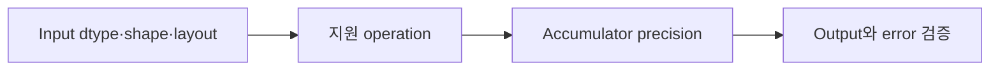

# 08. Tensor Core와 Numerical Precision

[이전: 07. Matrix tiling](07-matrix-multiplication-and-tiling.md) · [목차](README.md) · [다음: 09. Stream](09-streams-events-and-asynchronous-copies.md)

Tensor Core는 지원된 matrix operation을 높은 throughput으로 수행하는 hardware 경로다. 모든 type과 shape에 자동 적용되는 것은 아니다.

## 먼저 “빠른 행렬 연산”의 실제 객체를 놓기

**Tensor Core**는 NVIDIA GPU 안에서 작은 행렬의 곱셈과 누산을 높은 처리량으로 수행하도록 만든 계산 장치다. 여기서 tensor는 framework의 임의 차원 배열 전체를 뜻하기보다, 지원된 작은 matrix tile 연산의 입력 조각을 가리키는 문맥이 강하다. Tensor Core는 독립된 GPU 한 대가 아니며, SM 안의 warp 또는 warpgroup이 명령을 발행해 사용한다.

기본 연산은 흔히 `D = A×B + C`인 **matrix multiply-accumulate(MMA, 행렬 곱-누산)**로 설명한다. A와 B는 곱할 입력 tile, C는 이전 partial sum, D는 갱신된 결과 tile이다. **Accumulate(누산)**는 K축의 여러 곱을 같은 output에 계속 더하는 일이다. 입력 type, accumulator type, output type은 서로 다를 수 있다.

일반 CUDA core가 scalar 또는 vector 명령을 thread별로 실행하는 경로와, Tensor Core의 warp 협력 matrix 명령은 실행 단위가 다르다. Warp의 일부 lane만 “자기 2×2 행렬”을 독립 계산하는 그림이 아니다. Warp lane들이 A·B·C tile의 조각인 **fragment(프래그먼트)**를 나누어 들고 하나의 집단 명령에 참여한다. Fragment는 lane register에 분산된 구현 객체이며, 내부 원소가 어느 lane의 어느 register에 놓이는지는 API와 architecture 계약에 달려 있다.

### 데이터가 지나가는 위치와 수명

| 객체 | 대표 위치 | 만든 주체 | 수명과 종료 조건 |
|---|---|---|---|
| 원본 matrix A/B | GPU global memory | host가 복사하거나 이전 kernel이 생성 | allocation 해제까지 |
| shared tile | SM의 block shared memory | block thread가 협력 load | block 종료 또는 다음 phase overwrite까지 |
| fragment | warp lane들의 register | WMMA·MMA load 명령 | 해당 warp 계산 구간까지 |
| accumulator fragment | warp lane register | MMA 명령 | K phase가 끝나 store할 때까지 |
| output D | global 또는 shared memory | fragment store | 다음 소비자 완료·allocation 해제까지 |
| scale·amax | register/global metadata | quantization code | 변환 또는 다음 layer가 사용할 때까지 |

**Global memory**는 GPU의 큰 장치 메모리이고, **shared memory**는 한 block이 공유하는 작은 on-chip 메모리다. **Register**는 thread의 작업 값을 두는 SM 내부 저장소다. Tensor Core가 빠르더라도 A와 B가 준비되지 않거나 layout이 맞지 않아 변환 copy가 많으면 전체 kernel은 그 장치를 기다릴 수 있다.

### Tensor Core 사용이 성립하는 지원 조건

다음 조건을 분리해 확인한다.

1. GPU architecture가 원하는 MMA 자료형과 tile 명령을 지원하는가.
2. Compiler와 toolkit이 그 architecture용 코드를 만들 수 있는가.
3. Driver와 runtime 조합이 해당 binary를 실행할 수 있는가.
4. Library API의 math mode, compute type, input/output type이 의도와 맞는가.
5. M·N·K shape와 leading dimension, pointer alignment가 선택된 kernel 조건을 만족하는가.
6. Warp의 필요한 lane이 같은 collective 명령에 참여하는가.

Toolkit이 최신이라는 사실만으로 오래된 GPU에 새 FP8 명령이 생기지 않는다. 반대로 hardware가 지원해도 API 설정과 shape 때문에 library가 다른 kernel을 고를 수 있다. “FP16 tensor를 썼다”와 “Tensor Core instruction이 실행됐다”는 별도 주장이다.

## 2×2 MMA를 숫자로 끝까지 계산하기

교육용으로 A, B, C가 모두 2×2라고 하자. 실제 instruction tile은 architecture와 API별로 더 크거나 다른 모양일 수 있다.

```text
A = [[1,2],      B = [[5,6],      C = [[1,1],
     [3,4]]           [7,8]]           [1,1]]
```

먼저 `A×B`의 네 원소를 계산한다.

```text
P00 = 1*5 + 2*7 = 19
P01 = 1*6 + 2*8 = 22
P10 = 3*5 + 4*7 = 43
P11 = 3*6 + 4*8 = 50
```

누산 입력 C를 더하면 다음과 같다.

```text
D = A×B+C = [[20,23],
             [44,51]]
```

K축이 tile 두 개라면 첫 MMA의 D가 다음 MMA의 C 역할을 한다. 예를 들어 첫 phase partial이 20이고 둘째 phase 곱의 기여가 30이면 최종 accumulator는 50이다. 실제 warp에서는 각 lane이 D 전체를 일반 배열처럼 독점하지 않는다. Collective store가 fragment를 shared나 global layout으로 내보낸다.

## 부동소수점은 실수를 유한한 bit로 근사한다

**Floating-point(부동소수점)** 값은 부호, 크기 범위를 정하는 exponent, 유효 숫자를 담는 significand로 구성된다. 고정된 bit 수로 모든 실수를 저장할 수 없으므로 가장 가까운 표현 가능 값으로 **rounding(반올림)**한다. 값이 커질수록 인접 표현 가능 값 사이 간격도 커질 수 있다.

대표 형식을 개념적으로 비교하면 다음과 같다. 숨은 leading bit, subnormal, NaN 세부는 IEEE 규칙에 따른다.

| 이름 | 저장 bit | exponent field | fraction field | 핵심 성격 |
|---|---:|---:|---:|---|
| FP32 | 32 | 8 | 23 | 넓은 범위와 비교적 긴 유효 숫자 |
| FP16 | 16 | 5 | 10 | 좁은 범위, 작은 저장량 |
| BF16 | 16 | 8 | 7 | FP32와 비슷한 exponent 범위, 짧은 유효 숫자 |
| FP8 계열 | 8 | 형식별 상이 | 형식별 상이 | scale과 범위 관리가 특히 중요 |

**TF32**는 FP32 값을 메모리에 저장하는 새 C type 이름으로 이해하면 안 된다. NVIDIA의 지원 경로에서 FP32 범위 성격을 유지하면서 Tensor Core 곱셈에 더 짧은 정밀도를 사용하는 compute mode다. Accumulator와 output 규칙은 API 설정을 따로 확인한다.

### 작은 반올림이 사라지는 과정

10진수 세 자리만 보존하는 가상 형식을 생각하자. 이는 실제 FP16 구현을 흉내 낸 정확한 bit 모형이 아니라 cancellation을 보기 위한 교육용 모형이다.

```text
1000 + 1 -> 세 자리로 반올림하면 1000
1000 - 1000 -> 0
```

순서가 `1000 + (1-1000)`이면 `1-1000=-999`, 이어서 `1000+(-999)=1`을 만들 수 있다. 수학적으로 같은 세 수의 합도 중간 반올림 위치가 달라 결과가 0 또는 1이 된다. Parallel reduction, tile K 순서, fused multiply-add 여부가 bitwise 결과를 바꿀 수 있는 이유다.

**Overflow**는 결과 크기가 형식의 최대 유한 범위를 넘어 infinity 같은 값이 되는 현상이고, **underflow**는 너무 작은 값이 subnormal 또는 0 쪽으로 사라지는 현상이다. **NaN**은 0/0 같은 정의되지 않은 연산을 나타내는 특수값이다. Kernel이 빠르더라도 NaN·infinity가 생기거나 중요한 gradient가 0이 되면 올바른 계산이 아니다.

## Input·accumulator·output 정밀도를 분리하기

`FP16 사용`이라는 문장만으로는 부족하다. 다음 세 경계를 적는다.

- **Input precision**: A와 B storage를 어떤 dtype으로 읽는가.
- **Compute/accumulator precision**: 곱과 partial sum을 어떤 규칙으로 계산하는가.
- **Output precision**: D를 어떤 dtype storage에 써서 다음 연산에 넘기는가.

FP16 input과 FP32 accumulator를 사용해도 output을 FP16으로 내보내면 마지막 store에서 다시 반올림한다. Accumulator가 넓으면 K축 합산 중 일부 오차와 overflow 위험을 줄일 수 있지만, 이미 input 변환에서 사라진 정보는 복구하지 못한다. Quantized integer나 FP8 경로에서는 scale, zero point 또는 format별 변환과 saturation 규칙까지 계산의 일부다.

### Shape, layout, padding의 실제 의미

**Shape**는 matrix의 논리적 M·N·K 길이다. **Layout**은 원소가 memory에 놓이는 순서다. Row-major는 같은 행이 연속이고 column-major는 같은 열이 연속이다. **Leading dimension**은 한 행 또는 열의 시작에서 다음 시작까지 storage 간격이다. Padding이 있으면 논리 열 수보다 클 수 있다.

지원 kernel이 K를 16의 배수로 요구하는 교육 예에서 K=18이면 K=32 storage로 padding할 수 있다. 추가 A 열과 B 행을 0으로 채우면 `0*x`가 되어 원래 dot product 의미를 바꾸지 않는다. 하지만 메모리와 계산은 늘어난다. M/N padding output은 원래 범위만 잘라 사용한다. 잘못된 layout flag는 단순한 성능 저하가 아니라 다른 숫자 조합을 곱해 틀린 결과를 만든다.

## WMMA collective를 시간순으로 보기

**WMMA(Warp Matrix Multiply Accumulate)**는 warp가 fragment load, MMA, store에 협력하는 CUDA C++ API다. 일반 흐름은 다음과 같다.

1. Block thread들이 global A/B tile을 shared memory에 협력해 적재한다.
2. Block barrier로 tile 준비를 보장한다.
3. Warp의 모든 필요한 lane이 같은 matrix_a, matrix_b, accumulator fragment를 선언한다.
4. Collective load가 shared layout에서 lane register fragment로 값을 가져온다.
5. MMA가 `D=A×B+C`를 계산해 accumulator fragment를 갱신한다.
6. 필요한 K phase를 반복한다.
7. Collective store가 output tile을 shared 또는 global memory layout으로 쓴다.
8. 소비자가 읽기 전에 필요한 barrier나 stream dependency를 둔다.

다음 분기는 위험하다.

```text
if lane_id < 16:
    wmma_mma(...)
```

Warp collective가 32 lane의 일치한 참여를 요구하는데 절반만 호출하면 지원 계약을 어긴다. Boundary는 lane을 collective에서 빼는 방식이 아니라 input tile을 0으로 채우고 warp가 함께 연산한 뒤 유효 output만 저장하는 방식으로 처리할 수 있다. 정확한 참여 조건은 사용하는 WMMA/MMA API 문서를 따른다.




## 1. Precision

Floating-point는 sign, exponent, significand bit로 실수를 근사한다. Bit 수가 적으면 표현 범위·간격·rounding이 달라진다.

## 2. FP32·FP16·BF16

FP32는 일반 single precision이다. FP16은 좁은 exponent와 significand, BF16은 FP32와 비슷한 exponent 범위지만 significand가 짧다.

지원 세부는 GPU generation과 instruction/API를 확인한다.

## 3. TF32

TensorFloat-32는 Tensor Core 계산 경로에서 사용하는 형식/모드다. C/C++ 저장 type 하나로 단순 동일시하지 않는다.

## 4. Integer·FP8

일부 architecture는 integer나 FP8 계열 matrix operation을 지원한다. Scale, saturation, accumulation type이 중요하다.

## 5. Multiply와 accumulate

Input multiply precision과 accumulator precision이 다를 수 있다. 낮은 precision input을 더 넓은 accumulator에 합치면 일부 오차 누적을 줄인다.

## 6. 작은 rounding 예

Decimal 세 자리만 유지하는 가상 형식에서 `1000+1-1000`을 순서대로 계산하면 1이 사라질 수 있다.

Parallel/tiling 순서가 달라지면 rounding 결과가 달라질 수 있다.

## 7. Relative·absolute error

Absolute error는 `|gpu-reference|`, relative error는 이를 reference 크기로 나눈 값이다.

Reference가 0 근처면 relative error가 불안정해 absolute tolerance도 함께 쓴다.

## 7.1 숫자 네 개로 error 계산

Reference `[1.0,1000.0,0.0,-2.0]`, GPU `[1.001,999.5,0.0002,-2.01]`이라 하자.

| 위치 | Absolute error | Relative error |
| ---: | ---: | ---: |
| 0 | 0.001 | 0.001 |
| 1 | 0.5 | 0.0005 |
| 2 | 0.0002 | 정의 주의 |
| 3 | 0.01 | 0.005 |

큰 값에서는 absolute 0.5가 relative로 작고, zero reference는 relative 분모가 없다. `|a-b|≤atol+rtol*|reference|` 같은 기준을 쓴다.

Dot product를 serial, pairwise tree, Tensor Core tile로 합치면 rounding point가 달라질 수 있다. 수학식과 floating execution 순서를 구분한다.

## 8. ULP

Units in the Last Place는 인접 representable 값 간격 관점의 오차다. Dtype과 값 크기에 따라 간격이 다르다.

## 9. Overflow·underflow

큰 값은 infinity로 overflow, 아주 작은 값은 0/subnormal 쪽으로 underflow할 수 있다.

Loss scaling은 training에서 gradient underflow를 다루는 기법 중 하나다.

## 10. Shape 제약

Matrix dimension과 alignment가 Tensor Core tile 요구에 맞아야 효율적일 수 있다. Padding이 필요할 수 있다.

Padding element는 계산 의미를 바꾸지 않도록 0으로 채우고 output 범위를 잘라낸다.

## 11. Layout

Row-major, column-major, leading dimension을 API가 요구하는 조합으로 전달한다. Shape가 같아도 layout flag가 틀리면 다른 행렬을 계산한다.

## 12. Library

cuBLAS, cuBLASLt 같은 library는 architecture와 shape에 맞는 kernel을 선택할 수 있다. 직접 WMMA를 쓰는 것만이 Tensor Core 사용법은 아니다.

## 13. WMMA

Warp Matrix Multiply Accumulate API는 warp 협력 fragment를 사용한다. Fragment 내부 layout을 일반 array처럼 임의 접근한다고 가정하지 않는다.

## 14. Warp 참여

Warp collective matrix operation에서 lane 참여와 control flow가 일치해야 한다. 일부 lane만 호출하는 branch는 위험하다.

## Mixed precision 훈련과 loss scaling의 상태 추적

**Mixed precision**은 한 프로그램에서 목적에 따라 여러 dtype을 쓰는 전략이다. Parameter의 master copy와 optimizer state는 FP32에 두고, forward input과 일부 matrix 연산은 FP16/BF16로 수행하며, gradient 누적은 더 넓게 할 수 있다. 모든 tensor를 무조건 FP16으로 바꾸는 것과 다르다.

작은 gradient `1e-8`이 어떤 FP16 실행 경로에서 0으로 underflow한다고 가정하자. **Loss scaling**은 backward 전에 loss에 scale S를 곱해 gradient도 S배 크게 만들고, optimizer가 쓰기 전에 다시 S로 나눈다.

```text
원래 gradient g = 1e-8
scale S = 1024
scaled gradient = 1.024e-5
unscale = 1.024e-5 / 1024 = 1e-8
```

Scale된 값이 표현 가능한 범위에 남으면 0으로 사라지는 위험을 줄일 수 있다. 반대로 scale이 너무 크면 overflow해 inf가 된다. Dynamic loss scaler는 inf/NaN을 검사해 해당 step update를 건너뛰고 scale을 낮추거나, 안정된 step 뒤 높이는 정책을 쓸 수 있다. 구체적 증가·감소 규칙은 framework 설정이다. Loss scaling은 forward activation overflow, 잘못된 모델, 모든 수치 문제를 해결하지 않는다.

## 결과 검증을 하나의 판정식으로 만들기

Reference 값 `r`, GPU 값 `g`에 대해 흔히 다음 조건을 사용한다.

```text
|g-r| <= atol + rtol*|r|
```

`atol`은 0 근처에서 허용할 절대 오차이고 `rtol`은 값 크기에 비례한 오차다. 기존 예제의 네 값에 `atol=0.001`, `rtol=0.001`을 적용해 보자.

| 위치 | 절대 오차 `abs(g-r)` | 허용량 `0.001+0.001*abs(r)` | 판정 |
|---:|---:|---:|---|
| 0 | 0.001 | 0.002 | 통과 |
| 1 | 0.5 | 1.001 | 통과 |
| 2 | 0.0002 | 0.001 | 통과 |
| 3 | 0.01 | 0.003 | 실패 |

같은 absolute 0.01도 reference 크기에 따라 의미가 달라진다. `rtol`만 쓰면 reference 0에서 허용량이 0이 되므로 작은 수치 noise를 모두 실패시킬 수 있다. 반대로 tolerance를 크게 잡아 NaN이나 구조적 오류를 숨겨서는 안 된다. 먼저 shape·layout·boundary를 exact한 작은 integer 사례로 검증하고, 그다음 실제 dtype의 error distribution과 model quality를 본다.

**ULP(Units in the Last Place)**는 특정 값 주변의 인접 표현 가능 수 간격을 단위로 오차를 보는 관점이다. 값 크기와 dtype에 따라 1 ULP의 절대 크기가 달라진다. API의 정확도 계약이 ULP로 주어지면 임의의 decimal 자릿수와 바꾸지 말고 해당 정의를 따른다.

## FP8 연구를 읽을 때 분리할 조건

FlashAttention-3의 FP8 경로는 Hopper GPU 지원을 이용하고, block별 scale과 값 분포를 섞는 변환으로 단순 FP8 변환보다 수치 오차를 줄이려 했다. 여기서 확인할 것은 세 층이다. Kernel이 FP8 matrix instruction으로 빨라졌는지, attention output error가 허용 범위인지, 전체 모델 task 품질이 유지되는지는 서로 다른 주장이다.

논문에서 특정 H100 shape와 구현으로 얻은 처리량을 다른 GPU, 작은 matrix, decode workload에 그대로 적용할 수 없다. FP8 지원 형식과 scale 처리 비용, memory traffic, non-matrix operator 비율에 따라 전체 효과가 바뀐다. 연구 수치를 사용할 때 GPU architecture, dtype 조합, sequence/head shape, baseline, error metric을 함께 기록한다.


## 15. Mixed precision

Input, accumulation, output dtype을 각각 기록한다. “FP16 사용” 한 문장으로 전체 계산 precision을 설명하지 않는다.

## 16. 검증 표

| 항목 | 기록 예 |
| --- | --- |
| Input dtype | FP16 |
| Accumulator | FP32 |
| Output | FP16 또는 FP32 |
| Shape | M,N,K |
| Tolerance | atol, rtol |
| Reference | CPU FP64 등 |

## 17. Reproducibility

Library version, math mode, GPU architecture가 algorithm과 rounding을 바꿀 수 있다. Seed만 기록해서 충분하지 않다.

## 지원 실패와 수치 실패를 구분하는 진단 순서

Tensor Core 경로가 기대대로 동작하지 않을 때 먼저 **실행 가능성**, 다음 **수치 정당성**, 마지막 **성능**을 확인한다. 실행 가능성은 GPU compute capability, binary target, driver/runtime/toolkit 호환, library가 지원하는 dtype·layout·alignment를 본다. 지원하지 않는 instruction이면 launch 전에 선택이 거부되거나 다른 kernel로 fallback할 수 있다. Fallback은 정답을 만들면서 느릴 수 있으므로 “오류가 없었다”만으로 원하는 경로를 증명하지 못한다.

수치 정당성은 작은 matrix의 exact reference, 실제 규모의 `atol/rtol`, NaN·infinity 개수, model metric 순으로 본다. Output이 전부 0이면 Tensor Core 자체보다 잘못된 scale, boundary mask, output dtype 변환을 먼저 의심할 수 있다. 특정 행·열만 틀리면 leading dimension과 padding, transpose flag를 점검한다. 크기가 커질수록 오차가 자라면 accumulator와 K축 합산 순서를 살핀다.

성능은 선택된 kernel 이름이나 instruction counter, matrix shape, memory 이동과 전체 시간을 함께 본다. Tensor Core instruction 비율이 높아도 input layout 변환과 padding, global-memory load가 시간을 지배할 수 있다. 반대로 작은 문제는 CPU launch overhead가 kernel 계산보다 클 수 있다. Peak TFLOP/s는 이상적인 지원 연산의 상한이며 애플리케이션이 자동으로 그 값을 얻는 보장이 아니다.

### 재현 가능한 실험 기록

한 줄짜리 “FP16 Tensor Core가 빨랐다” 대신 다음을 남긴다.

```text
GPU 모델·architecture:
driver / runtime / toolkit / library:
M,N,K와 batch:
A/B storage dtype:
compute·accumulator type:
D output dtype:
layout·leading dimension·alignment:
math mode와 선택 algorithm:
warm-up·반복 수·동기화 방법:
reference와 atol/rtol:
NaN/inf 검사:
kernel 시간과 end-to-end 시간:
```

이 기록이 있어야 GPU 세대나 library version이 바뀌어 algorithm과 rounding이 달라졌을 때 결과를 비교할 수 있다. Seed는 input 재생에는 도움을 주지만 library kernel 선택과 floating reduction 순서를 고정하는 완전한 재현성 계약은 아니다.


## 18. Performance와 accuracy

Throughput 향상과 model quality/수치 오차를 함께 평가한다. 빠르지만 overflow하는 configuration은 실패다.

## 19. 반례

FP16 input이면 항상 Tensor Core가 사용된다고 단정할 수 없다. Shape, API, architecture, math mode가 필요하다.

Tensor Core를 사용하면 exact FP32 결과와 bitwise 같다고 기대하지 않는다.

## 문제와 해설

**문제 1.** Input FP16, accumulator FP32이면 output도 반드시 FP32인가?

**해설.** 아니다. API가 정한 output type을 별도로 확인한다.

**문제 2.** Reference가 0일 때 relative error만 쓰면?

**해설.** 0으로 나누거나 과도한 값이 된다. Absolute tolerance를 함께 쓴다.

**문제 3.** 최신 toolkit이면 오래된 GPU가 최신 Tensor Core type을 지원하는가?

**해설.** 아니다. Hardware compute capability와 runtime 조합을 확인한다.

**문제 4.** A=`[[1,2],[3,4]]`, B=`[[5,6],[7,8]]`, C가 모든 원소 1일 때 `D=A×B+C`를 구하라.

**해설.** `A×B=[[19,22],[43,50]]`이다. C를 원소별로 더하면 `D=[[20,23],[44,51]]`이다. C는 matrix multiplication의 K축 input이 아니라 이전 partial 또는 bias처럼 output shape에 더하는 accumulator 입력이다.

**문제 5.** K=18을 지원 조건 때문에 32로 padding한다. 원래 결과를 보존하려면 A와 B의 어느 영역을 무엇으로 채워야 하는가?

**해설.** A의 추가 column 18~31과 B의 추가 row 18~31을 0으로 채운다. 추가 K항은 `0*값` 또는 `값*0`으로 dot product에 0을 더한다. Storage와 계산량은 늘며, padding되지 않은 garbage를 곱하면 결과가 틀린다.

**문제 6.** Reference 2.0, GPU 2.01, `atol=0.001`, `rtol=0.002`이면 통과하는가?

**해설.** Absolute error는 `0.01`이다. 허용량은 `0.001+0.002*2=0.005`다. `0.01>0.005`이므로 실패다. 더 큰 tolerance가 필요하다고 결론 내리기 전에 dtype, accumulator, layout, reference와 응용 품질 요구를 확인한다.


## 공식 자료

- [CUDA numerical accuracy](https://docs.nvidia.com/cuda/cuda-programming-guide/05-appendices/mathematical-functions.html)
- [CUDA WMMA](https://docs.nvidia.com/cuda/cuda-programming-guide/05-appendices/cpp-language-extensions.html)
- [FlashAttention-3 논문](https://arxiv.org/abs/2407.08608)
