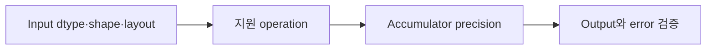

# 08. Tensor Core와 Numerical Precision

[이전: 07. Matrix tiling](07-matrix-multiplication-and-tiling.md) · [목차](README.md) · [다음: 09. Stream](09-streams-events-and-asynchronous-copies.md)

Tensor Core는 지원된 matrix operation을 높은 throughput으로 수행하는 hardware 경로다. 모든 type과 shape에 자동 적용되는 것은 아니다.

## 1. Precision

Floating-point는 sign, exponent, significand bit로 실수를 근사한다. Bit 수가 적으면 표현 범위·간격·rounding이 달라진다.

## 2. FP32·FP16·BF16

FP32는 일반 single precision이다. FP16은 좁은 exponent와 significand, BF16은 FP32와 비슷한 exponent 범위지만 significand가 짧다.

지원 세부는 GPU generation과 instruction/API를 확인한다.

## 3. TF32

TensorFloat-32는 Tensor Core 계산 경로에서 사용하는 형식/모드다. C/C++ 저장 type 하나로 단순 동일시하지 않는다.

## 4. Integer·FP8

일부 architecture는 integer나 FP8 계열 matrix operation을 지원한다. Scale, saturation, accumulation type이 중요하다.

## 5. Multiply와 accumulate

Input multiply precision과 accumulator precision이 다를 수 있다. 낮은 precision input을 더 넓은 accumulator에 합치면 일부 오차 누적을 줄인다.

## 6. 작은 rounding 예

Decimal 세 자리만 유지하는 가상 형식에서 `1000+1-1000`을 순서대로 계산하면 1이 사라질 수 있다.

Parallel/tiling 순서가 달라지면 rounding 결과가 달라질 수 있다.

## 7. Relative·absolute error

Absolute error는 `|gpu-reference|`, relative error는 이를 reference 크기로 나눈 값이다.

Reference가 0 근처면 relative error가 불안정해 absolute tolerance도 함께 쓴다.

## 7.1 숫자 네 개로 error 계산

Reference `[1.0,1000.0,0.0,-2.0]`, GPU `[1.001,999.5,0.0002,-2.01]`이라 하자.

| 위치 | Absolute error | Relative error |
| ---: | ---: | ---: |
| 0 | 0.001 | 0.001 |
| 1 | 0.5 | 0.0005 |
| 2 | 0.0002 | 정의 주의 |
| 3 | 0.01 | 0.005 |

큰 값에서는 absolute 0.5가 relative로 작고, zero reference는 relative 분모가 없다. `|a-b|≤atol+rtol*|reference|` 같은 기준을 쓴다.

Dot product를 serial, pairwise tree, Tensor Core tile로 합치면 rounding point가 달라질 수 있다. 수학식과 floating execution 순서를 구분한다.

## 8. ULP

Units in the Last Place는 인접 representable 값 간격 관점의 오차다. Dtype과 값 크기에 따라 간격이 다르다.

## 9. Overflow·underflow

큰 값은 infinity로 overflow, 아주 작은 값은 0/subnormal 쪽으로 underflow할 수 있다.

Loss scaling은 training에서 gradient underflow를 다루는 기법 중 하나다.

## 10. Shape 제약

Matrix dimension과 alignment가 Tensor Core tile 요구에 맞아야 효율적일 수 있다. Padding이 필요할 수 있다.

Padding element는 계산 의미를 바꾸지 않도록 0으로 채우고 output 범위를 잘라낸다.

## 11. Layout

Row-major, column-major, leading dimension을 API가 요구하는 조합으로 전달한다. Shape가 같아도 layout flag가 틀리면 다른 행렬을 계산한다.

## 12. Library

cuBLAS, cuBLASLt 같은 library는 architecture와 shape에 맞는 kernel을 선택할 수 있다. 직접 WMMA를 쓰는 것만이 Tensor Core 사용법은 아니다.

## 13. WMMA

Warp Matrix Multiply Accumulate API는 warp 협력 fragment를 사용한다. Fragment 내부 layout을 일반 array처럼 임의 접근한다고 가정하지 않는다.

## 14. Warp 참여

Warp collective matrix operation에서 lane 참여와 control flow가 일치해야 한다. 일부 lane만 호출하는 branch는 위험하다.

## 15. Mixed precision

Input, accumulation, output dtype을 각각 기록한다. “FP16 사용” 한 문장으로 전체 계산 precision을 설명하지 않는다.

## 16. 검증 표

| 항목 | 기록 예 |
| --- | --- |
| Input dtype | FP16 |
| Accumulator | FP32 |
| Output | FP16 또는 FP32 |
| Shape | M,N,K |
| Tolerance | atol, rtol |
| Reference | CPU FP64 등 |

## 17. Reproducibility

Library version, math mode, GPU architecture가 algorithm과 rounding을 바꿀 수 있다. Seed만 기록해서 충분하지 않다.

## 18. Performance와 accuracy

Throughput 향상과 model quality/수치 오차를 함께 평가한다. 빠르지만 overflow하는 configuration은 실패다.

## 19. 반례

FP16 input이면 항상 Tensor Core가 사용된다고 단정할 수 없다. Shape, API, architecture, math mode가 필요하다.

Tensor Core를 사용하면 exact FP32 결과와 bitwise 같다고 기대하지 않는다.

## 문제와 해설

**문제 1.** Input FP16, accumulator FP32이면 output도 반드시 FP32인가?

**해설.** 아니다. API가 정한 output type을 별도로 확인한다.

**문제 2.** Reference가 0일 때 relative error만 쓰면?

**해설.** 0으로 나누거나 과도한 값이 된다. Absolute tolerance를 함께 쓴다.

**문제 3.** 최신 toolkit이면 오래된 GPU가 최신 Tensor Core type을 지원하는가?

**해설.** 아니다. Hardware compute capability와 runtime 조합을 확인한다.

## 공식 자료

- [CUDA numerical accuracy](https://docs.nvidia.com/cuda/cuda-programming-guide/05-appendices/mathematical-functions.html)
- [CUDA WMMA](https://docs.nvidia.com/cuda/cuda-programming-guide/05-appendices/cpp-language-extensions.html)
