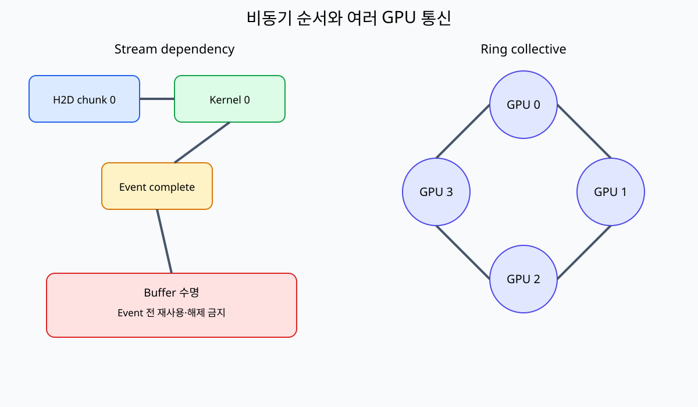
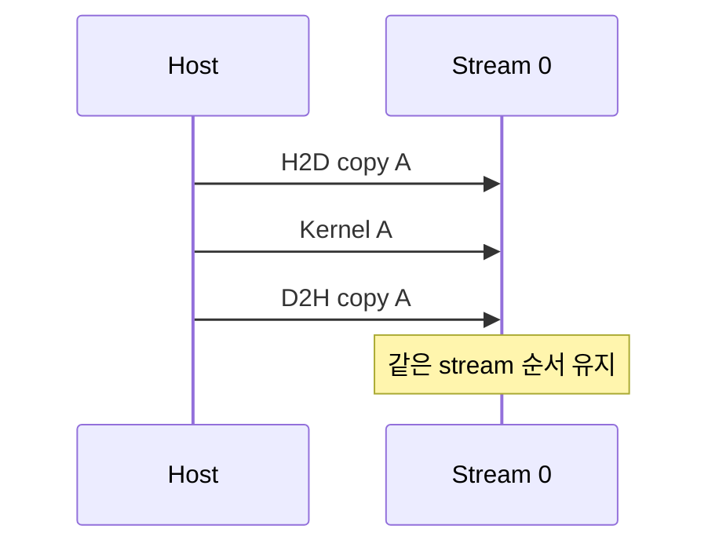

# 09. Stream·Event·Asynchronous Copy

[이전: 08. Tensor Core](08-tensor-cores-and-numerical-precision.md) · [목차](README.md) · [다음: 10. Launch와 CUDA Graph](10-kernel-launches-and-cuda-graphs.md)

Stream은 host가 enqueue한 GPU 작업의 순서 영역이다. 비동기 반환과 실제 완료를 구분한다.

## 먼저 host와 device가 따로 움직인다는 뜻

**Host**는 보통 CPU에서 실행되는 애플리케이션과 그 RAM을 가리키고, **device**는 GPU와 GPU가 주로 사용하는 장치 메모리를 가리킨다. Python이나 C++ thread가 CUDA runtime 함수를 호출해 GPU에 일을 제출한다. CPU 함수 한 줄이 GPU 안에서 직접 실행되는 것이 아니다.

**Enqueue(인큐)**는 copy나 kernel 명령을 실행 순서열에 넣는 일이다. **Stream(스트림)**은 GPU 작업 사이의 순서를 표현하는 runtime 객체다. 같은 stream에 `copy A → kernel A → copy result A`를 넣으면 뒤 작업은 필요한 앞 작업보다 먼저 실행되지 않는다. Stream은 CPU thread도, GPU core 하나도 아니다. Hardware scheduler가 준비된 여러 stream의 작업을 device 자원에 배치한다.

**Asynchronous(비동기)** 호출은 host API가 device 작업 완료를 기다리지 않고 반환할 수 있다는 뜻이다. 반환 시점에는 명령이 host queue에 제출되었을 뿐이거나 device queue에서 기다리는 중일 수 있다. `API 성공`, `enqueue 완료`, `device 실행 시작`, `device 실행 완료`, `host가 완료를 관찰`은 서로 다른 상태다.

**Event(이벤트)**는 stream의 특정 지점에 기록하는 GPU 진행 표식이다. Host가 event record 함수를 호출한 시각이 event 완료 시각은 아니다. Stream의 앞 작업이 끝나고 device가 record 지점에 도달해야 complete가 된다. Host는 query로 상태를 확인하거나 synchronize로 기다릴 수 있고, 다른 stream은 wait-event로 필요한 dependency만 연결할 수 있다.

## Memory buffer의 위치와 소유권

**Buffer(버퍼)**는 전송하거나 계산할 byte를 담는 memory 영역이다. Host input buffer는 CPU RAM, device input/output buffer는 GPU memory에 있다. 같은 논리 chunk도 시점마다 host와 device에 별도 사본을 가질 수 있다. 어느 쪽이 최신인지, 누가 읽거나 쓰는지를 적어야 한다.

**Pageable host memory**는 OS가 일반적으로 관리하고 회수·이동·swap할 수 있는 RAM page다. **Pinned 또는 page-locked memory**는 DMA 동안 물리 page 위치가 안정되도록 등록된 host memory다. **DMA(Direct Memory Access)**는 CPU가 각 byte를 복사하는 loop를 수행하지 않고 장치 copy engine이 host와 device memory 사이를 옮기는 기작이다. CPU와 driver는 주소 mapping과 제출, 완료 처리를 맡는다.

Pageable pointer로 async copy를 요청하면 runtime이 내부 pinned staging buffer로 먼저 복사하거나 호출 일부를 동기화할 수 있다. 따라서 함수 이름에 `Async`가 있어도 host와 device overlap이 보장되지 않는다. Pinned memory도 공짜가 아니다. 너무 많이 고정하면 OS가 회수할 수 있는 RAM이 줄고 allocation·registration 비용이 생긴다.

### 한 buffer의 상태 기계

Host input A가 H2D copy와 kernel에 쓰이는 동안 상태를 다음처럼 나눌 수 있다.

```text
HOST_WRITABLE
  -- H2D enqueue -->
COPY_PENDING_OR_RUNNING
  -- copy complete, kernel consumes device copy -->
DEVICE_IN_USE
  -- dependent kernel/event complete -->
HOST_REUSABLE
```

Host가 `COPY_PENDING_OR_RUNNING`인 A를 다음 chunk로 덮으면 DMA가 이전 byte와 새 byte를 섞어 읽을 수 있다. Device buffer도 kernel이 읽는 동안 allocator에 반환하거나 다른 stream이 overwrite하면 race가 난다. Pointer 변수의 scope가 남았다는 것과 비동기 작업이 참조하는 storage 수명이 안전하다는 것은 별도다.

## 같은 stream의 순서와 다른 stream의 edge

Stream S0에 다음 명령을 넣는다고 하자.

```text
S0: H2D(A) → kernel(A,B) → D2H(B) → record(done0)
```

S0 안에서는 D2H가 kernel output보다 먼저 읽지 않는다. Host는 네 호출을 빠르게 끝내고 다른 일을 할 수 있지만 A는 H2D 완료 전, B는 D2H 완료 전 재사용할 수 없다.

다른 stream S1은 자동으로 S0의 B 준비를 알지 못한다. S1 kernel이 S0 output을 읽어야 한다면 다음 edge가 필요하다.

```text
S0: producer_kernel → record(E)
S1: wait(E) → consumer_kernel
```

Event E는 producer 뒤, consumer 앞에 하나의 happens-before 관계를 만든다. Device 전체 synchronize는 모든 stream을 기다려 더 넓은 순서를 만들지만 불필요한 overlap까지 막을 수 있다. 필요한 edge만 넣으면 독립 작업은 계속 진행할 수 있다.

### Edge가 빠진 실패 추적

초기 device `x=0`이고 S0 kernel이 `x=7`을 쓴 뒤 S1 kernel이 `y=2*x`를 계산한다고 하자. Edge가 없으면 다음 두 실행이 모두 가능하다.

```text
정상처럼 보이는 순서: S0 write x=7 → S1 read x=7 → y=14
race 순서:          S1 read x=0 → y=0 → S0 write x=7
```

Stream을 두 개 만들었다는 것은 동시 가능성을 열 뿐 data dependency를 추론하지 않는다. Event wait를 추가하면 S1 read가 S0 record 뒤에 놓여 y=14를 보장한다. Cache flush라는 막연한 설명보다 producer write, event record, wait, consumer read 네 지점을 적는다.

## 두 chunk double buffering을 숫자로 그리기

Chunk마다 H2D 4 ms, kernel compute 10 ms, D2H 3 ms가 걸린다고 가정한다. 한 stream에서 chunk 0 전체 뒤 chunk 1 전체를 실행하면 다음과 같다.

```text
chunk0: 4+10+3 = 17 ms
chunk1: 4+10+3 = 17 ms
total = 34 ms
```

두 input/output buffer와 두 stream을 사용하고, H2D engine·compute engine·D2H engine이 동시에 서로 다른 작업을 수행할 수 있다고 가정한다.

| 시간 | H2D engine | Compute engine | D2H engine |
|---|---|---|---|
| 0~4 | chunk0 H2D | idle | idle |
| 4~8 | chunk1 H2D | chunk0 compute 4~14 | idle |
| 8~14 | idle | chunk0 compute | idle |
| 14~17 | idle | chunk1 compute 14~24 | chunk0 D2H |
| 17~24 | idle | chunk1 compute | idle |
| 24~27 | idle | idle | chunk1 D2H |

이상적 총시간은 27 ms다. `34/27≈1.26배`의 단순 개선이다. Compute engine 하나라는 가정 때문에 kernel0과 kernel1은 겹치지 않고, 별도 방향 copy engine 가정으로 D2H0은 compute1과 겹친다. 실제 장치의 engine 수, PCIe 양방향 경쟁, pinned memory, chunk 크기와 kernel 자원 사용이 다르면 표도 달라진다.

### Buffer A/B 소유권

| 시각 | Host buffer A | Device buffer A | Host buffer B | Device buffer B |
|---:|---|---|---|---|
| 0 | chunk0, H2D가 읽음 | write 중 | chunk1 준비 가능 | idle |
| 4 | H2D0 완료, 재사용 후보 | kernel0이 읽음 | H2D1이 읽음 | write 중 |
| 8 | host가 chunk2 준비 가능 | kernel0이 읽음 | H2D1 완료 | kernel1 대기 |
| 14 | D2H0 destination은 별도 output | D2H0이 결과 읽음 | 재사용 후보 | kernel1이 읽음 |
| 17 | result0 host 사용 가능 | A cycle 완료 | 유지 | kernel1이 읽음 |
| 27 | 다음 cycle 가능 | idle | result1 host 사용 가능 | B cycle 완료 |

Input과 output이 같은 host buffer인지 별도인지 명시해야 한다. 위 표는 input host buffer와 D2H output destination을 개념상 분리했다. In-place 재사용이라면 마지막 소비자까지 더 오래 기다려야 한다.

## Event로 시간 재기

CPU wall clock으로 launch 전후만 재면 enqueue 시간이 나올 수 있다.

```text
t0=host_now
kernel<<<...,stream>>>()
t1=host_now
```

Kernel이 10 ms 실행되어도 host가 0.02 ms 만에 반환할 수 있다. GPU kernel 구간을 재려면 같은 stream에 start event, kernel, end event를 순서대로 넣고 end 완료를 기다린 뒤 event elapsed를 읽는다.

```text
record(start,S)
launch(kernel,S)
record(end,S)
synchronize(end)
elapsed(start,end)
```

Event 구간은 그 stream 진행 지점의 device 시간을 본다. 사용자가 느끼는 end-to-end latency에는 host preprocessing, queue, H2D, kernel, D2H, host 후처리가 포함되므로 별도 wall-clock 측정이 필요하다. Timing event 설정과 clock 의미는 API 문서를 확인한다.

**Warm-up(예열)**은 context 생성, module load, JIT, allocator 준비 같은 첫 실행 비용을 정상 반복과 분리하는 단계다. Cold-start도 운영상 중요하므로 버리지 말고 별도 보고한다. 다른 stream load와 GPU clock·전력 상태가 측정에 영향을 줄 수 있다.

## 완료와 오류의 여러 경계

Launch parameter나 invalid configuration 오류는 enqueue 근처에서 드러날 수 있다. Out-of-bounds 같은 device 실행 오류는 kernel이 실제로 실행된 뒤 다음 synchronize 또는 관련 API에서 보고될 수 있다. 마지막 오류 상태 하나만 늦게 읽으면 어느 operation이 원인인지 잃는다.

실무 추적은 H2D 제출, launch, event record, event wait/synchronize, D2H 완료마다 error를 연결한다. `event complete`는 그 event 앞의 stream 작업이 완료되었다는 뜻이지 모든 stream이 idle이라는 뜻은 아니다. Stream destroy나 buffer free가 pending work를 어떻게 처리하는지도 runtime 계약을 확인한다.

## Default stream과 priority를 조심해서 읽기

Default stream의 다른 stream과의 동기화 의미는 legacy default와 per-thread default 설정에 따라 다를 수 있다. 오래된 예제의 “default stream은 항상 전역 barrier” 문장을 모든 build 설정에 적용하지 않는다. 의존성이 필요하면 암묵 규칙에 기대지 않고 명시적 stream과 event edge로 표현한다.

Stream priority는 scheduler에 주는 우선순위 힌트다. 이미 실행 중인 긴 kernel을 즉시 중단해 높은 priority kernel을 정해진 시간 안에 완료한다는 hard real-time 보장이 아니다. Resource를 가득 쓰는 kernel, dependency와 hardware scheduling 단위가 실제 지연에 영향을 준다.






## 1. Stream

CUDA operation을 enqueue하는 ordered sequence다. 같은 stream의 작업은 정의된 순서를 따른다.

다른 stream 사이에는 event/wait 같은 dependency가 없으면 순서를 자동 가정하지 않는다.

## 2. Async

Host API가 작업 완료 전에 반환할 수 있다는 뜻이다. 반환 뒤 host가 다른 일을 할 수 있지만 buffer 수명을 지켜야 한다.

## 3. Event

Stream 진행 지점에 기록하는 object다. Timing과 dependency에 사용할 수 있다. Event record 호출 시각과 GPU가 그 지점에 도달한 시각을 구분한다.

## 4. Buffer 시간표

| 시각 | Host 행동 | Device 행동 | Buffer 상태 |
| ---: | --- | --- | --- |
| 0 | pinned input 준비 | 없음 | Host owns |
| 1 | async H2D enqueue | copy 대기 | 변경 금지 |
| 2 | kernel enqueue | copy/kernel 진행 | Host·device 사용 중 |
| 3 | event query not ready | kernel 진행 | 해제 금지 |
| 4 | event complete | 작업 완료 | 재사용·해제 가능 |

## 5. Pinned host memory

Page-locked host memory는 async transfer와 DMA에 필요할 수 있다. Pinned allocation은 system 자원 비용이 있어 무제한 사용하지 않는다.

## 6. Pageable memory

API가 내부 staging을 사용할 수 있고 async 성질이 달라질 수 있다. 이름만 async라고 overlap을 가정하지 않는다.

## 7. Double buffering

Chunk 0 compute와 chunk 1 copy를 서로 다른 stream에서 겹치는 pipeline을 만든다.

```text
time0: copy chunk0
time1: compute0 | copy1
time2: compute1 | copy2
```

Hardware copy engine과 dependency가 허용해야 실제 overlap된다.

## 7.1 두 buffer의 소유 시간표

Buffer A와 B를 번갈아 사용하면 host가 채우는 buffer와 device가 읽는 buffer가 겹치지 않게 한다.

| 시간 | Buffer A | Buffer B |
| ---: | --- | --- |
| t0 | H2D copy 중 | Host fill chunk1 |
| t1 | Kernel chunk0 | H2D copy chunk1 |
| t2 | D2H result0 | Kernel chunk1 |
| t3 | Event0 완료, 재사용 | D2H result1 |

Host가 t1에 A를 chunk2로 덮으면 kernel0 input이 변할 수 있다. Event0 뒤에만 A를 재사용한다.

Event E0를 stream0 kernel0 뒤에 record하고 stream1이 E0를 wait하면 필요한 edge만 만든다. Record 호출 직후 device completion이라는 뜻은 아니다.

## 8. Event dependency

Stream A가 event E를 record하고 Stream B가 E를 wait하면 B의 후속 작업은 A의 그 지점 뒤로 연결된다.

Host 전체 synchronization보다 좁은 dependency다.

## 9. Default stream

Default stream semantics와 per-thread default 설정을 version/configuration과 함께 확인한다. 모든 stream과 자동 global barrier라고 단순화하지 않는다.

## Async allocation과 다른 stream에서의 pointer 수명

Stream-ordered allocator는 allocation과 free도 특정 stream의 순서에 연결한다. S0에서 pointer P를 할당하고 쓴 뒤 S1이 읽는다면, S1은 P 생성과 producer 완료를 기다리는 edge가 필요하다. S0에서 free를 enqueue할 때도 S1의 마지막 read가 끝난 뒤라는 dependency가 있어야 한다.

```text
S0: alloc(P) → write(P) → record(ready)
S1: wait(ready) → read(P) → record(consumed)
S0: wait(consumed) → free(P)
```

주소 숫자가 아직 변수에 남아 있어도 free가 실행된 뒤 접근하면 use-after-free다. Caching allocator가 같은 주소를 즉시 다른 tensor에 재사용하면 오류가 조용히 다른 data corruption으로 보일 수 있다.

## Graph capture에서 stream이 제공하는 것

Stream capture는 capture 구간에서 enqueue한 copy와 kernel 및 event dependency를 graph node와 edge로 기록한다. Capture가 host 프로그램의 모든 side effect를 기록하는 것은 아니다. 파일 I/O, 임의의 host lock, 지원되지 않는 API는 capture-safe하지 않을 수 있다. Capture 시작 전에 buffer와 module을 준비하고, capture 중 allocation 가능 여부와 다른 thread/stream interaction을 사용하는 runtime version에서 확인한다.

Graph로 만들었다고 buffer 수명과 event edge가 자동 수정되지 않는다. 잘못된 stream race를 capture하면 잘못된 dependency graph를 반복 재생할 뿐이다.


## 10. Async allocation

Stream-ordered allocation/free API는 stream dependency를 따른다. Pointer를 다른 stream에서 쓰면 ordering을 연결한다.

## 11. Lifetime 반례

Host stack buffer를 async copy에 넘기고 함수 return하면 copy가 끝나기 전 memory 수명이 끝날 수 있다.

Device output을 async D2H 뒤 event completion 전에 host가 읽으면 오래된 값일 수 있다.

## 12. Timing

Host wall clock은 enqueue 시간만 측정할 수 있다. Event를 적절히 기록하고 synchronize해 device elapsed를 측정한다.

Warm-up, clock 변화, 다른 stream load를 기록한다.

## 13. Error reporting

Launch error와 asynchronous execution error가 다른 API 시점에 나타날 수 있다. 마지막 오류만 덮어쓰지 않고 각 단계 확인을 설계한다.

## 14. Copy 방향

H2D, D2H, D2D 방향과 pointer 위치를 맞춘다. 잘못된 size·direction은 결과 오류나 API 실패를 만든다.

## Copy 방향과 실제 경로를 확인하기

**H2D(host-to-device)**는 CPU RAM에서 GPU memory로, **D2H**는 반대로, **D2D**는 device memory 사이로 옮긴다. Pointer가 어느 memory space에 속하는지와 byte 수가 copy 방향에 맞아야 한다. 원소 수 1,024개인 FP32 배열은 `1024×4=4096 bytes`다. 원소 수 1,024를 byte 수로 잘못 넘기면 앞 256개 FP32만 복사되어 나머지는 오래된 값일 수 있다.

Pinned host memory와 GPU가 서로 다른 CPU socket의 NUMA 영역에 연결되면 DMA가 원격 memory controller를 지나 대역폭과 latency가 달라질 수 있다. Multi-GPU에서는 device 0 pointer를 device 1 stream에 넘길 때 peer access와 topology 지원을 확인한다. “D2D”라는 이름만으로 NVLink, PCIe peer path, host staging 중 어느 경로인지 고정되지 않는다.

Managed memory나 unified virtual addressing은 pointer 사용을 단순하게 할 수 있지만 page migration과 fault 비용을 없애지는 않는다. 첫 GPU 접근 때 page 이동이 일어나면 kernel 시간에 migration이 섞일 수 있다. Prefetch와 memory advice의 지원 조건을 확인하고, 어느 장치에 page가 있었는지 기록한다.

## Chunk 크기를 고르는 계산

총 64 MiB를 pipeline으로 처리한다고 하자. 1 MiB chunk면 64회 copy·kernel·event를 제출하고, 16 MiB chunk면 4회다. 작은 chunk는 첫 결과를 빨리 만들고 copy와 compute를 촘촘히 겹칠 수 있지만 enqueue와 event overhead가 많다. 큰 chunk는 overhead 비율이 작지만 double buffer 두 세트의 memory가 커지고 마지막 긴 작업 때문에 pipeline tail이 길어진다.

최적 크기는 단순히 가장 큰 값이 아니다. 각 chunk의 H2D 시간, compute 시간, D2H 시간 중 가장 긴 단계가 steady-state 처리율을 제한한다. H2D 2 ms, compute 8 ms, D2H 2 ms라면 compute가 병목이고 copy를 더 작은 조각으로 나누어도 compute engine 한 대의 8 ms 간격보다 빨리 완료할 수 없다. 반대로 H2D가 12 ms라면 kernel 최적화보다 input 전송과 전처리 경로가 먼저 병목이다.

Pipeline 측정은 첫 chunk가 들어가는 **fill**, 여러 engine이 겹치는 **steady state**, 마지막 chunk가 빠져나오는 **drain**을 분리한다. 짧은 작업은 fill/drain 비중이 커 이상적인 overlap 계산에 못 미칠 수 있다.

## 실패를 재현하는 최소 상태표

비동기 오류를 디버깅할 때 다음 항목을 operation마다 기록한다.

| 항목 | 예 |
|---|---|
| operation ID | H2D-17, kernel-17 |
| stream | S0 |
| input/output pointer와 byte | A0 4096 B, D0 2048 B |
| producer event | input_ready_17 |
| consumer wait | S0 waits input_ready_17 |
| host 재사용 event | done_17 |
| enqueue 오류 | success/failure |
| completion 오류 | synchronize 결과 |

이 표는 “GPU가 가끔 틀린다”를 어느 buffer가 어느 edge 없이 재사용됐는지로 바꾼다. 모든 작업 뒤 device-wide synchronize를 넣으면 race가 가려지고 overlap이 사라질 수 있으므로, 원인을 찾은 뒤 필요한 dependency만 남긴다.


## 15. Chunk size

너무 작은 chunk는 enqueue overhead, 너무 큰 chunk는 pipeline overlap과 memory 사용을 제한할 수 있다.

## 16. Stream priority

Priority는 scheduling hint/정책이며 실행 선점과 완료 시간의 절대 보장이 아니다.

## 17. Graph capture와 stream

Stream capture로 dependency graph를 만들 수 있지만 capture-safe API 제약을 확인한다.

## 18. 반례

Stream 두 개를 만들었다는 사실만으로 copy와 kernel이 겹치지 않는다. Hardware·pinned memory·dependency가 필요하다.

Event record 직후 host time을 읽어 kernel 완료라고 생각하면 안 된다.

## 문제와 해설

**문제 1.** Async H2D enqueue 직후 host input을 덮어써도 되는가?

**해설.** Copy completion 전이면 안 된다. Event/stream completion을 확인한다.

**문제 2.** 같은 stream에서 copy→kernel 순서는?

**해설.** Enqueue order dependency를 따른다.

**문제 3.** 서로 다른 stream의 작업 순서는 자동인가?

**해설.** 아니다. 필요한 event/wait dependency를 만든다.

**문제 4.** H2D 4 ms, compute 10 ms, D2H 3 ms인 chunk 두 개를 순차 실행할 때와 본문의 이상적 pipeline에서 총시간과 배속을 구하라.

**해설.** 순차는 `(4+10+3)*2=34 ms`다. Pipeline은 H2D0 0~4, compute0 4~14와 H2D1 4~8, compute1 14~24와 D2H0 14~17, D2H1 24~27이므로 27 ms다. 단순 배속은 `34/27≈1.26`이다. 별도 engine과 pinned memory, 의존성, bandwidth 비경쟁 가정이 깨지면 실제 값은 달라진다.

**문제 5.** S0이 `x=7`을 쓰고 S1이 `y=2*x`를 계산한다. Event edge가 없을 때 가능한 y와 필요한 edge를 쓰라.

**해설.** S1이 먼저 읽으면 초기 x=0을 보아 y=0, S0 뒤에 읽으면 y=14가 가능하다. S0 producer 뒤 `record(E)`, S1 consumer 앞 `wait(E)`를 둔다. Host가 record 함수를 호출한 직후가 아니라 device가 그 지점에 도달한 뒤 wait가 풀린다.

**문제 6.** Kernel event 시간은 10 ms인데 end-to-end 요청 시간은 18 ms다. 모순인가?

**해설.** 아니다. Event 구간이 kernel만 포함했다면 나머지 8 ms는 host preprocessing, queue, H2D/D2H, 후처리와 동기화에 있을 수 있다. 두 측정의 시작·끝 경계, stream, warm-up, 다른 load를 기록해야 비교할 수 있다.


## 공식 자료

- [CUDA asynchronous execution](https://docs.nvidia.com/cuda/cuda-programming-guide/02-basics/asynchronous-execution.html)
- [CUDA streams and events](https://docs.nvidia.com/cuda/cuda-runtime-api/group__CUDART__STREAM.html)
