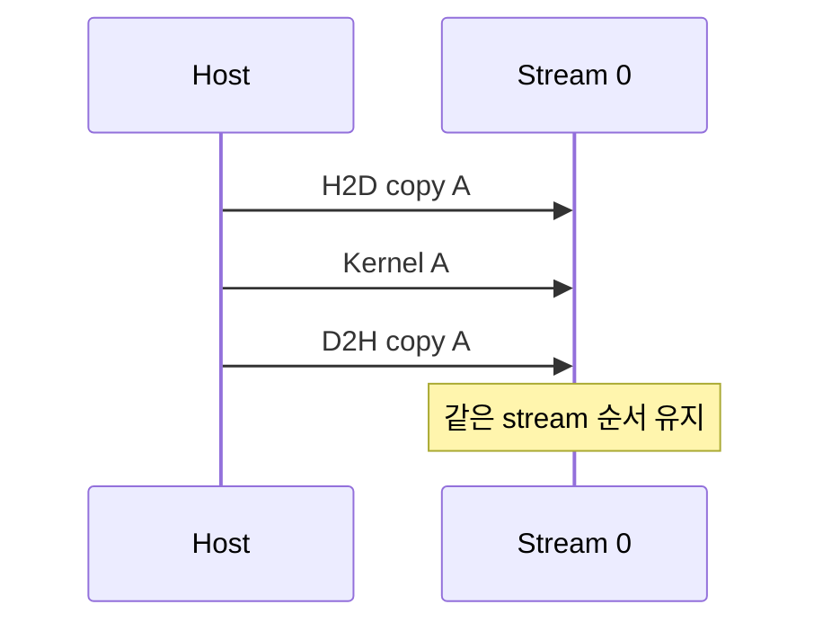

# 09. Stream·Event·Asynchronous Copy

[이전: 08. Tensor Core](08-tensor-cores-and-numerical-precision.md) · [목차](README.md) · [다음: 10. Launch와 CUDA Graph](10-kernel-launches-and-cuda-graphs.md)

Stream은 host가 enqueue한 GPU 작업의 순서 영역이다. 비동기 반환과 실제 완료를 구분한다.




## 1. Stream

CUDA operation을 enqueue하는 ordered sequence다. 같은 stream의 작업은 정의된 순서를 따른다.

다른 stream 사이에는 event/wait 같은 dependency가 없으면 순서를 자동 가정하지 않는다.

## 2. Async

Host API가 작업 완료 전에 반환할 수 있다는 뜻이다. 반환 뒤 host가 다른 일을 할 수 있지만 buffer 수명을 지켜야 한다.

## 3. Event

Stream 진행 지점에 기록하는 object다. Timing과 dependency에 사용할 수 있다. Event record 호출 시각과 GPU가 그 지점에 도달한 시각을 구분한다.

## 4. Buffer 시간표

| 시각 | Host 행동 | Device 행동 | Buffer 상태 |
| ---: | --- | --- | --- |
| 0 | pinned input 준비 | 없음 | Host owns |
| 1 | async H2D enqueue | copy 대기 | 변경 금지 |
| 2 | kernel enqueue | copy/kernel 진행 | Host·device 사용 중 |
| 3 | event query not ready | kernel 진행 | 해제 금지 |
| 4 | event complete | 작업 완료 | 재사용·해제 가능 |

## 5. Pinned host memory

Page-locked host memory는 async transfer와 DMA에 필요할 수 있다. Pinned allocation은 system 자원 비용이 있어 무제한 사용하지 않는다.

## 6. Pageable memory

API가 내부 staging을 사용할 수 있고 async 성질이 달라질 수 있다. 이름만 async라고 overlap을 가정하지 않는다.

## 7. Double buffering

Chunk 0 compute와 chunk 1 copy를 서로 다른 stream에서 겹치는 pipeline을 만든다.

```text
time0: copy chunk0
time1: compute0 | copy1
time2: compute1 | copy2
```

Hardware copy engine과 dependency가 허용해야 실제 overlap된다.

## 7.1 두 buffer의 소유 시간표

Buffer A와 B를 번갈아 사용하면 host가 채우는 buffer와 device가 읽는 buffer가 겹치지 않게 한다.

| 시간 | Buffer A | Buffer B |
| ---: | --- | --- |
| t0 | H2D copy 중 | Host fill chunk1 |
| t1 | Kernel chunk0 | H2D copy chunk1 |
| t2 | D2H result0 | Kernel chunk1 |
| t3 | Event0 완료, 재사용 | D2H result1 |

Host가 t1에 A를 chunk2로 덮으면 kernel0 input이 변할 수 있다. Event0 뒤에만 A를 재사용한다.

Event E0를 stream0 kernel0 뒤에 record하고 stream1이 E0를 wait하면 필요한 edge만 만든다. Record 호출 직후 device completion이라는 뜻은 아니다.

## 8. Event dependency

Stream A가 event E를 record하고 Stream B가 E를 wait하면 B의 후속 작업은 A의 그 지점 뒤로 연결된다.

Host 전체 synchronization보다 좁은 dependency다.

## 9. Default stream

Default stream semantics와 per-thread default 설정을 version/configuration과 함께 확인한다. 모든 stream과 자동 global barrier라고 단순화하지 않는다.

## 10. Async allocation

Stream-ordered allocation/free API는 stream dependency를 따른다. Pointer를 다른 stream에서 쓰면 ordering을 연결한다.

## 11. Lifetime 반례

Host stack buffer를 async copy에 넘기고 함수 return하면 copy가 끝나기 전 memory 수명이 끝날 수 있다.

Device output을 async D2H 뒤 event completion 전에 host가 읽으면 오래된 값일 수 있다.

## 12. Timing

Host wall clock은 enqueue 시간만 측정할 수 있다. Event를 적절히 기록하고 synchronize해 device elapsed를 측정한다.

Warm-up, clock 변화, 다른 stream load를 기록한다.

## 13. Error reporting

Launch error와 asynchronous execution error가 다른 API 시점에 나타날 수 있다. 마지막 오류만 덮어쓰지 않고 각 단계 확인을 설계한다.

## 14. Copy 방향

H2D, D2H, D2D 방향과 pointer 위치를 맞춘다. 잘못된 size·direction은 결과 오류나 API 실패를 만든다.

## 15. Chunk size

너무 작은 chunk는 enqueue overhead, 너무 큰 chunk는 pipeline overlap과 memory 사용을 제한할 수 있다.

## 16. Stream priority

Priority는 scheduling hint/정책이며 실행 선점과 완료 시간의 절대 보장이 아니다.

## 17. Graph capture와 stream

Stream capture로 dependency graph를 만들 수 있지만 capture-safe API 제약을 확인한다.

## 18. 반례

Stream 두 개를 만들었다는 사실만으로 copy와 kernel이 겹치지 않는다. Hardware·pinned memory·dependency가 필요하다.

Event record 직후 host time을 읽어 kernel 완료라고 생각하면 안 된다.

## 문제와 해설

**문제 1.** Async H2D enqueue 직후 host input을 덮어써도 되는가?

**해설.** Copy completion 전이면 안 된다. Event/stream completion을 확인한다.

**문제 2.** 같은 stream에서 copy→kernel 순서는?

**해설.** Enqueue order dependency를 따른다.

**문제 3.** 서로 다른 stream의 작업 순서는 자동인가?

**해설.** 아니다. 필요한 event/wait dependency를 만든다.

## 공식 자료

- [CUDA asynchronous execution](https://docs.nvidia.com/cuda/cuda-programming-guide/02-basics/asynchronous-execution.html)
- [CUDA streams and events](https://docs.nvidia.com/cuda/cuda-runtime-api/group__CUDART__STREAM.html)
