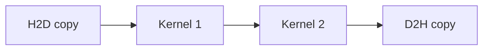

# 10. Kernel Launch와 CUDA Graph

[이전: 09. Stream](09-streams-events-and-asynchronous-copies.md) · [목차](README.md) · [다음: 11. 성능 분석](11-occupancy-roofline-and-profiling.md)

Kernel launch는 계산을 시작하는 host-device control 작업이다. CUDA Graph는 반복 dependency를 object로 구성해 재사용한다.

## 1. Launch configuration

Grid dimension, block dimension, dynamic shared byte, stream을 정한다. Argument pointer와 scalar 수명·값을 확인한다.

## 2. Launch overhead

Host가 runtime/driver를 통해 work를 enqueue하는 비용이다. Kernel 계산 2 µs인데 launch가 비슷한 크기면 작은 kernel 반복이 overhead-bound일 수 있다.

## 3. 1000회 반복 모형

Launch overhead 5 µs, kernel 2 µs면 1000회에 7 ms 단순 합이다. Kernel fusion이나 graph replay로 control overhead를 줄일 후보가 된다.

실제 시간은 queueing과 overlap 때문에 단순 합과 다를 수 있다.

## 4. Kernel fusion

두 elementwise kernel을 하나로 합치면 intermediate global traffic과 launch를 줄일 수 있다.

Register pressure, code complexity, 재사용 경계가 나빠질 수 있다.

## 5. CUDA Graph

Node와 dependency edge로 operation sequence를 표현한다. Instantiate 후 반복 launch할 수 있다.

## 6. Graph object 위치

Host가 graph를 만들고 executable graph를 instantiate한다. Device는 launch된 graph node 작업을 실행한다.

## 7. Capture

Stream에서 enqueue되는 작업을 capture해 graph로 만들 수 있다. Capture 중 지원되지 않는 API와 외부 dependency를 확인한다.

## 8. Explicit construction

Copy/kernel node와 dependency를 직접 추가할 수 있다. Pointer와 parameter를 node에 연결한다.

## 9. Parameter update

반복마다 input pointer·size가 달라지면 update 가능 범위를 확인한다. Graph topology 전체가 바뀌면 재생성 비용이 들 수 있다.

## 10. Graph 수명

Graph executable이 참조하는 kernel/module/parameter memory와 launch buffer 수명을 API 계약에 맞춘다.

Async graph launch completion 전에 data buffer를 해제하지 않는다.

## 10.1 반복 parameter 시간표

Executable graph가 copy→kernel→copy node를 가진다고 하자. Iteration 0이 buffer A, iteration 1이 buffer B를 사용한다.

| 단계 | Graph parameter | Device 상태 |
| ---: | --- | --- |
| 0 | A pointer 설정 | Idle |
| 1 | Graph launch 0 | A 사용 중 |
| 2 | B용 execution 준비 | Launch 0 진행 |
| 3 | Completion 0 | A 재사용 가능 |

진행 중 launch가 참조하는 parameter를 안전하지 않게 바꾸면 잘못된 pointer를 볼 수 있다. API가 허용하는 update 시점과 execution object 분리를 확인한다.

Invalid block dimension은 launch 시점, out-of-bounds는 비동기 실행 뒤 synchronization에서 드러날 수 있다. Launch API 성공만으로 node 실행 성공을 단정하지 않는다.

## 11. Dependency 누락

Kernel 2가 Kernel 1 output을 읽는데 edge가 없으면 동시에 실행되어 race가 날 수 있다.

Graph는 올바른 dependency를 자동 추론하는 일반 compiler가 아니다.

## 12. Cycle

Execution dependency graph는 cycle 없는 구조여야 한다. A가 B 뒤, B가 A 뒤면 시작할 수 없다.

## 13. Conditional node

지원되는 graph 조건 기능은 version/hardware 제약을 확인한다. 일반 host branch와 같다고 가정하지 않는다.

## 14. Dynamic parallelism과 비교

Device-side launch와 host CUDA Graph는 다른 기능이다. Launch 주체와 dependency object 위치가 다르다.

## 15. Persistent kernel과 비교

Persistent kernel은 오래 실행하며 queue를 소비할 수 있다. Graph replay는 여러 operation dependency를 반복 enqueue한다.

## 16. Error handling

Graph creation, instantiate, launch, async node execution 오류를 각각 확인한다.

## 17. 측정

Direct launch 반복과 graph replay를 같은 kernel·input·warm-up 조건에서 비교한다. Graph build/instantiate 비용을 amortize할 반복 수를 기록한다.

## 18. 반례

한 번만 실행하는 큰 kernel은 graph build 비용이 이득을 넘을 수 있다.

Graph를 사용했다고 kernel memory access가 coalesced되거나 occupancy가 좋아지는 것은 아니다.

## 문제와 해설

**문제 1.** A output을 B가 읽는데 graph edge가 없으면?

**해설.** 순서 보장이 없어 race가 가능하다.

**문제 2.** Build 2 ms, replay 절감 10 µs이면 break-even 반복은?

**해설.** 단순 모형에서 200회다.

**문제 3.** Graph replay가 수치 정확성을 바꾸는가?

**해설.** 올바른 dependency와 같은 kernel이면 의미가 같아야 한다. 누락 edge나 parameter 오류는 별개다.

## 공식 자료

- [CUDA Graphs](https://docs.nvidia.com/cuda/cuda-programming-guide/04-special-topics/cuda-graphs.html)
- [CUDA Runtime Graph API](https://docs.nvidia.com/cuda/cuda-runtime-api/group__CUDART__GRAPH.html)
