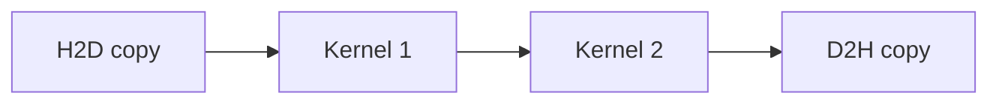

# 10. Kernel Launch와 CUDA Graph

[이전: 09. Stream](09-streams-events-and-asynchronous-copies.md) · [목차](README.md) · [다음: 11. 성능 분석](11-occupancy-roofline-and-profiling.md)

Kernel launch는 계산을 시작하는 host-device control 작업이다. CUDA Graph는 반복 dependency를 object로 구성해 재사용한다.

## Kernel launch를 “GPU 계산 시작 버튼”보다 작게 나누기

**GPU kernel**은 많은 GPU thread가 서로 다른 data index에 실행하는 장치 함수다. **Kernel launch**는 host CPU 프로그램이 어느 kernel을 어떤 실행 모양과 인자로 어느 stream에 넣을지 runtime에 요청하는 일이다. Launch 함수 반환은 GPU 계산 완료가 아니라 보통 enqueue가 받아들여졌다는 뜻이다.

Host의 framework 또는 C++ code는 CUDA runtime을 호출하고, runtime과 driver는 argument와 launch descriptor를 준비해 device command queue에 넣는다. GPU command processor와 hardware scheduler는 앞선 dependency가 충족되고 SM 자원이 생기면 thread block을 배치한다. 따라서 다음 상태를 구별한다.

```text
host가 launch 호출
→ runtime이 argument·configuration 검사
→ command enqueue
→ stream 앞 작업 대기
→ block이 SM에 배치
→ kernel 실행
→ device 완료
→ host가 event/synchronize로 완료 관찰
```

**Launch overhead**는 host와 software stack이 이 제출을 준비하는 시간이다. Kernel 안의 산술 시간과 다르다. 아주 짧은 kernel을 수천 번 제출하면 device 계산보다 control overhead가 큰 비율을 차지할 수 있다.

## Launch configuration의 실제 의미

CUDA식 launch는 보통 grid dimension, block dimension, dynamic shared-memory byte, stream을 가진다.

- **Thread**는 kernel 함수 한 실행 인스턴스다.
- **Block**은 shared memory와 block barrier를 공유하는 thread 집합이다.
- **Grid**는 한 launch가 만든 모든 block의 집합이다.
- **Dynamic shared memory**는 launch 시 block당 요청하는 shared byte다.
- **Stream**은 이 launch의 다른 GPU 작업과의 순서를 나타낸다.

1차원 원소 `N=1000`, block size 256이면 grid block 수는 `ceil(1000/256)=4`다. 총 1,024 thread가 생기고 마지막 24 thread는 `index>=N`이므로 load/store를 하지 않아야 한다.

```text
global index = blockIdx.x*blockDim.x + threadIdx.x
if index < N:
    output[index] = f(input[index])
```

Block size 0, 장치 limit보다 큰 block, 요청 가능한 범위를 넘는 dynamic shared byte는 configuration 오류다. Block size가 유효해도 register·shared 사용이 너무 크면 동시에 resident할 block 수가 줄거나 launch resource 오류가 날 수 있다.

### Argument는 값과 pointee 수명이 다르다

Scalar `N=1000` 같은 작은 argument는 launch 준비 과정에서 값이 복사될 수 있다. Pointer argument는 device buffer의 주소 값이다. 주소 숫자가 전달됐다고 그 buffer 내용까지 launch 때 snapshot되는 것은 아니다. Kernel이 실제 실행할 때 buffer가 살아 있고 producer write가 완료되어야 한다.

```text
allocate P
producer fills P
launch consumer(P)
free P immediately    # 위험: consumer가 아직 읽기 전일 수 있음
```

Async launch completion event 뒤에 free하거나 stream-ordered allocator의 dependency를 사용한다. Stack에 둔 host-side argument storage와 device pointee의 수명도 구분한다. API가 launch parameter를 언제 복사하는지는 runtime 계약을 따른다.

## 1,000회 direct launch를 시간과 상태로 계산하기

교육 모형에서 매 iteration의 launch overhead가 5 µs, kernel device 시간이 2 µs이고 둘이 직렬로 합쳐진다고 가정한다.

```text
iteration 1회 = 5+2 = 7 µs
1,000회 = 7,000 µs = 7 ms
```

이것은 queueing과 overlap이 없는 단순 합이다. Host가 여러 launch를 먼저 enqueue하면 5 µs host 제출과 이전 2 µs device 실행이 일부 겹칠 수 있고, queue가 차거나 dependency가 있으면 다시 기다릴 수 있다. 숫자의 목적은 2 µs 계산에 5 µs control이 붙는 작은-kernel 영역을 드러내는 것이다.

Kernel fusion으로 1,000개 iteration을 하나의 큰 kernel에 무조건 넣을 수 있는 것도 아니다. Iteration 사이 host 결정이나 global dependency가 있으면 의미가 바뀐다. Graph replay는 kernel들을 하나로 합치지 않고 반복 dependency 제출 비용을 줄이는 다른 방법이다.

## CUDA Graph의 객체 네 종류

**CUDA Graph**는 copy, kernel, event 같은 operation을 **node(노드)**로, 반드시 먼저 끝나야 하는 관계를 **edge(간선)**로 표현한 host-side dependency object다. 방향을 따라 cycle이 없는 **DAG(Directed Acyclic Graph, 방향 비순환 그래프)**여야 실행 순서를 정할 수 있다.

1. **Graph definition**: node와 edge의 편집 가능한 설명.
2. **Graph executable**: definition을 **instantiate(인스턴스화)**하여 반복 launch할 수 있게 검증·준비한 객체.
3. **Graph launch instance**: executable을 stream에 enqueue한 한 번의 실행.
4. **Node parameter와 data buffer**: copy 주소, kernel 인자, 실제 input/output storage.

Definition을 파괴해도 executable이 독립적으로 사용할 수 있는지, executable이 module·function·buffer를 어떤 방식으로 참조하는지는 API 수명 계약을 따른다. Graph executable이 있다고 input data가 그 안에 복사되어 영구 보관되는 것은 아니다.

### Build→instantiate→launch→complete 전체 시간선

```text
t0 graph definition 생성
t1 H2D node C, kernel node K1, K2, D2H node R 추가
t2 edge C→K1→K2→R 추가
t3 instantiate: topology·parameter 지원 검증, executable Gexec 생성
t4 iteration 0 parameter를 buffer A로 설정
t5 graph launch 0 enqueue
t6 device가 C,K1,K2,R 실행
t7 done0 event complete, host가 output A 읽고 buffer A 재사용
t8 iteration 1 parameter를 buffer B로 갱신
t9 graph launch 1 enqueue
...
tN 마지막 완료 뒤 Gexec와 buffer 해제
```

Build와 instantiate는 host 준비 비용이다. Replay마다 Gexec를 enqueue하는 비용과 device node 실행 시간이 있다. 반복이 적으면 build 비용을 회수하지 못할 수 있다.

## Explicit construction과 stream capture

**Explicit construction**은 API로 node와 edge를 직접 추가한다. Dependency가 코드에 드러나고 parameter를 정밀하게 관리할 수 있지만 작성량이 많다.

**Stream capture**는 capture 구간에 stream들이 enqueue한 지원 operation을 관찰해 graph로 만든다.

```text
begin_capture(S0)
H2D(A,S0)
kernel1(S0)
record(E,S0)
wait(E,S1)
kernel2(S1)
D2H(B,S1)
end_capture -> graph
```

Capture는 host 프로그램의 모든 일을 기록하는 일반 debugger가 아니다. 파일 I/O, 임의의 host mutex, 동적 module load, 지원되지 않는 allocation/API는 graph node가 되지 않을 수 있다. Capture mode에 따라 다른 thread와 stream이 capture 대상과 상호작용하는 규칙도 다르다. Capture 전에 memory pool, module, library handle을 warm-up해야 할 수 있다.

Capture 중 숨은 default-stream dependency가 있으면 의도보다 넓은 edge가 생기거나 capture가 실패할 수 있다. 완성 graph의 node와 edge를 검사해 원래 pipeline을 표현하는지 확인한다.

## Edge 누락과 cycle을 상태로 증명하기

K1이 buffer X를 쓰고 K2가 X를 읽는다면 K1→K2 edge가 필요하다. Edge가 없으면 scheduler는 둘을 독립 node로 보고 다음 순서를 허용할 수 있다.

```text
초기 X=0
K2: Y=2*X -> Y=0
K1: X=7
```

원한 결과 Y=14가 아니다. Graph는 pointer alias와 kernel 내부 의미를 모두 분석해 edge를 자동 추론하는 compiler가 아니다.

반대로 A→B와 B→A를 모두 넣으면 cycle이다. A는 B 완료를 기다리고 B는 A 완료를 기다려 시작 node가 없다. Instantiate가 cycle을 거부해야 한다. “양쪽 순서를 모두 보장하면 더 안전하다”가 아니라 실행 불가능한 dependency다.

## Parameter update와 동시 launch

Graph topology가 같고 pointer나 scalar 일부만 달라지면 지원되는 update API로 executable 또는 node parameter를 바꿀 수 있다. 어떤 field와 topology 변경이 허용되는지는 runtime version을 확인한다. Update가 실패하면 기존 executable이 어떤 상태로 남는지도 반환값 계약을 따른다.

Iteration 0이 buffer A를 사용하는 동안 같은 executable의 parameter를 buffer B로 바꾸는 것이 안전한지는 API의 update와 concurrent launch 규칙에 달려 있다. 가장 단순한 안전 모형은 launch 0 완료 뒤 update하고 launch 1을 시작하는 것이다. Overlap이 필요하면 독립 executable이나 double-buffer parameter 구성을 사용하고 buffer별 completion event를 둔다.

```text
Gexec-A launch uses A → doneA
Gexec-B launch uses B → doneB
host reuses A only after doneA
```

Graph node parameter와 data buffer는 다르다. Parameter update가 pointer 숫자를 B로 바꿔도 이전 launch가 A를 참조하는 동안 A를 해제하면 안 된다.

## Fusion, Graph, persistent kernel의 경계

**Kernel fusion**은 여러 연산을 한 kernel 함수로 합친다. Launch 수와 intermediate global-memory traffic을 줄일 수 있지만 register pressure, code size, barrier와 재사용 경계가 커질 수 있다.

**Graph replay**는 여러 kernel과 copy를 별도 node로 유지하면서 반복 submission을 준비된 executable로 줄인다. Kernel 자체 memory access와 occupancy를 자동 개선하지 않는다.

**Persistent kernel**은 오래 살아 있는 kernel이 device queue에서 여러 work item을 꺼내 처리한다. Host launch 빈도를 줄일 수 있지만 GPU 자원을 장시간 점유하고 load balancing·종료·오류 처리를 직접 설계해야 한다.

**Dynamic parallelism**은 실행 중인 device kernel이 다른 kernel을 device-side에서 launch하는 기능이다. Host가 준비한 CUDA Graph와 launch 주체, overhead, 지원 조건이 다르다. 네 방법을 “launch를 줄인다” 한 문장으로 바꾸지 않고 control이 어디에 있고 data dependency가 어떻게 표현되는지 비교한다.




## 1. Launch configuration

Grid dimension, block dimension, dynamic shared byte, stream을 정한다. Argument pointer와 scalar 수명·값을 확인한다.

## 2. Launch overhead

Host가 runtime/driver를 통해 work를 enqueue하는 비용이다. Kernel 계산 2 µs인데 launch가 비슷한 크기면 작은 kernel 반복이 overhead-bound일 수 있다.

## 3. 1000회 반복 모형

Launch overhead 5 µs, kernel 2 µs면 1000회에 7 ms 단순 합이다. Kernel fusion이나 graph replay로 control overhead를 줄일 후보가 된다.

실제 시간은 queueing과 overlap 때문에 단순 합과 다를 수 있다.

## 4. Kernel fusion

두 elementwise kernel을 하나로 합치면 intermediate global traffic과 launch를 줄일 수 있다.

Register pressure, code complexity, 재사용 경계가 나빠질 수 있다.

## 5. CUDA Graph

Node와 dependency edge로 operation sequence를 표현한다. Instantiate 후 반복 launch할 수 있다.

## 6. Graph object 위치

Host가 graph를 만들고 executable graph를 instantiate한다. Device는 launch된 graph node 작업을 실행한다.

## 7. Capture

Stream에서 enqueue되는 작업을 capture해 graph로 만들 수 있다. Capture 중 지원되지 않는 API와 외부 dependency를 확인한다.

## 8. Explicit construction

Copy/kernel node와 dependency를 직접 추가할 수 있다. Pointer와 parameter를 node에 연결한다.

## 9. Parameter update

반복마다 input pointer·size가 달라지면 update 가능 범위를 확인한다. Graph topology 전체가 바뀌면 재생성 비용이 들 수 있다.

## 10. Graph 수명

Graph executable이 참조하는 kernel/module/parameter memory와 launch buffer 수명을 API 계약에 맞춘다.

Async graph launch completion 전에 data buffer를 해제하지 않는다.

## 10.1 반복 parameter 시간표

Executable graph가 copy→kernel→copy node를 가진다고 하자. Iteration 0이 buffer A, iteration 1이 buffer B를 사용한다.

| 단계 | Graph parameter | Device 상태 |
| ---: | --- | --- |
| 0 | A pointer 설정 | Idle |
| 1 | Graph launch 0 | A 사용 중 |
| 2 | B용 execution 준비 | Launch 0 진행 |
| 3 | Completion 0 | A 재사용 가능 |

진행 중 launch가 참조하는 parameter를 안전하지 않게 바꾸면 잘못된 pointer를 볼 수 있다. API가 허용하는 update 시점과 execution object 분리를 확인한다.

Invalid block dimension은 launch 시점, out-of-bounds는 비동기 실행 뒤 synchronization에서 드러날 수 있다. Launch API 성공만으로 node 실행 성공을 단정하지 않는다.

## 11. Dependency 누락

Kernel 2가 Kernel 1 output을 읽는데 edge가 없으면 동시에 실행되어 race가 날 수 있다.

Graph는 올바른 dependency를 자동 추론하는 일반 compiler가 아니다.

## 12. Cycle

Execution dependency graph는 cycle 없는 구조여야 한다. A가 B 뒤, B가 A 뒤면 시작할 수 없다.

## 13. Conditional node

지원되는 graph 조건 기능은 version/hardware 제약을 확인한다. 일반 host branch와 같다고 가정하지 않는다.

## 14. Dynamic parallelism과 비교

Device-side launch와 host CUDA Graph는 다른 기능이다. Launch 주체와 dependency object 위치가 다르다.

## 15. Persistent kernel과 비교

Persistent kernel은 오래 실행하며 queue를 소비할 수 있다. Graph replay는 여러 operation dependency를 반복 enqueue한다.

## Break-even을 식으로 계산하기

Graph build와 instantiate 비용을 `B`, direct 반복 비용을 `D`, graph replay 반복 비용을 `G`라 하자. Graph가 이득이 되는 최소 반복 수 `n`은 다음 부등식을 만족해야 한다.

```text
B+nG <= nD
n >= B/(D-G)
```

기존 문제처럼 B=2 ms=2,000 µs이고 반복당 절감 `D-G=10 µs`이면 `n>=200`이다. 정확히 200회에서는 비용이 같고 그보다 많아야 순이익이 생긴다. Build cache가 여러 요청에 재사용되는지, parameter update와 graph launch 비용이 G에 포함됐는지 적어야 한다.

다른 예로 direct control 5 µs, graph replay control 1 µs, build 2,000 µs라면 반복당 4 µs를 절감하므로 break-even은 500회다. Kernel device 시간 2 µs가 양쪽에 동일하면 차에서 상쇄되지만, graph 때문에 overlap이나 kernel 선택이 바뀌면 단순식이 성립하지 않는다.

## 오류를 네 단계에서 찾기

1. **Construction error**: 잘못된 node 인자나 API 사용.
2. **Instantiation error**: cycle, 지원하지 않는 topology·function·parameter.
3. **Launch error**: invalid stream, 실행 가능 resource/configuration 문제.
4. **Asynchronous execution error**: node kernel의 out-of-bounds, device fault 등.

Graph launch API 성공은 4단계 성공을 보장하지 않는다. Iteration ID와 executable ID, parameter pointer, launch stream, completion event를 함께 로그에 남긴다. 한 graph에 많은 node가 있으면 node별 marker나 최소 graph로 줄여 실패 지점을 찾는다.

## 동적 LLM serving과 CUDA Graph 연구 조건

LLM decode는 매 step kernel 모양이 비슷해 graph replay 후보지만 요청이 도착·종료하면서 batch와 KV cache 길이가 변한다. CUDA Graph는 고정된 topology와 준비된 memory address를 재사용할 때 유리하고, 동적 scheduler는 매번 work 크기가 바뀐다.

FlashInfer MLSys 2025 연구는 load-balanced scheduling metadata와 attention template를 사용해 동적 요청을 다루면서 CUDA Graph의 정적 실행 구성을 활용하는 방법을 제시했다. 이는 “CUDA Graph가 동적 shape를 자동 처리한다”는 뜻이 아니다. 일정한 launch 틀 안에서 runtime metadata가 실제 작업을 나타내도록 kernel을 설계한 것이다.

논문의 latency 개선은 사용한 GPU, 모델, request trace, 비교 backend와 software version 조건에서 읽는다. Graph replay가 attention 산술을 줄이는 것도 아니고, KV cache capacity나 network 병목을 해결하는 것도 아니다. 처음 JIT compile·graph build 비용, shape bucket 수, inactive slot의 낭비와 memory 예약을 함께 평가한다.


## 16. Error handling

Graph creation, instantiate, launch, async node execution 오류를 각각 확인한다.

## Direct launch와 graph replay를 공정하게 비교하기

먼저 같은 input과 같은 output 검증을 사용한다. Direct 경로와 graph 경로가 서로 다른 kernel algorithm이나 dtype을 선택하면 control overhead 비교가 아니다. 두 경로 모두 context 생성, module load, allocator와 library autotuning을 warm-up하고, cold-start는 별도 측정한다.

Host submission 시간과 device completion 시간을 분리한다. Host 시간은 iteration을 enqueue하는 CPU 비용을 보여 주고, device event는 node 실행 구간을 보여 준다. End-to-end 시간은 input 준비부터 마지막 결과 사용까지 잰다. 매 iteration device-wide synchronize를 넣으면 원래 queueing과 overlap이 사라질 수 있으므로 필요한 completion 경계에서만 기다린다.

```text
공통 조건:
  같은 GPU clock/power 상태와 다른 workload
  같은 M,N,K·dtype·pointer alignment
  같은 stream dependency와 buffer 수명
  같은 warm-up 횟수

보고:
  graph build 시간
  instantiate 시간
  parameter update 시간
  replay enqueue 시간
  device node 실행 시간
  end-to-end median·p95
  반복 수와 break-even
```

Median은 정렬한 측정의 가운데 값이고 p95는 약 95%가 그 이하인 지점이다. 평균 하나만 쓰면 드문 graph update나 OS scheduling 지연을 놓칠 수 있다. Graph가 p50은 줄여도 shape bucket miss 때문에 p95가 커질 수 있으므로 분포와 원인을 연결한다.

### 사용하지 말아야 할 결론

Graph replay가 빨라졌다고 kernel의 global-memory coalescing, bank conflict, arithmetic intensity가 개선된 것은 아니다. 반대로 graph 효과가 작다고 CUDA Graph 구현이 잘못됐다고 바로 결론 낼 수도 없다. Kernel이 수 millisecond로 길면 몇 microsecond control 절감 비율이 작을 수 있다. 성능 주장은 build를 포함한 첫 실행과 amortized steady state, 실행 횟수, hardware·software version을 함께 제시할 때만 재현 가능하다.


## 17. 측정

Direct launch 반복과 graph replay를 같은 kernel·input·warm-up 조건에서 비교한다. Graph build/instantiate 비용을 amortize할 반복 수를 기록한다.

## 18. 반례

한 번만 실행하는 큰 kernel은 graph build 비용이 이득을 넘을 수 있다.

Graph를 사용했다고 kernel memory access가 coalesced되거나 occupancy가 좋아지는 것은 아니다.

## 문제와 해설

**문제 1.** A output을 B가 읽는데 graph edge가 없으면?

**해설.** 순서 보장이 없어 race가 가능하다.

**문제 2.** Build 2 ms, replay 절감 10 µs이면 break-even 반복은?

**해설.** 단순 모형에서 200회다.

**문제 3.** Graph replay가 수치 정확성을 바꾸는가?

**해설.** 올바른 dependency와 같은 kernel이면 의미가 같아야 한다. 누락 edge나 parameter 오류는 별개다.

**문제 4.** `N=1000`, block size 256일 때 grid block 수, 생성 thread 수, boundary thread 수를 구하라.

**해설.** `ceil(1000/256)=4` block이다. 총 thread는 `4*256=1024`, 범위 밖 thread는 24개다. 모든 thread가 launch되지만 `index<N` 조건을 만족한 1,000개만 data를 읽고 써야 한다.

**문제 5.** Graph build가 2,000 µs, direct 반복이 7 µs, graph 반복이 3 µs라면 break-even은 몇 회인가?

**해설.** 반복당 절감은 4 µs다. `2000/4=500`이므로 500회에서 비용이 같고 501회부터 단순 모형의 순이익이다. Build를 이미 cache했다면 요청별 계산은 달라지고, update·동기화 비용이 반복 시간에 빠졌는지 확인한다.

**문제 6.** Graph node K1이 X를 7로 쓰고 K2가 `Y=2X`를 계산한다. Edge가 없을 때 결과와 수정 방법을 설명하라.

**해설.** K2가 먼저 실행되면 초기 X=0을 읽어 Y=0, K1 뒤면 Y=14가 가능하다. K1→K2 edge를 추가한다. 양방향 edge를 넣으면 cycle이 되어 실행할 수 없다. Pointer가 같다는 사실만으로 graph가 producer-consumer 의미를 자동 추론한다고 가정하지 않는다.


## 공식 자료

- [CUDA Graphs](https://docs.nvidia.com/cuda/cuda-programming-guide/04-special-topics/cuda-graphs.html)
- [CUDA Runtime Graph API](https://docs.nvidia.com/cuda/cuda-runtime-api/group__CUDART__GRAPH.html)
- [FlashInfer, MLSys 2025](https://proceedings.mlsys.org/paper_files/paper/2025/hash/dbf02b21d77409a2db30e56866a8ab3a-Abstract-Conference.html)
