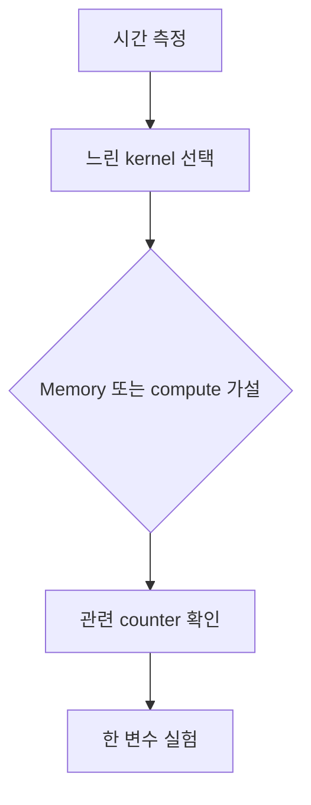

# 11. Occupancy·Roofline·Profiling

## 용어를 위치와 실행 주체로 구분하기

**점유율(occupancy)**은 한 SM에 실제로 상주하는 워프 수를 그 SM이 허용하는 최대 워프 수로 나눈 비율이다. GPU 전체 사용률이나 계산기가 바쁜 시간의 비율과는 다르다. GPU 하드웨어 스케줄러가 블록의 스레드 수·레지스터 수·공유 메모리 크기를 보고 동시에 몇 블록을 SM에 둘지 정한 결과다. 대기 워프가 많으면 메모리를 기다릴 때 다른 워프를 실행할 여지가 생기지만, 이미 계산이 충분하면 점유율을 더 높여도 빨라지지 않는다.

**루프라인(roofline)**은 연산량과 메모리 이동량 중 어느 쪽이 속도의 상한을 정하는지 보는 모형이다. **프로파일러(profiler)**는 실행 중 하드웨어 카운터를 읽어 관측값을 만드는 계측 도구이며, 개발자가 값을 해석한다. 산술 집약도는 `연산 횟수 / 이동 바이트`이고 단위는 `연산/바이트`다. 메모리 대역폭 `바이트/초`를 곱하면 `연산/초`가 되어 계산 성능 상한과 비교할 수 있다.

## 여러 자원 제한을 한 번에 계산하기

설명용 SM이 최대 2,048스레드, 64워프, 65,536개 32비트 레지스터, 64 KiB 공유 메모리, 16블록을 허용한다고 하자. 블록은 256스레드, 스레드당 40레지스터, 블록당 공유 메모리 20 KiB를 쓴다.

| 제한 자원 | 한 블록의 소비 | 이 자원만 본 상주 블록 수 |
|---|---:|---:|
| 스레드 | 256 | `2048 / 256 = 8` |
| 워프 | 8 | `64 / 8 = 8` |
| 레지스터 | `256 × 40 = 10,240` | `65536 / 10240 = 6` |
| 공유 메모리 | 20 KiB | `64 / 20 = 3` |
| 블록 슬롯 | 1 | 16 |

가장 작은 값 3이 실제 상주 블록 수다. 상주 워프는 `3 × 8 = 24`, 점유율은 `24 / 64 = 37.5%`다. 레지스터만 보고 6블록이라고 결론 내리면 공유 메모리 제한을 놓친다. 실제 한도는 GPU 세대별 사양으로 확인한다.

메모리 대역폭 상한이 800 GB/s이고 산술 집약도가 2 FLOP/B라면 메모리 쪽 상한은 `800 × 2 = 1,600 GFLOP/s`다. 장치 계산 상한 10,000 GFLOP/s보다 작으므로 이 모형의 지붕은 1,600 GFLOP/s다. 측정값 800 GFLOP/s는 지붕의 50%다. 이 수치만으로 원인을 확정하지 말고 주소 섹터, 분기, 실행 준비 비용을 함께 본다.

### 실패 조건

- 점유율 100%를 위해 레지스터를 줄이면 값이 느린 로컬 메모리로 밀려 오히려 느려질 수 있다.
- 캐시가 줄인 실제 이동량과 알고리즘의 논리적 이동량을 섞으면 산술 집약도가 달라진다.
- 짧은 한 번의 측정은 초기화·주파수 변화·비동기 실행의 영향을 크게 받는다.

[이전: 10. CUDA Graph](10-kernel-launches-and-cuda-graphs.md) · [목차](README.md) · [다음: 12. Multi-GPU](12-multi-gpu-and-collectives.md)

성능 분석은 counter 이름을 나열하는 일이 아니라 병목 가설을 구분하는 과정이다.

## 1. SM

Streaming Multiprocessor는 warp scheduling, execution unit, register, shared memory 자원을 포함하는 GPU 실행 단위다.

Block은 한 SM에 resident하며 완료 전 다른 SM으로 나뉘지 않는 실행 모델로 이해한다.

## 2. Occupancy

SM이 지원하는 최대 active warp 대비 실제 resident active warp 비율이다.

Maximum 64 warp, resident 32면 occupancy 50%다.

## 3. 무엇이 제한하는가

Thread/block limit, register, shared memory, architecture block limit 중 최소가 residency를 정한다.

## 4. Register 계산

SM register 65536, thread당 64, block 256이면 block당 16384, register만 보면 4 block이다.

하지만 SM max block이 3이면 실제는 3 이하, shared가 크면 더 줄 수 있다.

## 5. Shared 계산

SM shared 96 KiB, block당 40 KiB면 floor(96/40)=2 block이다. 남은 16 KiB로 세 번째를 넣지 못한다.

## 6. Occupancy가 필요한 이유

한 warp가 memory를 기다릴 때 다른 ready warp를 실행해 latency를 숨길 수 있다.

## 7. Occupancy≠속도

100% occupancy라도 uncoalesced memory나 atomic contention으로 느릴 수 있다. 50%라도 compute unit을 충분히 쓰고 locality가 좋으면 빠를 수 있다.

Occupancy를 목표가 아니라 제약과 단서로 본다.

## 8. Roofline

Arithmetic intensity를 x축, achieved performance를 y축으로 보고 memory bandwidth roof와 compute roof 중 가능한 상한을 생각한다.

## 9. 숫자 모형

Peak compute 10 TFLOP/s, bandwidth 1 TB/s, intensity 2 FLOP/byte면 bandwidth roof는 2 TFLOP/s다.

가능 상한은 min(10,2)=2 TFLOP/s다.

Intensity 20이면 bandwidth roof 20이므로 compute roof 10이 제한한다.

## 10. FLOP 계산 주의

FMA를 2 FLOP으로 세는 관례 등 측정 정의를 명시한다. Byte도 cache level과 read/write 포함 범위를 적는다.

## 11. Profiler

Timeline profiler는 CPU API, copy, kernel 순서를 본다. Kernel profiler는 instruction, memory, occupancy counter를 본다.

도구와 counter 이름은 version별로 달라질 수 있다.

## 12. 먼저 시간

전체 application에서 어느 구간이 지배하는지 찾기 전에 모든 kernel을 micro-optimize하지 않는다.

End-to-end와 kernel-only 시간을 함께 기록한다.

## 13. Memory-bound 증거

높은 memory throughput, 낮은 arithmetic intensity, load stall, 낮은 cache hit 등이 함께 가설을 지지할 수 있다.

한 counter가 peak의 몇 %라는 사실만으로 원인을 확정하지 않는다.

## 14. Compute-bound 증거

Execution pipe 활용, instruction mix, dependency stall을 본다. Tensor Core eligible shape인지 확인한다.

## 15. Latency-bound

Parallelism이 작아 bandwidth와 compute가 모두 낮을 수 있다. 더 많은 work, batch, independent warp를 검토한다.

## 16. Tail effect

마지막 wave에 block 수가 SM 수보다 적으면 일부 SM이 idle이다. Kernel 평균 occupancy와 시간 끝부분을 구분한다.

## 17. Baseline

결과 정확성, input, clock/power 상태, toolkit, driver, GPU model을 고정한다.

## 18. 한 변수 실험

Block 크기와 tile 크기와 dtype을 동시에 바꾸면 원인을 알기 어렵다. 하나씩 바꾸고 결과·counter를 기록한다.

## 19. 반례

Block 크기를 occupancy calculator 최댓값으로 바꿨는데 register spill이 늘어 느려질 수 있다.

Roofline 상한에 못 미친다는 사실만으로 compiler 문제라고 결론 내리지 않는다.

## 문제와 해설

**문제 1.** Max 64 warp 중 48 resident면 occupancy는?

**해설.** 75%다.

**문제 2.** Intensity 4, bandwidth 0.5 TB/s면 bandwidth roof는?

**해설.** 2 TFLOP/s다.

**문제 3.** Occupancy 100%가 목표인가?

**해설.** 필수 목표가 아니다. 실제 throughput과 병목을 함께 본다.

## 공식 자료

- [CUDA performance guidelines](https://docs.nvidia.com/cuda/cuda-c-best-practices-guide/)
- [Nsight Compute](https://docs.nvidia.com/nsight-compute/)
