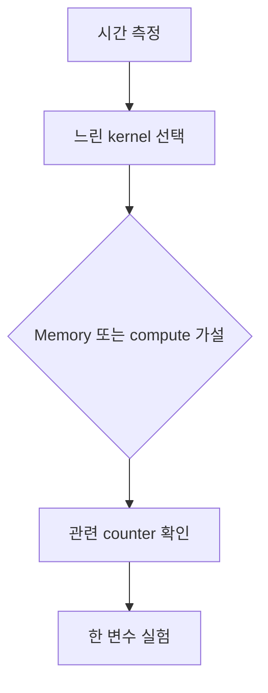

# 11. Occupancy·Roofline·Profiling

## 용어를 위치와 실행 주체로 구분하기

## SM에 block이 올라가고 끝날 때까지

**SM(Streaming Multiprocessor)**은 GPU 안에서 warp 명령을 스케줄하고 실행하는 단위다. SM에는 warp scheduler, 산술 실행 장치, register file, shared memory 등이 있다. Kernel의 **block**은 한 SM에 배치되고, 그 block의 thread들은 같은 shared memory를 사용한다. 한 block을 여러 SM에 반씩 나눠 동시에 실행하는 모형이 아니다.

Block이 SM 자원을 할당받아 실행 대기 또는 실행 가능한 상태로 머무는 것을 **resident(상주)**라고 한다. Block 안의 32-thread 묶음인 **warp**도 resident가 된다. Warp가 global-memory 응답을 기다리면 scheduler는 operand가 준비된 다른 resident warp를 고를 수 있다. 이 교체는 CPU process context switch처럼 메모리 전체를 저장하는 것이 아니라 이미 SM에 놓인 warp 실행 상태 가운데 ready한 것을 선택하는 방식이다.

Block은 모든 thread가 끝나고 필요한 memory write를 마치면 SM 자원을 반납한다. 그제야 대기 중인 다음 block이 register와 shared memory를 할당받아 들어올 수 있다. Grid에 block이 많아도 SM당 resident 수는 thread, warp, register, shared-memory, block-slot 제한 중 가장 작은 값으로 정해진다.

### Occupancy의 분자와 분모

**Occupancy(점유율)**는 `resident active warp / architecture가 허용하는 최대 active warp`다. `active`는 resident라서 스케줄 대상이 될 수 있다는 뜻이지 매 cycle instruction을 실행한다는 뜻은 아니다. 최대 64 warp인 SM에 24 warp가 resident면 `24/64=37.5%`다.

GPU utilization은 일정 시간 device가 busy였는지를 나타내는 다른 metric일 수 있고, execution-pipe utilization은 특정 계산 장치가 바빴는지를 본다. Occupancy 100%, GPU utilization 100%, peak FLOP 달성은 서로 동의어가 아니다.

## Register pressure와 spill의 실제 경로

**Register pressure**는 thread가 동시에 유지하려는 값이 많아 register 수요가 커진 상태다. Compiler는 변수의 live range, loop unrolling, inlining과 accumulator 수를 보고 thread당 register를 배정한다. Thread당 register가 늘면 한 block의 register 소비가 늘어 SM에 상주할 block 수가 줄 수 있다.

Register 제한을 강제로 낮추면 compiler가 일부 값을 **spill**할 수 있다. Spill은 값을 thread의 논리적 **local memory**로 내보냈다가 다시 읽는 것이다. 이름이 local이라 thread 전용 주소 공간이라는 뜻은 맞지만 물리적으로 항상 SM 안의 빠른 memory라는 뜻은 아니다. Local-memory traffic은 cache를 거쳐 device memory 경로를 사용할 수 있어 load/store와 latency가 늘어난다.

예를 들어 block 256 thread가 thread당 40 register면 block당 `256*40=10,240` register다. 65,536-register SM에서 register만 보면 floor가 6 block이다. Thread당 64면 block당 16,384이고 4 block이다. Occupancy를 높이려고 40에서 32로 줄였는데 spill load가 늘면 전체 시간은 오히려 길 수 있다. Compiler resource report와 profiler local load/store counter를 함께 본다.

### 두 configuration 비교

같은 교육용 SM 한도 2,048 thread, 64 warp, register 65,536, shared 64 KiB, block slot 16을 쓴다.

| 항목 | Config A | Config B |
|---|---:|---:|
| thread/block | 256 | 128 |
| warp/block | 8 | 4 |
| register/thread | 40 | 64 |
| shared/block | 20 KiB | 8 KiB |

Config A는 기존 계산처럼 thread 8, warp 8, register 6, shared 3, slot 16 중 최소 3 block이다. Resident warp 24, occupancy 37.5%다.

Config B는 thread 16, warp 16, register `floor(65536/(128*64))=8`, shared `floor(64/8)=8`, slot 16 중 최소 8 block이다. Resident warp는 `8*4=32`, occupancy 50%다. B가 더 높은 occupancy지만 thread당 register가 많고 block 모양도 달라 실제 instruction 수, memory access와 tail을 측정해야 어느 쪽이 빠른지 알 수 있다.

## Latency hiding이 끝나는 조건

Resident warp가 많으면 한 warp가 memory를 기다릴 때 다른 warp를 실행할 후보가 늘어난다. 그러나 모든 warp가 같은 long-latency dependency를 기다리거나 memory bandwidth가 이미 포화되면 후보를 더 늘려도 처리량이 오르지 않는다. Instruction-level parallelism이 충분한 compute kernel은 낮은 occupancy에서도 pipeline을 채울 수 있다.

반대로 grid block 수가 SM 수보다 적으면 occupancy calculator가 높은 수치를 예측해도 일부 SM에는 block이 전혀 없다. 마지막 wave에 block 5개만 남고 SM이 8개면 세 SM이 idle인 **tail effect**가 생긴다. 평균 occupancy와 시간축 끝부분의 device 활용을 함께 본다.

**점유율(occupancy)**은 한 SM에 실제로 상주하는 워프 수를 그 SM이 허용하는 최대 워프 수로 나눈 비율이다. GPU 전체 사용률이나 계산기가 바쁜 시간의 비율과는 다르다. GPU 하드웨어 스케줄러가 블록의 스레드 수·레지스터 수·공유 메모리 크기를 보고 동시에 몇 블록을 SM에 둘지 정한 결과다. 대기 워프가 많으면 메모리를 기다릴 때 다른 워프를 실행할 여지가 생기지만, 이미 계산이 충분하면 점유율을 더 높여도 빨라지지 않는다.

**루프라인(roofline)**은 연산량과 메모리 이동량 중 어느 쪽이 속도의 상한을 정하는지 보는 모형이다. **프로파일러(profiler)**는 실행 중 하드웨어 카운터를 읽어 관측값을 만드는 계측 도구이며, 개발자가 값을 해석한다. 산술 집약도는 `연산 횟수 / 이동 바이트`이고 단위는 `연산/바이트`다. 메모리 대역폭 `바이트/초`를 곱하면 `연산/초`가 되어 계산 성능 상한과 비교할 수 있다.

## 여러 자원 제한을 한 번에 계산하기

설명용 SM이 최대 2,048스레드, 64워프, 65,536개 32비트 레지스터, 64 KiB 공유 메모리, 16블록을 허용한다고 하자. 블록은 256스레드, 스레드당 40레지스터, 블록당 공유 메모리 20 KiB를 쓴다.

| 제한 자원 | 한 블록의 소비 | 이 자원만 본 상주 블록 수 |
|---|---:|---:|
| 스레드 | 256 | `2048 / 256 = 8` |
| 워프 | 8 | `64 / 8 = 8` |
| 레지스터 | `256 × 40 = 10,240` | `65536 / 10240 = 6` |
| 공유 메모리 | 20 KiB | `64 / 20 = 3` |
| 블록 슬롯 | 1 | 16 |

가장 작은 값 3이 실제 상주 블록 수다. 상주 워프는 `3 × 8 = 24`, 점유율은 `24 / 64 = 37.5%`다. 레지스터만 보고 6블록이라고 결론 내리면 공유 메모리 제한을 놓친다. 실제 한도는 GPU 세대별 사양으로 확인한다.

메모리 대역폭 상한이 800 GB/s이고 산술 집약도가 2 FLOP/B라면 메모리 쪽 상한은 `800 × 2 = 1,600 GFLOP/s`다. 장치 계산 상한 10,000 GFLOP/s보다 작으므로 이 모형의 지붕은 1,600 GFLOP/s다. 측정값 800 GFLOP/s는 지붕의 50%다. 이 수치만으로 원인을 확정하지 말고 주소 섹터, 분기, 실행 준비 비용을 함께 본다.

### 실패 조건

- 점유율 100%를 위해 레지스터를 줄이면 값이 느린 로컬 메모리로 밀려 오히려 느려질 수 있다.
- 캐시가 줄인 실제 이동량과 알고리즘의 논리적 이동량을 섞으면 산술 집약도가 달라진다.
- 짧은 한 번의 측정은 초기화·주파수 변화·비동기 실행의 영향을 크게 받는다.

[이전: 10. CUDA Graph](10-kernel-launches-and-cuda-graphs.md) · [목차](README.md) · [다음: 12. Multi-GPU](12-multi-gpu-and-collectives.md)

성능 분석은 counter 이름을 나열하는 일이 아니라 병목 가설을 구분하는 과정이다.

## 1. SM

Streaming Multiprocessor는 warp scheduling, execution unit, register, shared memory 자원을 포함하는 GPU 실행 단위다.

Block은 한 SM에 resident하며 완료 전 다른 SM으로 나뉘지 않는 실행 모델로 이해한다.

## 2. Occupancy

SM이 지원하는 최대 active warp 대비 실제 resident active warp 비율이다.

Maximum 64 warp, resident 32면 occupancy 50%다.

## 3. 무엇이 제한하는가

Thread/block limit, register, shared memory, architecture block limit 중 최소가 residency를 정한다.

## 4. Register 계산

SM register 65536, thread당 64, block 256이면 block당 16384, register만 보면 4 block이다.

하지만 SM max block이 3이면 실제는 3 이하, shared가 크면 더 줄 수 있다.

## 5. Shared 계산

SM shared 96 KiB, block당 40 KiB면 floor(96/40)=2 block이다. 남은 16 KiB로 세 번째를 넣지 못한다.

## 6. Occupancy가 필요한 이유

한 warp가 memory를 기다릴 때 다른 ready warp를 실행해 latency를 숨길 수 있다.

## 7. Occupancy≠속도

100% occupancy라도 uncoalesced memory나 atomic contention으로 느릴 수 있다. 50%라도 compute unit을 충분히 쓰고 locality가 좋으면 빠를 수 있다.

Occupancy를 목표가 아니라 제약과 단서로 본다.

## Roofline을 세 점으로 계산하기

**Roofline**은 kernel의 **arithmetic intensity(산술 집약도)** `FLOP / 이동 byte`를 x축에 두고, 가능한 성능 상한을 `min(peak compute, bandwidth*intensity)`로 보는 모형이다. FMA를 2 FLOP으로 셀지, byte를 HBM traffic으로 셀지 L2 traffic으로 셀지 먼저 정한다.

Peak compute 10 TFLOP/s, memory bandwidth 1 TB/s라고 하자.

| intensity | bandwidth roof | 최종 roof | 해석 |
|---:|---:|---:|---|
| 0.5 FLOP/B | 0.5 TFLOP/s | 0.5 | memory 쪽 상한 |
| 2 FLOP/B | 2 TFLOP/s | 2 | memory 쪽 상한 |
| 20 FLOP/B | 20 TFLOP/s | 10 | compute 쪽 상한 |

두 roof가 만나는 **ridge point**는 `10 TFLOP/s / 1 TB/s = 10 FLOP/B`다. Intensity가 10보다 낮으면 이 단순 모형에서 bandwidth roof가 낮고, 높으면 compute roof가 낮다.

Intensity 2인 kernel이 실제 1 TFLOP/s를 냈다면 2 TFLOP/s roof의 50%다. 이것만으로 “memory bandwidth가 절반만 사용됐다”고 단정하지 않는다. Uncoalesced request, latency 부족, 작은 grid, instruction overhead, cache level byte 정의가 원인일 수 있다.

### Logical byte와 measured byte

Vector addition `C=A+B`가 FP32 원소 N개를 처리하면 논리적으로 A 4B read, B 4B read, C 4B write라 원소당 12B로 셀 수 있다. 연산은 덧셈 1 FLOP이므로 logical intensity는 `1/12≈0.083 FLOP/B`다. Write allocate, cache hit, 재사용, sector 낭비에 따라 HBM counter가 본 실제 byte는 달라질 수 있다.

Roofline 보고서에는 FLOP 산식, read/write 포함 범위, cache level, problem size를 적는다. 서로 다른 byte 정의로 만든 점을 같은 roof에 놓으면 병목 해석이 틀어진다.

## Profiler는 원인 판결기가 아니라 측정기다

**Profiler**는 CPU API, GPU kernel, copy의 시간선과 hardware **counter(계수기)**를 수집하는 도구다. Counter는 cycle 동안 발생한 event 수나 비율을 hardware가 세어 노출한 값이다. 이름과 계산식은 GPU와 tool version에 따라 바뀔 수 있다.

분석 순서는 다음과 같다.

1. 정확한 output과 재현 가능한 baseline을 만든다.
2. End-to-end timeline에서 시간이 큰 요청·copy·kernel을 찾는다.
3. Kernel의 shape, launch, duration, resource 사용을 기록한다.
4. Memory-bound, compute-bound, latency-bound 중 구분 가능한 가설을 쓴다.
5. 그 가설을 반증할 counter 몇 개만 수집한다.
6. Code에서 한 변수를 바꾸고 정확성·시간·counter를 다시 측정한다.

Counter를 많이 수집하면 replay가 여러 번 필요하거나 실행 조건을 교란할 수 있다. 한 번에 모든 metric을 켜고 그중 눈에 띄는 숫자만 고르지 않는다.

### Counter를 연결해서 읽는 예

Kernel 시간이 2.0 ms, occupancy 37.5%, HBM throughput이 측정 peak의 20%, compute pipe도 15%라고 하자. 두 utilization이 낮으므로 바로 memory-bound나 compute-bound라고 말하기 어렵다. Grid가 block 6개뿐이고 SM이 80개라면 parallelism 부족이 강한 가설이다.

다른 kernel이 intensity 0.2 FLOP/B, HBM throughput 85%, load sector utilization이 낮고 compute pipe 10%라면 memory traffic·주소 낭비 가설이 강해진다. Coalescing을 개선해 HBM byte와 시간이 함께 줄었는지 한 변수 실험으로 확인한다.

반대로 Tensor Core pipe가 높고 intensity가 ridge point보다 높으며 memory throughput이 낮다면 compute roof 가까이 있을 수 있다. Dependency stall과 eligible warp가 낮으면 instruction scheduling이나 register dependency도 살핀다.

## 측정 전체 조건

Warm-up은 context, module, JIT, allocator와 clock 상태의 첫 비용을 분리한다. Kernel은 비동기 launch일 수 있으므로 event 또는 명시적 completion 경계로 시간을 잰다. 동일 input, output 검증, GPU clock/power 정책, 다른 workload, driver/toolkit, profiler version을 기록한다.

Median과 p95를 함께 보고, profiler를 붙이지 않은 시간도 보존한다. Profiler overhead가 짧은 kernel에 크게 보일 수 있다. 변경 전후는 같은 조건에서 여러 번 측정하고 차이가 run-to-run noise보다 큰지 본다.

## 8. Roofline

Arithmetic intensity를 x축, achieved performance를 y축으로 보고 memory bandwidth roof와 compute roof 중 가능한 상한을 생각한다.

## 9. 숫자 모형

Peak compute 10 TFLOP/s, bandwidth 1 TB/s, intensity 2 FLOP/byte면 bandwidth roof는 2 TFLOP/s다.

가능 상한은 min(10,2)=2 TFLOP/s다.

Intensity 20이면 bandwidth roof 20이므로 compute roof 10이 제한한다.

## 10. FLOP 계산 주의

FMA를 2 FLOP으로 세는 관례 등 측정 정의를 명시한다. Byte도 cache level과 read/write 포함 범위를 적는다.

## 11. Profiler

Timeline profiler는 CPU API, copy, kernel 순서를 본다. Kernel profiler는 instruction, memory, occupancy counter를 본다.

도구와 counter 이름은 version별로 달라질 수 있다.

## 12. 먼저 시간

전체 application에서 어느 구간이 지배하는지 찾기 전에 모든 kernel을 micro-optimize하지 않는다.

End-to-end와 kernel-only 시간을 함께 기록한다.

## 13. Memory-bound 증거

높은 memory throughput, 낮은 arithmetic intensity, load stall, 낮은 cache hit 등이 함께 가설을 지지할 수 있다.

한 counter가 peak의 몇 %라는 사실만으로 원인을 확정하지 않는다.

## 14. Compute-bound 증거

Execution pipe 활용, instruction mix, dependency stall을 본다. Tensor Core eligible shape인지 확인한다.

## 15. Latency-bound

Parallelism이 작아 bandwidth와 compute가 모두 낮을 수 있다. 더 많은 work, batch, independent warp를 검토한다.

## 16. Tail effect

마지막 wave에 block 수가 SM 수보다 적으면 일부 SM이 idle이다. Kernel 평균 occupancy와 시간 끝부분을 구분한다.

## 17. Baseline

결과 정확성, input, clock/power 상태, toolkit, driver, GPU model을 고정한다.

## 18. 한 변수 실험

Block 크기와 tile 크기와 dtype을 동시에 바꾸면 원인을 알기 어렵다. 하나씩 바꾸고 결과·counter를 기록한다.

## 19. 반례

Block 크기를 occupancy calculator 최댓값으로 바꿨는데 register spill이 늘어 느려질 수 있다.

Roofline 상한에 못 미친다는 사실만으로 compiler 문제라고 결론 내리지 않는다.

## 문제와 해설

**문제 1.** Max 64 warp 중 48 resident면 occupancy는?

**해설.** 75%다.

**문제 2.** Intensity 4, bandwidth 0.5 TB/s면 bandwidth roof는?

**해설.** 2 TFLOP/s다.

**문제 3.** Occupancy 100%가 목표인가?

**해설.** 필수 목표가 아니다. 실제 throughput과 병목을 함께 본다.

**문제 4.** 최대 2,048 thread, 64 warp, register 65,536, shared 64 KiB인 SM에서 block 128 thread, 64 register/thread, 8 KiB shared를 쓴다. 다른 block limit이 16이면 occupancy는?

**해설.** Thread 제한 16 block, warp는 block당 4라서 16 block, register는 `65536/(128*64)=8`, shared는 `64/8=8`, slot 16이다. 최소 8 block, resident warp `8*4=32`, occupancy `32/64=50%`다.

**문제 5.** Peak 12 TFLOP/s, bandwidth 600 GB/s인 장치의 ridge point와 intensity 5인 kernel roof를 구하라.

**해설.** Ridge는 `12,000 GFLOP/s / 600 GB/s = 20 FLOP/B`다. Intensity 5의 bandwidth roof는 `600*5=3,000 GFLOP/s=3 TFLOP/s`, compute roof 12보다 낮으므로 최종 roof는 3 TFLOP/s다.

**문제 6.** Occupancy가 37.5%에서 50%로 올랐지만 kernel 시간이 1.0 ms에서 1.2 ms가 됐다. 가능한 원인과 다음 측정은?

**해설.** Register 제한 때문에 spill이 늘었거나 block·tile 변경으로 memory traffic과 instruction 수가 늘 수 있다. Compiler register/spill report, local-memory load/store, HBM byte, instruction 수를 같은 input에서 비교한다. Occupancy 상승만으로 최적화 성공을 판정하지 않는다.

## 공식 자료

- [CUDA performance guidelines](https://docs.nvidia.com/cuda/cuda-c-best-practices-guide/)
- [Nsight Compute](https://docs.nvidia.com/nsight-compute/)
