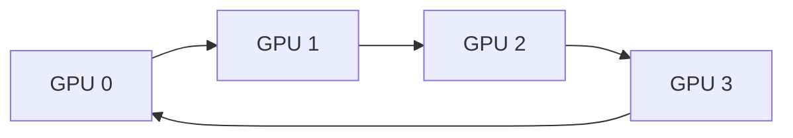

# 12. Multi-GPU와 Collective

## 객체와 실행 주체부터 찾기

**순위(rank)**는 여러 GPU가 한 통신 그룹에 참여할 때 각 참여자를 구별하는 `0, 1, 2, ...` 번호다. 성능 등급이 아니다. 각 프로세스나 런타임 스레드는 자기 GPU의 입력·출력 버퍼를 준비하고, 집합 통신 라이브러리는 링크 경로와 전송 순서를 정한다. **집합 통신(collective)**은 모든 참여자가 같은 종류의 연산에 들어오는 통신이다. 합계를 모두에게 돌려주는 all-reduce와 조각을 모으는 all-gather가 예다.

버퍼는 각 GPU의 장치 메모리에 있고 통신 명령은 스트림 작업 큐에 놓인다. CPU 호출이 반환되었다고 버퍼를 바로 다시 쓰면 안 된다. 완료 이벤트 전까지 통신 엔진이나 GPU가 버퍼를 읽거나 쓸 수 있기 때문이다.

## 네 순위 링 all-reduce 손 추적

입력을 네 조각 `A, B, C, D`로 나누고 순위를 `0~3`이라 하자. 각 순위는 오른쪽 이웃에게 한 조각을 보내고 왼쪽 이웃에게서 한 조각을 받는다.

| 단계 | rank 0이 받음 | rank 1 | rank 2 | rank 3 | 받은 뒤 상태 |
|---:|---|---|---|---|---|
| 0 | D | A | B | C | 자기 값과 합산 |
| 1 | C | D | A | B | 부분합을 다음 이웃으로 전달 |
| 2 | B | C | D | A | 각 순위가 한 조각의 전체 합 소유 |

뒤이은 all-gather 세 단계가 합쳐진 조각을 다시 돌린다. 마지막에는 모든 순위가 네 조각의 전체 합을 갖는다. GPU 수 `P=4`, 전체 데이터 `N=400 MiB`이면 순위당 단순 전송량은 `2(P-1)N/P = 600 MiB`다.

`T = α × 단계 수 + β × 전송 바이트`에서 α는 한 단계를 시작하는 지연 시간(초/단계), β는 바이트 하나를 옮기는 시간(초/바이트)이다. α가 5 μs, 유효 대역폭이 100 GB/s이고 한 구간에서 40 MB를 옮긴다면 세 단계 지연 `15 μs`와 데이터 시간 `400 μs`를 합쳐 약 `415 μs`다. 모든 링크가 같고 계산과 통신이 겹치지 않는다는 가정을 결과와 함께 적는다.

### 실패 조건

- 한 순위가 호출에 들어오지 않으면 다른 순위가 기다린다.
- 순위별 원소 개수나 자료형이 다르면 메시지 경계의 뜻이 맞지 않는다.
- 느린 링크 하나가 전체 단계를 제한하므로 GPU 수만 늘린다고 항상 빨라지지 않는다.

[이전: 11. 성능 분석](11-occupancy-roofline-and-profiling.md) · [목차](README.md) · [다음: 13. 로컬 모형](13-local-models.md)

여러 GPU에서는 계산 분할뿐 아니라 통신량, topology, synchronization, failure 범위를 설계한다.

## 1. Device 선택

각 host thread/process가 어느 GPU context를 사용하는지 정한다. Pointer가 속한 device와 current device를 맞춘다.

## 2. Peer access

GPU 사이 direct access 가능성은 topology와 peer capability에 달렸다. 가능해도 bandwidth·route가 동일하지 않다.

## 3. Collective

여러 participant가 함께 수행하는 통신 operation이다. Broadcast, reduce, all-reduce, all-gather, reduce-scatter 등이 있다.

## 4. Broadcast

Root GPU의 N-byte buffer를 모든 GPU가 받는다. Root와 participant 순서·count·dtype가 일치해야 한다.

## 5. Reduce

각 GPU 값을 sum/max 같은 operation으로 root에 결합한다.

GPU 4개의 scalar `[1,2,3,4]` sum reduce 결과는 root의 10이다.

## 6. All-reduce

Reduce 결과를 모든 participant가 받는다. Data-parallel training의 gradient 합/평균에 쓰일 수 있다.

Sum 후 world size 4로 나누는 average 단계가 별도일 수 있다.

## 7. Ring 모형

P GPU가 chunk를 돌려 reduce-scatter 후 all-gather한다. 각 GPU가 보내는 data volume은 대략 `2*(P-1)/P*N`인 단순 ring 모형을 쓸 수 있다.

P=4, N=400 MiB면 GPU당 `2*3/4*400=600 MiB`다.

## 8. α·β 모형

α는 message/startup latency, β는 byte당 전송 시간이라는 가정이다.

`T≈steps*α+bytes*β`로 쓴다. 실제 overlap, topology, protocol은 생략한 모형이다.

## 9. 숫자 계산

6 step, α=5 µs, β=1 ns/byte, bytes=1,000,000이면 `30 µs+1000 µs=1030 µs`다.

단위 변환을 맞춘다.

## 10. Tree collective

Tree는 step 수를 log P 수준으로 줄일 수 있지만 link 사용과 큰 message bandwidth 특성이 ring과 다르다.

Library가 message size와 topology에 따라 algorithm/protocol을 고를 수 있다.

## 11. Topology

PCIe switch, NVLink/NVSwitch, NUMA CPU, network adapter 위치가 route를 바꾼다.

GPU 번호가 물리적으로 adjacent라는 보장은 없다.

## 12. Stream ordering

Collective도 stream에 enqueue될 수 있다. 앞 kernel이 buffer를 만들고 collective가 읽는 순서를 같은 stream 또는 event로 연결한다.

## 13. Buffer 수명

Collective completion 전 send/recv buffer를 해제·재사용하지 않는다. Async error와 communicator 상태를 확인한다.

## 14. 모든 rank 참여

Collective call 순서, count, dtype가 rank마다 다르면 hang·오류·잘못된 결과가 날 수 있다.

조건 branch로 일부 rank만 all-reduce를 호출하면 안 된다.

## 15. In-place

지원되는 in-place 규칙의 pointer offset과 의미를 library 문서로 확인한다. 임의 send/recv alias는 안전하지 않다.

## 16. Floating reduction

Tree/ring 결합 순서가 바뀌면 rounding이 달라질 수 있다. 허용 오차와 reproducibility 요구를 기록한다.

## 17. Failure

한 rank process나 network path 실패가 collective 전체 진행에 영향을 준다. Timeout, async error, communicator abort 정책을 설계한다.

## 18. Strong·weak scaling

Strong scaling은 총 문제 크기 고정, weak scaling은 GPU당 문제 크기 고정이다. 통신 비율 해석이 다르다.

## 19. 반례

GPU를 2배로 늘리면 계산은 줄어도 통신·동기화가 늘어 2배 빨라지지 않는다.

All-reduce가 끝났다는 host 추측만으로 buffer를 읽지 않고 stream completion을 확인한다.

## 문제와 해설

**문제 1.** 4 GPU scalar `[2,4,6,8]` sum all-reduce 결과는?

**해설.** 모든 GPU가 20을 받는다.

**문제 2.** α가 큰 small message에서 중요한 항은?

**해설.** Startup/step latency 항이 지배할 수 있다.

**문제 3.** Rank 3만 collective를 건너뛰면?

**해설.** 다른 rank가 matching participant를 기다려 hang/오류가 날 수 있다.

## 공식 자료

- [NCCL user guide](https://docs.nvidia.com/deeplearning/nccl/user-guide/docs/)
- [CUDA multi-device programming](https://docs.nvidia.com/cuda/cuda-programming-guide/03-advanced/multi-gpu-systems.html)
