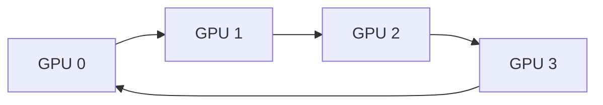

# 12. Multi-GPU와 Collective

## 객체와 실행 주체부터 찾기

## 여러 GPU 통신의 실제 객체

**Rank(순위)**는 communication group 안의 참여자를 식별하는 정수다. 빠르기 등급이 아니다. Rank 0은 process 0일 수도 있고 한 process 안의 GPU 0을 담당하는 thread일 수도 있다. **World size**는 group의 rank 수다.

**Communicator(통신자 객체)**는 어떤 rank들이 한 collective에 참여하고 서로 어떤 transport로 연결되는지 library가 관리하는 상태다. NCCL은 NVIDIA GPU collective communication library다. Communicator는 초기화부터 destroy/abort까지 살아 있고, collective 순서와 async error 상태를 가진다.

각 rank의 **send/receive buffer**는 보통 해당 GPU의 global memory에 있다. Collective call은 GPU stream에 work를 enqueue할 수 있다. Host API 반환 뒤에도 GPU copy engine, network adapter 또는 communication kernel이 buffer를 읽고 쓸 수 있으므로 stream completion 전 재사용하면 안 된다.

**Collective(집합 통신)**는 group 참여자들이 맞춰 호출하는 통신 operation이다.

| 연산 | 시작 상태 | 끝 상태 |
|---|---|---|
| broadcast | root만 원본 N byte 보유 | 모든 rank가 같은 N byte 보유 |
| reduce | 각 rank가 N byte 입력 | root가 원소별 sum/max 결과 보유 |
| all-reduce | 각 rank가 N byte 입력 | 모든 rank가 reduce 결과 보유 |
| reduce-scatter | 각 rank가 N byte 입력 | reduce 결과의 1/P 조각씩 보유 |
| all-gather | 각 rank가 서로 다른 조각 보유 | 모든 rank가 모든 조각 보유 |

Collective는 function 이름 하나가 network packet 하나라는 뜻이 아니다. Library가 ring, tree, 여러 channel과 protocol로 많은 send/receive를 구성한다. 선택은 message 크기, topology, GPU와 library version에 따라 달라질 수 있다.

## Topology와 전송 경로

**Topology**는 GPU, PCIe switch, CPU socket, NVLink/NVSwitch, NIC가 물리적으로 어떻게 연결됐는지 나타낸다. GPU 번호가 연속이라는 사실은 가장 가까운 물리 경로를 보장하지 않는다.

**P2P(peer-to-peer)**는 한 GPU가 다른 GPU memory에 직접 접근하거나 device 사이 copy를 하는 기능이다. 두 GPU와 driver, topology가 peer access를 지원해야 한다. 같은 node에서도 어떤 pair는 NVLink, 어떤 pair는 PCIe switch나 CPU root complex를 지날 수 있다.

**NIC(Network Interface Card)**은 node 밖 network로 packet을 보내는 장치다. **RDMA(Remote Direct Memory Access)**는 remote CPU가 각 byte를 복사하지 않고 NIC가 등록된 memory 사이 data를 전송하는 방식이다. GPU memory까지 직접 경로를 제공하는 GPUDirect RDMA는 GPU·NIC·driver·IOMMU·network stack 지원과 memory registration이 필요하다. “RDMA”라는 이름만으로 CPU involvement가 0이거나 모든 topology에서 같은 bandwidth라는 뜻은 아니다.

Multi-node all-reduce는 node 안 NVLink/NVSwitch와 node 사이 NIC path를 함께 사용할 수 있다. 느린 rank나 oversubscribed switch link 하나가 collective step 완료를 지연시킬 수 있으므로 평균 link speed만 보지 않는다.

## 4-GPU ring all-reduce를 실제 숫자로 추적하기

Rank마다 길이 4 vector를 가지고, chunk를 A,B,C,D라 부른다.

```text
rank0 = [1,   10,  100, 1000]
rank1 = [2,   20,  200, 2000]
rank2 = [3,   30,  300, 3000]
rank3 = [4,   40,  400, 4000]
```

원소별 sum 결과는 `[10,100,1000,10000]`이다. Ring은 각 rank가 오른쪽 rank `(r+1) mod 4`로 보내고 왼쪽 rank `(r-1) mod 4`에서 받는다고 하자.

### Reduce-scatter 세 단계

Step 0에서 rank r은 자기 chunk r을 보내고 왼쪽에서 chunk r-1을 받아 같은 chunk의 자기 값과 더한다.

| step 0 receiver | 받은 값 | 자기 값과 합친 partial |
|---|---|---|
| rank0 | rank3의 D=4000 | D: `4000+1000=5000` |
| rank1 | rank0의 A=1 | A: `1+2=3` |
| rank2 | rank1의 B=20 | B: `20+30=50` |
| rank3 | rank2의 C=300 | C: `300+400=700` |

Step 1은 그 partial을 오른쪽으로 보낸다.

| receiver | 받은 partial | 자기 값과 합친 partial |
|---|---|---|
| rank0 | C=700 | `700+100=800` |
| rank1 | D=5000 | `5000+2000=7000` |
| rank2 | A=3 | `3+3=6` |
| rank3 | B=50 | `50+40=90` |

Step 2를 한 번 더 돌린다.

| receiver | 받은 partial | 자기 값과 합친 final chunk |
|---|---|---|
| rank0 | B=90 | B=`90+10=100` |
| rank1 | C=800 | C=`800+200=1000` |
| rank2 | D=7000 | D=`7000+3000=10000` |
| rank3 | A=6 | A=`6+4=10` |

Reduce-scatter 뒤에는 rank0이 B=100, rank1이 C=1000, rank2가 D=10000, rank3이 A=10 하나씩 소유한다. 아직 어느 rank도 전체 vector를 갖지 않는다.

### All-gather 세 단계

이제 reduce하지 않고 final chunk를 돌린다.

```text
초기 owner: r0=B, r1=C, r2=D, r3=A
step0: r0→r1 B, r1→r2 C, r2→r3 D, r3→r0 A
step1: r0→r1 A, r1→r2 B, r2→r3 C, r3→r0 D
step2: r0→r1 D, r1→r2 A, r2→r3 B, r3→r0 C
```

마지막에는 네 rank 모두 A=10, B=100, C=1000, D=10000을 가진다. 각 step에서 보내는 chunk index의 정확한 convention은 구현마다 표현이 다를 수 있지만, 각 원본 chunk가 P-1번 이동하며 reduce되고 다시 P-1번 배포된다는 구조는 같다.

### 전송량과 α·β

전체 buffer N=400 MiB, P=4이면 chunk는 100 MiB다. Reduce-scatter 3회와 all-gather 3회, 총 6번 chunk를 보내므로 rank당 `6*100=600 MiB`, 즉 `2(P-1)N/P`다.

`T≈steps*α+bytes*β`에서 α는 step startup latency, β는 byte당 전송 시간이다. 이 식은 계산 overlap, bidirectional link, protocol pipeline을 생략한 교육 모형이다. Small message는 α가, 큰 message는 β 항이 지배하기 쉽다.

## Tree collective와 ring의 차이

4 rank tree reduce는 예를 들어 첫 단계 `r1→r0`, `r3→r2`, 둘째 `r2→r0`으로 합을 root에 모을 수 있다. Broadcast는 반대로 `r0→r2`, 이어 `r0→r1`과 `r2→r3`로 보낸다. Reduce와 broadcast가 각각 log2(4)=2 level이라 4 latency level이다.

Ring all-reduce는 6 step이지만 큰 message를 네 link에 pipeline으로 흘려 link bandwidth를 고르게 쓰는 장점이 있다. Tree는 small message에서 적은 latency step이 유리할 수 있지만 root 근처 link 사용과 message 분할 방식이 다르다. NCCL 같은 library가 topology와 size에 맞춰 algorithm과 protocol을 선택할 수 있으므로 사용자가 ring 이름만 보고 실제 route를 단정하지 않는다.

## Collective 호출 순서가 group 전체 계약인 이유

모든 rank가 communicator에서 같은 collective 순서를 맞춰야 한다.

```text
rank0: all_reduce(A) → broadcast(B)
rank1: all_reduce(A) → broadcast(B)   # 일치
```

Rank1만 조건문으로 broadcast를 먼저 호출하면 다른 rank의 all-reduce 메시지와 match되지 않아 hang이나 error가 날 수 있다. Count와 dtype도 같아야 같은 byte 경계를 해석한다. Rank0은 1,024 FP32, rank1은 1,024 FP16을 넘기면 둘 다 “1024개”라도 byte와 연산 의미가 다르다.

Collective 완료 전에 send buffer를 optimizer가 덮거나 communicator를 destroy하면 use-after-use가 된다. Completion event와 async error를 확인하고, 한 rank 실패 시 timeout·abort·restart 범위를 정한다.


**순위(rank)**는 여러 GPU가 한 통신 그룹에 참여할 때 각 참여자를 구별하는 `0, 1, 2, ...` 번호다. 성능 등급이 아니다. 각 프로세스나 런타임 스레드는 자기 GPU의 입력·출력 버퍼를 준비하고, 집합 통신 라이브러리는 링크 경로와 전송 순서를 정한다. **집합 통신(collective)**은 모든 참여자가 같은 종류의 연산에 들어오는 통신이다. 합계를 모두에게 돌려주는 all-reduce와 조각을 모으는 all-gather가 예다.

버퍼는 각 GPU의 장치 메모리에 있고 통신 명령은 스트림 작업 큐에 놓인다. CPU 호출이 반환되었다고 버퍼를 바로 다시 쓰면 안 된다. 완료 이벤트 전까지 통신 엔진이나 GPU가 버퍼를 읽거나 쓸 수 있기 때문이다.

## 네 순위 링 all-reduce 손 추적

입력을 네 조각 `A, B, C, D`로 나누고 순위를 `0~3`이라 하자. 각 순위는 오른쪽 이웃에게 한 조각을 보내고 왼쪽 이웃에게서 한 조각을 받는다.

| 단계 | rank 0이 받음 | rank 1 | rank 2 | rank 3 | 받은 뒤 상태 |
|---:|---|---|---|---|---|
| 0 | D | A | B | C | 자기 값과 합산 |
| 1 | C | D | A | B | 부분합을 다음 이웃으로 전달 |
| 2 | B | C | D | A | 각 순위가 한 조각의 전체 합 소유 |

뒤이은 all-gather 세 단계가 합쳐진 조각을 다시 돌린다. 마지막에는 모든 순위가 네 조각의 전체 합을 갖는다. GPU 수 `P=4`, 전체 데이터 `N=400 MiB`이면 순위당 단순 전송량은 `2(P-1)N/P = 600 MiB`다.

`T = α × 단계 수 + β × 전송 바이트`에서 α는 한 단계를 시작하는 지연 시간(초/단계), β는 바이트 하나를 옮기는 시간(초/바이트)이다. α가 5 μs, 유효 대역폭이 100 GB/s이고 한 구간에서 40 MB를 옮긴다면 세 단계 지연 `15 μs`와 데이터 시간 `400 μs`를 합쳐 약 `415 μs`다. 모든 링크가 같고 계산과 통신이 겹치지 않는다는 가정을 결과와 함께 적는다.

### 실패 조건

- 한 순위가 호출에 들어오지 않으면 다른 순위가 기다린다.
- 순위별 원소 개수나 자료형이 다르면 메시지 경계의 뜻이 맞지 않는다.
- 느린 링크 하나가 전체 단계를 제한하므로 GPU 수만 늘린다고 항상 빨라지지 않는다.

[이전: 11. 성능 분석](11-occupancy-roofline-and-profiling.md) · [목차](README.md) · [다음: 13. 로컬 모형](13-local-models.md)

여러 GPU에서는 계산 분할뿐 아니라 통신량, topology, synchronization, failure 범위를 설계한다.




## 1. Device 선택

각 host thread/process가 어느 GPU context를 사용하는지 정한다. Pointer가 속한 device와 current device를 맞춘다.

## 2. Peer access

GPU 사이 direct access 가능성은 topology와 peer capability에 달렸다. 가능해도 bandwidth·route가 동일하지 않다.

## 3. Collective

여러 participant가 함께 수행하는 통신 operation이다. Broadcast, reduce, all-reduce, all-gather, reduce-scatter 등이 있다.

## 4. Broadcast

Root GPU의 N-byte buffer를 모든 GPU가 받는다. Root와 participant 순서·count·dtype가 일치해야 한다.

## 5. Reduce

각 GPU 값을 sum/max 같은 operation으로 root에 결합한다.

GPU 4개의 scalar `[1,2,3,4]` sum reduce 결과는 root의 10이다.

## 6. All-reduce

Reduce 결과를 모든 participant가 받는다. Data-parallel training의 gradient 합/평균에 쓰일 수 있다.

Sum 후 world size 4로 나누는 average 단계가 별도일 수 있다.

## 7. Ring 모형

P GPU가 chunk를 돌려 reduce-scatter 후 all-gather한다. 각 GPU가 보내는 data volume은 대략 `2*(P-1)/P*N`인 단순 ring 모형을 쓸 수 있다.

P=4, N=400 MiB면 GPU당 `2*3/4*400=600 MiB`다.

## 8. α·β 모형

α는 message/startup latency, β는 byte당 전송 시간이라는 가정이다.

`T≈steps*α+bytes*β`로 쓴다. 실제 overlap, topology, protocol은 생략한 모형이다.

## 9. 숫자 계산

6 step, α=5 µs, β=1 ns/byte, bytes=1,000,000이면 `30 µs+1000 µs=1030 µs`다.

단위 변환을 맞춘다.

## 10. Tree collective

Tree는 step 수를 log P 수준으로 줄일 수 있지만 link 사용과 큰 message bandwidth 특성이 ring과 다르다.

Library가 message size와 topology에 따라 algorithm/protocol을 고를 수 있다.

## 11. Topology

PCIe switch, NVLink/NVSwitch, NUMA CPU, network adapter 위치가 route를 바꾼다.

GPU 번호가 물리적으로 adjacent라는 보장은 없다.

## Gradient all-reduce와 계산 overlap

Data-parallel training에서 각 GPU는 서로 다른 sample의 gradient를 계산한다. Layer의 backward가 끝날 때마다 gradient bucket이 ready되면 all-reduce를 시작하고, GPU가 더 앞 layer의 backward를 계속 계산하도록 겹칠 수 있다.

```text
compute stream: backward L3 → backward L2 → backward L1
comm stream:       AR bucket3 → AR bucket2 → AR bucket1
```

필요한 edge는 다음과 같다.

1. Compute stream이 bucket3 write를 끝낸 뒤 ready3 event를 기록한다.
2. Comm stream이 ready3를 기다린 뒤 all-reduce를 시작한다.
3. Optimizer가 bucket3을 읽기 전에 all-reduce done3을 기다린다.

Ready edge가 없으면 collective가 미완성 gradient를 읽고, done edge가 없으면 optimizer가 partial sum을 읽을 수 있다. Device-wide synchronize를 매 bucket마다 넣으면 overlap이 사라진다.

Bucket이 너무 작으면 collective startup α와 enqueue overhead가 커지고, 너무 크면 backward 후반까지 통신 시작이 늦어진다. 최적 bucket은 layer gradient 크기, network bandwidth/latency, compute 시간과 memory capacity에 달려 있다.

### 4 GPU sum과 average

Local gradient scalar가 `[2,4,6,8]`이면 sum all-reduce 후 모든 rank가 20을 받는다. Average gradient가 필요하면 `20/4=5`다. Library collective가 sum만 했는지 framework가 pre-scale/post-scale했는지 확인한다. World size가 바뀌는데 learning rate와 averaging convention을 그대로 두면 학습 의미가 달라질 수 있다.

## Strong scaling과 weak scaling 수치

한 GPU에서 계산 80 ms, 기타 고정 작업 20 ms로 총 100 ms라고 하자. GPU를 4개로 strong scaling해 계산이 이상적으로 20 ms가 되지만 all-reduce 15 ms가 추가되면 총 `20+20+15=55 ms`, 속도 향상은 `100/55≈1.82배`다. GPU 수는 4배지만 4배 빨라지지 않는다.

Weak scaling은 GPU당 data를 유지하므로 네 GPU가 네 배 data를 처리한다. Step 시간이 100 ms에서 communication 때문에 115 ms가 되면 총 throughput은 단일 GPU의 `4*100/115≈3.48배`다. Strong scaling의 latency와 weak scaling의 throughput을 섞어 보고하지 않는다.

## Failure와 복구 경계

한 rank process가 종료되거나 NIC path가 끊기면 다른 rank가 collective 완료를 기다릴 수 있다. Async error polling, timeout, communicator abort가 필요하다. Abort 뒤 같은 buffer와 stream을 바로 재사용할 수 있는지는 library 계약과 framework recovery를 따른다.

Collective는 database transaction이 아니다. 일부 rank가 output 일부를 썼다가 실패할 수 있으며 자동 rollback을 기대하지 않는다. Checkpoint에서 전체 job을 재시작할지, elastic membership으로 communicator를 다시 만들지 상위 runtime이 정한다. 재시작 시 rank numbering과 data shard가 달라질 수 있어 random seed만으로 같은 학습 순서를 보장하지 못할 수 있다.

## 실측 기록

GPU model·수, node 수, GPU-NIC/PCIe/NVLink topology, NCCL·driver version, message size·dtype, collective, algorithm/protocol 선택, warm-up, stream dependency를 기록한다. Bus bandwidth와 algorithm bandwidth의 정의가 다를 수 있으므로 profiler metric 단위를 확인한다.

Latency는 small/medium/large message별 median과 p95를 보고, slow rank와 link counter를 함께 본다. 모든 rank가 동일한 시작 시각에 도달하지 못하면 collective 자체보다 load imbalance가 시간에 포함된다.


## 12. Stream ordering

Collective도 stream에 enqueue될 수 있다. 앞 kernel이 buffer를 만들고 collective가 읽는 순서를 같은 stream 또는 event로 연결한다.

## 13. Buffer 수명

Collective completion 전 send/recv buffer를 해제·재사용하지 않는다. Async error와 communicator 상태를 확인한다.

## 14. 모든 rank 참여

Collective call 순서, count, dtype가 rank마다 다르면 hang·오류·잘못된 결과가 날 수 있다.

조건 branch로 일부 rank만 all-reduce를 호출하면 안 된다.

## 15. In-place

지원되는 in-place 규칙의 pointer offset과 의미를 library 문서로 확인한다. 임의 send/recv alias는 안전하지 않다.

## 16. Floating reduction

Tree/ring 결합 순서가 바뀌면 rounding이 달라질 수 있다. 허용 오차와 reproducibility 요구를 기록한다.

## 17. Failure

한 rank process나 network path 실패가 collective 전체 진행에 영향을 준다. Timeout, async error, communicator abort 정책을 설계한다.

## 18. Strong·weak scaling

Strong scaling은 총 문제 크기 고정, weak scaling은 GPU당 문제 크기 고정이다. 통신 비율 해석이 다르다.

## 19. 반례

GPU를 2배로 늘리면 계산은 줄어도 통신·동기화가 늘어 2배 빨라지지 않는다.

All-reduce가 끝났다는 host 추측만으로 buffer를 읽지 않고 stream completion을 확인한다.

## 문제와 해설

**문제 1.** 4 GPU scalar `[2,4,6,8]` sum all-reduce 결과는?

**해설.** 모든 GPU가 20을 받는다.

**문제 2.** α가 큰 small message에서 중요한 항은?

**해설.** Startup/step latency 항이 지배할 수 있다.

**문제 3.** Rank 3만 collective를 건너뛰면?

**해설.** 다른 rank가 matching participant를 기다려 hang/오류가 날 수 있다.

**문제 4.** 본문의 4-rank vector에서 reduce-scatter 뒤 각 rank가 소유한 final chunk를 쓰라.

**해설.** Rank0은 B=100, rank1은 C=1000, rank2는 D=10000, rank3은 A=10이다. All-gather 세 단계를 마쳐야 모든 rank가 `[10,100,1000,10000]` 전체를 갖는다.

**문제 5.** P=4, N=400 MiB ring all-reduce의 rank당 전송량과 step 수를 구하라.

**해설.** Chunk는 100 MiB다. Reduce-scatter 3 step과 all-gather 3 step으로 총 6 step, 전송량은 600 MiB다. 식은 `2*(P-1)/P*N=2*3/4*400=600 MiB`다. 실제 link byte와 시간은 channel, topology, protocol, overlap 때문에 달라질 수 있다.

**문제 6.** 단일 GPU 100 ms 작업 중 계산이 80 ms, 고정 부분이 20 ms다. 4 GPU에서 계산 20 ms, all-reduce 15 ms라면 strong-scaling speedup은?

**해설.** 4-GPU 시간은 `20+20+15=55 ms`다. Speedup은 `100/55≈1.82`다. 4배 GPU를 써도 고정 부분과 새 통신 때문에 4배가 아니다. Cost efficiency와 throughput은 별도로 계산한다.


## 공식 자료

- [NCCL user guide](https://docs.nvidia.com/deeplearning/nccl/user-guide/docs/)
- [CUDA multi-device programming](https://docs.nvidia.com/cuda/cuda-programming-guide/03-advanced/multi-gpu-systems.html)
