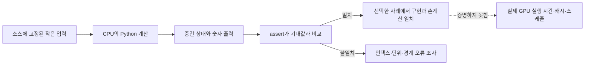

# 13. GPU 없이 검산하는 세 가지 로컬 모형

이 장의 세 Python 프로그램은 GPU를 흉내 내는 시뮬레이터가 아니다. **모형(model)**은 복잡한 대상에서 확인하려는 규칙만 남긴 작은 표현이다. 프로그램은 CPU 위의 Python 인터프리터에서 실행되고 CUDA 드라이버, GPU 장치 파일, GPU 메모리, 네트워크를 열지 않는다. 따라서 출력은 주소 계산, 행렬 곱, 통신량 공식을 손으로 계산한 답과 비교하는 검산 자료다. 실행 시간이 빠르거나 `assert`가 통과해도 실제 GPU의 속도, 캐시 정책, 명령 순서가 증명되지는 않는다.

이 장에서는 입력이 어느 변수에 들어가고, 반복마다 상태가 어떻게 바뀌며, 출력 한 줄이 정확히 무엇을 뜻하는지 추적한다. 세 프로그램은 저장소 루트에서 다음처럼 실행하도록 작성되어 있다.

```text
python3 -B learning/gpu-programming/examples/coalescing_model.py
python3 -B learning/gpu-programming/examples/tiled_matmul_model.py
python3 -B learning/gpu-programming/examples/collective_cost_model.py
```

`-B`는 Python이 바이트코드 캐시 파일을 만들지 않게 하는 선택이다. 이 명령은 교재가 기대하는 경로를 보여 주지만, 이 장을 작성하는 과정에서는 실제 GPU도 사용하지 않았고 프로그램도 실행하지 않았다. 아래 결과는 소스의 고정 입력과 수식을 읽어 손으로 다시 계산한 것이다.



## 1. `coalescing_model.py`: 레인 주소에서 섹터 집합까지

**워프(warp)**는 CUDA 실행 모형에서 보통 32개 스레드를 함께 다루는 묶음이고, **레인(lane)**은 그 안의 0부터 31까지 위치다. 여기서는 실제 워프가 실행되지 않는다. 정수 `lane=0..31`을 Python 반복문으로 순회할 뿐이다. 각 레인이 4바이트 원소 하나를 읽는다고 두고 주소를 만든다.

**바이트 주소(byte address)**는 메모리의 한 바이트 위치를 나타내는 정수다. 시작 주소를 `base`, 이웃 레인의 원소 간격을 `stride_elements`, 원소 크기를 4바이트라고 하면 레인 `l`의 시작 주소는 다음과 같다.

\[
address(l)=base+l\times stride\_elements\times4
\]

**섹터(sector)**는 이 교육 모형이 메모리 범위를 32바이트씩 자른 조각이다. 주소 `a`가 속한 섹터 번호는 정수 나눗셈 `a // 32`다. 프로그램은 모든 레인의 주소를 만들고, 서로 다른 섹터 번호를 집합에 넣은 뒤 집합 크기를 센다. 실제 하드웨어의 요청 병합, 캐시 적중, 재실행 정책을 구현한 것이 아니다.

### 입력 A: 정렬된 연속 접근

`base=0`, `stride_elements=1`이면 주소는 다음처럼 변한다.

| 레인 | 계산 | 시작 주소 | 읽는 바이트 | 섹터 |
|---:|---|---:|---|---:|
| 0 | `0+0×1×4` | 0 | 0..3 | 0 |
| 1 | `0+1×1×4` | 4 | 4..7 | 0 |
| 7 | `0+7×1×4` | 28 | 28..31 | 0 |
| 8 | `0+8×1×4` | 32 | 32..35 | 1 |
| 15 | `0+15×1×4` | 60 | 60..63 | 1 |
| 16 | `0+16×1×4` | 64 | 64..67 | 2 |
| 24 | `0+24×1×4` | 96 | 96..99 | 3 |
| 31 | `0+31×1×4` | 124 | 124..127 | 3 |

첫 주소는 0, 마지막 원소의 시작 주소는 124이며 마지막 바이트는 127이다. 닿는 섹터는 `{0,1,2,3}`이므로 결과는 4다. “32레인×4바이트=128바이트”라는 총 유효 데이터 양과 “32바이트 섹터 4개”라는 범위 계산이 서로 맞는다.

### 입력 B: 4바이트 어긋난 연속 접근

`base=4`이면 레인 0은 4..7, 레인 31은 128..131을 읽는다. 시작 쪽에서는 섹터 0의 처음 4바이트를 쓰지 않지만, 끝쪽 4바이트가 새 섹터 4에 들어간다. 집합은 `{0,1,2,3,4}`이고 결과는 5다.

| 입력 | 시작 주소 | 마지막 원소 시작 | 전체 바이트 범위 | 섹터 집합 | 개수 |
|---|---:|---:|---|---|---:|
| 연속 정렬 | 0 | 124 | 0..127 | 0,1,2,3 | 4 |
| 연속 비정렬 | 4 | 128 | 4..131 | 0,1,2,3,4 | 5 |
| 다시 정렬 | 32 | 156 | 32..159 | 1,2,3,4 | 4 |

비정렬 사례가 섹터 하나를 더 건드린다는 것은 이 주소 모형 안의 사실이다. 실제 커널이 정확히 25% 느리다는 뜻은 아니다. 캐시에 이미 데이터가 있거나, 계산 시간이 더 길거나, 장치의 메모리 요청 규칙이 이 단순 모형과 다르면 시간 차이가 달라진다.

### 입력 C: 두 원소씩 건너뛰는 접근

`base=0`, `stride_elements=2`이면 주소는 `0,8,16,...,248`이다. 32바이트 섹터 하나에는 네 주소가 들어가므로 섹터 0부터 7까지 총 8개다. 레인은 여전히 유효 데이터 128바이트를 요청하지만, 그 데이터가 256바이트 범위에 흩어졌다. 이것이 **스트라이드(stride)**, 즉 이웃 접근 사이의 일정한 간격이 메모리 범위를 넓히는 예다.

`assert`는 이 세 고정 사례의 기대 섹터 수가 코드 결과와 같은지만 확인한다. 음수 주소, 다른 원소 크기, 부분 워프, 캐시 라인, L1/L2 적중, 실제 처리량은 검사하지 않는다.

## 2. `tiled_matmul_model.py`: 타일별 적재와 누산

**행렬(matrix)**은 행과 열로 배열한 숫자 표다. 행렬 곱 `C=A×B`에서 출력 `C[i][j]`는 A의 `i`번째 행과 B의 `j`번째 열에서 같은 위치의 수를 곱해 모두 더한 값이다. 이 한 값을 만드는 곱셈과 덧셈을 **점곱(dot product)**이라고 한다.

**타일(tile)**은 큰 행렬을 일정한 크기의 작은 사각 조각으로 나눈 것이다. 실제 GPU 커널은 여러 스레드가 전역 메모리에서 타일을 읽어 블록의 공유 메모리에 놓고 재사용할 수 있다. Python 모형에는 전역 메모리, 공유 메모리, 스레드, 배리어가 없다. 리스트 복사로 “적재 단계가 끝난 뒤 계산 단계가 시작된다”는 순서만 표현한다.

### 2×2 입력의 전체 결과

입력이 다음과 같다고 하자.

\[
A=\begin{bmatrix}1&2\\3&4\end{bmatrix},\quad
B=\begin{bmatrix}5&6\\7&8\end{bmatrix}
\]

네 출력은 다음과 같다.

- `C[0][0]=1×5+2×7=19`
- `C[0][1]=1×6+2×8=22`
- `C[1][0]=3×5+4×7=43`
- `C[1][1]=3×6+4×8=50`

따라서 결과는 `[[19,22],[43,50]]`이다. 타일 크기가 1이면 K 방향을 한 원소씩 두 단계로 나누고, 타일 크기가 2이면 두 원소를 한 단계에서 읽는다. 분할 방식은 달라도 모든 항을 정확히 한 번씩 곱해 더하면 수학 결과는 같다.

### 3×3, 타일 2의 경계 추적

소스의 경계 사례에서는 행렬 크기 3이 타일 크기 2의 배수가 아니다. `C[0][0]`을 구할 때 K 방향 첫 단계는 `k=0,1`, 둘째 단계는 `k=2,3`을 담당한다. `k=3`은 행렬 밖이므로 모형은 0을 적재한다.

첫 단계:
\[
1\times7+2\times9=7+18=25
\]

둘째 단계:
\[
3\times11+0\times0=33
\]

누산기 값은 `0→25→58`이고 최종 `C[0][0]=58`이다. **누산기(accumulator)**는 부분합을 계속 보관하는 변수다. 이 모형에서는 Python 정수이고 함수 호출 동안 존재한다. 실제 GPU에서는 컴파일러가 보통 스레드의 레지스터에 두려 시도하지만 자원 압박에 따라 다른 저장 경로가 생길 수 있다.

경계 밖을 0으로 채워도 되는 이유는 덧셈의 항등원 0을 더하면 값이 바뀌지 않기 때문이다. 경계 검사 없이 리스트를 읽으면 Python에서는 인덱스 오류 또는 잘못된 음수 인덱스 의미가 생길 수 있고, 실제 GPU에서는 범위 밖 메모리 접근이 된다.

### 참조 계산과 `assert`

프로그램의 단순 삼중 반복은 같은 입력에서 기준 결과를 만든다. 타일 모형 결과와 기준 결과가 같다는 `assert`는 선택한 작은 정수 행렬에서 인덱스와 0 채움이 일치함을 확인한다. 모든 크기에 대한 수학적 증명이 아니며, 부동소수점 덧셈 순서, 반올림, 오버플로, 공유 메모리 충돌, 배리어 배치를 검증하지 않는다.

특히 Python 문장이 앞 문장을 마친 뒤 다음 문장을 실행한다는 사실을 GPU 블록 배리어와 같다고 보면 안 된다. 실제 GPU에서는 여러 스레드가 타일 적재를 나누므로 모든 스레드의 적재 완료와 다음 재사용 시점을 동기화해야 한다.

## 3. `collective_cost_model.py`: 링 통신량과 시간 식

**집합 통신(collective communication)**은 여러 참여자가 같은 통신 연산에 함께 들어가는 방식이다. **랭크(rank)**는 참여자를 구분하는 논리 번호이고 `P`는 전체 랭크 수다. **all-reduce**는 각 랭크의 같은 위치 값을 합치는 등의 축약을 한 뒤, 완성 결과를 모든 랭크가 받는 연산이다.

모형 입력은 `P=4`, 메시지 크기 `N=400 MiB`다. MiB는 `2^20`바이트다. 링 all-reduce를 reduce-scatter `P-1`단계와 all-gather `P-1`단계로 보는 단순 통신량 식은 다음과 같다.

\[
bytes\ per\ rank=2(P-1)\frac{N}{P}
\]

먼저 한 조각은 `400/4=100 MiB`다. 한 랭크는 첫 구간에서 3단계 동안 100 MiB씩 보내 300 MiB, 둘째 구간에서도 300 MiB를 보낸다. 합계는 600 MiB다.

\[
2\times(4-1)\times100=600\ MiB
\]

프로그램의 `assert`는 바이트와 MiB 변환, 단계 수, 이 공식의 구현을 확인한다. 실제 NCCL이 반드시 링을 고르거나 모든 링크가 같은 대역폭을 내거나 계산과 통신이 겹친다고 보장하지 않는다.

### α·β 시간 모형

**α(알파)**는 메시지 크기와 무관하게 단계 시작에 든다고 가정한 고정 지연이고, **β(베타)**는 바이트 하나를 보내는 데 드는 시간 계수다. 전체 단순 예측은 `단계 수×α + 전송 바이트×β`다.

α가 5마이크로초이고 단계가 6이면 시작 지연 부분은 `6×5=30 µs`다. β가 초/바이트 단위라면 600 MiB를 먼저 바이트로 바꾸고 곱한 뒤 마이크로초로 환산해야 한다. MiB 숫자 600을 그대로 β와 곱하면 단위가 맞지 않는다.

이 식은 링크 경쟁, 토폴로지, 프로토콜, 패킷화, GPU 커널 시간, 동기화 지연을 하나의 α와 β로 눌러 담은 근사다. 예측과 실측이 다를 때 식을 억지로 맞추기보다 빠진 조건을 찾는 출발점으로 쓴다.

## 4. 세 모형을 함께 읽는 방법

세 프로그램은 모두 `입력→상태 변화→출력→assert` 구조를 가진다.

| 모형 | 입력 객체 | 중간 상태 | 출력 의미 | 증명하지 않는 것 |
|---|---|---|---|---|
| 주소 | base, stride, lane 수, 원소/섹터 바이트 | 레인별 주소와 섹터 집합 | 선택한 주소가 닿는 섹터 수 | 실제 캐시·대역폭·커널 시간 |
| 행렬 | A, B, 타일 크기 | 단계별 타일과 누산기 | 정수 행렬 곱 결과 | GPU 스레드·배리어·부동소수점 오차 |
| 통신 | P, N, α, β | 조각 크기·단계·바이트 | 링 공식의 통신량과 근사 시간 | NCCL 알고리즘 선택·토폴로지·혼잡 |

입력을 바꿀 때는 기대 결과도 먼저 손으로 적는다. base를 0에서 4로 바꾸면 섹터 수가 4에서 5가 되어야 한다. 타일을 2에서 1로 바꾸면 단계 수는 늘지만 정수 결과는 같아야 한다. P를 4에서 8로 바꾸고 N을 고정하면 순위당 비율은 `2×7/8=1.75N`이 된다. 기대값 없이 코드를 바꾸고 출력만 관찰하면 오류도 새로운 답처럼 보일 수 있다.

## 5. 실패 반례와 모형의 경계

섹터 수가 적은 커널이 항상 빠르지는 않다. 더 많은 분기, 낮은 점유율, 긴 연산 의존성이 시간을 지배할 수 있다. 작은 정수 행렬이 맞아도 큰 FP16 행렬에서는 입력 반올림과 누산 순서가 달라질 수 있다. 링 공식이 맞아도 두 GPU가 느린 PCIe 경로로 연결되면 균일 링크 가정이 깨진다.

세 프로그램은 외부 파일과 소켓을 열지 않고 소스 안의 입력을 쓴다. 실행 시간을 재면 Python과 CPU의 시간이다. 실제 GPU 주장은 CUDA 프로그램의 정확성을 별도로 확인하고 GPU 이벤트와 프로파일러로 측정해야 한다.

## 6. 문제와 완전 해설

### 문제 1. base 28의 연속 4레인

4개 레인이 base 28에서 4바이트씩 연속으로 읽는다. 섹터는 32바이트다. 주소와 섹터 수를 구하라.

**해설.** 시작 주소는 28, 32, 36, 40이고 읽는 범위는 28..43이다. 주소 28은 섹터 0, 나머지는 섹터 1에 있다. 집합은 `{0,1}`이므로 2개다. 레인이 네 개뿐이어도 경계를 걸치면 두 섹터가 필요하다.

### 문제 2. stride 4의 32레인

base 0, 4바이트 원소, 원소 단위 stride 4라면 마지막 주소와 섹터 수는 얼마인가?

**해설.** 레인 `l` 주소는 `16l`이다. 마지막 시작 주소는 `16×31=496`, 마지막 바이트는 499다. 주소는 각 섹터마다 두 개씩 들어가므로 섹터 0부터 15까지 16개다. 유효 데이터는 128바이트지만 범위는 500바이트다.

### 문제 3. 타일 크기 변화

2×2 행렬 곱에서 타일 크기를 2에서 1로 바꾸면 왜 값은 같고 단계 수는 달라지는가?

**해설.** `C[i][j]`에 들어갈 K 항 두 개는 그대로다. 크기 2는 두 항을 한 단계에서 읽고, 크기 1은 한 항씩 두 단계에서 읽는다. 항을 빠뜨리거나 중복하지 않으면 합은 같다. 실제 부동소수점에서는 덧셈 묶음 순서가 바뀌면 마지막 비트가 달라질 수 있다.

### 문제 4. 0 채움이 잘못되는 연산

경계 밖을 언제나 0으로 채워도 되는가?

**해설.** 아니다. 합 기반 행렬 곱에서는 0이 덧셈 항등원이라 안전하다. 최댓값 축약에서 모든 유효 값이 음수인데 경계를 0으로 채우면 0이 거짓 최댓값이 된다. 그때는 연산의 항등원인 음의 무한대 같은 값을 써야 한다.

### 문제 5. P=8 링 통신량

N=800 MiB, P=8이면 순위당 링 all-reduce 전송량은 얼마인가?

**해설.** 조각은 `800/8=100 MiB`, 두 구간은 각각 7단계다. `2×7×100=1400 MiB`다. 이는 전송량 식의 답이며 실행 시간은 α, β, 토폴로지와 경쟁을 더 알아야 한다.

### 문제 6. assert의 의미

세 모형의 모든 `assert`가 통과했다. “GPU 구현이 올바르고 빠르다”라고 결론 내릴 수 있는가?

**해설.** 결론 낼 수 없다. assert는 고정된 작은 입력에서 Python 계산과 기대 숫자가 일치함을 보인다. GPU 코드는 실행되지 않았고, 스레드 동기화·메모리 계층·드라이버·네트워크·시간은 관찰하지 않았다. 올바른 결론은 “선택한 교육 규칙의 구현을 이 사례들에서 검산했다”이다.

+## 7. 입력을 확장할 때 지켜야 할 검산 절차

모형을 공부용으로 바꾸는 가장 안전한 순서는 “예상 답 작성, 입력 변경, 출력 비교, 경계 기록”이다. 예를 들어 주소 모형을 8바이트 원소로 바꾸려면 코드부터 고치지 않는다. base 0에서 32레인이 연속 접근하면 유효 데이터는 `32×8=256`바이트이고, 32바이트 섹터는 8개여야 한다고 먼저 적는다. 그다음 원소 크기 변수를 바꾸고 주소 0,8,…,248과 섹터 0..7이 나오는지 확인한다. 예상과 다르면 프로그램, 손계산, 단위 가운데 어느 것이 틀렸는지 구분한다.

행렬 모형에서는 정사각형만 시험하지 말고 A가 `M×K`, B가 `K×N`인 직사각형도 생각해야 한다. M은 출력 행 수, N은 출력 열 수, K는 각 점곱의 항 수다. A의 열 수와 B의 행 수가 다르면 곱 자체가 정의되지 않으므로 프로그램은 계산 전에 거부해야 한다. 타일 크기보다 M, N, K가 작거나 하나만 배수가 아닌 사례는 행 경계, 열 경계, K 경계를 서로 따로 시험하게 해 준다. 한 입력이 우연히 세 오류를 가리지 않도록 각 경계를 겨냥한 작은 사례를 둔다.

통신 모형에서는 P가 1인 경우를 살펴본다. 참여자가 하나뿐이면 다른 랭크로 보낼 데이터가 없고 식 `2(P-1)N/P`도 0이 된다. P가 0이면 랭크 집합 자체가 없고 0으로 나누므로 유효하지 않은 입력이다. N이 0이면 데이터 전송량은 0이지만 실제 라이브러리 호출에는 검증과 시작 비용이 남을 수 있다. 수학식의 0과 실제 API 호출 시간 0을 같은 뜻으로 보면 안 된다.

### 단위 표를 먼저 만드는 이유

성능 모형 오류의 상당수는 숫자보다 단위에서 생긴다.

| 값 | 예시 | 단위 | 다음 계산에서 필요한 변환 |
|---|---:|---|---|
| 메시지 크기 N | 400 | MiB | `×2^20`으로 byte |
| 시작 지연 α | 5 | µs/step | 단계 수를 곱함 |
| β | `1e-10` | s/byte | byte를 곱한 뒤 µs로 변환 |
| 행렬 원소 크기 | 4 | byte/element | 원소 수와 곱해 주소 간격 계산 |
| 처리량 | 100 | GB/s | GB와 GiB 정의를 구분 |

`400 MiB`를 `400 MB`와 섞으면 약 4.9% 차이가 난다. 교육 모형에서 이 차이는 하드웨어 잡음이 아니라 입력 정의의 차이다. 출력에 숫자만 남기지 말고 단위를 함께 표시해야 다음 사람이 식을 다시 확인할 수 있다.

### 실제 프로그램으로 넘어가는 종료 조건

로컬 모형의 역할은 다음 질문에 손으로 답할 수 있을 때 끝난다. 각 레인의 주소를 쓸 수 있는가, 타일 단계마다 누산기에 어떤 항이 더해지는가, 각 랭크가 몇 단계에서 몇 바이트를 보내는가, 그리고 모형이 생략한 현실 조건을 말할 수 있는가. 그 뒤 실제 GPU 실험에서는 같은 입력 의미를 유지하면서 CUDA 오류 확인, 출력 기준값 비교, 완료 동기화, 반복 측정, 프로파일러 관찰을 새로 수행한다. Python 모형의 통과 기록을 GPU 실험의 검증 기록으로 재사용하지 않는다.

## 8. 추가 문제와 완전 해설

### 문제 7. 8바이트 원소의 정렬 접근

32레인이 base 0에서 8바이트 원소를 연속 읽는다. 32바이트 교육 섹터는 몇 개인가?

**해설.** 주소는 0,8,…,248이고 마지막 원소는 248..255를 차지한다. 전체 범위 0..255는 32바이트 섹터 8개다. 4바이트 원소 사례보다 각 레인이 두 배를 읽으므로 유효 바이트와 섹터 수도 두 배다.

### 문제 8. P=1 all-reduce

N=400 MiB이고 P=1일 때 링 전송량 식은 무엇을 내며 어떻게 해석해야 하는가?

**해설.** `2×(1-1)×400/1=0 MiB`다. 합칠 다른 랭크가 없으므로 네트워크 전송이 필요 없다는 뜻이다. 라이브러리 함수 호출, 스트림 순서 확인, 로컬 버퍼 처리 시간까지 0이라고 주장하는 식은 아니다.


## 공식 자료

- [CUDA C++ Best Practices Guide](https://docs.nvidia.com/cuda/cuda-c-best-practices-guide/)
- [CUDA C++ Programming Guide](https://docs.nvidia.com/cuda/cuda-programming-guide/)
- [NCCL User Guide](https://docs.nvidia.com/deeplearning/nccl/user-guide/docs/)

[이전: 12. Multi-GPU](12-multi-gpu-and-collectives.md) · [목차](README.md) · [다음: 14. 실험과 연구](14-experiments-and-research.md)
