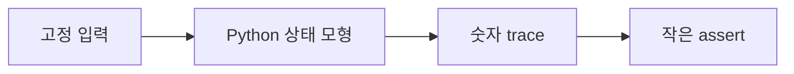

# 13. GPU 없는 안전한 로컬 모형

## 이 장의 프로그램이 표현하는 것

여기서 **모형(model)**은 실제 GPU를 제어하지 않고 규칙 일부를 작은 정수 계산으로 옮긴 교육용 프로그램이다. Python 인터프리터가 CPU에서 실행하며 CUDA 드라이버, GPU 메모리, 장치 파일을 열지 않는다. 출력은 주소 묶음·행렬 값·통신 식의 손계산 답과 비교하는 답지다. 실제 GPU 시간, 캐시 정책, 명령 스케줄을 검증했다는 뜻은 아니다.

`coalescing_model.py`에서 레인 0~31이 각각 4바이트를 읽는다. 시작 주소가 0이면 주소 범위는 0~127이고 32바이트 섹터는 0, 1, 2, 3이다. 시작 주소가 4이면 범위가 4~131이 되어 섹터 0~4, 모두 5개가 필요하다.

| 입력 | 첫 주소 | 마지막 주소 | 서로 다른 섹터 | 예상 결과 |
|---|---:|---:|---|---:|
| 연속 정렬 | 0 | 124 | 0,1,2,3 | 4 |
| 연속 비정렬 | 4 | 128 | 0,1,2,3,4 | 5 |
| 8바이트 간격 | 0 | 248 | 0~7 | 8 |

`tiled_matmul_model.py`는 타일 크기 2로 `C[0][0]`을 계산한다. 첫 단계 `1×7 + 2×9 = 25`, 둘째 단계 `3×11 + 0×0 = 33`을 더해 58을 얻는다. 마지막 0은 3×3 입력이 타일 크기의 배수가 아니어서 경계 밖을 0으로 채운 값이다. 단순 삼중 반복 결과와 같다는 assert는 인덱스와 경계 처리를 확인하지만 실제 공유 메모리나 barrier를 실행하지 않는다.

`collective_cost_model.py`는 `P=4`, `N=400 MiB`에서 링 all-reduce 순위당 전송량 `2(P-1)N/P = 600 MiB`를 계산한다. assert는 단위 변환 오류를 잡지만 네트워크가 그 시간에 동작한다고 보증하지 않는다.


### 공통 실패 조건

- 입력을 크게 해도 GPU 병렬 실행을 재현하지 않는다.
- assert 통과는 나열한 작은 입력의 확인이며 전체 알고리즘 증명이 아니다.
- 실행 시간을 재면 Python 시간일 뿐 CUDA 커널 시간과 관계가 없다.

[이전: 12. Multi-GPU](12-multi-gpu-and-collectives.md) · [목차](README.md) · [다음: 14. 실험과 연구](14-experiments-and-research.md)

세 Python 파일은 주소·tile·통신 비용의 고정 입력을 검산한다. GPU 실행·성능 측정이 아니다.



## 1. 실행

Repository root에서:

```text
python3 -B learning/gpu-programming/examples/coalescing_model.py
python3 -B learning/gpu-programming/examples/tiled_matmul_model.py
python3 -B learning/gpu-programming/examples/collective_cost_model.py
```

## 2. Coalescing 모형

Warp를 32 lane, element 4 byte, sector 32 byte로 둔다. Base 0에서 lane l 주소는 4l이다.

주소 0~127은 32-byte sector 네 개를 건드린다.

## 3. 128-byte 교육 모형과 sector

연속 32 lane×4 byte=128 byte이므로 오래된 단순 설명에서는 aligned 128-byte 범위 하나라고 말한다.

실제 현대 GPU transaction은 32-byte sector 단위 관찰이 중요할 수 있다. 이 모형은 touched sector 수를 세며 architecture의 cache/transaction 전체를 예측하지 않는다.

## 4. Misalignment

Base 4면 주소 4~128이다. Sector index는 0~4, 다섯 sector를 건드린다.

| base | 첫/끝 주소 | sector 수 |
| ---: | --- | ---: |
| 0 | 0..127 | 4 |
| 4 | 4..131 | 5 |
| 32 | 32..159 | 4 |

## 5. Stride

Stride 2면 주소 0,8,...,248이고 여덟 sector를 건드린다. Useful byte는 같지만 더 넓은 범위다.

## 6. Assert 한계

고정 주소의 sector set 계산만 확인한다. L1/L2 cache, replay, actual bandwidth는 확인하지 않는다.

## 7. Tiled matmul 모형

2×2 integer matrix를 tile size 1과 2로 계산하고 naive reference와 비교한다.

각 phase의 tile load와 partial accumulator를 trace로 남긴다.

## 8. 실제 계산

A `[[1,2],[3,4]]`, B `[[5,6],[7,8]]` 결과는 `[[19,22],[43,50]]`이다.

## 9. Tile load

Tile size 1은 K phase 두 번, tile size 2는 한 phase다. 수학 결과는 같다.

Python은 barrier를 실행하지 않는다. Load phase와 compute phase를 list 복사로 분리해 의미만 보인다.

## 10. Boundary

3×3과 tile 2에서 마지막 tile 범위 밖을 0으로 채우는 assert를 둔다.

## 11. Collective cost 모형

α·β ring 공식의 step·byte·단위를 계산한다. Network/GPU를 사용하지 않는다.

## 12. Ring volume

P=4, N=400 MiB이면 GPU당 600 MiB라는 앞 장 값을 assert한다.

## 13. Latency 계산

α=5 µs, six steps면 30 µs다. β와 bytes 곱은 second로 계산한 뒤 µs로 바꾼다.

## 14. 가정 출력

각 파일은 “model only” 문구를 출력한다. 실제 CUDA/NCCL 성능 결과처럼 인용하지 않는다.

## 15. 입력 바꾸기

Base를 0→4로 바꾸고 sector 수가 4→5가 되는 이유를 주소로 설명한다.

Tile을 2→1로 바꾸고 결과는 같지만 phase 수가 늘어나는지 본다.

GPU 수를 4→8로 바꾸고 ring byte factor가 `2*7/8`이 되는지 본다.

## 16. 검증과 증명

Assert는 선택한 작은 입력의 구현 오류를 잡는다. 모든 shape, architecture, dtype에 대한 증명이 아니다.

## 17. File·network 없음

세 모형은 입력을 source 안에 고정하고 외부 file·socket·GPU API를 열지 않는다.

## 18. 반례

Sector 수가 적다고 kernel이 반드시 빠른 것은 아니다. Compute, cache hit, occupancy가 남는다.

Matrix 결과가 작은 integer에서 맞아도 floating precision과 overflow는 별도다.

## 문제와 해설

**문제 1.** 32 lane×4 byte는 몇 byte인가?

**해설.** 128 byte다.

**문제 2.** Base 4에서 32-byte sector가 늘어나는 이유는?

**해설.** 끝 주소가 다음 sector로 넘어가 sector 0~4를 건드린다.

**문제 3.** Python matmul assert가 GPU barrier를 검증하는가?

**해설.** 아니다. Phase 순서의 수학 모형만 확인한다.

## 공식 자료

- [CUDA coalescing guidance](https://docs.nvidia.com/cuda/cuda-c-best-practices-guide/)
- [NCCL performance model context](https://docs.nvidia.com/deeplearning/nccl/user-guide/docs/)
