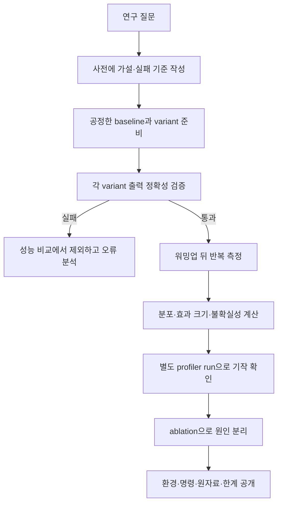

# 14. GPU 실험 설계와 연구 재현성

GPU 프로그램의 숫자가 빨라 보여도 비교 조건이 다르거나 결과가 틀리면 연구 증거가 아니다. 이 장은 “무엇이 더 빠른가?”를 측정 가능한 질문으로 바꾸고, 공정한 기준 구현을 만들고, 한 요소씩 제거해 원인을 확인하며, 다른 사람이 같은 결론을 다시 시험할 수 있게 기록하는 과정을 설명한다.

**실험(experiment)**은 입력과 조건을 통제한 뒤 관측값을 모아 가설을 평가하는 절차다. **가설(hypothesis)**은 결과를 보기 전에 적는 반증 가능한 예상이다. “커널을 최적화한다”는 성공과 실패를 가를 수 없어 가설이 아니다. 다음 문장은 가설이다.

> 같은 GPU, FP32, `4096×4096` 행렬과 같은 출력 허용 오차에서 tile-32 커널은 tile-16 커널보다 중앙 실행 시간이 짧다. 단, tile-32의 레지스터 또는 공유 메모리 사용량이 상주 블록 수를 절반 이하로 낮추면 이 예상은 기각될 수 있다.

여기에는 비교 대상, 고정할 입력, 결과 정확성, 측정값, 예상 방향, 실패 가능성이 들어 있다.

## 1. 질문을 측정 가능한 계약으로 쓰기

실험 전에 다음 다섯 항목을 한 문장 또는 표로 고정한다.

| 항목 | 구체적 예 | 필요한 이유 |
|---|---|---|
| 작업 | `C=A×B`, M=N=K=4096 | 프로그램이 수행할 일을 같게 함 |
| 자료형 | A/B/C FP32, FP32 누산 | 연산량과 오차 조건을 같게 함 |
| 독립 변수 | tile 16 대 tile 32 | 연구자가 의도적으로 바꾸는 한 요소 |
| 종속 변수 | 커널 완료 시간 중앙값 | 변화의 결과로 관찰할 숫자 |
| 정확성 기준 | FP64 CPU 기준과 `atol=1e-4`, `rtol=1e-4`, NaN 불허 | 빠르지만 틀린 구현 제외 |

**독립 변수**는 연구자가 비교를 위해 바꾸는 조건이고, **종속 변수**는 그 결과로 측정하는 값이다. **통제 변수**는 GPU, 입력, 컴파일 옵션처럼 두 조건에서 같게 유지하는 값이다. 한 번에 tile 크기, block 크기, 자료형, 입력까지 모두 바꾸면 시간 차이의 원인을 알 수 없다.

## 2. 공정한 baseline 만들기

**baseline(기준선)**은 새 방법과 비교할 기존 구현과 그 측정값이다. 기준선은 일부러 느린 코드가 아니다. 연구 질문과 같은 일을 정확히 수행하고, 합리적인 설정을 쓰며, 어떤 구현인지 재현할 수 있어야 한다.

예를 들어 새 행렬 곱 커널을 다음 세 대상과 비교할 수 있다.

1. CPU의 높은 정밀도 구현은 결과 정확성 기준을 만든다. GPU 속도 경쟁 상대는 아닐 수 있다.
2. 단순 GPU 커널은 최적화 전후의 교육적 차이를 보여 준다.
3. 같은 dtype과 shape를 지원하는 검증된 GPU 라이브러리는 실용 성능 기준을 준다.

라이브러리 baseline이 FP16 Tensor Core를 쓰고 새 커널은 FP32라면 같은 계산 계약이 아니다. 반대로 라이브러리 알고리즘 선택을 기본값으로 두었다면 버전, 환경 변수, workspace 제한을 기록한다. “baseline보다 2배 빠르다”는 말은 baseline의 설정이 공개될 때만 평가할 수 있다.

### 공정성 표

| 조건 | baseline | variant | 판정 |
|---|---|---|---|
| 입력 배열 | 같은 seed로 만든 A/B | 동일한 A/B | 공정 |
| 출력 | FP32 C | FP32 C | 공정 |
| 정확성 | 같은 참조와 허용 오차 | 같은 참조와 허용 오차 | 공정 |
| 측정 범위 | kernel only | H2D+kernel+D2H | 불공정 |
| 컴파일 | `-O3`, 같은 대상 아키텍처 | `-O3`, 같은 대상 아키텍처 | 공정 |
| 준비 비용 | plan 생성 제외 | graph 생성 포함 | 질문에 따라 재정의 필요 |

초기화 비용을 뺄지 넣을지는 정답이 하나가 아니다. 반복 서비스 요청의 정상 상태를 묻는다면 초기화 이후 시간을 비교할 수 있다. 한 번만 실행하는 명령의 사용자 대기 시간을 묻는다면 초기화도 포함해야 한다. 핵심은 두 조건에서 같은 범위를 재고 연구 질문에 그 범위를 명시하는 것이다.

## 3. 정확성 gate가 성능보다 먼저다

**gate(통과 조건)**는 다음 단계로 넘어가기 전에 반드시 만족해야 하는 조건이다. 각 variant는 시간 표에 들어가기 전에 참조 출력과 비교한다. 마지막 구현 하나만 검사하면 다른 variant의 범위 밖 접근이나 누산 오류를 놓친다.

부동소수점에서는 연산 순서가 바뀌면 마지막 비트가 달라질 수 있으므로 bitwise equality가 항상 적절하지 않다. `atol`은 값 크기와 무관한 절대 허용 오차, `rtol`은 참조 값 크기에 비례하는 상대 허용 오차다. 비교 규칙은 결과를 본 뒤 넓히지 말고 사전에 정한다. 최대 절대 오차, 최대 상대 오차, NaN/Inf 개수, 가장 나쁜 원소의 위치를 함께 남긴다.

정확성 검사는 여러 입력 분포를 포함해야 한다. 균일 난수만 쓰면 0, 매우 큰 값, 매우 작은 값, 희소 행렬, 반복 값, 정렬이 깨진 크기에서 생기는 오류를 놓친다. seed는 난수를 다시 만드는 번호지만, 같은 seed가 다른 라이브러리·버전에서도 항상 같은 배열을 보장하는지는 별도 확인해야 한다.

## 4. 비동기 실행의 측정 범위 닫기

GPU 커널 launch는 흔히 **비동기(asynchronous)**다. CPU가 작업을 스트림에 넣은 뒤 GPU 완료 전에 API가 돌아올 수 있다는 뜻이다. host 벽시계로 launch 호출 앞뒤만 재면 GPU 실행 시간이 아니라 enqueue 시간이 주로 잡힐 수 있다.

커널 전용 시간을 재려면 같은 스트림에서 시작 GPU event, 커널, 종료 event를 기록하고 종료 event 완료를 기다린 뒤 두 event 사이 시간을 읽는다. end-to-end 시간을 재려면 입력 준비, H2D 복사, 커널, D2H 복사와 필요한 완료 대기를 모두 같은 계약에 넣는다. **event**는 스트림의 특정 진행 지점을 기록하는 런타임 객체이며 완료 확인 전에는 해당 지점 이후 작업이 끝났다고 가정할 수 없다.

CPU timer를 써도 명시적 동기화로 범위를 닫을 수 있지만 동기화 자체가 포함되는 위치를 기록한다. 매 반복마다 전체 장치를 동기화하면 실제 파이프라인의 겹침을 없앨 수 있으므로, 측정 질문에 맞는 최소 완료 조건을 사용한다.

## 5. 워밍업, 반복, 순서 무작위화

첫 실행에는 CUDA context 생성, 모듈 적재, 라이브러리 plan 선택, 메모리 page 준비, 캐시 상태가 섞일 수 있다. **워밍업(warm-up)**은 이런 초기 효과를 측정 표본에서 분리하기 위한 준비 실행이다. 예를 들어 각 조건을 10회 실행해 버리고 100회를 측정한다. 워밍업 횟수는 마법의 상수가 아니며 시간이 안정되는지 확인해 정한다.

항상 A를 100회 재고 그 뒤 B를 100회 재면 온도와 clock 변화가 조건에 붙을 수 있다. A/B 순서를 무작위로 섞거나 `ABBA`처럼 교차하고, 각 순서와 timestamp를 남긴다. 같은 입력 buffer를 연속 재사용할 때 캐시가 의도한 실제 workload와 다른 이점을 주는지도 판단한다.

전원 모드, GPU clock, 온도, 다른 프로세스, MIG 설정, 컨테이너 제한을 기록한다. 통제할 수 없는 환경에서는 그 사실을 한계로 쓰고 여러 시점에 반복한다.

## 6. 평균 하나 대신 분포를 보고한다

100개 시간이 있다고 하자. **중앙값(median)**은 정렬했을 때 가운데 값이고, **백분위수(percentile)**는 표본의 일정 비율이 그 이하가 되는 경계다. p95는 약 95%의 실행이 그 시간 이하였다는 뜻이다. 평균은 모든 값을 더해 개수로 나누므로 드문 긴 지연에 크게 움직일 수 있다.

예시로 정렬 조건의 중앙값이 80 µs, p10–p90이 75–90 µs이고, 비정렬 조건의 중앙값이 86 µs, p10–p90이 76–92 µs라고 하자. 중앙값 차이는 6 µs이고 비정렬을 기준으로 한 상대 개선은 `(86-80)/86≈6.98%`다. 그러나 범위가 크게 겹친다. “항상 7% 빠르다”가 아니라 “이 환경의 표본 중앙값에서 약 7% 짧았으며 분포가 겹쳤다”고 보고한다.

**효과 크기(effect size)**는 차이가 얼마나 큰지를 나타낸다. 절대 차이 6 µs와 상대 차이 7%를 같이 쓰면 실제 의미를 판단하기 쉽다. **신뢰 구간(confidence interval)**은 반복 표본에서 추정한 효과의 불확실성 범위다. 독립성이 약한 연속 GPU 측정에 교과서 공식을 기계적으로 적용하지 말고, 실행 batch 단위 bootstrap이나 여러 프로세스 재시작처럼 실험 구조에 맞는 단위를 택한다.

여러 shape와 여러 variant를 동시에 시험해 가장 좋은 결과만 고르면 우연한 승리를 선택할 가능성이 커진다. 사전에 primary metric과 주요 shape를 정하고, 나머지는 탐색 결과로 구분한다. 통계적 유의성만으로 실용적 가치가 생기지는 않는다. 0.2% 개선이 매우 안정적이어도 배포 복잡성보다 작을 수 있다.

## 7. profiler와 counter로 기작을 확인하기

**프로파일러(profiler)**는 커널·복사 timeline 또는 하드웨어 측정값을 수집하는 도구다. **counter(카운터)**는 실행 중 특정 사건이나 양을 세는 하드웨어·도구의 측정 항목이다. 요청 섹터, DRAM 바이트, 실행된 명령, 활성 워프 등이 예다.

시간이 줄었다는 관찰과 원인 설명은 다르다. 정렬 variant가 빠르다는 가설이라면 요청 섹터와 DRAM 전송량이 줄었는지 별도 profiler run에서 확인한다. occupancy가 올랐다는 사실만 보고 속도 원인이라고 단정하지 않는다. 메모리 트래픽과 명령 수까지 함께 바뀌었을 수 있다.

프로파일러는 실행을 재생하거나 직렬화하고 오버헤드를 더할 수 있다. 따라서 일반 timing run과 profiling run을 분리한다. 도구 버전, metric 이름, 수집 pass 수, 필터를 기록한다. 카운터 이름과 의미는 GPU 세대와 도구 버전에 따라 달라질 수 있다.

## 8. ablation으로 원인을 분리하기

**ablation(요소 제거 실험)**은 완성된 방법에서 한 요소씩 빼거나 기준값으로 되돌려 그 요소의 기여를 보는 비교다. tile, vector load, fusion 세 요소를 한꺼번에 넣어 2배 빨라졌다면 무엇이 기여했는지 모른다.

| variant | tile | vector load | fusion | 중앙 시간 |
|---|---|---|---|---:|
| B0 | 없음 | 없음 | 없음 | 100 µs |
| B1 | 있음 | 없음 | 없음 | 72 µs |
| B2 | 있음 | 있음 | 없음 | 64 µs |
| B3 | 있음 | 있음 | 있음 | 55 µs |

이 순차 표에서 B0→B1은 28 µs, B1→B2는 8 µs, B2→B3는 9 µs 차이다. 하지만 요소들이 상호작용하면 순서에 따라 기여도가 달라진다. 이를 확인하려면 가능한 조합을 더 측정한다. 예를 들어 fusion만 넣은 조건과 vector만 넣은 조건도 필요하다. “각 요소가 독립적으로 정확히 X% 기여한다”는 결론은 완전 요인 실험이나 명시적 상호작용 분석 없이는 강하다.

ablation에서도 각 조건의 정확성 gate, 컴파일 설정, 반복 방법을 동일하게 적용한다. 요소를 제거하면서 block 크기까지 바꾸면 제거 효과와 자원 설정 효과가 섞인다.

## 9. scaling 실험의 질문을 분리한다

**strong scaling**은 전체 문제 크기를 고정하고 GPU 수를 늘린다. 한 GPU 100 ms, 네 GPU 30 ms이면 speedup은 `100/30≈3.33배`, 이상적인 4배 대비 효율은 `3.33/4≈83.3%`다. 데이터 분할과 all-reduce 비용이 있어 4배가 되지 않을 수 있다.

**weak scaling**은 GPU당 문제 크기를 고정해 GPU 수와 총 작업량을 함께 늘린다. 한 GPU가 100개를 100 ms, 네 GPU가 400개를 120 ms에 처리하면 처리량은 1,000/s에서 약 3,333/s로 3.33배다. latency는 늘었지만 총 처리량은 늘었다. 두 실험을 같은 “확장성” 숫자로 섞지 않는다.

multi-GPU 실험은 GPU 수, rank별 batch, global batch, 토폴로지, NCCL 버전, collective 알고리즘, gradient 평균 규칙을 기록한다. GPU 수를 늘리며 global batch까지 늘렸다면 모델 수렴과 한 step 시간 변화가 함께 생길 수 있다.

## 10. 재현 패키지에 남길 것

**재현성(reproducibility)**은 다른 사람이 기록된 조건과 절차로 같은 분석을 다시 수행해 호환되는 결론을 얻을 수 있는 성질이다. 정확히 같은 마이크로초를 요구하는 말이 아니다. 장치 편차와 환경 차이가 있으므로 원자료와 범위를 공개한다.

최소 기록은 다음과 같다.

- GPU 모델, 개수, 연결 토폴로지, compute capability
- OS, kernel, driver, CUDA toolkit, compiler, 사용 라이브러리 버전
- 소스 commit, 빌드 명령, compiler flags, 환경 변수
- 전원·clock 정책, 온도 관찰, 동시 실행 프로세스 조건
- 입력 shape, dtype, seed, 데이터 생성법과 checksum
- baseline과 모든 variant의 정확성 결과
- 워밍업 횟수, 반복 횟수, 실행 순서, 동기화 지점
- 원시 시간 표본, 요약 스크립트, profiler 명령과 원본 report
- 실패한 OOM, timeout, 지원하지 않는 명령이나 dtype
- 사전에 정한 가설과 사후 탐색에서 발견한 항목의 구분

문서에 나온 최신 CUDA 기능이 설치 장치에서 자동으로 지원되는 것은 아니다. runtime query와 공식 호환성 표로 장치, 드라이버, toolkit 조건을 확인한다. 이 장의 예시 시간은 실험 설계를 설명하기 위한 가상 숫자이며 실제 측정값이 아니다.

+## 10.1 결과가 예상과 다를 때의 진단 순서

variant가 느리면 곧바로 아이디어가 틀렸다고 결론 내리지 않는다. 먼저 출력 정확성과 측정 경계를 다시 확인한다. 다음으로 launch 수, H2D/D2H 바이트, 커널별 시간을 timeline에서 확인한다. 그 뒤 각 커널의 명령 수, DRAM 바이트, 요청 섹터, 상주 워프, 레지스터와 공유 메모리 사용량을 가설에 맞춰 좁혀 본다. 마지막으로 장치 온도, clock, 다른 프로세스와 실행 순서가 두 조건에 다르게 작용했는지 본다.

예를 들어 tile-32가 tile-16보다 느리고 프로파일러에서 레지스터가 스레드당 40개에서 96개로 늘었다고 하자. 동시에 SM당 상주 블록이 4개에서 1개로 줄고 메모리 stall이 늘었다면 “큰 타일이 데이터 재사용을 늘렸지만 레지스터 제한이 지연 은폐 능력을 낮췄다”는 설명을 시험할 수 있다. block 크기를 유지한 채 타일 내부 계산이나 레지스터 사용을 줄인 새 variant로 다시 측정해야 인과 설명이 강해진다. 한 번의 counter 상관만으로 원인을 확정하지 않는다.

반대로 시간은 줄었는데 DRAM 바이트가 같다면 정렬 가설이 틀렸거나 캐시·명령·launch 수 같은 다른 요소가 변했을 수 있다. 기대한 카운터가 움직이지 않은 결과도 유용하다. 가설 기각과 구현 실패를 구분하고 원자료에 남긴다.

## 10.2 중단 기준과 부정적 결과

실험을 오래 반복하면 우연히 좋은 표본을 얻을 수 있으므로 반복 횟수와 중단 기준을 미리 정한다. 예를 들어 “각 조건 10회 워밍업, 10개 batch마다 20회 측정, 최대 5 batch, 중앙값 차이의 bootstrap 구간 폭이 2% 아래면 조기 종료”처럼 쓴다. 결과를 보며 유리할 때만 멈추면 편향이 생긴다.

정확성을 만족하지만 속도 차이가 잡음 범위에 있거나, 메모리 절감과 실행 시간 개선이 함께 나오지 않은 결과도 기록한다. 부정적 결과는 어떤 조건에서 기법의 비용이 이득보다 큰지를 알려 준다. 연구 결론은 “효과가 없다”보다 “시험한 장치·shape·오차 기준에서 사전 성공 기준을 넘지 못했다”처럼 관측 범위를 포함한다.

## 11. 문제와 완전 해설

### 문제 1. 불공정한 비교 찾기

A는 kernel-only 2 ms이고 B는 H2D+kernel+D2H 3 ms다. A가 빠르다고 결론 내려도 되는가?

**해설.** 안 된다. 측정 경계가 다르다. 두 구현 모두 kernel-only로 재거나 모두 end-to-end로 재야 한다. 어떤 경계가 중요한지는 연구 질문에서 정한다.

### 문제 2. 비동기 timer

host timer로 launch 직전과 API 반환 직후를 쟀더니 8 µs다. 커널 시간이 8 µs인가?

**해설.** 완료를 기다리지 않았다면 주로 enqueue 시간일 수 있다. GPU event 또는 명시적 완료를 사용해 측정 범위를 닫아야 한다.

### 문제 3. 상대 개선 계산

baseline 중앙값 50 µs, variant 40 µs다. baseline 기준 감소율은 얼마인가?

**해설.** 절대 차이는 10 µs이고 감소율은 `(50-40)/50=0.2`, 즉 20%다. “1.25배 빠르다”는 처리 속도 비 `50/40=1.25`와 표현 기준이 다르므로 식을 함께 쓴다.

### 문제 4. ablation 해석

tile+fusion이 60 µs, tile만 70 µs, 아무것도 없을 때 100 µs다. fusion의 독립 기여가 정확히 10 µs인가?

**해설.** tile이 있는 조건에서 fusion을 추가한 조건부 차이는 10 µs다. fusion만 있는 조건이 없으므로 tile과의 상호작용 없이 독립적으로 10 µs라고 일반화할 수 없다.

### 문제 5. 가장 빠른 표본 선택

100회 중 최솟값만 보고하는 것이 위험한 이유는?

**해설.** 우연히 유리한 clock, cache, 시스템 상태의 한 번을 대표값으로 고를 수 있다. 원자료 분포, 중앙값과 꼬리 백분위를 함께 보고해야 한다.

### 문제 6. strong scaling

한 GPU 120 ms, 네 GPU 42 ms다. speedup과 병렬 효율은?

**해설.** speedup은 `120/42≈2.86`, 효율은 `2.86/4≈71.4%`다. 통신과 불균형을 profiler와 rank별 시간으로 조사할 수 있지만 이 두 숫자만으로 원인은 확정할 수 없다.

### 문제 7. 정확성 허용 오차

결과를 본 뒤 variant가 실패하자 `rtol`을 10배 늘렸다. 왜 문제가 되는가?

**해설.** 성능 결과에 맞춰 성공 규칙을 바꾸면 틀린 구현을 선택할 편향이 생긴다. 허용 오차는 dtype과 응용 요구에 따라 사전에 정하고, 변경했다면 새 가설과 새 실험으로 기록한다.

### 문제 8. 재현 실패

다른 GPU에서 개선율이 2%뿐이다. 원 연구가 거짓인가?

**해설.** 즉시 그렇게 결론 낼 수 없다. 원 주장의 장치·shape·버전 범위를 확인하고, 메모리 대역폭·자원 제한·알고리즘 선택 차이를 조사한다. 원문이 모든 GPU에 일반화했다면 범위가 과도했고, 특정 환경 주장이라면 새 결과는 적용 범위를 넓히는 추가 증거다.

## 공식 자료

- [CUDA C++ Best Practices Guide](https://docs.nvidia.com/cuda/cuda-c-best-practices-guide/)
- [Nsight Systems User Guide](https://docs.nvidia.com/nsight-systems/)
- [Nsight Compute Documentation](https://docs.nvidia.com/nsight-compute/)
- [NVIDIA Developer Blog: CUDA Events timing](https://developer.nvidia.com/blog/how-implement-performance-metrics-cuda-cc/)

[이전: 13. 로컬 모형](13-local-models.md) · [목차](README.md) · [다음: 15. 문제·용어](15-exercises-glossary-and-sources.md)
