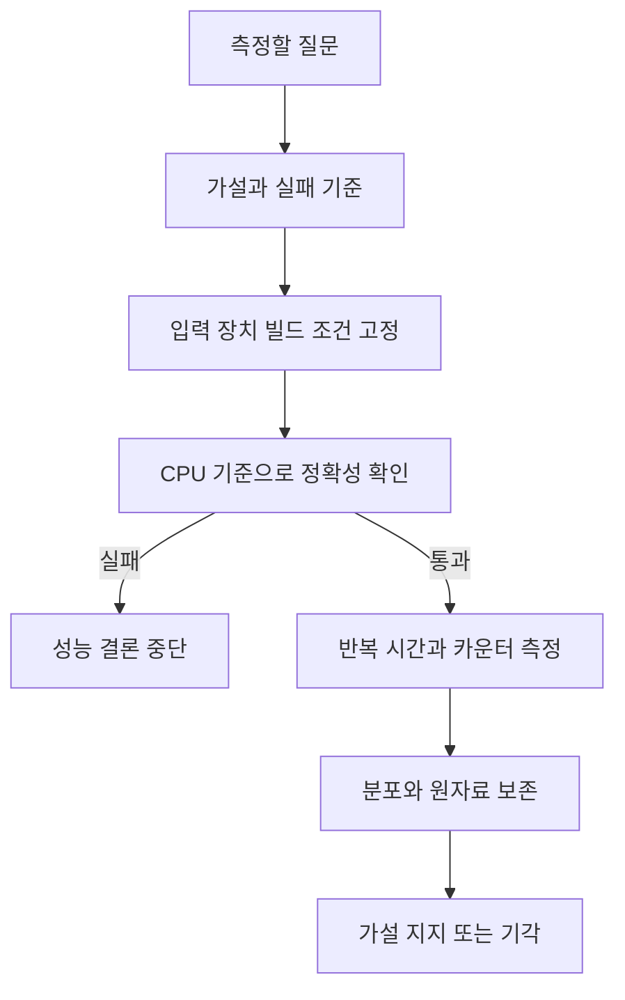
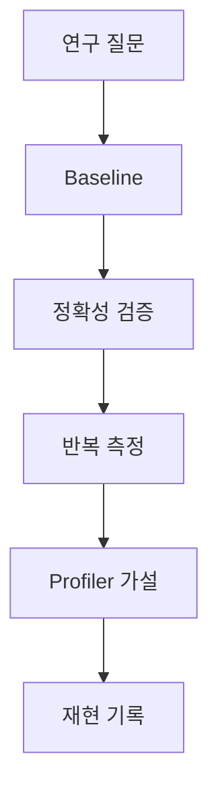

# 14. GPU 실험과 연구 재현성

## 실험은 질문을 측정 가능한 문장으로 바꾸는 일이다

**가설(hypothesis)**은 관찰 전에 세우는 반증 가능한 예상이다. “최적화한다”는 가설이 아니다. “1 MiB 연속 입력에서 시작 주소를 128바이트 경계에 맞추면, 같은 계산과 출력 정확도를 유지한 채 4바이트 어긋난 입력보다 요청 섹터 수가 줄고 중앙 실행 시간이 짧아진다”처럼 입력, 변경 변수, 관측값, 성공 조건을 적는다.

실험을 설계하는 주체는 개발자지만 시간을 기록하는 주체는 GPU 이벤트 또는 프로파일러다. CPU 벽시계는 비동기 커널이 끝나기 전에 호출 구간만 잴 수 있다. 측정 객체가 커널 실행인지, 메모리 복사까지 포함한 요청인지 먼저 정한다.

| 항목 | 고정하거나 기록할 값 | 필요한 이유 |
|---|---|---|
| 입력 | 1 MiB, 같은 난수 시드 | 실행마다 일이 달라지지 않게 함 |
| 독립 변수 | 시작 오프셋 0B와 4B | 한 번에 한 조건만 바꿈 |
| 정확성 | CPU 기준과 최대 절대 오차 0 | 빠르지만 틀린 결과 제외 |
| 준비 | 조건마다 10회 워밍업 | 초기화 영향을 측정 밖으로 둠 |
| 측정 | 조건마다 100회 GPU 이벤트 | 비동기 실행 완료를 포함 |
| 요약 | 중앙값과 10·90백분위수 | 우연한 긴 지연을 드러냄 |
| 증거 | 요청 섹터와 처리 바이트 | 시간 차이와 가능한 원인 연결 |

먼저 두 출력이 같은지 확인한다. 틀린 반복이 하나라도 있으면 성능 결론을 보류한다. 정렬 조건 중앙값 80 μs, 비정렬 조건 86 μs이면 관측 차이는 6 μs, 비정렬 대비 약 7%다. 그러나 10~90백분위 범위가 75~90 μs와 76~92 μs로 크게 겹치면 “항상 7% 빠르다”고 일반화할 수 없다.

한 GPU와 한 입력의 결과를 모든 세대로 일반화하지 않는다. 보고서에는 GPU 모델, 드라이버와 툴킷 버전, 전원 상태, 컴파일 옵션, 입력 생성법, 실행 명령, 원자료를 남긴다. 최신 문서의 기능도 설치된 드라이버와 장치가 지원한다는 뜻은 아니다.

### 실패 조건

- 변경 변수와 함께 블록 크기까지 바꾸면 어느 변화가 결과를 만들었는지 분리할 수 없다.
- 평균만 기록하면 드문 긴 지연을 숨길 수 있다.
- 프로파일러를 켠 시간은 계측 오버헤드가 있으므로 일반 실행 시간과 섞지 않는다.
- 출력 오차 범위를 결과를 본 뒤 넓히면 실험 규칙이 바뀐다.

[이전: 13. 로컬 모형](13-local-models.md) · [목차](README.md) · [다음: 15. 문제·용어](15-exercises-glossary-and-sources.md)

GPU 실험은 빠른 숫자 하나보다 비교 가능한 조건과 정확한 결과를 남긴다.

## 1. 질문

“Tile 16과 32 중 같은 FP32 matmul에서 어느 쪽이 빠르고 왜인가?”처럼 입력, 결과 의미, 변수 하나를 적는다.

## 2. Baseline

단순 CPU 또는 검증된 library 결과를 둔다. Optimization 전 GPU kernel 결과부터 맞춘다.

## 3. 고정 항목

GPU model, compute capability, driver, toolkit, compiler flags, library, clock/power policy, input shape·dtype를 기록한다.

## 4. Warm-up

첫 실행에는 context/module load와 cache 준비가 섞일 수 있다. Warm-up과 측정 반복을 분리한다.

## 5. Synchronization

Async launch 직후 host timer를 멈추면 enqueue만 잰다. Event 또는 명시적 completion으로 측정 범위를 닫는다.

## 6. 반복

최소·중앙값·p95 등 분포를 기록한다. 가장 빠른 한 번만 보고하지 않는다.

## 7. Outlier

다른 process, thermal, clock 변화가 outlier를 만들 수 있다. 임의 삭제보다 기준과 원인을 기록한다.

## 8. Correctness gate

각 configuration에서 result를 reference와 비교한 뒤 시간 표에 포함한다. 틀린 빠른 결과를 제외한다.

## 9. Floating tolerance

Atol·rtol과 reference precision, NaN/Inf 정책을 명시한다. Shape별 worst error도 본다.

## 10. Seed

Random input seed를 기록한다. Seed만으로 library algorithm과 hardware 차이가 사라지지는 않는다.

## 11. Dataset

Synthetic uniform input만 쓰면 skew, sparsity, alignment 문제를 놓칠 수 있다. 대표 workload 분포를 포함한다.

## 12. End-to-end

Copy, preprocessing, kernel, collective, result copy를 포함한 시간과 kernel-only를 둘 다 보고한다.

## 13. Profiler overhead

Profiler 수집 자체가 실행을 serialize하거나 overhead를 만들 수 있다. Timing run과 profiling run을 분리한다.

## 14. Counter 재현성

Counter 이름·수집 pass·도구 version을 기록한다. 여러 pass replay가 workload를 반복할 수 있다.

## 15. Ablation

Shared tiling만 제거, vector load만 제거처럼 한 요소씩 빼 효과를 확인한다.

## 16. Scaling

Input 크기를 늘리며 latency와 throughput을 본다. 작은 size의 launch-bound와 큰 size의 bandwidth-bound를 구분한다.

## 17. Multi-GPU

GPU 수, local batch, global batch, topology, collective algorithm을 기록한다. Strong/weak scaling을 명시한다.

## 18. Energy

성능뿐 아니라 power·energy를 연구한다면 sampling 방법과 단위를 적는다. 순간 power와 작업당 joule을 구분한다.

## 19. 실패 기록

OOM, unsupported opcode/type, timeout, thermal throttling도 결과다. 성공 run만 남기지 않는다.

## 20. Version 지원

CUDA 13.2 문서의 기능이 설치 GPU에서 지원된다고 가정하지 않는다. Runtime query와 compatibility table을 기록한다.

## 21. 연구 주장 범위

한 GPU와 세 shape 결과를 “모든 GPU에서 빠르다”고 확대하지 않는다. 관찰 범위를 제목과 결론에 쓴다.

## 22. 예시 결과표

| variant | shape | median ms | p95 ms | max error | note |
| --- | --- | ---: | ---: | ---: | --- |
| naive | 1024² | 8.2 | 8.5 | 1e-5 | baseline |
| tile16 | 1024² | 3.1 | 3.3 | 1e-5 | same dtype |

숫자는 형식 예이며 측정값이 아니다.

## 23. 반례

Profiler에서 occupancy가 올라간 뒤 시간이 줄었다고 occupancy가 원인이라고 즉시 확정하지 않는다. Memory traffic도 함께 변했을 수 있다.

한 번의 2% 차이는 noise일 수 있다.

## 문제와 해설

**문제 1.** Async kernel을 host timer만 감싸면 무엇을 잴 수 있는가?

**해설.** 주로 enqueue 시간일 수 있다. Completion으로 범위를 닫는다.

**문제 2.** Correctness check를 마지막 variant 한 개만 해도 되는가?

**해설.** 아니다. 각 variant가 다른 bug를 가질 수 있다.

**문제 3.** Toolkit version만 기록하면 충분한가?

**해설.** GPU, driver, compiler flags, library, workload 조건도 필요하다.

## 공식 자료

- [CUDA Best Practices Guide](https://docs.nvidia.com/cuda/cuda-c-best-practices-guide/)
- [Nsight Systems](https://docs.nvidia.com/nsight-systems/)
- [Nsight Compute](https://docs.nvidia.com/nsight-compute/)
