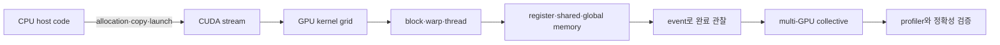

# 15. GPU 프로그래밍 종합 문제와 연결형 용어사전

[이전: 14. 실험과 연구](14-experiments-and-research.md) · [목차](README.md)

이 장은 용어를 한 줄씩 외우는 사전이 아니다. CPU가 GPU 작업을 만들고, 메모리를 준비하고, 커널을 실행하고, 여러 GPU의 결과를 합치며, 측정값으로 병목을 찾는 한 흐름 안에서 개념을 연결한다. 각 객체가 어디에 있고, 누가 관리하며, 언제 생기고 사라지는지를 먼저 확인한다.

## 1. 한 요청의 수명으로 보는 기본 객체

**CPU(Central Processing Unit)**는 운영체제와 일반 프로그램을 실행하는 처리 장치다. 이 교재에서 CPU에서 실행되는 C/C++ 또는 Python 프로그램 부분을 **host(호스트)**라고 부른다. **GPU(Graphics Processing Unit)**는 많은 실행 단위를 두고 같은 형태의 계산을 대량 데이터에 적용하는 장치다. CUDA 문맥에서 GPU와 GPU가 볼 수 있는 자원을 **device(디바이스)**라고 부른다.

호스트 프로그램은 먼저 입력 배열의 크기와 자료형을 정한다. **allocation(할당)**은 일정 크기의 메모리 영역을 사용할 수 있도록 런타임이나 운영체제에 요청하는 작업이다. host 메모리는 주 메모리 RAM에, device allocation은 GPU의 전역 메모리 주소 공간에 놓인다. 할당 객체는 해제하거나 프로세스가 끝날 때까지 존재한다. 비동기 복사나 커널이 아직 사용하는 동안 해제하면 수명이 끝난 객체를 접근하는 오류가 된다.

호스트는 작업을 **stream(스트림)**에 넣는다. 스트림은 GPU 연산을 enqueue하는 순서가 있는 런타임 객체다. 생성부터 파괴까지 존재하며, 같은 스트림에서는 앞 작업과 뒤 작업의 순서를 정의한다. 서로 다른 스트림 사이에는 event나 명시적 동기화가 없으면 필요한 순서가 자동으로 생기지 않는다. **event(이벤트)**는 스트림의 특정 지점을 기록하는 객체다. event 완료를 관찰하면 그 지점까지의 작업이 끝났다는 조건을 만들 수 있다.

호스트가 **kernel(커널)**을 launch하면 한 번의 launch에 속하는 전체 스레드 집합인 **grid(그리드)**가 만들어진다. grid는 여러 **block(블록)**으로 나뉜다. 블록은 공유 메모리와 블록 배리어를 함께 쓰는 스레드 집합이다. **thread(스레드)**는 커널 함수 본문을 한 인덱스 조합으로 실행하는 논리 인스턴스다. 이 객체들은 launch 동안 존재하고 커널이 끝나면 사라진다.

블록의 스레드는 보통 32개씩 **warp(워프)**라는 스케줄 단위로 묶인다. **lane(레인)**은 워프 안의 0..31 위치다. 워프와 레인은 프로그램이 별도 allocation으로 만드는 메모리 객체가 아니라 GPU 실행기가 스레드 ID를 묶어 관리하는 실행 단위다. GPU 세대와 프로그래밍 모형의 세부 조건은 공식 문서를 확인해야 하며, “항상 모든 lane이 같은 순간 같은 명령을 끝낸다”는 단순 가정은 동기화 계약을 대신하지 못한다.

## 2. 인덱스가 주소가 되는 과정

1차원 grid에서 흔히 쓰는 전역 논리 인덱스는 다음과 같다.

\[
i=blockIdx.x\times blockDim.x+threadIdx.x
\]

`blockIdx.x`는 grid 안 블록 번호, `blockDim.x`는 블록당 스레드 수, `threadIdx.x`는 블록 안 스레드 번호다. 배열 길이 `n`보다 grid를 크게 반올림해 만들 수 있으므로 `if (i<n)` 경계 검사가 필요하다.

FP32 배열에서 원소 하나가 4바이트이고 배열 시작 주소가 `base`라면 원소 i의 바이트 주소는 `base+4i`다. **alignment(정렬)**은 주소가 16, 32, 128바이트 같은 요구 경계의 배수인 성질이다. **stride(스트라이드)**는 이웃 스레드나 반복 접근 사이의 간격이다. 논리 인덱스가 연속이어도 구조체 배치나 pitch 때문에 실제 바이트 주소가 연속이 아닐 수 있다.

**coalescing(병합 접근)**은 한 워프의 메모리 요청이 적은 수의 메모리 요청 단위로 처리될 수 있게 주소가 배치된 성질이다. **transaction(트랜잭션)**은 메모리 계층이 처리하는 전송 요청이고, **sector(섹터)**는 캐시나 요청을 설명할 때 쓰는 작은 바이트 구간이다. 교육 모형에서 32레인이 base 0부터 4바이트씩 읽으면 범위는 0..127이고 32바이트 섹터 4개다. base 4이면 4..131이라 섹터 5개에 닿는다. 실제 transaction 수와 성능은 GPU 세대, 캐시 상태, 접근 크기에 따라 측정해야 한다.

**AoS(Array of Structures)**는 각 객체의 모든 필드를 붙여 저장하고, **SoA(Structure of Arrays)**는 같은 필드끼리 배열로 나눈다. 32개 스레드가 각 객체의 한 필드만 읽는다면 AoS의 큰 객체 크기가 stride가 되어 주소가 흩어질 수 있고 SoA는 연속 주소가 될 수 있다. 그러나 객체 하나의 여러 필드를 함께 쓰는 CPU 코드에서는 AoS가 유리할 수도 있으므로 배치 선택은 실제 접근 패턴으로 결정한다.

## 3. GPU 안의 메모리와 수명

**register(레지스터)**는 한 스레드의 계산 중간값을 담는 빠른 on-chip 저장 자원이다. 커널 실행 동안 해당 스레드에 속하며 컴파일러가 배치한다. 스레드당 레지스터 요구가 높아 SM에 동시에 둘 수 있는 워프 수가 줄어드는 현상을 **register pressure(레지스터 압박)**라고 한다.

레지스터에 두지 못한 값을 **spill(스필)**한다고 표현한다. 스필 값은 논리적으로 스레드 전용인 **local memory(로컬 메모리)** 주소 공간에 놓인다. 이름에 local이 있어도 반드시 on-chip이라는 뜻은 아니며 실제 경로는 장치 메모리와 캐시를 거칠 수 있다. 스필 여부와 비용은 컴파일 결과와 프로파일러로 확인한다.

**shared memory(공유 메모리)**는 같은 블록의 스레드가 함께 쓰는 on-chip scratchpad다. 블록이 SM에 상주하는 동안 존재하고 블록 종료와 함께 사라진다. 프로그램이 어떤 데이터를 어느 인덱스에 둘지 결정한다. **global memory(전역 메모리)**는 GPU의 큰 주소 공간이며 여러 블록과 커널이 볼 수 있다. allocation 수명이 커널 하나보다 길 수 있으므로 stream 완료와 해제 순서를 관리해야 한다.

공유 메모리는 동시에 접근할 수 있는 내부 **bank(뱅크)**로 나뉜다. 한 워프가 서로 다른 주소인데 같은 bank에 몰리면 **bank conflict(뱅크 충돌)**로 접근이 여러 차례 처리될 수 있다. 모두 정확히 같은 주소를 읽는 **broadcast(브로드캐스트)** 경로와는 다르다. 32-bank, 4바이트 word 교육 모형에서 lane `l`이 `shared[32l]`을 읽으면 모든 word index가 나머지 0이라 bank 0에 몰린다.

**cache(캐시)**는 최근 데이터를 더 가까운 계층에 보관하는 하드웨어 관리 저장소다. 공유 메모리와 달리 프로그램이 각 바이트를 직접 배치하지 않는다. 캐시 적중은 실행 이력에 따라 달라지므로 첫 실행과 반복 실행의 상태가 다를 수 있다.

## 4. 순서, barrier, race, atomic

**synchronization(동기화)**은 여러 실행 주체 사이에 필요한 실행 순서와 메모리 가시성 관계를 만드는 규칙이다. **barrier(배리어)**는 참여 주체가 모두 도달할 때까지 각 주체를 기다리게 하는 지점이다. CUDA의 `__syncthreads()`는 블록 범위 배리어다. 블록의 일부 스레드만 배리어에 들어가고 나머지는 건너뛰면 모든 참여자가 도달하지 않아 진행이 멈추거나 정의되지 않은 결과가 생길 수 있다.

**data race(데이터 레이스)**는 같은 메모리 위치에 충돌하는 접근이 있고, 그중 하나 이상이 쓰기이며, 필요한 동기화 관계가 없는 상황이다. 예를 들어 한 스레드가 shared tile을 쓰는 동안 다른 스레드가 같은 위치를 읽으면 이전 값과 새 값 중 무엇을 볼지 정해지지 않는다. 타일 적재 뒤 계산 전 배리어와, 계산 뒤 다음 타일로 덮어쓰기 전 배리어가 각각 필요한 이유다.

**atomic(원자 연산)**은 한 위치의 read-modify-write를 분리되지 않는 한 연산으로 수행한다. 여러 스레드가 `counter += 1`을 일반 load/add/store로 수행하면 갱신을 잃을 수 있지만 atomic add는 그 위치의 갱신을 직렬화한다. 원자성은 그 주소 하나의 갱신 계약이며 모든 다른 메모리의 순서를 자동으로 해결하지 않는다.

**scope(범위)**는 atomic이나 동기화 관계가 연결할 수 있는 관찰자 집합이고, **memory order(메모리 순서)**는 원자 연산 주변의 다른 메모리 접근에 어떤 순서를 보장하는지 정한다. **fence(펜스)**는 지정한 범위에서 메모리 순서와 가시성 관계를 만드는 primitive다. device 범위로 충분한지 CPU와 다른 장치까지 포함하는 system 범위가 필요한지는 생산자와 소비자 위치로 결정한다.

## 5. reduction, scan, 행렬 곱

**reduction(축약)**은 여러 입력을 덧셈·최댓값 같은 결합 연산으로 하나의 결과로 줄인다. `[1,2,3,4,5,6,7,8]`의 덧셈 트리는 `[3,7,11,15]→[10,26]→[36]`이다. 각 단계에서 다음 단계가 읽기 전에 이전 단계 쓰기가 끝나야 한다. 연산의 **identity(항등원)**는 결합해도 값을 바꾸지 않는 값이다. 덧셈은 0, 곱셈은 1이다.

**scan(누적 접두 연산)**은 하나의 최종값만 만들지 않고 각 접두 구간의 결과를 만든다. 입력 `[3,1,4,2]`의 inclusive sum scan은 `[3,4,8,10]`, exclusive sum scan은 `[0,3,4,8]`이다. inclusive는 현재 원소를 포함하고 exclusive는 현재 원소 앞까지만 포함한다. 병렬 scan은 단계마다 다른 스레드가 쓴 값을 읽으므로 인덱스와 배리어를 함께 검증해야 한다.

행렬 곱 `C[i][j]`는 A의 i행과 B의 j열의 점곱이다. **tiling(타일링)**은 입력을 작은 타일로 나누어 공유 메모리에서 재사용하는 방법이다. 각 스레드는 출력 원소의 부분합을 **accumulator(누산기)**에 보관한다. 경계 타일에서는 범위 밖 원소를 덧셈 항등원 0으로 채울 수 있다. 모든 스레드가 타일 적재를 끝낸 뒤 읽고, 현재 타일 계산을 끝낸 뒤 다음 타일로 덮어써야 한다.

**Tensor Core**는 지원되는 작은 행렬 연산을 가속하는 GPU 하드웨어 경로다. FP16, BF16, TF32, FP8 같은 입력 형식과 누산 형식에는 장치 세대별 지원 조건이 있다. **mixed precision(혼합 정밀도)**은 입력·누산·출력에 서로 다른 정밀도를 쓰는 방식이다. 낮은 정밀도 입력은 메모리와 계산량을 줄일 수 있지만 **rounding(반올림)**, **overflow(표현 최대 범위 초과)**, **underflow(아주 작은 값이 0 또는 subnormal 쪽으로 이동)**가 결과에 영향을 준다. 같은 수학식을 계산해도 연산 순서가 바뀌면 bitwise 결과가 달라질 수 있다.

## 6. 비동기 복사, pinned memory, graph

**H2D**는 host-to-device 복사, **D2H**는 device-to-host 복사다. 비동기 복사는 API 반환과 실제 완료 시점이 분리된다. 입력 host buffer를 복사가 끝나기 전에 덮어쓰거나 device buffer를 커널 완료 전에 해제하면 아직 진행 중인 작업과 수명이 충돌한다.

**pinned memory(페이지 고정 메모리)**는 운영체제가 물리 페이지를 다른 곳으로 옮기지 않도록 고정한 host 메모리다. DMA 전송에 사용할 수 있지만 무제한으로 잡으면 시스템이 사용할 pageable 메모리가 줄어든다. **DMA(Direct Memory Access)**는 CPU가 각 바이트를 복사하지 않고 장치가 메모리 전송을 수행하는 기능이다.

**double buffering(이중 버퍼링)**은 두 버퍼를 번갈아 써서 한 버퍼의 계산과 다른 버퍼의 복사를 겹치는 방식이다. 겹침은 별도 stream, 하드웨어 copy engine, pinned host memory, 의존성 배치 같은 조건이 충족되어야 한다. timeline에서 실제 겹침을 확인하기 전에는 이론적 pipeline을 실측 결과로 말하지 않는다.

**CUDA Graph**는 GPU 연산 node와 dependency edge를 저장한 실행 객체다. 반복 launch의 host 제어 비용을 줄일 수 있지만 graph 생성·instantiate 비용이 있다. 생성 비용이 1 ms이고 replay마다 5 µs를 절약한다면 손익분기 반복 수는 `1000/5=200회`다. 입력 shape와 포인터가 자주 바뀌어 graph를 다시 만들면 이득이 줄 수 있다.

## 7. SM, occupancy, Roofline, profiler

**SM(Streaming Multiprocessor)**은 워프를 상주시켜 명령을 실행하는 GPU 내부 단위다. **residency(상주)**는 블록과 워프가 SM의 레지스터·공유 메모리·스레드 슬롯을 배정받아 실행 가능한 상태다. **occupancy(점유율)**는 하드웨어 최대 활성 워프 수 대비 상주 워프 수 비율이다.

SM 최대 64워프 중 40워프가 상주하면 occupancy는 `40/64=62.5%`다. 높은 occupancy는 메모리 지연 동안 다른 워프를 실행할 기회를 늘릴 수 있지만 그 자체가 속도는 아니다. 레지스터를 줄여 occupancy를 높였는데 스필 트래픽이 늘면 더 느릴 수 있다.

**arithmetic intensity(산술 집약도)**는 이동한 바이트당 수행한 연산 수다. **Roofline 모형**은 메모리 대역폭 상한과 계산 처리량 상한 가운데 작은 쪽으로 가능한 성능 상한을 해석한다. 최대 계산 10 TFLOP/s, 대역폭 1 TB/s이면 ridge point는 10 FLOP/byte다. 집약도 3 FLOP/byte인 커널의 대역폭 roof는 3 TFLOP/s다. 실제 성능은 이 상한 아래이며 명령 의존성, occupancy, 불규칙 접근이 차이를 만든다.

**latency(지연 시간)**는 한 작업 완료까지 걸린 시간이고, **throughput(처리량)**은 단위 시간에 끝낸 작업량이다. **profiler(프로파일러)**는 timeline과 counter를 수집하는 도구다. 측정 자체가 실행에 영향을 줄 수 있어 일반 timing run과 profiler run을 구분한다. “메모리 병목” 주장은 실행 시간만이 아니라 DRAM 바이트, 요청 섹터, stall과 예상 Roofline 위치 같은 증거를 함께 본다.

## 8. 여러 GPU와 collective

**rank(랭크)**는 분산 실행 참여자의 논리 번호이고, **collective(집합 통신)**는 communicator의 모든 참여자가 정해진 연산을 함께 호출하는 통신이다. broadcast는 root 데이터를 모두에게 보내고, reduce는 여러 값을 root에 결합하며, all-reduce는 결합 결과를 모두가 받는다. all-gather는 각 rank 조각을 모두 모으고, reduce-scatter는 결합 결과 조각을 rank별로 나눈다.

4개 rank가 각각 `[1,10,100,1000]`, `[2,20,200,2000]`, `[3,30,300,3000]`, `[4,40,400,4000]`을 가진 sum all-reduce의 결과는 모든 rank에서 `[10,100,1000,10000]`이다. 학습에서 평균 gradient가 필요하다면 합을 world size 4로 나누어야 한다. 라이브러리가 자동으로 합과 평균 중 무엇을 하는지 API 계약을 확인한다.

**ring algorithm**은 rank를 고리로 연결해 조각을 순환시키고, **tree algorithm**은 트리의 가지를 따라 결합한 뒤 결과를 전파한다. 큰 메시지에서는 ring의 링크 활용이 유리할 수 있고 작은 메시지에서는 tree의 단계 수가 유리할 수 있지만 실제 선택은 라이브러리, 토폴로지, 프로토콜에 따라 달라진다.

**P2P(peer-to-peer)**는 GPU가 다른 GPU 메모리와 직접 통신할 수 있는 경로다. **RDMA(Remote Direct Memory Access)**는 원격 장치 메모리로 CPU 복사를 줄이는 전송 방식이고, GPUDirect RDMA는 지원 조건에서 NIC와 GPU 메모리 사이 경로를 제공한다. GPU, PCIe/NVLink, switch, NIC의 실제 연결인 **topology(토폴로지)**가 병목을 결정할 수 있다.

## 9. 종합 문제와 완전 해설

### 문제 1. 전역 인덱스와 경계

block 크기 128, `blockIdx.x=2`, `threadIdx.x=17`의 전역 인덱스는 무엇이며 n=270이면 접근해도 되는가?

**해설.** `2×128+17=273`이다. 273은 270 이상이므로 `if(i<n)` 안에서는 작업하지 않는다. grid에 스레드가 존재한다는 사실과 유효 배열 원소를 맡는다는 사실은 다르다.

### 문제 2. warp와 lane

블록 안 `threadIdx.x=77`의 warp 번호와 lane은?

**해설.** `77//32=2`번 warp, `77%32=13`번 lane이다. 이 번호는 블록 안 1차원 스레드 번호를 기준으로 한 교육 계산이다.

### 문제 3. 비정렬 접근

32레인이 base 4에서 4바이트씩 연속 읽을 때 32바이트 섹터 수는?

**해설.** 시작 주소는 4..128이고 실제 바이트 범위는 4..131이다. 섹터 0,1,2,3,4에 닿으므로 5개다. 섹터 수만으로 실제 시간 비율을 결정할 수는 없다.

### 문제 4. bank conflict와 broadcast

lane `l`이 `shared[32l]`을 읽는 경우와 모든 lane이 `shared[0]`을 읽는 경우는 같은가?

**해설.** 전자는 서로 다른 주소가 같은 bank 0에 몰리는 충돌 사례다. 후자는 같은 주소를 읽는 broadcast가 가능한 사례다. bank 번호가 같다는 사실만 보고 둘을 같게 분류하면 안 된다.

### 문제 5. 분기 안의 배리어

64-thread 블록에서 `threadIdx.x<32`인 스레드만 `__syncthreads()`를 호출해도 되는가?

**해설.** 안 된다. 블록 전체가 같은 방식으로 배리어에 참여해야 하는 계약을 어긴다. 첫 워프가 모두 도달해도 둘째 워프가 오지 않으므로 블록 배리어가 완료될 조건이 없다.

### 문제 6. reduction

`[1,2,3,4,5,6,7,8]`의 트리 덧셈 단계를 쓰고 결과를 구하라.

**해설.** 이웃 쌍을 더해 `[3,7,11,15]`, 다시 `[10,26]`, 마지막으로 `[36]`이다. 공유 메모리 병렬 구현에서는 단계 사이에 다음 읽기가 이전 쓰기보다 먼저 가지 않도록 동기화해야 한다.

### 문제 7. scan

입력 `[3,1,4,2]`의 inclusive와 exclusive 덧셈 scan은?

**해설.** inclusive는 현재 값까지 더해 `[3,4,8,10]`이다. exclusive는 현재 값 앞까지만 더하며 첫 위치는 항등원 0이므로 `[0,3,4,8]`이다.

### 문제 8. tile 행렬 곱

A=`[[1,2],[3,4]]`, B=`[[5,6],[7,8]]`에서 `C[0][1]`은?

**해설.** A의 0행 `[1,2]`와 B의 1열 `[6,8]` 점곱이므로 `1×6+2×8=22`다. 타일 크기는 계산 순서와 재사용을 바꾸지만 필요한 두 항은 바꾸지 않는다.

### 문제 9. 비동기 수명

async H2D를 enqueue한 직후 host 입력 버퍼를 새 요청에 재사용해도 되는가?

**해설.** 해당 복사가 완료되었다는 event나 stream 조건을 확인하기 전에는 안 된다. DMA가 아직 버퍼를 읽을 수 있다. API가 반환된 시점은 작업 완료 시점과 다르다.

### 문제 10. occupancy

SM 최대 64워프 중 40워프가 상주한다. occupancy는 얼마이며 커널이 빠르다고 결론 낼 수 있는가?

**해설.** `40/64=62.5%`다. latency hiding 가능성을 설명하는 한 자원 비율일 뿐이다. 스필, 명령 수, 메모리 트래픽과 실제 시간을 함께 봐야 한다.

### 문제 11. graph 손익분기

graph 생성 1 ms, 각 replay에서 5 µs를 절약한다. 몇 번 반복해야 생성 비용과 같아지는가?

**해설.** `1 ms=1000 µs`, `1000/5=200회`다. 200회 이후부터 단순 모형상 순이득이 생긴다. graph update나 입력 변경 비용은 별도다.

### 문제 12. Roofline

산술 집약도 3 FLOP/byte, 메모리 대역폭 2 TB/s, 계산 상한 20 TFLOP/s라면 roof는?

**해설.** 대역폭 roof는 `3×2=6 TFLOP/s`다. 계산 상한 20보다 작으므로 모형상 6 TFLOP/s가 상한이다. 이는 예상 상한이지 측정 성능 보장이 아니다.

### 문제 13. ring 전송량

P=4, N=800 MiB인 단순 ring all-reduce의 rank당 전송량은?

**해설.** `2(P-1)N/P=2×3×800/4=1200 MiB`다. reduce-scatter 600 MiB와 all-gather 600 MiB의 합이다. 실제 시간에는 단계 시작 지연과 링크 속도가 필요하다.

### 문제 14. 합과 평균

8개 rank의 gradient를 sum all-reduce한 뒤 평균을 쓰려면 무엇을 해야 하는가?

**해설.** 합 결과를 world size 8로 나눈다. 프레임워크가 loss나 gradient를 이미 어떤 방식으로 정규화했는지 확인해야 중복 나눗셈을 피할 수 있다.

### 문제 15. precision

FP16 입력과 FP32 누산을 쓴 GPU 결과가 CPU FP32 입력 결과와 bitwise 같아야 하는가?

**해설.** 아니다. FP16으로 바꿀 때 입력이 먼저 반올림되고 연산 순서도 달라질 수 있다. dtype에 맞는 참조와 사전에 정한 `atol`, `rtol`, NaN/Inf 정책으로 비교한다.

### 문제 16. profiler 인과

variant에서 occupancy가 50%에서 75%로 오르고 시간도 줄었다. occupancy 증가가 원인이라고 확정할 수 있는가?

**해설.** 확정할 수 없다. 같은 변경이 명령 수, 메모리 요청, 스필도 바꿨을 수 있다. 한 요소씩 바꾼 ablation과 관련 counter를 사용해 대안 설명을 줄여야 한다.

## 10. 자주 생기는 잘못된 연결

- “shared memory는 빠르다”만으로 충분하지 않다. 블록 수명, bank 배치, 적재 전후 배리어가 맞아야 한다.
- “atomic이면 안전하다”만으로 충분하지 않다. 대상 주소, scope, memory order와 주변 데이터 공개 순서를 확인한다.
- “occupancy가 높다”는 “계산 장치가 항상 바쁘다”와 같은 말이 아니다.
- “비동기라서 겹친다”는 뜻이 아니다. 독립 stream, 엔진 지원, 의존성, pinned buffer 조건을 timeline에서 확인한다.
- “all-reduce가 끝났다”면 communicator 참여와 stream 완료 조건이 맞아야 한다. 호출 반환만으로 device 결과 사용 가능 시점을 가정하지 않는다.
- “프로파일러 수치가 높다”는 원인 증명이 아니다. 사전 가설, 시간 차이, 관련 카운터, ablation을 연결한다.

## 11. 공식 출처와 사용하는 방법

공식 문서는 구현 계약과 지원 조건을 확인하는 근거다. 교재 문장을 대신 읽으라는 링크가 아니다. GPU 세대, CUDA 버전, API별 조건이 바뀔 수 있으므로 실제 환경의 버전과 맞는 문서를 선택한다.

- [CUDA C++ Programming Guide](https://docs.nvidia.com/cuda/cuda-programming-guide/) — 실행 계층, 메모리, 동기화 계약
- [CUDA C++ Memory Model](https://docs.nvidia.com/cuda/cuda-programming-guide/05-appendices/cuda-cpp-memory-model.html) — scope와 memory order
- [CUDA C++ Best Practices Guide](https://docs.nvidia.com/cuda/cuda-c-best-practices-guide/) — 접근 패턴과 측정 지침
- [CUDA Runtime API](https://docs.nvidia.com/cuda/cuda-runtime-api/) — stream, event, memory API의 반환과 조건
- [Nsight Systems](https://docs.nvidia.com/nsight-systems/) — CPU·GPU timeline
- [Nsight Compute](https://docs.nvidia.com/nsight-compute/) — kernel counter와 분석
- [NCCL User Guide](https://docs.nvidia.com/deeplearning/nccl/user-guide/docs/) — communicator와 collective 계약
- [CUDA Samples](https://github.com/NVIDIA/cuda-samples) — 공식 예제의 지원 환경과 빌드 구조

GPU 코드를 설명할 때는 실행 주체, 객체 위치와 수명, 인덱스에서 주소로 가는 계산, 동기화 범위, 비동기 완료 조건, 결과 정확성을 먼저 쓴다. 그 다음에 입력·하드웨어·버전·측정 범위와 profiler 증거를 붙여 성능을 주장한다.
