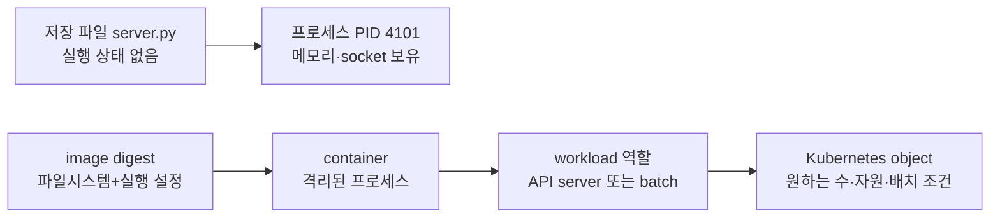
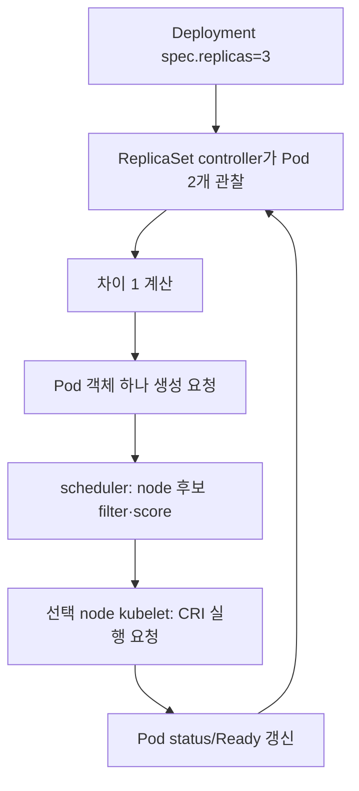

# 00. Kubernetes가 필요한 이유

[이 책 목차](README.md) · [다음: 컨테이너와 이미지](01-containers-and-images.md)

이 장의 YAML과 명령 출력은 동작 원리를 설명하는 교육용 모형이다. 현재 클러스터에 적용했거나 특정 환경에서 실행한 결과가 아니다.

Kubernetes를 배우며 `Pod`, `Deployment`, `Service` 이름부터 외우면 “왜 이 중간 계층이 필요한가?”가 남는다. 출발점은 프로그램 하나다. 저장 장치의 `server.py`는 아직 일하지 않는다. 운영체제가 그 파일의 명령을 메모리에 올리고 CPU 실행 문맥, PID, 열린 파일 표, 가상 주소 공간을 붙이면 **프로세스(process)**가 된다. 같은 파일을 두 번 실행하면 프로그램 파일은 하나지만 PID와 메모리가 다른 프로세스가 둘이다.

프로세스 하나는 한 서버에서 잘 돌 수 있다. 문제가 커지는 순간은 수가 늘고, 시간이 길어지고, 실패가 정상 사건이 될 때다. 웹 프로세스 30개를 서버 10대에 놓았다고 하자. 서버 4가 전원 장애로 사라지면 그 안의 프로세스 세 개도 사라진다. 새 버전으로 교체하는 동안 옛 버전과 새 버전의 수를 누가 맞출지, CPU가 남은 서버가 어디인지, 새 프로세스 주소를 호출자가 어떻게 찾을지 결정해야 한다. 사람의 메모와 SSH 명령은 이 상태 변화를 계속 따라가기 어렵다.

## 1. 프로그램, 프로세스, 컨테이너, 워크로드

**프로그램(program)**은 실행 코드와 정적 자원이다. 디스크의 ELF 실행 파일, Python 소스, JVM 바이트코드가 여기에 해당한다. 프로그램의 수명은 파일이 보존되는 동안이고, 실행 중 CPU 상태는 없다.

**프로세스**는 커널이 스케줄링하는 실행 인스턴스다. PID는 프로세스를 구별하고, 가상 메모리는 코드·heap·stack을 담으며, 파일 descriptor는 socket과 파일 연결을 가리킨다. 프로세스가 종료되면 이 실행 상태는 사라진다. 파일이나 외부 데이터베이스에 기록하지 않은 메모리 값은 복구되지 않는다.

**컨테이너(container)**는 별도 종류의 프로그램이 아니다. Linux namespace로 프로세스가 보는 PID·mount·network 범위를 나누고, cgroup으로 CPU·memory 같은 자원 사용을 묶으며, image의 filesystem을 연결해 실행한 프로세스다. 컨테이너도 결국 host kernel이 실행하는 프로세스다. 다음 장에서 이 물리 경로를 깊게 다룬다.

**워크로드(workload)**는 사용자가 수행하려는 계산과 서비스다. HTTP API처럼 계속 살아 있어야 할 프로세스, 한 번 끝나는 batch job, 모든 node에서 실행할 log agent는 수명과 실패 의미가 다르다. Kubernetes는 이 차이를 Deployment, Job, DaemonSet 같은 API 객체로 표현한다.



첫 화살표는 운영체제가 프로그램을 실행한다는 뜻이다. 두 번째 줄의 image→container는 저장된 배포 재료에서 실행 인스턴스를 만든다는 뜻이다. container→workload는 같은 기술 객체가 업무상 어떤 수명을 갖는지 해석하는 단계다. 마지막 화살표는 그 수명과 개수를 Kubernetes API에 원하는 상태로 기록한다는 뜻이다.

## 2. 한 서버의 명령이 여러 서버의 상태 관리가 될 때

한 서버에서 `python server.py`를 실행하면 명령의 성공 여부를 바로 볼 수 있다. 열 대에서는 다음 상태가 서로 다른 위치에 생긴다.

| 상태 | 실제 위치 | 누가 바꾸는가 | 실패하면 생기는 질문 |
|---|---|---|---|
| 프로그램 파일 | image registry와 node image store | build/push 도구, runtime | 같은 버전인가? |
| 실행 프로세스 | 각 node kernel | container runtime | 종료를 누가 감지하는가? |
| 원하는 개수 | API의 Deployment spec | 사용자·배포 자동화 | 실제 개수와 누가 비교하는가? |
| 현재 준비 상태 | Pod status·condition | kubelet과 controller | 실행 중과 요청 가능을 어떻게 구별하는가? |
| 연결 대상 | EndpointSlice | controller | IP가 바뀌면 누가 갱신하는가? |

Kubernetes는 이 상태를 한 번에 처리하는 거대한 순차 스크립트가 아니다. API server는 객체를 받고 저장한다. controller는 원하는 상태와 실제 상태의 차이를 줄인다. scheduler는 아직 node가 없는 Pod의 위치를 결정한다. node의 kubelet은 자신에게 할당된 Pod를 runtime으로 실행한다. 각 주체가 작은 책임을 반복한다.

## 3. 클러스터와 control plane

**클러스터(cluster)**는 하나의 Kubernetes API와 그 API가 관리하는 node들의 집합이다. node는 실제 프로세스를 실행할 machine이며 VM일 수도 physical server일 수도 있다. **control plane**은 API, 저장 상태, scheduling과 controller를 담당하는 구성 요소 집합이다. worker node는 kubelet, container runtime, network 구현을 통해 Pod를 실행한다.

클러스터는 “서버 여러 대”와 동의어가 아니다. 서버 세 대가 있어도 API와 etcd가 한 장애 영역에만 있으면 control plane 고가용성이 아니다. 반대로 노트북 안의 kind cluster도 개념상 control plane과 worker 역할을 가지지만 물리 전원·rack·network 장애를 재현하지 못한다.

## 4. 원하는 상태와 실제 상태

사용자가 `replicas: 3`을 기록하면 이것은 지금 당장 프로세스 세 개를 직접 fork하라는 명령이 아니다. API에 보존되는 **원하는 상태(desired state)**다. 현재 Ready Pod가 두 개라면 **실제 상태(actual state)**와 차이는 하나다.

```text
desired replicas = 3
current Pods     = 3
ready Pods       = 2
차이의 해석      = 객체 수는 맞지만 요청 가능한 복제본이 하나 부족
```

객체 수와 Ready 수를 구별해야 한다. 세 번째 Pod가 image pull 중이거나 readiness 검사에 실패할 수 있다. ReplicaSet controller는 Pod 수를 맞추지만 애플리케이션의 준비 여부를 직접 판정하지 않는다. kubelet이 probe 결과로 Ready condition을 갱신하고 EndpointSlice controller가 Service backend 포함 여부를 조정한다.

**reconciliation(조정)**은 관찰한 현재 상태를 원하는 상태에 가깝게 만드는 반복 과정이다. controller가 새 Pod 생성을 API에 요청했어도 scheduler가 자원 부족으로 node를 찾지 못하면 Pending에 머문다. “조정을 시도한다”와 “정해진 시간에 성공한다”는 다른 계약이다.



각 화살표는 함수 호출 하나가 이어지는 동기 파이프라인이 아니다. API 객체 쓰기와 watch 관찰 사이의 비동기 관계다. 구성 요소가 재시작되어 event를 놓쳐도 다시 목록을 읽고 차이를 계산할 수 있어야 한다.

## 5. 선언형 API가 필요한 이유

명령형 방식은 “server-4에서 container를 시작하라”처럼 동작을 지정한다. 그 명령 뒤 server-4가 사라지면 원래 의도를 다시 추론해야 한다. 선언형 방식은 “이 image의 준비된 복제본 세 개를 유지하라”는 상태를 저장한다. 새 controller는 저장된 의도를 다시 읽을 수 있다.

YAML은 그 API 객체를 사람이 쓰기 쉬운 텍스트로 표현한 형식일 뿐이다. Kubernetes가 YAML 파일을 계속 감시하는 것이 아니다. client가 YAML을 JSON과 같은 API 요청 표현으로 직렬화해 API server에 보낸다. server는 인증·인가·기본값·검증·admission을 거쳐 객체를 저장한다.

```yaml
apiVersion: apps/v1
kind: Deployment
metadata:
  name: research-api
spec:
  replicas: 3
  selector:
    matchLabels: {app: research-api}
  template:
    metadata:
      labels: {app: research-api}
    spec:
      containers:
        - name: api
          image: registry.example/research/api@sha256:0123456789abcdef0123456789abcdef0123456789abcdef0123456789abcdef
```

`apiVersion`과 `kind`는 어느 REST 자원 schema로 해석할지 정한다. `metadata.name`은 namespace 안의 객체 이름이다. `spec`은 사용자가 바라는 상태다. `template`은 새 Pod를 만들 때 복사할 PodSpec이다. 이 digest는 형식 설명용이며 실제 image 존재를 주장하지 않는다.

## 6. 완전 예제 1: node 하나가 사라졌을 때

가정: 세 node에 Pod 하나씩 Ready이고 Deployment replicas=3이다.

| 시각 | 관찰 | 객체/상태 변화 | 담당 주체 |
|---:|---|---|---|
| 0초 | node-b heartbeat 정상 | Node Ready=True | kubelet→API |
| 10초 | node-b network 단절 | heartbeat Lease 갱신 중단 | network failure |
| 이후 | grace 조건 초과 | Node condition Unknown/NotReady 판단 | node controller |
| 이후 | 해당 Pod 사용 불가 | EndpointSlice에서 Ready endpoint 제외 | endpoint controller |
| 이후 | 정책 조건 충족 | 대체 Pod 객체 생성 | workload controller |
| 이후 | node-c 자원 가능 | 새 Pod nodeName=node-c | scheduler |
| 이후 | image·프로세스 시작 | container state Running | kubelet·runtime |
| 이후 | `/readyz` 성공 | Pod Ready=True | kubelet |

이 시간표에는 고정 완료 시간이 없다. node 장애 판단 유예, Pod 삭제·퇴거 규칙, image 크기, registry 속도, startup 시간이 모두 영향을 준다. 새 Pod가 생겨도 기존 Pod 메모리의 session은 돌아오지 않는다. 외부 저장소나 session 설계가 필요하다.

예상 진단 출력은 다음처럼 서로 다른 원인을 분리해야 한다.

```text
Pod research-api-old   Ready=False   Node=node-b   Reason=NodeLost
Pod research-api-new   Phase=Pending Node=<none>   Reason=Unschedulable
```

첫 줄은 이미 할당된 node의 도달 실패다. 둘째는 대체 객체가 생겼지만 배치 조건을 만족할 node가 없다는 뜻이다. 둘을 모두 “Pod가 안 뜬다”로 묶으면 조치가 틀린다.

## 7. 완전 예제 2: 새 버전이 준비되지 않는 경우

Deployment를 digest A에서 B로 바꾸자. controller는 새 ReplicaSet을 만들고 B Pod를 늘리며 A Pod를 줄이려 한다. 그런데 B가 잘못된 DB 주소 때문에 readiness에 실패한다.

```text
desired new replicas: 3
new Pods Running:     1
new Pods Ready:       0
old Pods Ready:       3
rollout condition:    Progressing, 아직 Available 전환 불가
```

프로세스가 Running인 것과 서비스 요청을 받을 준비가 된 것은 다르다. readiness 실패는 보통 같은 container를 즉시 죽이는 조치가 아니라 Ready=False와 backend 제외로 이어진다. rollout 설정은 가용한 옛 복제본을 유지할 수 있다. 반대로 liveness를 외부 DB 연결에 묶으면 DB 장애 때 container 재시작 폭주가 생길 수 있다.

원인 분리는 세 층으로 한다. Pod `status.containerStatuses`에서 image pull과 process 시작을 본다. readiness event에서 HTTP status나 timeout을 본다. 애플리케이션 log에서 DB 주소·인증 오류를 본다. Deployment condition 하나만으로 세 원인을 구별할 수 없다.

## 8. Kubernetes가 제공하지 않는 의미

Pod를 다시 만들 수 있다는 사실은 업무를 정확히 한 번 수행한다는 뜻이 아니다. 결제 요청을 외부 API에 보낸 직후 process가 죽으면 새 Pod는 전송 성공 여부를 모른다. idempotency key, transaction, outbox 같은 애플리케이션 규칙이 필요하다.

PersistentVolume은 Pod 수명과 분리된 저장소 연결을 제공하지만 backup이 아니다. 잘못된 삭제는 동일 volume에 그대로 반영될 수 있다. snapshot·보존·복원 훈련이 따로 필요하다.

CPU request와 memory limit은 scheduling과 runtime 자원 제어 입력이다. 어떤 query를 포기할지, cache를 얼마나 줄일지, 연구 결과가 재현 가능한지는 모른다. Kubernetes는 실행 기반을 관리하고 업무 의미는 상위 계층이 관리한다.

## 9. 자원과 연구 문제의 경계

GPU workload에서도 “GPU 1개를 요청했다”는 사실만으로 처리 시간이 같아지지 않는다. topology, network, memory bandwidth, sharing 방식에 따라 성능이 달라진다. IWQoS 2024의 GPU sharing scheduling 연구와 network-sensitive GPU scheduling 사전 논문은 특정 모델·목표·평가 환경에서 sharing 또는 network 비용을 고려한 정책을 연구한다. 이는 기본 Kubernetes scheduler가 자동으로 같은 성능을 보장한다는 근거가 아니다.

첫 세 장에서는 연구 알고리즘보다 경계를 익힌다. scheduler는 선언된 request와 plugin 정책으로 node를 선택한다. 실제 GPU kernel 실행 시간과 collective communication 병목은 측정·모델링 대상이다. 후속 GPU Operator·DRA 심화 장에서 ResourceClaim, device 할당, topology 연구 가정을 연결한다.

## 10. 언제 Kubernetes를 쓰지 않을 수 있는가

한 사람이 한 machine에서 하루 한 번 실행하는 script라면 systemd, cron, batch scheduler가 더 단순할 수 있다. Kubernetes를 쓰면 API 인증, upgrade, CNI, storage, 관측 시스템까지 운영해야 한다. 반면 여러 팀이 수십 서비스를 반복 배포하고, 실패 복구·service discovery·자원 격리·표준 API가 필요하면 조정 비용을 중앙화할 가치가 커진다.

선택 질문은 “유행하는가?”가 아니다. 원하는 상태가 반복되는가, 실패 뒤 누가 복구하는가, 여러 사용자가 자원을 나누는가, 플랫폼 운영 비용을 감당할 주체가 있는가를 묻는다.

## 11. 확인 문제와 유도 해설

### 문제 1
같은 `server.py`를 두 번 실행했다. 프로그램과 프로세스 수, 서로 공유하지 않는 대표 상태를 말하라.

**해설:** 저장 프로그램은 하나이고 실행 프로세스는 둘이다. 각 프로세스는 PID, 가상 메모리, 열린 socket 같은 실행 상태를 따로 가진다. 파일에 기록하지 않은 한 프로세스의 heap 값은 다른 프로세스나 재시작 뒤 자동 복구되지 않는다.

### 문제 2
`replicas=3`, Pod 객체 3개, Ready 2개다. 차이가 없다고 볼 수 있는가?

**해설:** 객체 수 기준 차이는 0이지만 요청 가능 복제본 기준 차이는 1이다. ReplicaSet 수 조정과 kubelet readiness 판정은 다른 책임이다. Pod condition과 EndpointSlice 포함 여부를 함께 본다.

### 문제 3
node 장애 뒤 대체 Pod가 Pending/Unschedulable이다. controller가 실패했다고 단정할 수 있는가?

**해설:** 대체 Pod 객체를 만들었다면 workload controller의 수 조정은 진행되었다. scheduler가 request, affinity, taint 조건을 만족할 node를 찾지 못한 별도 실패일 수 있다. event의 scheduling reason을 확인한다.

### 문제 4
Deployment 재시작이 결제의 exactly-once를 보장하지 못하는 이유를 사건 순서로 설명하라.

**해설:** process가 외부 결제 성공 응답을 받기 전후에 종료될 수 있고 새 Pod는 메모리 상태를 잃는다. 재시도하면 중복 결제가 될 수 있다. 외부 시스템이 인식하는 idempotency key와 영속 transaction 기록이 필요하다.

### 문제 5
GPU request가 같은 두 Pod의 학습 시간이 다른 것이 Kubernetes 오류인가?

**해설:** request가 표현한 device 수와 scheduling 조건이 충족됐는지 먼저 본다. GPU 모델, sharing, NUMA·PCIe topology, network 경로, 입력 데이터가 다르면 실행 시간은 달라질 수 있다. 기본 scheduler의 할당 계약과 연구용 성능 목표를 분리해야 한다.

## 공식·연구 자료

- [Kubernetes Overview](https://kubernetes.io/docs/concepts/overview/)
- [Kubernetes Objects](https://kubernetes.io/docs/concepts/overview/working-with-objects/)
- [Resource Management for Pods and Containers](https://kubernetes.io/docs/concepts/configuration/manage-resources-containers/)
- [IWQoS 2024 GPU Sharing Scheduling](https://arxiv.org/abs/2407.13088)
- [Network-Sensitive GPU Scheduling preprint](https://arxiv.org/abs/2401.16492)

[이 책 목차](README.md) · [다음: 컨테이너와 이미지](01-containers-and-images.md)
