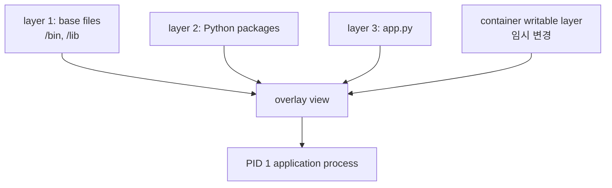
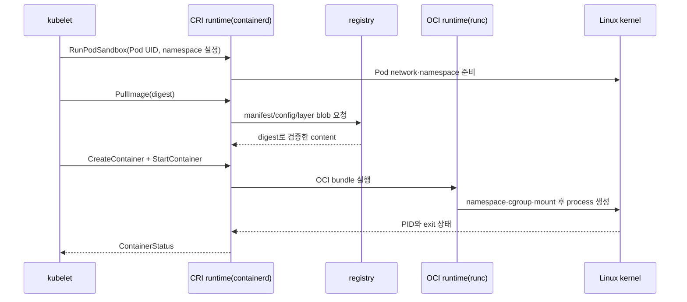

# 01. 컨테이너와 이미지

[이 책 목차](README.md) · [이전: Kubernetes가 필요한 이유](00-why-kubernetes.md) · [다음: 아키텍처와 reconciliation](02-architecture-and-reconciliation.md)

이 장의 manifest와 출력은 교육용이며 현재 클러스터에 적용한 기록이 아니다. Image 참조의 digest도 형식 예시다.

“컨테이너 안에 애플리케이션이 들어 있다”는 표현은 편하지만 물리 동작을 숨긴다. 저장된 것은 **image**이고, 실행되는 것은 Linux **process**다. Container는 image filesystem, namespace, cgroup, 실행 설정을 결합해 만든 프로세스 실행 환경이다.

## 1. 파일시스템에서 프로세스까지

프로그램은 코드만으로 실행되지 않는다. 동적 library, CA certificate, timezone data, 설정 기본값, interpreter가 필요할 수 있다. 개발자 노트북과 node의 파일 구성이 다르면 “내 컴퓨터에서는 된다”가 생긴다. Image는 실행에 필요한 filesystem content와 기본 command·environment·working directory 같은 설정을 내용 주소화된 묶음으로 배포한다.

**filesystem**은 경로 이름을 파일 바이트와 metadata에 연결하는 구조다. Image layer는 파일 추가·변경·삭제 정보를 담는 읽기 전용 content다. Runtime은 여러 layer를 겹쳐 하나의 root filesystem view를 만들고 그 위에 container별 writable layer를 붙인다. 아래 layer의 파일을 수정하면 구현에 따라 위 writable layer에 복사한 뒤 바꾸는 copy-on-write가 일어날 수 있다.



세 layer→overlay 화살표는 파일을 매 시작마다 합쳐 복사한다는 뜻이 아니라 여러 변경 집합을 하나의 경로 view로 제공한다는 뜻이다. Writable layer→view는 실행 중 생성한 파일이 그 container 수명에 붙는다는 뜻이다. View→process는 kernel이 그 mount namespace에서 executable과 library를 읽어 프로세스를 시작한다는 뜻이다.

## 2. Image는 압축 파일 하나가 아니다

OCI image는 대략 manifest, configuration, layer blob으로 구성된다. **manifest**는 어느 config와 layer digest가 한 image를 이루는지 적는다. **config**는 architecture, environment, entrypoint, history 같은 실행·생성 metadata를 담는다. **blob**은 digest로 식별되는 content다.

Registry는 이 객체를 HTTP API로 저장·전달하는 서비스다. Repository는 이름 공간이고 tag는 repository 안에서 manifest를 가리키는 사람이 읽기 쉬운 이름이다. Digest는 content hash 기반 식별자다.

```text
registry.example/research/api:1.4
└─ registry host ─┘└ repository ┘└tag┘

registry.example/research/api@sha256:0123...cdef
                                  └ manifest digest ┘
```

Tag `1.4`가 오늘 digest A를 가리키고 내일 digest B로 이동할 수 있다. 이미 pull한 node cache와 새 node가 서로 다른 content를 실행할 수 있다. Digest 참조는 특정 manifest를 고정한다. 다만 digest 고정은 취약점이 없다는 보장이 아니다. 어떤 source와 build 과정에서 만들어졌는지, signature·SBOM·scanner 결과를 별도로 검증해야 한다.

Multi-platform image의 최상위 index digest는 architecture별 manifest를 가리킬 수 있다. amd64 node와 arm64 node가 같은 index 이름에서 서로 다른 layer를 선택하는 것은 정상이다. “digest 하나면 모든 node에서 바이트가 완전히 같다”는 문장은 index와 platform manifest를 구분해야 한다.

## 3. Namespace: 무엇이 보이는가

Linux **namespace**는 프로세스가 보는 kernel 자원의 view를 분리한다. 별도 kernel을 만드는 기능이 아니다.

- PID namespace는 보이는 프로세스 번호와 부모 관계를 나눈다. Container 내부 PID 1도 host에서는 다른 PID다.
- Mount namespace는 mount point와 root filesystem view를 나눈다.
- Network namespace는 interface, address, route, socket port 공간을 나눈다. Pod 안 container들은 보통 같은 network namespace를 공유한다.
- IPC namespace는 System V IPC와 POSIX message queue 범위를 나눈다.
- UTS namespace는 hostname 같은 식별 view를 나눈다.
- User namespace는 내부 UID/GID와 host UID/GID의 mapping을 다르게 할 수 있다.

Namespace는 “안 보임”을 만들지만 모든 권한을 제거하지 않는다. Host path를 mount하거나 강한 capability를 주거나 privileged로 실행하면 경계가 넓어진다. Container가 host kernel을 공유하므로 kernel 취약점도 위협 모델에 들어간다.

## 4. cgroup: 얼마나 쓸 수 있는가

**cgroup(control group)**은 프로세스를 계층으로 묶어 CPU, memory, I/O 같은 자원 사용을 측정하고 제어하는 Linux kernel 기능이다. Namespace가 “무엇이 보이는가”라면 cgroup은 “얼마나 사용하고 어떤 압력을 받는가”에 가깝다.

CPU limit은 일정 기간의 실행 quota로 구현되어 프로세스를 kill하기보다 다음 기간까지 throttling할 수 있다. Memory limit은 메모리 회수가 충분하지 않고 상한을 넘는 상황에서 cgroup OOM kill로 이어질 수 있다. Kubernetes request는 scheduler의 배치 계산 입력이고 limit은 node runtime이 cgroup 설정으로 전달하는 상한이다. request를 cgroup의 절대 예약 메모리와 같은 것으로 보면 안 된다.

Runtime이 container의 프로세스 PID들을 한 cgroup 아래 놓아야 사용량과 제한이 해당 container에 귀속된다. Child process가 생겨도 cgroup membership을 상속한다. 애플리케이션 내부 thread는 PID namespace와 cgroup 관점에서 같은 workload 자원을 함께 소비한다.

## 5. OCI와 CRI는 어느 경계인가

OCI(Open Container Initiative)는 image format, distribution, runtime에 관한 공개 specification을 만든다. OCI runtime specification은 bundle의 config와 root filesystem을 받아 격리된 process를 만들고 관리하는 저수준 계약이다. `runc` 같은 구현이 대표적이다.

CRI(Container Runtime Interface)는 kubelet과 node의 고수준 container runtime 사이 Kubernetes용 gRPC API다. Kubelet은 `RunPodSandbox`, `CreateContainer`, `StartContainer`, 상태 조회 같은 요청을 보낸다. containerd나 CRI-O가 image pull, snapshot filesystem, sandbox 관리와 OCI runtime 호출을 조정한다.



Kubelet→CRI 화살표는 Kubernetes node 관리 계약이다. CRI runtime→registry는 content 전송이다. CRI runtime→OCI runtime은 준비된 bundle의 저수준 실행 요청이다. OCI runtime→kernel은 namespace·cgroup·process system call이다. CRI와 OCI를 같은 약어로 외우면 장애 위치를 찾지 못한다.

과거 dockershim은 kubelet 내부에서 Docker Engine을 CRI에 맞추는 adapter였다. Kubernetes 1.24의 제거는 Dockerfile로 만든 OCI 호환 image를 못 쓴다는 뜻이 아니다. Node는 containerd나 CRI-O 같은 CRI endpoint를 사용하고 같은 image 형식을 실행할 수 있다.

## 6. PID 1과 container 수명

Runtime이 설정된 command를 시작하면 그 process는 container PID namespace에서 보통 PID 1이다. 주 process가 exit하면 container 실행도 끝난 것으로 보고된다. Background child만 남기는 daemonization 방식은 container 모델과 충돌할 수 있다.

PID 1은 signal과 child 수거에서 주의가 필요하다. Kubelet이 종료를 요청하면 runtime은 주 process에 SIGTERM을 전달한다. Shell wrapper가 signal을 child application으로 넘기지 않으면 graceful shutdown이 시작되지 않고 grace period 뒤 SIGKILL을 받을 수 있다. `exec`로 shell을 실제 application으로 바꾸거나 검증된 init을 쓰는 이유다.

Exit code는 프로세스 종료 결과다. 0은 관례상 성공, 137은 흔히 SIGKILL과 관련되지만 숫자만으로 OOM을 단정하지 않는다. Pod `containerStatuses.lastState.terminated.reason`, node event, kernel/cgroup 증거를 함께 본다.

## 7. Writable layer와 Volume

Container writable layer의 수명은 그 container 인스턴스에 묶인다. 같은 Pod에서 container가 재시작되어 새 인스턴스가 되면 이전 writable layer 파일을 기대해서는 안 된다. `emptyDir` volume은 Pod 수명 동안 container 재시작을 넘어 유지될 수 있지만 Pod가 삭제되면 사라진다. PersistentVolume은 Pod 밖의 storage 수명을 연결할 수 있다.

세 수명을 구분한다.

| 데이터 위치 | 대략적 수명 | 적합한 예 | 오해 |
|---|---|---|---|
| image layer | build된 content | binary·library | 실행 중 쓰기 장소가 아님 |
| writable layer | container 인스턴스 | 임시 scratch | container 교체 뒤 보존 아님 |
| volume | volume 종류의 수명 | checkpoint·공유 파일 | backup·transaction 자동 보장 아님 |

## 8. 완전 예제 1: digest pull에서 프로세스 실행까지

PodSpec에 image digest D가 있다. Node cache에 D manifest는 있지만 layer L3가 없다고 하자.

| 시각 | 주체 | 입력 | 중간 상태 | 결과 |
|---:|---|---|---|---|
| t0 | kubelet | 할당된 PodSpec | container Waiting | CRI에 image 상태 조회 |
| t1 | runtime | digest D | manifest·config 확인 | L1,L2 hit, L3 miss |
| t2 | runtime | L3 digest | registry blob stream | hash 계산하며 임시 저장 |
| t3 | runtime | 완전한 L3 | digest 비교 성공 | content store에 원자적 등록 |
| t4 | runtime | L1~L3 | snapshot/overlay 구성 | root filesystem 준비 |
| t5 | OCI runtime | config+rootfs | namespace·cgroup 생성 | PID 1 시작 |
| t6 | kubelet | CRI status | Running, Ready는 아직 별도 | API status 보고 |

예상 출력이 `ImagePullBackOff`라면 process 시작 이전 단계다. 원인은 registry DNS, 인증, 존재하지 않는 digest, TLS, rate limit로 나뉜다. `CrashLoopBackOff`라면 image pull과 process 생성은 되었고 주 process가 반복 종료한 단계다. 두 backoff를 같은 “image 문제”로 다루지 않는다.

## 9. 완전 예제 2: read-only root와 쓰기 경로

다음 Pod 일부는 root filesystem을 read-only로 만들고 `/tmp`만 `emptyDir`로 제공한다. 실제 image가 non-root와 경로 설정을 지원해야 한다.

```yaml
apiVersion: v1
kind: Pod
metadata:
  name: filesystem-demo
spec:
  securityContext:
    runAsNonRoot: true
  containers:
    - name: app
      image: registry.example/demo/app@sha256:0123456789abcdef0123456789abcdef0123456789abcdef0123456789abcdef
      securityContext:
        readOnlyRootFilesystem: true
        allowPrivilegeEscalation: false
        capabilities: {drop: ["ALL"]}
      volumeMounts:
        - {name: tmp, mountPath: /tmp}
  volumes:
    - name: tmp
      emptyDir: {}
```

Application이 `/var/cache/app`에 쓰려 하면 permission 또는 read-only filesystem 오류가 난다. 이는 process crash, image pull, scheduling 실패가 아니다. 경로를 `/tmp`로 설정하거나 필요한 volume을 명시한다. `runAsNonRoot` 실패라면 image의 USER metadata와 실제 실행 UID를 확인한다.

```text
Warning  Failed     container app: read-only file system: /var/cache/app
Normal   Pulled     image digest already present
Normal   Created    container app
```

Pulled와 Created가 있으므로 registry·CRI 생성은 통과했다. Application의 파일 쓰기 정책이 실패 원인이다.

## 10. 보안 경계와 공급망

Non-root는 유용하지만 단독 완성 조건이 아니다. Linux capability는 root 권한을 세분화한 kernel 권한 단위다. `CAP_NET_ADMIN` 같은 강한 capability, host network/PID namespace, hostPath, device 접근은 경계를 넓힌다. Seccomp는 허용할 system call을 제한하고 LSM은 추가 접근 제어를 제공할 수 있다.

Image scan 결과도 시간과 database에 의존한다. “빌드 때 취약점 0개”가 영구 안전을 뜻하지 않는다. Digest, provenance, signature, SBOM, base image 갱신 정책을 함께 관리한다. Runtime 보안은 배포 content 신뢰와 실행 권한을 모두 본다.

## 11. 확인 문제와 유도 해설

### 문제 1
Image와 container의 수명·상태 차이를 설명하라.

**해설:** Image는 registry/node store에 있는 불변 content와 설정이다. Container는 그 image view에 writable layer, namespace, cgroup을 붙여 실행한 process 인스턴스다. Process 종료와 container 교체가 image를 바꾸지는 않는다.

### 문제 2
Tag `1.4`와 digest 중 재현성에 더 직접적인 것은 무엇이며 한계는 무엇인가?

**해설:** Digest가 manifest content를 고정한다. 하지만 multi-platform index가 platform별 manifest를 선택할 수 있고, 고정 content의 보안·출처까지 보장하지는 않는다.

### 문제 3
CRI와 OCI runtime의 호출자를 각각 말하라.

**해설:** kubelet은 CRI로 containerd/CRI-O 같은 고수준 runtime을 호출한다. 그 runtime은 준비한 OCI bundle을 runc 같은 OCI runtime에 넘겨 kernel process를 만든다.

### 문제 4
Running인데 Ready가 아닐 수 있는가?

**해설:** 가능하다. Running은 주 process가 실행 중이라는 container 상태이고 Ready는 readiness 조건을 통과해 요청 대상으로 사용할 수 있다는 판단이다. 서로 다른 입력과 책임이다.

### 문제 5
Container 안 `/tmp/result`가 재시작 뒤 사라졌다. 원인과 수정 방향은 무엇인가?

**해설:** writable layer는 container 인스턴스 수명에 묶인다. Pod 수명만 필요하면 emptyDir, Pod 교체를 넘어야 하면 요구에 맞는 persistent storage를 검토한다. 어느 volume도 backup과 application consistency를 자동 보장하지 않는다.

## 공식 자료

- [Kubernetes Images](https://kubernetes.io/docs/concepts/containers/images/)
- [Kubernetes Container Runtimes](https://kubernetes.io/docs/setup/production-environment/container-runtimes/)
- [OCI Specifications](https://opencontainers.org/)
- [Kubernetes Pod Lifecycle](https://kubernetes.io/docs/concepts/workloads/pods/pod-lifecycle/)
- [Kubernetes Security Context](https://kubernetes.io/docs/tasks/configure-pod-container/security-context/)

[이 책 목차](README.md) · [이전: Kubernetes가 필요한 이유](00-why-kubernetes.md) · [다음: 아키텍처와 reconciliation](02-architecture-and-reconciliation.md)
