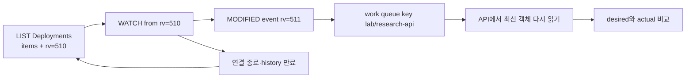
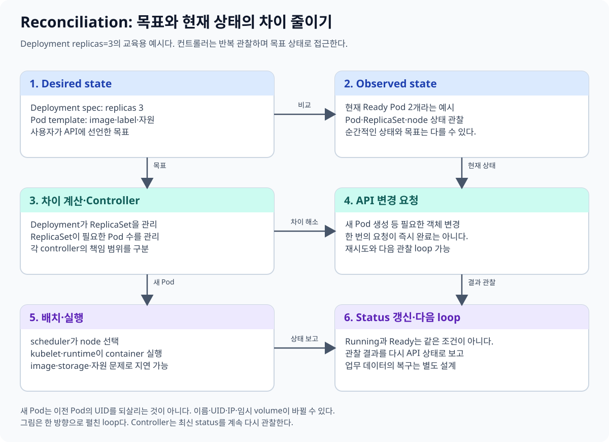
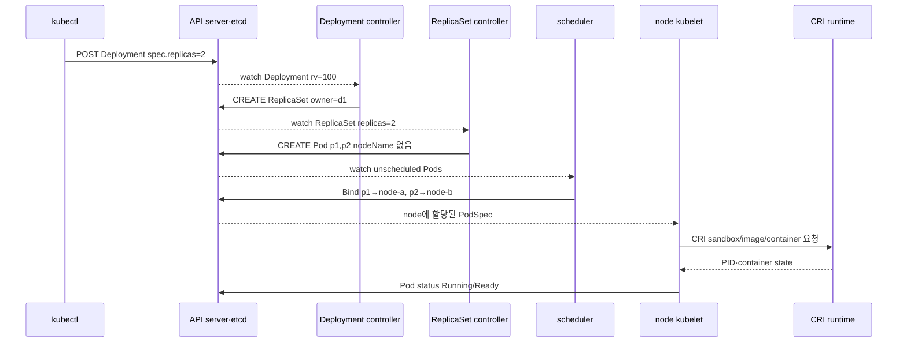

# 02. 아키텍처와 reconciliation

[이 책 목차](README.md) · [이전: 컨테이너와 이미지](01-containers-and-images.md) · [다음: Pod와 namespace](03-pods-and-namespaces.md)

이 장의 YAML, 시각, UID, resourceVersion, 출력은 동작을 설명하기 위한 예시다. 실제 클러스터에 적용한 기록이 아니다.

Kubernetes는 YAML을 읽고 container를 직접 실행하는 중앙 프로그램 하나가 아니다. 사용자의 의도는 API 객체가 되고, 여러 구성 요소가 그 객체를 관찰해 자신이 소유한 상태만 바꾼다. 이 분리는 장애 뒤 다시 시작할 수 있게 하지만 결과가 비동기적으로 나타난다는 뜻이기도 하다.


## 1. API, REST, YAML, 객체

**API(Application Programming Interface)**는 프로그램 사이 요청과 응답의 계약이다. Kubernetes API는 HTTP 기반 REST 자원 형태를 사용한다. Deployment 컬렉션에 POST하고, 이름으로 GET·PATCH·DELETE하며, 변경 stream을 watch할 수 있다.

**REST**는 자원을 URL과 HTTP method로 다루는 API 스타일이다. 예를 들어 namespace `lab`의 Deployment는 대략 `/apis/apps/v1/namespaces/lab/deployments/research-api`라는 자원 경로를 갖는다. 사용자는 보통 `kubectl`을 쓰지만 controller도 같은 API 계약의 client다.

**YAML**은 들여쓰기로 map과 list를 표현하는 직렬화 형식이다. 파일 자체가 클러스터 객체는 아니다. `kubectl`이 YAML을 읽어 인증 정보와 함께 HTTP 요청으로 보낸 뒤 API server가 받아야 객체가 된다. YAML을 Git에 저장했지만 적용하지 않았다면 클러스터 상태는 변하지 않는다.

**객체(object)**는 API server가 관리하는 유형화된 자원 인스턴스다. `kind: Deployment`, `metadata.name: research-api`가 객체 종류와 이름을 정한다. 저장 시 UID, resourceVersion, creationTimestamp 같은 server 관리 필드가 붙는다.

```yaml
apiVersion: apps/v1
kind: Deployment
metadata: {name: research-api}
spec:
  replicas: 2
  selector:
    matchLabels: {app: research-api}
  template:
    metadata:
      labels: {app: research-api}
    spec:
      containers:
        - {name: api, image: registry.example/research/api@sha256:0123456789abcdef0123456789abcdef0123456789abcdef0123456789abcdef}
```

## 2. spec, status, metadata는 누가 쓰는가

`spec`은 사용자가 원하는 상태를 표현한다. 모든 세부 필드가 사람이 직접 쓴다는 뜻은 아니다. API defaulting이나 admission이 값을 채울 수 있다. `status`는 controller와 kubelet 같은 관찰자가 실제 상태를 보고하는 하위 자원이다. 사용자가 보통 status를 원하는 값으로 지정하지 않는다.

`metadata`는 이름, namespace, label, annotation, UID, resourceVersion, ownerReference를 담는다. Label은 selector가 객체 집합을 고르는 색인 가능한 key/value다. Annotation은 selector보다 도구 metadata에 적합하다. OwnerReference는 상위 객체가 사라질 때 종속 객체를 garbage collection하는 관계를 표현한다.

```text
spec.replicas: 2                 사용자의 목표
status.replicas: 2               controller가 본 현재 Pod 수
status.readyReplicas: 1          준비된 Pod 수
metadata.generation: 4           spec 의미 변경 세대
status.observedGeneration: 3     controller status가 처리한 세대
```

generation 4와 observedGeneration 3이면 최신 spec 처리가 아직 status에 반영되지 않았을 수 있다. 둘이 같아도 Ready가 충분하다는 뜻은 아니므로 condition과 replica 수를 함께 본다.

## 3. kube-apiserver: 검증과 상태 변경의 문

API server는 client 인증, authorization, admission, schema validation, version 변환, 저장, watch 제공의 중심이다. Container process를 직접 fork하지 않는다.

인증은 “누구인가”, 인가는 “이 사용자가 이 verb와 resource를 수행할 수 있는가”를 판단한다. Admission은 인증·인가 뒤 객체 내용을 검사하거나 변경하는 확장 단계다. Schema validation은 `replicas: two`처럼 타입이 맞지 않는 요청을 거부한다.

API server를 우회해 etcd key를 직접 쓰면 이 계약을 건너뛴다. Schema, admission, authorization, version conversion과 storage layout을 깨뜨릴 수 있다. 일반 component는 Kubernetes API를 사용한다.

## 4. etcd: 무엇을 저장하고 무엇을 저장하지 않는가

**etcd**는 일관된 key-value 저장소다. API server는 Kubernetes 객체의 지속 상태를 저장한다. etcd의 물리 key와 직렬화 형식은 API 자원 계약과 다르며 구현 세부다.

etcd snapshot은 Deployment·Secret·Node 같은 API 상태 복구에 중요하다. PersistentVolume 내부 database 파일, registry image blob, object storage의 Parquet, 외부 load balancer 전체 상태는 포함하지 않는다. 클러스터 상태 backup과 application data backup을 분리해야 한다.

etcd가 합의로 복제된다고 모든 외부 workload 데이터가 자동 복제되는 것도 아니다. API object `PersistentVolumeClaim`이 저장되어도 실제 storage backend 데이터 복구 가능성은 별도다.

## 5. watch와 resourceVersion

Client가 매초 모든 객체를 다시 읽으면 비용이 크다. **watch**는 특정 자원의 변경 event stream을 받는 API다. Controller는 먼저 LIST로 현재 객체들과 resourceVersion을 받고, 그 이후 변화를 WATCH한다.

`metadata.resourceVersion`은 저장 상태 버전을 나타내는 opaque 문자열이다. 숫자처럼 보여도 초나 순번 차이를 업무 계산에 쓰지 않는다. Update 시 이전 resourceVersion을 보내 optimistic concurrency 충돌을 감지할 수 있다.

Watch 연결은 영구적이지 않다. Network 단절, API server 재시작, 오래된 history 만료가 생긴다. Controller는 연결 하나의 event에만 의존하지 않고 다시 LIST하여 현재 상태를 재구성한 뒤 WATCH를 이어야 한다.



LIST→WATCH 화살표는 snapshot 이후 변경을 이어 받는다는 뜻이다. Event→queue는 event 본문을 무조건 실행 명령으로 삼기보다 재조정할 객체 key를 넣는다는 뜻이다. Queue→최신 읽기는 중복·압축된 event에도 현재 상태로 판단하게 한다.

## 6. Controller와 reconciliation

**Controller**는 특정 객체를 관찰해 원하는 상태와 실제 상태의 차이를 줄이는 process다. Deployment controller는 Deployment에서 ReplicaSet을 만들고 rollout 관계를 관리한다. ReplicaSet controller는 selector에 맞는 Pod 수를 맞춘다. 한 controller가 모든 단계를 직접 실행하지 않는다.

**reconciliation**은 같은 객체를 여러 번 처리해도 현재 상태를 기준으로 필요한 다음 동작만 수행하는 조정 과정이다. API 쓰기가 timeout되어 성공 여부를 모를 때 다시 현재 객체를 읽어야 한다. 무조건 Pod 생성 명령을 반복하면 중복이 생긴다.

Controller는 ownerReference, label selector, status를 사용해 자신이 관리하는 객체를 찾는다. 사용자가 selector와 template label을 어긋나게 하면 API가 거부하거나 controller가 기대 집합을 만들 수 없다.



## 7. Scheduler: Pod와 node 사이의 결정

**kube-scheduler**는 `spec.nodeName`이 없는 Pod를 관찰한다. 먼저 filter 단계에서 request 수용 가능량, node selector/affinity, taint/toleration, volume topology 등 필수 조건을 만족하지 않는 node를 제외한다. 그다음 score 단계에서 남은 후보의 선호도를 계산한다. 선택 결과를 API의 binding으로 기록한다.

Scheduler는 container를 시작하지 않는다. GPU kernel 성능이나 Spark stage 시간을 자동 측정해 최적화하는 것도 기본 계약이 아니다. Device request와 scheduler plugin이 표현한 조건 안에서 node를 선택한다.

GPU sharing과 network-sensitive scheduling 연구는 특정 workload model, 목적 함수, topology 정보, 평가 trace를 사용해 기본 정책보다 나은 지표를 보일 수 있다. 그 결과를 모든 cluster의 자동 보장으로 일반화하면 안 된다. 어떤 metric을 줄였는지, preemption·fairness·utilization 비용이 무엇인지, 네트워크가 병목이 아닌 반례를 함께 읽어야 한다.

## 8. Kubelet과 CRI

**kubelet**은 각 node의 agent process다. API에서 자신에게 배정된 PodSpec을 보고 node의 실제 Pod 상태를 맞춘다. Volume 준비, Pod sandbox, image pull, container 실행을 runtime·plugin에 요청하고 probe 결과와 container 상태를 API에 보고한다.

Kubelet은 Deployment의 복제본 수를 결정하지 않고 다른 node로 Pod를 옮기지도 않는다. 자신의 node에 이미 binding된 Pod를 실행한다. Container runtime과는 CRI로 통신하며 실제 process 생성은 runtime과 OCI runtime, kernel로 이어진다.

## 9. 세 줄 의도가 실행되기까지의 전체 시간표

사용자 의도를 핵심 세 줄로 줄이면 `kind: Deployment`, `name: research-api`, `replicas: 2`다. 실제로는 template과 selector가 더 필요하다. 다음 표는 위 완전 YAML을 제출한 뒤의 상태다.

| 시각 | 주체와 입력 | 새로 생기거나 바뀐 객체·필드 | 아직 일어나지 않은 일 |
|---:|---|---|---|
| t0 | kubectl이 YAML 파싱 | apps/v1 Deployment REST 요청 | container 실행 안 됨 |
| t1 | API server 인증·인가·검증 | default가 채워진 객체 후보 | etcd 저장 전 |
| t2 | API server가 저장 | Deployment UID=d1, rv=100, generation=1 | Pod 없음 |
| t3 | Deployment controller watch | ReplicaSet `research-api-abc`, owner=d1, replicas=2 생성 요청 | node 미정 |
| t4 | API 저장 | ReplicaSet UID=r1, rv=103 | Pod 없음 |
| t5 | ReplicaSet controller watch | Pod p1·p2 객체 생성, owner=r1, nodeName 없음 | process 없음 |
| t6 | scheduler watch | p1 filter/score 후 `spec.nodeName=node-a`, p2=node-b binding | image pull 전 |
| t7 | node-a/b kubelet watch | PodSpec을 local desired state에 추가 | Ready 아님 |
| t8 | kubelet→CRI | sandbox, image digest, container config | application 시작 중 |
| t9 | runtime→OCI→kernel | namespace/cgroup/mount와 PID 1 생성 | readiness 미확인 |
| t10 | kubelet status update | container state Running, Pod phase Running | Ready는 false 가능 |
| t11 | readiness 성공 | condition Ready=True | Service 연결은 별도 controller 관찰 |
| t12 | controller status | Deployment readyReplicas=2, observedGeneration=1 | 실시간 영구 보장은 아님 |



API server와 etcd를 한 참가자로 묶은 것은 그림 단순화다. 일반 client는 API server만 호출하고 API server가 etcd와 통신한다. Watch 화살표는 point-to-point 명령이 아니라 저장된 객체 변화의 관찰이다. 각 create는 새 UID와 resourceVersion을 가진 별도 API 객체다.

## 10. 완전 예제 1: 잘못된 YAML은 어디서 멈추는가

`spec.replicas: two`를 보냈다고 하자. YAML parser는 `two`를 문자열로 읽을 수 있지만 Deployment schema는 정수를 요구한다.

```text
Error from server (BadRequest): Deployment.spec.replicas: Invalid value: "string": must be integer
```

API validation에서 거부되므로 etcd에 새 Deployment가 저장되지 않고 controller watch event도 없으며 Pod도 생기지 않는다. 이 오류에 node log나 container log를 찾는 것은 층이 맞지 않는다.

반대로 API가 Deployment를 받았는데 Pod가 Pending이면 schema 단계는 통과했다. `kubectl get deployment`의 generation/status, ReplicaSet 존재, Pod scheduling event 순서로 내려가야 한다.

## 11. 완전 예제 2: watch event 유실과 재시작

Controller가 rv=200까지 본 뒤 network가 끊겼다. 그 사이 replicas가 2→3으로 바뀌어 rv=205가 되었고 오래 지나 server가 rv=200 이후 history를 제공하지 못한다고 하자.

| 단계 | 잘못된 구현 | 올바른 조정 구현 |
|---|---|---|
| 연결 복구 | rv=200 event만 영원히 기다림 | watch 만료 응답 인식 |
| 상태 획득 | 옛 cache의 replicas=2 사용 | LIST로 현재 replicas=3과 새 rv 획득 |
| 행동 | 새 Pod를 만들지 않음 | 실제 Pod 2개와 목표 3개의 차이 1 계산 |
| 재개 | 상태 불명 | 새 rv부터 WATCH |

Event는 “한 번만 전달되는 명령”이 아니다. 현재 상태를 다시 계산할 힌트다. 이 때문에 controller의 reconcile 함수는 같은 key를 여러 번 받아도 안전해야 한다.

## 12. 상태와 진단을 층별로 분리한다

```text
Deployment Available=False, ProgressDeadlineExceeded
ReplicaSet desired=2 current=2
Pod p1 Pending: FailedScheduling, Insufficient cpu
Pod p2 Waiting: ErrImagePull, unauthorized
```

Deployment condition은 rollout 결과의 상위 요약이다. p1은 scheduler filter에서 CPU 조건을 만족하지 못했다. p2는 node까지 배치됐지만 runtime registry 인증에서 실패했다. 같은 Available=False 아래 원인이 둘이다.

진단 순서는 소유 객체를 따라간다. Deployment generation과 condition, ReplicaSet owner와 수, Pod nodeName과 event, container state와 log, node condition과 runtime 상태를 본다. 상위 객체 하나를 반복 삭제하면 원인 증거가 사라질 수 있다.

## 13. Lease와 시간의 의미

Lease는 짧은 coordination 정보를 담는 API 객체다. Node heartbeat와 leader election에 쓰인다. Node의 kubelet이 Lease renewTime을 갱신하고 controller가 유예 시간을 고려해 node condition을 판단한다. 갱신 한 번이 늦었다고 물리 전원이 꺼졌다고 단정하지 않는다.

Leader election Lease도 “영원한 leader”를 기록하지 않는다. 정해진 시간 안에 갱신하는 주체가 역할을 유지한다. Clock, network 지연, API 가용성이 판단에 영향을 주므로 process log와 Lease 상태를 함께 본다.

## 14. DRA와 기본 아키텍처의 연결

DRA(Dynamic Resource Allocation)는 device request를 ResourceClaim 등 API 객체로 표현하고 driver가 device 준비·할당에 참여하게 하는 체계다. Kubernetes 문서의 v1.35 stable/locked 표시는 현재 기능 gate 상태를 읽는 정보이며 “v1.35에서 처음 GA가 되었다”와 같은 역사 문장으로 바꾸면 안 된다. GA 역사와 이후 버전에서 gate가 잠긴 상태를 구분한다.

DRA가 device를 할당해도 GPU memory 사용량, multi-tenant interference, collective network 성능이 자동 최적화되는 것은 아니다. NVIDIA GPU Operator 지원 matrix도 Kubernetes, OS, driver, runtime 조합의 지원 범위를 확인하는 자료이지 임의 조합의 성능 보증서가 아니다. 후속 심화 책에서 driver daemon, ResourceSlice, ResourceClaim, CDI/CRI 경로와 연구 scheduler를 연결한다.

## 15. 확인 문제와 유도 해설

### 문제 1
YAML 파일을 Git에 commit했지만 API 요청을 보내지 않았다. desired state가 바뀌었는가?

**해설:** 클러스터 API 상태는 바뀌지 않았다. GitOps controller가 그 파일을 읽어 API에 반영하는 별도 경로가 있을 때만 이후 변경될 수 있다. YAML 파일과 API 객체를 구별한다.

### 문제 2
Deployment를 만들었는데 Pod가 없다. 어떤 객체 순서로 확인하는가?

**해설:** Deployment가 저장됐는지와 generation/condition을 보고, owner ReplicaSet이 생겼는지, ReplicaSet desired/current가 어떤지 본다. Deployment controller와 ReplicaSet controller 중 어느 단계가 진행되지 않았는지 분리한다.

### 문제 3
Pod에 nodeName이 있지만 container가 Waiting이다. Scheduler가 원인인가?

**해설:** binding이 기록됐으므로 scheduler의 node 선택은 끝났다. Kubelet event와 CRI 상태에서 volume, sandbox, image pull, container create 오류를 조사한다.

### 문제 4
resourceVersion 100과 110의 차이가 10초라는 뜻인가?

**해설:** 아니다. resourceVersion은 opaque한 저장 버전 식별자다. 시간이나 업데이트 개수를 산술 계산하는 계약이 아니다. Watch 시작과 concurrency 조건에 API 문서대로 사용한다.

### 문제 5
GPU ResourceClaim이 할당되면 network-sensitive 학습 성능도 보장되는가?

**해설:** 아니다. Claim은 device 요청·할당 상태를 표현한다. Topology, sharing interference, network traffic과 workload 특성은 별도 scheduling 정책과 측정 대상이다. 연구 결과의 가정과 기본 Kubernetes 계약을 분리한다.

## 공식·연구 자료

- [Kubernetes Components](https://kubernetes.io/docs/concepts/overview/components/)
- [Kubernetes API Concepts](https://kubernetes.io/docs/reference/using-api/api-concepts/)
- [Kubernetes Controllers](https://kubernetes.io/docs/concepts/architecture/controller/)
- [Kubernetes Scheduler](https://kubernetes.io/docs/concepts/scheduling-eviction/kube-scheduler/)
- [Kubernetes Leases](https://kubernetes.io/docs/concepts/architecture/leases/)
- [Dynamic Resource Allocation](https://kubernetes.io/docs/concepts/scheduling-eviction/dynamic-resource-allocation/)
- [NVIDIA GPU Operator Platform Support](https://docs.nvidia.com/datacenter/cloud-native/gpu-operator/latest/platform-support.html)
- [IWQoS 2024 GPU Sharing Scheduling](https://arxiv.org/abs/2407.13088)
- [Network-Sensitive GPU Scheduling preprint](https://arxiv.org/abs/2401.16492)

[이 책 목차](README.md) · [이전: 컨테이너와 이미지](01-containers-and-images.md) · [다음: Pod와 namespace](03-pods-and-namespaces.md)
