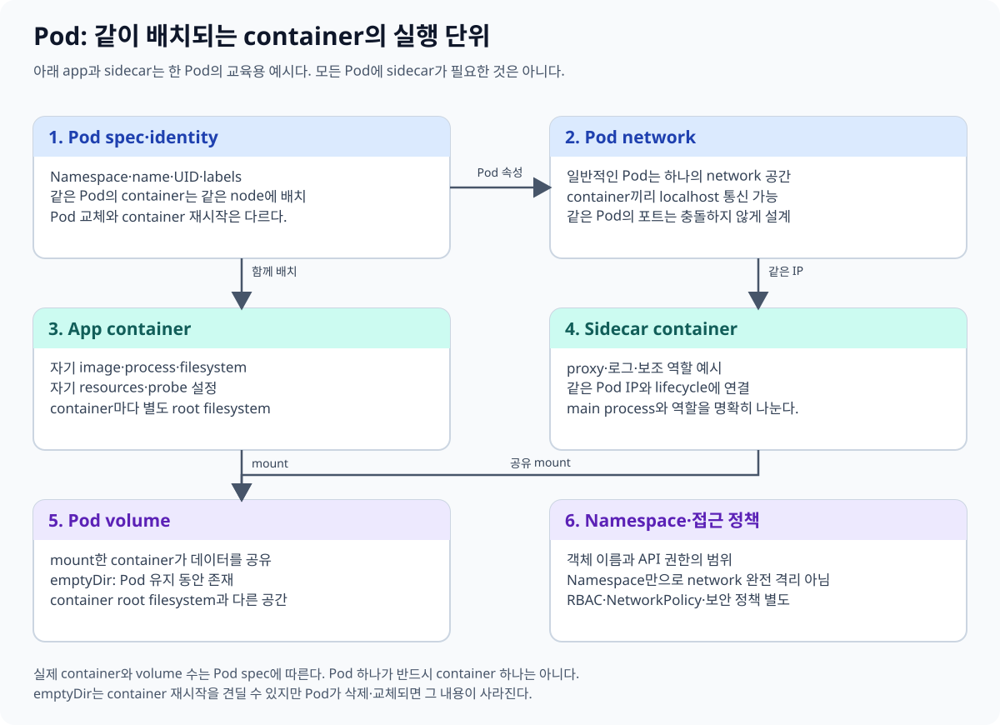
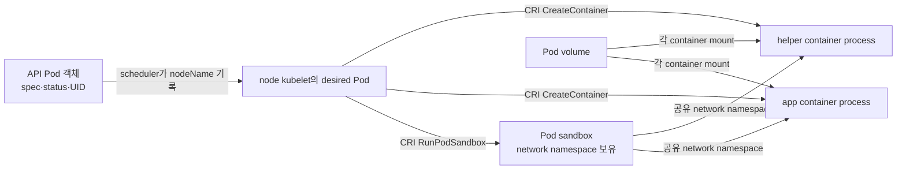
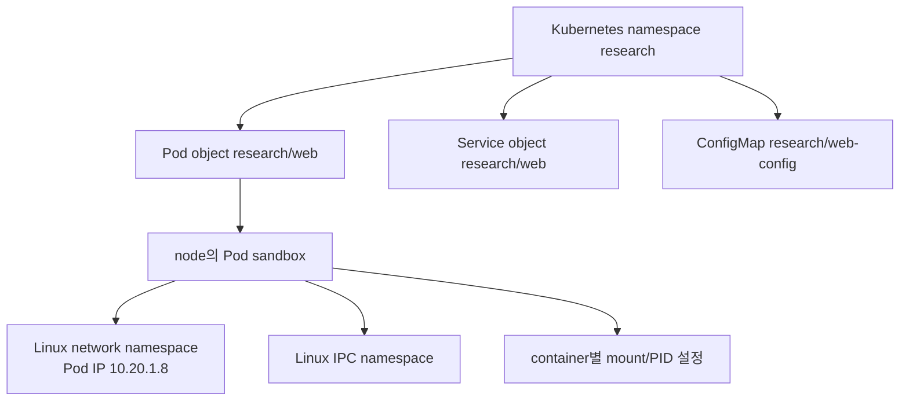

# 03. Pod와 namespace

[이 책 목차](README.md) · [이전: 아키텍처와 reconciliation](02-architecture-and-reconciliation.md) · [다음: Workload controller](04-workloads.md)

이 장의 YAML, 주소, 시각과 출력은 구조를 설명하는 교육용 예시다. 현재 클러스터에 적용한 기록이 아니다.

Pod는 “container를 담는 상자”라고만 외우면 공유 범위와 실패 단위를 놓친다. Pod는 scheduler가 node 하나에 배치하는 최소 단위이며, kubelet이 여러 container와 공통 sandbox를 한 묶음으로 조정하는 API 객체다. 같은 Pod의 container는 항상 같은 node에 있고 하나의 network identity와 명시한 volume을 공유하지만, 각각 별도 image와 process 수명을 가진다.



## 1. Pod 객체와 실행 중인 Pod는 어디에 있는가

API의 Pod 객체는 control plane 저장 상태다. `metadata.uid`, `spec.containers`, `spec.nodeName`, `status.conditions` 같은 필드가 API server를 통해 보인다. Node의 실행 상태에는 kubelet이 관리하는 pod sandbox, container runtime의 container metadata, Linux kernel의 namespace와 cgroup, volume mount와 process가 있다.

Pod 객체와 process는 같은 것이 아니다. API에 Pod가 저장됐지만 scheduler가 node를 못 정하면 process는 없다. `spec.nodeName`이 생겼지만 image pull이 실패해도 process는 없다. Process가 시작된 뒤 kubelet status 보고가 지연되면 API 관찰과 node 실제 상태 사이에 짧은 차이가 생길 수 있다.



API→kubelet 화살표는 파일 복사가 아니라 watch로 PodSpec을 관찰한다는 뜻이다. Kubelet→sandbox/container는 CRI 요청이다. Sandbox→container는 두 process가 같은 network namespace에 들어간다는 뜻이다. Volume 화살표는 volume을 정의하는 것만으로 충분하지 않고 각 container의 `volumeMounts`가 필요하다는 뜻이다.

## 2. Sandbox와 pause container가 필요한 이유

**Pod sandbox**는 Pod 수준 Linux namespace와 network 자원을 container보다 먼저 만들고 유지하는 runtime 단위다. 구현에 따라 작은 **pause container** 또는 infra container process가 namespace의 수명을 붙잡는다. Pause process가 업무를 처리하는 것은 아니다. App container가 재시작되어도 sandbox가 유지되면 같은 Pod IP와 network namespace를 계속 사용할 수 있게 하는 기준점이다.

Pod sandbox와 app container 수명은 다르다. App process가 crash하면 kubelet은 `restartPolicy`에 따라 같은 Pod 안에서 container 인스턴스를 다시 만들 수 있다. 이때 Pod UID와 일반적으로 Pod IP는 유지되며 container restart count가 증가한다. Sandbox 자체가 사라지거나 Pod가 삭제되어 새 Pod 객체가 생기면 새 UID와 새 IP를 받을 수 있다.

Runtime 구현 상세는 환경마다 다르므로 “모든 Kubernetes Pod에 이름이 pause인 container가 사용자 container 목록에 보인다”고 단정하지 않는다. 중요한 계약은 Pod 수준 namespace와 container 수준 process의 수명이 분리된다는 점이다.

## 3. Network namespace, IP, port

Linux **network namespace**는 interface, IP address, route, neighbor table, socket port 공간의 view를 분리한다. 같은 Pod의 container들은 보통 같은 network namespace를 사용한다. 그래서 모두 같은 Pod IP를 보고 `localhost`로 통신한다.

App가 `0.0.0.0:8080`을 listen하면 helper는 같은 namespace에서 `127.0.0.1:8080`을 다시 bind할 수 없다. 이미 같은 TCP port 공간을 사용하기 때문이다. Helper를 9090에 두면 app가 `http://127.0.0.1:9090`으로 호출할 수 있다.

CNI(Container Network Interface) plugin은 sandbox의 network namespace에 interface를 만들고 IP·route를 설정하는 데 참여한다. 예를 들어 host 쪽 veth와 Pod 쪽 `eth0`을 연결하고, IPAM이 `10.20.1.8`을 할당하며, node 간 route 또는 overlay 정보를 구성할 수 있다. 구체적인 device 이름과 packet 경로는 CNI 구현에 따라 달라진다.

Pod IP는 Pod 객체의 identity처럼 영구적이지 않다. 같은 Pod 안 container 재시작에서는 유지될 수 있지만 controller가 대체 Pod를 만들면 바뀔 수 있다. Client는 Pod IP를 설정 파일에 고정하지 않고 Service와 DNS를 사용한다.

## 4. PID, IPC, mount namespace는 항상 같은 방식으로 공유되는가

PID namespace는 process가 볼 수 있는 PID 집합과 번호를 나눈다. 기본적으로 같은 Pod의 container가 서로의 process를 모두 보는 것으로 가정하면 안 된다. `shareProcessNamespace: true`를 명시하면 Pod container 사이 process 관찰과 signal 패턴이 달라진다. 이 기능은 debugging이나 협력 process에 유용하지만 process 정보 노출과 권한 경계를 검토해야 한다.

IPC namespace는 shared memory, semaphore, message queue 같은 kernel IPC view를 나눈다. 같은 Pod의 container가 Pod sandbox 설정에 따라 IPC 자원을 공유할 수 있지만 애플리케이션 protocol을 자동 제공하지 않는다. 이름 충돌, 권한, lifetime을 프로그램이 관리해야 한다.

Mount namespace는 mount table view를 분리한다. 각 container는 자기 image root filesystem과 writable layer를 가진다. 같은 volume을 서로 다른 경로에 mount할 수 있고, 한 container에만 mount할 수도 있다. “같은 Pod니까 `/data` 내용이 같다”가 아니라 같은 volume source를 양쪽 `volumeMounts`가 참조해야 한다.

## 5. Volume의 객체와 수명

Pod `spec.volumes`의 항목은 Pod에서 사용할 volume source를 정의한다. Container `volumeMounts`는 그 volume 이름을 자기 filesystem의 경로에 연결한다. Volume 자체가 항상 별도 API 객체인 것은 아니다. `emptyDir`은 PodSpec 안의 volume source이고, PVC는 별도 PersistentVolumeClaim 객체를 참조한다.

`emptyDir`은 Pod가 node에 배치되어 실행될 때 준비되고 같은 Pod의 container 재시작을 넘어 유지될 수 있다. Pod가 node에서 제거되면 함께 사라진다. Memory medium을 쓰면 node memory 자원과 압력의 영향을 받는다. 로그나 임시 변환 파일에는 쓸 수 있지만 Pod 교체 뒤 필요한 database 파일의 영속 저장으로 해석하지 않는다.

## 6. 두 container Pod의 완전한 예

다음 Pod는 web이 `/shared/access.log`에 기록하고 helper가 같은 volume에서 읽는 개념 예다. 실제 image 동작과 경로 권한을 검증한 격리 환경에서만 사용해야 하며 여기서는 적용하지 않는다.

```yaml
apiVersion: v1
kind: Pod
metadata:
  name: web-with-helper
  namespace: research
  labels:
    app.kubernetes.io/name: web
    app.kubernetes.io/component: api
  annotations:
    example.org/purpose: training-only
spec:
  restartPolicy: Always
  containers:
    - name: web
      image: nginx:1.27.5
      ports:
        - {name: http, containerPort: 80}
      volumeMounts:
        - {name: shared, mountPath: /shared}
    - name: helper
      image: busybox:1.37.0
      command: ["sh", "-c", "touch /shared/access.log; tail -F /shared/access.log"]
      volumeMounts:
        - {name: shared, mountPath: /shared}
  volumes:
    - name: shared
      emptyDir: {}
```

`spec.containers`는 list이므로 각 항목 이름이 Pod 안에서 고유해야 한다. `ports.containerPort`는 문서화와 named port 참조에 쓰이며 프로그램을 자동으로 listen시키지 않는다. `restartPolicy: Always`는 kubelet이 종료한 container를 같은 Pod 안에서 다시 시작하려는 규칙이다. Pod 자체를 새로 만드는 controller 규칙과 다르다.

| 시각 | web | helper | Pod sandbox·volume | API 관찰 |
|---:|---|---|---|---|
| t0 | 없음 | 없음 | sandbox 생성, IP 10.20.1.8, emptyDir 준비 | Pending |
| t1 | PID 101 시작 | PID 120 시작 | 같은 netns, 같은 volume source | Running, Ready 0/2 가능 |
| t2 | Ready | Ready | port 80, shared file 사용 | Running, Ready 2/2 |
| t3 | crash, exit 1 | 계속 실행 | sandbox·IP·emptyDir 유지 | Running, Ready 1/2, restartCount 증가 예정 |
| t4 | 새 container PID 143 | 계속 실행 | 같은 Pod UID·IP, 파일 유지 | Running, Ready 회복 가능 |
| t5 | Pod 삭제 | 종료 | sandbox·emptyDir 제거 | 객체 terminating 후 삭제 |
| t6 | 상위 controller가 대체 Pod 생성 | 새 helper | 새 UID·IP·새 emptyDir | 이전 파일 없음 |

여기서 container restart와 Pod replacement를 구별해야 한다. t4는 같은 Pod 안의 새 container 인스턴스다. t6는 이름이 비슷할 수 있어도 새 Pod UID다. `RESTARTS` 숫자는 t4를 반영하지만 t6의 새 Pod는 다시 0에서 시작할 수 있다.

## 7. Init container와 sidecar의 순서

Init container는 일반 app container보다 먼저 순서대로 성공해야 한다. Schema 다운로드나 권한 준비처럼 main process 전에 끝나야 하는 유한 작업에 쓴다. Init이 실패하면 kubelet이 정책에 따라 재시도하고 app는 시작하지 않는다.

Sidecar는 main application과 함께 살아 있는 보조 container다. 로그 전송, local proxy처럼 같은 Pod 수명과 network/volume 공유가 꼭 필요한 경우에 사용한다. 독립적으로 scale해야 하는 서비스 두 개를 sidecar라는 이름으로 묶으면 web replica 수를 늘릴 때 불필요한 process도 함께 늘어난다.

두 container가 시작된 순서만으로 application readiness 의존성을 보장하지 않는다. App가 helper port를 기다리는 retry를 구현하거나 startup/readiness 조건을 설계해야 한다. Container `command`가 시작됐다는 사실과 service가 준비됐다는 사실은 다르다.

## 8. Kubernetes Namespace와 Linux namespace

**Kubernetes Namespace**는 API 객체 이름과 정책의 논리 범위다. `research/api` Service와 `production/api` Service는 이름이 같아도 다른 namespaced 객체다. RBAC Role, ResourceQuota, NetworkPolicy를 namespace 단위로 적용할 수 있다.

Linux namespace는 한 kernel에서 process가 보는 resource view다. Kubernetes Namespace `research`를 만들었다고 `research`라는 Linux network namespace 하나가 생기지 않는다. 반대로 Pod network namespace가 있어도 API RBAC 경계가 생기는 것은 아니다.

Node, Namespace, PersistentVolume, ClusterRole은 cluster-scoped 객체다. Pod, Service, ConfigMap, Secret, Deployment는 보통 namespaced다. 이름의 유일성 범위도 다르다. namespaced 객체는 `(namespace, kind, name)`에서 식별하고 cluster-scoped 객체는 cluster 전체 범위의 이름을 쓴다.

Namespace는 보안 sandbox 하나가 아니다. 같은 namespace의 Pod끼리도 NetworkPolicy가 없으면 통신이 열려 있을 수 있고, 다른 namespace 접근도 기본 차단된다고 단정하지 않는다. 신뢰 수준이 크게 다른 tenant는 RBAC, quota, policy, node 격리, 때로 별도 cluster를 함께 검토한다.



위의 Namespace→객체 화살표는 API 이름 범위를 나타낸다. Pod 객체→sandbox는 kubelet·runtime 조정 관계다. Sandbox→Linux namespace 화살표는 node kernel에 실제 격리 view가 만들어진다는 뜻이다. API namespace가 kernel namespace를 직접 포함하는 구조가 아니다.

## 9. metadata, spec reference, status condition

`metadata.name`은 사람이 지정한 이름이고 UID는 API server가 객체 생애마다 부여하는 identity다. 삭제 후 같은 이름으로 다시 만들면 UID가 다르다. Controller와 garbage collector는 이름만 아니라 UID가 포함된 ownerReference를 사용한다.

**reference**는 다른 객체를 가리키는 필드다. `serviceAccountName`은 같은 namespace의 ServiceAccount 이름을 참조한다. `volumes[].persistentVolumeClaim.claimName`은 PVC를 참조한다. Reference마다 namespace 교차 허용 여부와 대상 kind가 다르므로 문자열이 같다고 자동 연결되지 않는다.

`spec`은 원하는 상태다. Pod에서는 container image, command, resource, volume, scheduling 조건을 담는다. 이미 node에 binding된 Pod의 많은 spec 필드는 변경할 수 없으며, 새 template으로 새 Pod를 만드는 방식이 일반적이다.

`status.phase`는 Pending, Running, Succeeded, Failed, Unknown의 거친 요약이다. 세밀한 진단은 `status.conditions`, `containerStatuses`, event를 본다. Condition은 type, status(True/False/Unknown), reason, message, lastTransitionTime을 가진다. `Ready=False`와 `ContainersReady=False`의 reason이 probe 실패인지 container 미시작인지 구분한다.

## 10. Label, selector, annotation

Label은 객체를 그룹화하고 selector로 선택할 짧은 key/value다. Service selector `app=web`와 Pod label이 맞으면 endpoint 후보가 된다. Deployment selector와 Pod template label은 controller가 자기 Pod 집합을 인식하는 계약이다.

Annotation은 build revision, tool hint처럼 selection에 쓰지 않을 부가 metadata다. Label 값을 바꾸면 Service traffic과 NetworkPolicy 대상이 즉시 달라질 수 있다. 설명 문구를 바꾸는 것보다 위험한 운영 변경일 수 있다.

```yaml
metadata:
  labels:
    app.kubernetes.io/name: experiment-api
    environment: test
  annotations:
    example.org/source-revision: "3a7c9d1"
```

Selector는 object name의 부분 문자열을 검색하지 않는다. `web-v2`라는 Pod라도 `app=batch`이면 `app=web` Service가 선택하지 않는다. 반대로 이름이 전혀 달라도 label이 맞으면 선택된다.

## 11. 완전 예제 2: 같은 오류처럼 보이는 두 상태

사용자가 `http://web:80`에 접속하지 못한다고 하자. Pod 관찰이 다음 두 경우로 나뉜다.

```text
Case A: web-with-helper  1/2  Running  RESTARTS(web)=4
        web lastState: Terminated Reason=Error ExitCode=1

Case B: web-with-helper  2/2  Running  RESTARTS=0
        Pod IP=10.20.1.8, Service selector app=api, Pod label app=web
```

Case A는 같은 Pod 안 web container가 반복 종료하고 helper만 살아 있는 상태다. `kubectl logs --previous`에 이전 container log가 있을 수 있다. Case B는 process는 준비됐지만 selector가 맞지 않아 EndpointSlice에 들지 않는 API metadata 문제다. 둘 다 사용자는 접속 실패를 보지만 수정 위치가 다르다.

관찰 순서는 Pod UID와 node, container state, readiness reason, labels, Service/EndpointSlice로 이어진다. Pod를 먼저 삭제하면 이전 종료 상태와 event 증거가 사라질 수 있다.

## 12. Replica가 늘 때 Pod 내부는 어떻게 달라지는가

Deployment가 replicas 1→3으로 바뀌면 기존 Pod에 container 두 벌을 더 넣는 것이 아니다. ReplicaSet controller가 같은 template의 새 Pod 객체 두 개를 만든다. 각 Pod는 별도 sandbox, IP, emptyDir, app/helper process를 가진다.

| 항목 | Pod A | Pod B | Pod C |
|---|---|---|---|
| UID | uid-a | uid-b | uid-c |
| Pod IP | 10.20.1.8 | 10.20.2.7 | 10.20.3.5 |
| web/helper | 2 container | 2 container | 2 container |
| emptyDir | A 전용 | B 전용 | C 전용 |
| Service membership | readiness·label로 결정 | 동일 | 동일 |

Pod 안 container들은 함께 scale된다. Helper만 세 개에서 하나로 줄이고 싶다면 별도 Deployment나 daemon 형태가 맞는지 검토한다.

## 13. 연구 성능과 Pod 경계

같은 Pod에 넣으면 localhost 통신과 volume 공유가 가능하지만 CPU cache, memory bandwidth, GPU, network queue 경합이 사라지는 것은 아니다. PeRF 연구는 containerized 환경의 성능 간섭을 특정 workload와 계측 방법으로 분석한다. 결과를 “모든 같은-Pod sidecar는 몇 퍼센트 느리다”로 일반화하지 않고, CPU quota, NUMA, I/O, packet path라는 가정을 확인한다.

GPU sharing 연구도 Pod 수나 label만으로 성능을 보장하지 않는다. GPU memory와 compute sharing 방식, kernel 특성, co-location 정책을 측정한다. Kubernetes 객체는 실험 조건을 기록하는 한 층이고 실제 hardware counter와 application metric이 필요하다.

## 14. 확인 문제와 완전 해설

### 문제 1
App container가 crash해 재시작했다. Pod UID, Pod IP, emptyDir, restart count는 어떻게 되는가?

**해설:** 같은 Pod sandbox가 유지되는 일반적인 container restart라면 UID와 IP는 같고 emptyDir 내용도 남을 수 있다. 새 container 인스턴스가 시작되어 restart count가 증가한다. Pod 자체 replacement와 구별해야 한다.

### 문제 2
두 container가 모두 8080을 listen하려 한다. 왜 실패하며 해결 선택지는 무엇인가?

**해설:** 같은 Pod network namespace와 TCP port 공간을 공유한다. 먼저 bind한 process가 있으면 같은 address/port 조합 bind가 충돌한다. 서로 다른 port를 쓰거나 독립 network identity가 필요하면 별도 Pod로 나눈다.

### 문제 3
Kubernetes Namespace를 둘로 나누면 network가 자동 차단되는가?

**해설:** 아니다. Namespace는 API 이름·정책 범위다. 실제 packet 차단은 NetworkPolicy와 이를 구현하는 CNI 등 별도 구성이 필요하다. RBAC도 API 요청 권한이지 packet firewall 자체가 아니다.

### 문제 4
`Running 1/2`를 “Pod가 정상”이라고 해석할 수 있는가?

**해설:** phase Running은 적어도 container가 실행 중인 거친 상태다. 1/2는 두 container 중 하나만 Ready다. `containerStatuses`, condition reason, 이전 log를 봐 어느 container와 어느 단계가 실패했는지 확인한다.

### 문제 5
Replicas를 1에서 3으로 늘렸을 때 volume 데이터도 세 Pod가 자동 공유하는가?

**해설:** 아니다. 각 Pod의 emptyDir은 독립이다. PVC access mode와 storage backend를 명시해 공유할 수 있는지 결정해야 하며 동시 쓰기 일관성은 application과 storage 계약을 확인한다.

## 공식·연구 자료

- [Kubernetes Pods](https://kubernetes.io/docs/concepts/workloads/pods/)
- [Kubernetes Namespaces](https://kubernetes.io/docs/concepts/overview/working-with-objects/namespaces/)
- [Kubernetes Labels and Selectors](https://kubernetes.io/docs/concepts/overview/working-with-objects/labels/)
- [Kubernetes Volumes: emptyDir](https://kubernetes.io/docs/concepts/storage/volumes/#emptydir)
- [Kubernetes Share Process Namespace](https://kubernetes.io/docs/tasks/configure-pod-container/share-process-namespace/)
- [PeRF, USENIX ATC 2024](https://www.usenix.org/conference/atc24/presentation/lee)
- [IWQoS 2024 GPU Sharing Scheduling](https://arxiv.org/abs/2407.13088)

[이 책 목차](README.md) · [이전: 아키텍처와 reconciliation](02-architecture-and-reconciliation.md) · [다음: Workload controller](04-workloads.md)
