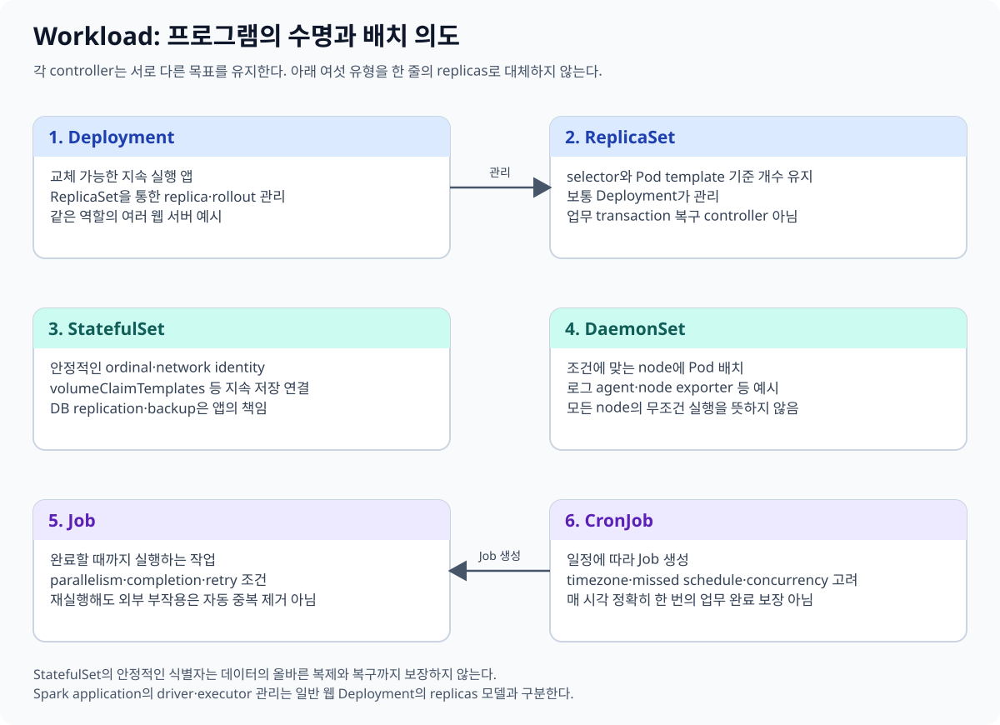
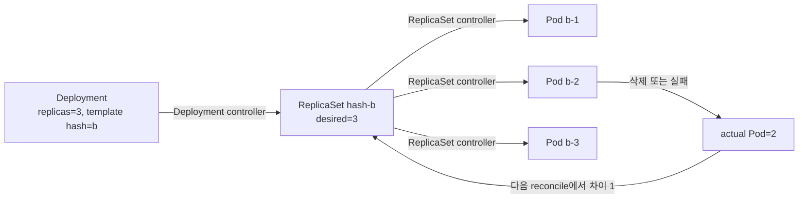
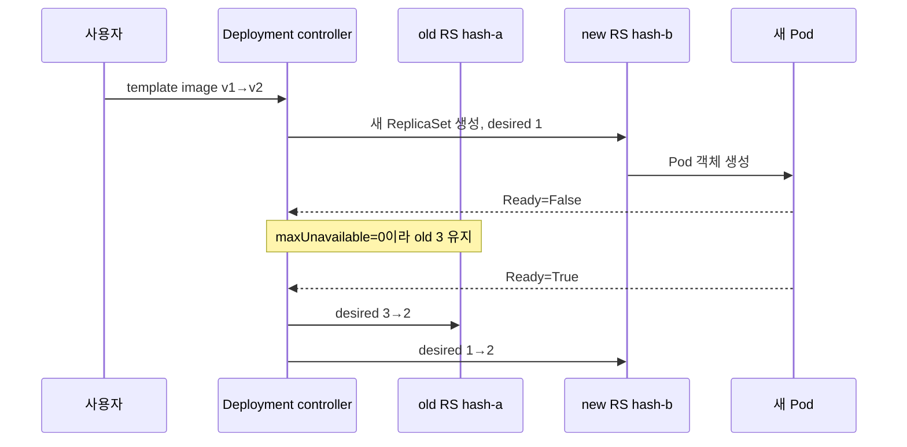
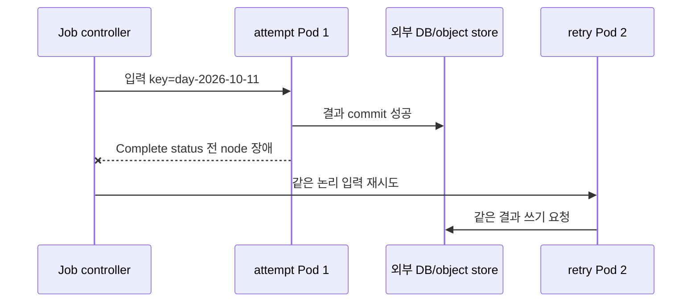

# 04. Workload controller

[이 책 목차](README.md) · [이전: Pod와 namespace](03-pods-and-namespaces.md) · [다음: Service와 network](05-networking-services.md)

이 장의 manifest, 이름, 시각과 출력은 교육용 모형이며 현재 클러스터에 적용한 기록이 아니다.

Pod를 직접 만들면 그 객체가 삭제된 뒤 같은 역할의 Pod를 보충할 상위 owner가 없다. Workload controller는 “어떤 Pod를 몇 개, 어떤 identity와 완료 규칙으로 유지할 것인가”를 API 객체로 표현한다. 종류를 고를 때 제품 이름보다 수명 규칙을 먼저 본다.



## 1. Controller는 Pod 안의 프로그램을 이해하지 않는다

Controller는 HTTP server인지 database인지 Python batch인지 코드를 읽지 않는다. `spec`, label selector, ownerReference, Pod phase와 condition 같은 API 상태를 본다. Deployment는 template revision과 replica를, StatefulSet은 ordinal identity와 claim template을, Job은 성공 완료 수를 맞춘다.

**desired state**는 spec에 기록된 목표다. **actual state**는 현재 API 객체와 status로 관찰되는 상태다. **iteration**은 한 번의 조정 반복이다. Controller가 event를 받아 queue에서 key를 꺼내 최신 객체를 읽고 차이를 계산하고 필요한 API 쓰기를 한 뒤 다시 관찰한다.



Deployment→ReplicaSet 화살표는 Deployment가 child 객체를 API에 생성하고 replica 목표를 조절한다는 뜻이다. ReplicaSet→Pod는 Pod 객체 생성이다. Pod 실패→actual은 process를 제자리 수리하는 것이 아니라 현재 child 수와 상태가 달라졌다는 뜻이다.

## 2. Deployment, ReplicaSet, Pod의 세 층

**Deployment**는 교체 가능한 replica의 rollout을 관리한다. **ReplicaSet**은 하나의 Pod template hash에 맞는 Pod 수를 유지한다. **Pod**는 node에 배치되어 실제 container를 실행한다.

Deployment의 template이 바뀌면 기존 Pod의 image field를 제자리 수정하지 않는다. 새 hash의 ReplicaSet을 만들고 새 RS를 늘리며 옛 RS를 줄인다. 옛 RS는 rollback history로 남을 수 있다. Pod UID와 IP는 새로 생긴다.

```yaml
apiVersion: apps/v1
kind: Deployment
metadata:
  name: api
  namespace: workload-lab
spec:
  replicas: 3
  strategy:
    type: RollingUpdate
    rollingUpdate:
      maxSurge: 1
      maxUnavailable: 0
  selector:
    matchLabels: {app: api}
  template:
    metadata:
      labels: {app: api}
    spec:
      containers:
        - name: api
          image: nginx:1.27.5
          ports: [{name: http, containerPort: 80}]
          resources:
            requests: {cpu: 100m, memory: 64Mi}
            limits: {cpu: 500m, memory: 128Mi}
```

`selector`는 어떤 Pod가 이 workload 집합인지 정하는 identity 계약이며 template label과 맞아야 한다. `replicas`는 Ready 수가 아니라 목표 Pod 수다. `maxSurge: 1`은 rollout 중 desired보다 하나 더 만들 수 있다는 뜻이고 `maxUnavailable: 0`은 available replica를 desired 아래로 줄이지 않으려는 조건이다. 자원 부족이나 readiness 실패로 완료되지 않을 수 있다.

## 3. Deployment rollout의 숫자 시간표

초기 v1 Ready 3개에서 template image를 v2로 바꾼다.

| 시각 | old RS desired/ready | new RS desired/ready | 전체 Pod | controller 판단 |
|---:|---:|---:|---:|---|
| 00초 | 3/3 | 0/0 | 3 | generation 2의 새 hash 발견 |
| 01초 | 3/3 | 1/0 | 4 | surge 1 사용, v2 Pod 생성 |
| 12초 | 3/3 | 1/1 | 4 | 새 Pod Ready 확인 |
| 13초 | 2/2 | 1/1 | 3 | available 3 유지하며 old 1 감소 |
| 14초 | 2/2 | 2/1 | 4 | 다음 v2 생성, 아직 Ready 아님 |
| 28초 | 2/2 | 2/2 | 4 | 다시 old 감소 가능 |
| 50초 | 0/0 | 3/3 | 3 | rollout complete 조건 충족 |

초 단위는 예시일 뿐 보장이 아니다. Image pull, startup, readiness, scheduler 자원에 따라 달라진다. 새 Pod가 계속 Ready가 아니면 `maxUnavailable: 0` 때문에 old RS를 더 줄이지 않는 것이 정상 안전 동작이다.



각 화살표는 controller가 다른 process를 직접 호출한다는 뜻이 아니라 API 객체를 쓰고 status를 관찰한다는 뜻이다. Ready event 하나만 믿지 않고 현재 replica 상태를 다시 계산한다.

## 4. Pod 삭제와 container restart

App process가 exit하면 kubelet은 같은 Pod 안에서 container를 재시작할 수 있다. 이때 Pod UID는 같고 `restartCount`가 증가한다. Pod 객체가 삭제되면 ReplicaSet이 새 Pod를 만든다. 새 Pod는 이름 suffix, UID, IP, writable layer가 바뀐다.

Deployment가 “죽은 process를 복구한다”는 말에는 두 제어 루프가 섞여 있다. Kubelet의 container restart와 ReplicaSet의 Pod replacement다. OOMKilled 뒤 같은 Pod restart가 반복되는지, node failure로 새 Pod가 생겼는지 status와 UID로 구분한다.

## 5. StatefulSet: ordinal과 개별 저장 identity

StatefulSet은 `db-0`, `db-1`, `db-2`처럼 안정적인 ordinal 이름, 순서 있는 생성·삭제, Pod별 PVC 연결이 필요한 workload를 관리한다. **ordinal**은 이름 끝의 순서 번호다. `db-1`이 교체돼도 새 Pod는 `db-1` identity와 대응 claim을 다시 사용한다.

Headless Service는 보통 `clusterIP: None`으로 stable DNS identity를 제공하는 데 쓰인다. `db-1.db-headless.workload-lab.svc...` 같은 이름이 특정 ordinal Pod 주소로 해석될 수 있다. 이것은 load-balanced virtual IP 하나를 제공하는 일반 ClusterIP Service와 목적이 다르다.

```yaml
apiVersion: v1
kind: Service
metadata: {name: db-headless, namespace: workload-lab}
spec:
  clusterIP: None
  selector: {app: db}
  ports: [{name: peer, port: 7000}]
---
apiVersion: apps/v1
kind: StatefulSet
metadata: {name: db, namespace: workload-lab}
spec:
  serviceName: db-headless
  replicas: 3
  selector:
    matchLabels: {app: db}
  template:
    metadata:
      labels: {app: db}
    spec:
      containers:
        - name: db
          image: registry.example/training-db:1.0
          ports: [{name: peer, containerPort: 7000}]
          volumeMounts: [{name: data, mountPath: /var/lib/db}]
  volumeClaimTemplates:
    - metadata: {name: data}
      spec:
        accessModes: ["ReadWriteOnce"]
        resources:
          requests: {storage: 10Gi}
```

`serviceName`은 stable network identity에 사용할 governing Service 이름이다. Claim template은 ordinal마다 `data-db-0`, `data-db-1` 같은 PVC를 만든다. Pod를 줄이거나 StatefulSet을 삭제해도 PVC 보존 정책에 따라 claim이 남을 수 있다. Pod 수명과 PVC 수명을 같다고 가정하지 않는다.

## 6. StatefulSet 순서와 database 복제의 차이

기본 ordered 동작에서는 `db-0`이 Running/Ready 조건을 만족한 뒤 `db-1` 생성으로 진행할 수 있고, 축소는 높은 ordinal부터 진행한다. 이 순서는 bootstrap에 도움을 주지만 application replication protocol을 만들지 않는다.

| Kubernetes가 제공하는 것 | Database가 별도로 해야 하는 것 |
|---|---|
| ordinal 이름과 DNS | leader election·quorum |
| Pod별 PVC 연결 | WAL/log 복제와 lag 관리 |
| 생성·삭제 순서 | split brain fencing |
| 실패한 Pod 재생성 | 손상 replica 재동기화 |
| rolling update 규칙 | schema migration·backup·restore |

`db-0`이라는 이름이 유지돼도 그 PVC가 최신 데이터라는 보장은 없다. 세 PVC가 같은 시점이라는 뜻도 아니다. ReadWriteOnce는 한 시점 한 node의 read-write attach 범위와 관련되며 database replica 일관성을 뜻하지 않는다.

PodManagementPolicy를 Parallel로 바꾸면 순서 가정이 달라진다. Application이 첫 ordinal을 bootstrap leader로 가정한다면 설정 변경 전에 반례를 검토해야 한다.

## 7. StatefulSet 완전 시간표

`db-1` node가 실패했다고 하자.

| 시각 | 객체·storage 상태 | 실행 주체 | 결과/대기 이유 |
|---:|---|---|---|
| t0 | db-0/1/2 Ready, PVC 3개 Bound | 정상 | 각 ordinal이 개별 claim 사용 |
| t1 | db-1 node NotReady | node controller | endpoint 준비 상태 변화 가능 |
| t2 | db-1 Pod 종료/삭제 조건 충족 | StatefulSet/controller | 같은 ordinal 대체 필요 |
| t3 | 새 db-1 Pod, PVC data-db-1 참조 | scheduler | volume zone·attach 조건으로 node 선택 |
| t4 | CSI attach/mount 진행 | kubelet·CSI | 이전 node detach가 안 되면 대기 가능 |
| t5 | process 시작 | runtime | 앱 자체 recovery 수행 |
| t6 | readiness 성공 | kubelet | db-1 endpoint 복귀 |

Kubernetes는 t5에서 database log recovery가 올바른지 이해하지 않는다. Readiness가 application 역할과 replication catch-up을 정확히 반영해야 한다. PVC가 다시 mount됐다는 사실만으로 쓰기 leader로 승격하면 안 된다.

## 8. DaemonSet: node 집합에 대한 함수

DaemonSet은 숫자 replicas를 직접 쓰기보다 조건에 맞는 각 node에 Pod를 둔다. Node가 세 개면 세 Pod일 수 있고 GPU label node만 선택하면 그 수만큼이다. Node가 추가되면 controller가 해당 node용 Pod를 만든다.

```yaml
apiVersion: apps/v1
kind: DaemonSet
metadata: {name: gpu-metrics, namespace: workload-lab}
spec:
  selector:
    matchLabels: {app: gpu-metrics}
  template:
    metadata:
      labels: {app: gpu-metrics}
    spec:
      nodeSelector:
        accelerator: nvidia
      tolerations:
        - {key: accelerator, operator: Equal, value: nvidia, effect: NoSchedule}
      containers:
        - {name: exporter, image: registry.example/gpu-exporter:1.0}
```

Node selector는 필수 label 조건이고 toleration은 해당 taint를 견딜 수 있게 한다. Toleration 자체가 그 node를 선택한다는 뜻은 아니다. DaemonSet Pod도 자원을 사용하므로 node allocatable과 system daemon 경합을 고려한다.

Log agent나 CNI agent처럼 node-local 관찰·기능에는 맞지만, 모든 node에 같은 데이터베이스 replica를 둔다고 replication이 생기지는 않는다. Control-plane node와 특별 taint node 포함 여부도 명시한다.

## 9. Job: 완료 수와 실행 시도

Job은 유한 작업이 성공 종료하도록 Pod를 관리한다. `completions`는 필요한 성공 완료 수, `parallelism`은 동시에 실행할 수 있는 Pod 수다. `backoffLimit`은 실패 재시도 제어에 관여하지만 업무 side effect 횟수를 보장하지 않는다.

```yaml
apiVersion: batch/v1
kind: Job
metadata: {name: partition-report, namespace: workload-lab}
spec:
  completions: 4
  parallelism: 2
  backoffLimit: 3
  template:
    spec:
      restartPolicy: Never
      containers:
        - name: report
          image: registry.example/report:1.0
          args: ["--job-key", "partition-report-2026-10-11"]
```

처음에는 Pod 두 개가 실행된다. 하나가 성공하고 하나가 실패하면 성공 count는 1이며 controller는 실패를 대체할 새 시도를 만들 수 있다. 정확한 Pod 생성 수는 restartPolicy, failure policy, controller 관찰에 따라 단순히 `completions+backoffLimit`로 계산하지 않는다.

## 10. At-least-once와 side effect

Kubernetes Job이 외부 업무를 “적어도 한 번 시도할 수 있는” 상황은 흔하다. Pod가 object storage에 결과를 쓴 직후 node가 죽어 성공 status를 API에 기록하지 못하면 controller는 실패로 보고 다시 실행할 수 있다.



첫 화살표는 실행 시도 생성이고 P1→X는 Kubernetes가 rollback할 수 없는 외부 side effect다. 상태 유실→P2는 중복 가능성이 생기는 지점이다. 논리 입력 key에 unique constraint를 두고 결과와 완료 marker를 같은 transaction으로 commit하거나, object name을 결정적으로 만들고 조건부 쓰기를 사용한다.

Email 발송처럼 transaction이 어려우면 outbox와 전달 기록, provider idempotency key를 검토한다. `restartPolicy: Never`는 container 재시작을 줄일 뿐 새 Pod retry와 외부 중복을 없애지 않는다.

## 11. CronJob과 concurrencyPolicy

CronJob은 schedule 시점마다 Job 객체를 만들려는 controller다. 정확한 wall-clock 한 번 실행 보장이 아니다. Controller downtime, missed schedule, clock와 API 지연을 고려해야 한다.

```yaml
apiVersion: batch/v1
kind: CronJob
metadata: {name: daily-report, namespace: workload-lab}
spec:
  schedule: "0 2 * * *"
  concurrencyPolicy: Forbid
  startingDeadlineSeconds: 600
  jobTemplate:
    spec:
      backoffLimit: 2
      template:
        spec:
          restartPolicy: Never
          containers:
            - name: report
              image: registry.example/report:1.0
              args: ["--logical-window", "from-schedule-time"]
```

`Allow`는 이전 Job과 새 Job이 겹칠 수 있다. `Forbid`는 이전 Job이 실행 중이면 새 시작을 건너뛸 수 있다. `Replace`는 이전 Job을 교체하려 하지만 이미 외부에 남긴 side effect를 되돌리지 않는다. 5분 schedule 작업이 8분 걸리고 Forbid면 중간 schedule이 생략될 수 있다.

Schedule 시각을 논리 업무 구간 key로 저장하면 중복 Job이 같은 구간을 두 번 commit하지 않게 설계할 수 있다. CronJob 이름이나 현재 시각만 쓰면 retry가 다른 key가 되어 중복될 수 있다.

## 12. 어떤 workload를 고르는가

교체 가능한 HTTP replica는 Deployment가 기본 후보다. Stable ordinal·Pod별 claim이 필요하면 StatefulSet을 검토한다. 조건에 맞는 각 node의 agent는 DaemonSet이다. 성공 종료가 목표면 Job, 일정마다 Job 생성이면 CronJob이다.

한 workload 안에 서로 다른 수명을 억지로 넣지 않는다. API server와 하루 한 번 report를 같은 Pod에 넣으면 web scaling이 report 수를 바꾸고 report crash가 Pod readiness에 영향을 줄 수 있다. Controller 선택은 application 이름보다 scale·identity·completion 계약이다.

## 13. 동일한 Pending의 다른 원인

```text
Pod api-new-1: Pending, FailedScheduling: Insufficient memory
Pod db-1:      Pending, FailedAttachVolume: volume already attached to node-x
Pod job-7:     Pending, ImagePullBackOff: unauthorized
```

첫 Pod는 scheduler의 resource filter, 둘째는 StatefulSet claim의 CSI attach 수명, 셋째는 node runtime registry 인증 문제다. Phase 하나만으로 원인을 판단하지 않고 event의 reporting component와 reason을 본다.

Deployment condition `ProgressDeadlineExceeded`도 controller가 망가졌다는 단독 증거가 아니다. 새 Pod가 scheduling, image, startup, readiness 어느 단계에서 멈췄는지 child 객체로 내려간다.

## 14. 연구 경합과 workload 객체의 경계

PeRF의 container 성능 연구는 자원 공유와 간섭을 관찰하는 방법과 workload 조건을 제시한다. Deployment replica를 늘리면 throughput이 선형 증가한다고 가정할 수 없다. Node CPU cache, memory bandwidth, network, storage가 공유되며 sidecar와 daemon도 경합한다.

IWQoS 2024 GPU sharing scheduling은 GPU 공유 정책을 특정 목적과 평가 환경에서 연구한다. DaemonSet으로 exporter를 배치하거나 Deployment에 GPU request를 썼다고 그 연구 정책이 자동 적용되는 것은 아니다. 기본 controller는 Pod 수명 규칙을 관리하고, sharing scheduler의 metric·fairness·preemption은 별도 구현·검증 대상이다.

## 15. 확인 문제와 완전 해설

### 문제 1
Deployment image를 바꾸면 기존 Pod image field가 수정되는가?

**해설:** 아니다. Template hash가 바뀌어 새 ReplicaSet이 생기고 새 Pod가 만들어진다. Old/new RS replica 수를 readiness와 surge/unavailable 한도에 맞춰 반복 조절한다.

### 문제 2
StatefulSet `db-1`이 교체됐다. 무엇이 안정적이고 무엇이 보장되지 않는가?

**해설:** ordinal 이름, governing Service를 통한 network identity, 대응 PVC 참조가 유지될 수 있다. Database 최신성, leader, 복제, backup 일관성은 application protocol이 별도로 보장해야 한다.

### 문제 3
GPU label node가 4개에서 5개가 됐다. 해당 DaemonSet Pod 목표 수는 어떻게 변하는가?

**해설:** 새 node가 selector·taint 조건을 만족하면 controller가 그 node용 Pod를 추가해 목표가 5개가 된다. 고정 replicas 숫자를 수정하는 방식이 아니다.

### 문제 4
Job Pod가 외부 결제를 성공시킨 뒤 Complete 기록 전에 죽었다. Retry를 안전하게 하려면?

**해설:** Kubernetes는 결제 성공을 알 수 없어 재시도할 수 있다. 논리 결제 ID를 idempotency key로 보내고 외부 시스템 또는 DB unique constraint가 중복 commit을 거부하게 한다. Pod local marker는 새 Pod가 볼 수 없어 부족하다.

### 문제 5
5분마다 실행하는 8분 Job에 Forbid를 썼다. 모든 schedule이 실행되는가?

**해설:** 아니다. 이전 Job이 실행 중인 시점의 새 schedule은 건너뛸 수 있다. 누락과 겹침 중 어떤 것이 허용되는지 정하고 논리 schedule key, deadline, backfill 정책을 별도로 설계한다.

## 공식·연구 자료

- [Kubernetes Deployments](https://kubernetes.io/docs/concepts/workloads/controllers/deployment/)
- [Kubernetes StatefulSets](https://kubernetes.io/docs/concepts/workloads/controllers/statefulset/)
- [Kubernetes DaemonSet](https://kubernetes.io/docs/concepts/workloads/controllers/daemonset/)
- [Kubernetes Jobs](https://kubernetes.io/docs/concepts/workloads/controllers/job/)
- [Kubernetes CronJobs](https://kubernetes.io/docs/concepts/workloads/controllers/cron-jobs/)
- [PeRF, USENIX ATC 2024](https://www.usenix.org/conference/atc24/presentation/lee)
- [IWQoS 2024 GPU Sharing Scheduling](https://arxiv.org/abs/2407.13088)

[이 책 목차](README.md) · [이전: Pod와 namespace](03-pods-and-namespaces.md) · [다음: Service와 network](05-networking-services.md)
