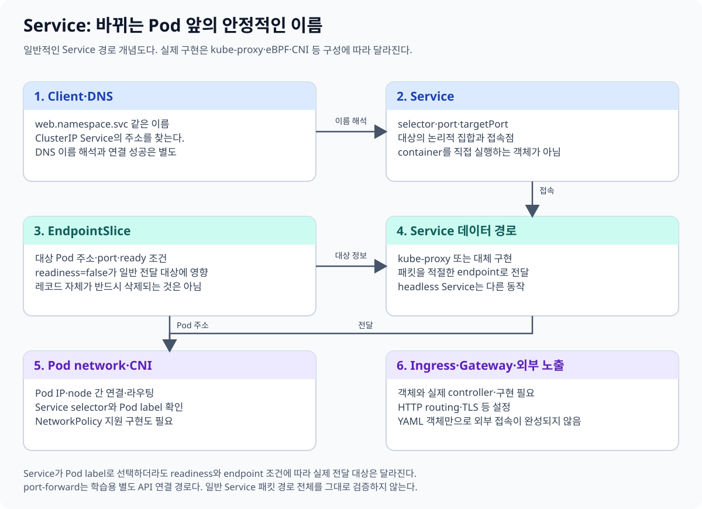
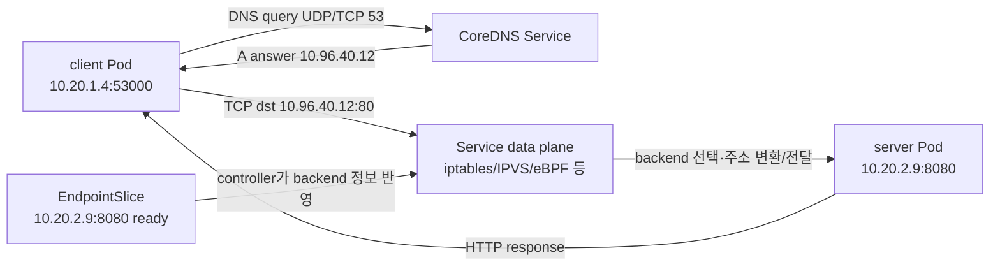
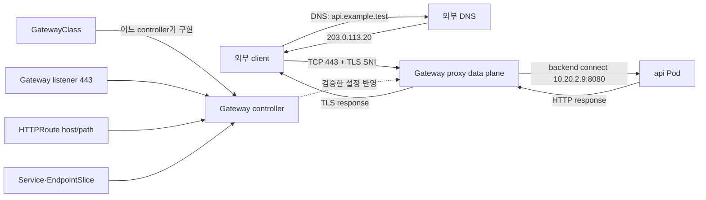

# 05. Service와 network

[이 책 목차](README.md) · [이전: Workload controller](04-workloads.md) · [심화: Gateway API](05a-gateway-api.md) · [다음: Storage](06-storage.md)

이 장의 IP, MAC, port, DNS 응답, manifest와 진단 출력은 교육용 예시다. 현재 클러스터에 적용하거나 특정 CNI 구현에서 캡처한 결과가 아니다.

Pod IP는 Pod replacement 때 바뀔 수 있다. Service는 변하는 Pod 집합을 안정적인 이름과 접속 지점으로 묶는다. 그러나 Service 객체가 packet을 직접 전달하거나 HTTP 응답을 만드는 process는 아니다. DNS, EndpointSlice, Service data plane, CNI, node route, Pod의 웹 process가 서로 다른 단계에서 협력한다.



## 1. 주소를 먼저 분리한다: 이름, MAC, IP, port

DNS 이름 `api.network-lab.svc.cluster.local`은 사람이 서비스 역할을 찾기 위한 이름이다. DNS server가 보통 ClusterIP 같은 IP 주소를 반환한다. **IP address**는 network 계층에서 source와 destination host/interface를 찾는 논리 주소다. **Port**는 그 IP의 어느 transport endpoint와 process를 원하는지 구별하는 TCP/UDP 번호다.

**MAC address**는 Ethernet 같은 link 계층에서 같은 L2 구간의 다음 interface로 frame을 전달할 때 쓰인다. Remote Pod의 MAC을 end-to-end로 그대로 들고 가는 것이 아니다. Router나 overlay hop을 지날 때 link header는 구간마다 바뀔 수 있지만 원래 IP packet은 routing·NAT 정책에 따라 전달된다.

HTTP path `/v1/items`는 TCP 연결 위 application protocol 정보다. DNS 성공, TCP connect 성공, HTTP status 성공은 서로 다른 검사다.

| 값 | 예시 | 누가 사용 | 교체 시 변화 가능성 |
|---|---|---|---|
| DNS name | `api.network-lab` | resolver·client | Service 이름 동안 안정적 |
| ClusterIP | `10.96.40.12` | Service data plane | Service 재생성 시 변경 가능 |
| Service port | TCP 80 | client·Service rule | spec 변경 시 변화 |
| Pod IP | `10.20.2.9` | endpoint·CNI routing | Pod replacement 시 변화 |
| target port | TCP 8080 | app process | Pod/app 설정과 맞아야 함 |
| next-hop MAC | `02:...` | node link/neighbor | hop·interface마다 다름 |

## 2. CNI와 Pod network

CNI(Container Network Interface)는 runtime이 Pod sandbox network를 준비할 때 호출하는 plugin 규격과 구현 생태계다. Plugin은 Pod network namespace에 interface를 연결하고 IPAM으로 주소를 할당하며 route를 설정한다. 일부 구현은 NetworkPolicy와 Service data plane까지 제공하지만 CNI라는 단어 자체가 특정 packet 기술을 뜻하지는 않는다.

Node A의 Pod `10.20.1.4`에서 Node B의 Pod `10.20.2.9`로 packet이 갈 때 구현은 native route, tunnel encapsulation, eBPF forwarding 등 여러 방식을 쓸 수 있다. Kubernetes network model의 계약과 실제 CNI packet path를 구분한다.



Client→DNS은 이름 해석 traffic이다. DNS→client는 Service 주소를 응답할 뿐 backend 건강을 보장하지 않는다. Client→data plane은 ClusterIP:port로 보낸 TCP packet이다. EndpointSlice→data plane 화살표는 실제 요청 packet이 EndpointSlice 객체를 통과한다는 뜻이 아니라 controller가 API 상태를 local forwarding rule로 반영한다는 뜻이다. Data plane→Pod는 선택한 backend로 packet을 전달하는 경로다.

## 3. Service, ClusterIP, port, targetPort

Service는 label selector에 맞는 backend 집합과 안정적인 virtual 접속 지점을 표현하는 API 객체다. 기본 type인 **ClusterIP**는 cluster 내부 virtual IP를 할당한다. 일반적으로 어떤 process가 그 IP를 interface에 bind해 listen하는 구조가 아니라 node data plane rule이 packet을 backend로 보낸다.

```yaml
apiVersion: v1
kind: Service
metadata:
  name: api
  namespace: network-lab
spec:
  type: ClusterIP
  selector: {app: api}
  ports:
    - name: http
      protocol: TCP
      port: 80
      targetPort: http
```

`port: 80`은 client가 Service에 접속하는 port다. `targetPort: http`는 선택된 Pod container port 이름 `http`를 찾아 실제 숫자, 예를 들어 8080으로 해석한다. `containerPort: 8080` 선언이 application을 자동 시작하거나 socket을 열지는 않는다. Process가 실제 `0.0.0.0:8080` 또는 Pod IP:8080을 listen해야 한다.

Selector는 이름이 아닌 label을 비교한다. Service `api`와 Pod `api-7f...`처럼 이름이 비슷해도 label이 `app=backend`면 선택되지 않는다. 반대로 이름이 달라도 `app=api`면 선택될 수 있다.

## 4. EndpointSlice와 readiness

EndpointSlice는 Service backend 주소와 port, condition을 조각으로 저장하는 API 객체다. 많은 endpoint를 하나의 거대한 Endpoints 객체보다 나누어 확장 가능하게 관리한다. EndpointSlice controller는 selector와 Pod 상태를 관찰해 slice를 갱신한다.

```text
Service api ClusterIP 10.96.40.12:80
EndpointSlice api-x7k2p:
  10.20.1.4:8080 ready=true  node=node-a
  10.20.2.9:8080 ready=false node=node-b
```

Readiness가 false인 endpoint는 일반적으로 새 Service traffic 대상에서 제외된다. 이것은 기존 TCP connection을 즉시 강제로 끊는 계약이 아니다. Client keep-alive, proxy connection pool, termination drain이 남을 수 있다. API condition 갱신과 각 node data plane 반영도 완전히 같은 순간은 아니다.

Pod에 IP가 있다는 사실은 application 준비를 뜻하지 않는다. CNI는 network를 준비했지만 process가 model을 읽는 중일 수 있다. Kubelet readiness probe가 성공하고 status가 API에 반영된 뒤 EndpointSlice와 forwarding state가 따라 바뀐다.

| 시각 | Pod A | Pod B | EndpointSlice 의미 | 새 요청 후보 |
|---:|---|---|---|---|
| t0 | Ready, 10.20.1.4 | Ready, 10.20.2.9 | A/B ready=true | A 또는 B |
| t1 | Ready | probe 실패 | B ready=false로 갱신 중 | 잠시 전파 차이 가능 |
| t2 | Ready | Ready=false 반영 | A true, B false | A |
| t3 | Ready | 삭제, 새 C 초기화 | A true, C ready=false | A |
| t4 | Ready | C Ready, 10.20.3.7 | A/C true | A 또는 C |

## 5. DNS는 이름만 해석한다

Cluster DNS는 Service 이름에 대한 record를 제공한다. 같은 namespace에서는 `api`, 다른 namespace에서는 `api.network-lab`, 전체 이름은 `api.network-lab.svc.cluster.local` 같은 형태다. Cluster domain은 변경될 수 있다.

Pod의 resolver 설정은 search suffix와 nameserver를 제공한다. Short name `api`에 여러 search suffix를 순서대로 붙일 수 있으므로 이름 충돌과 불필요한 query를 이해해야 한다. DNS TTL과 client cache 때문에 Service 삭제·재생성 주소 변화가 즉시 모든 process에 보인다고 가정하지 않는다.

DNS `NXDOMAIN`은 요청 이름에 record가 없다는 뜻이다. DNS가 `10.96.40.12`를 반환한 뒤 TCP timeout이 나면 이름 해석은 성공했다. Application `404`가 오면 DNS, route, TCP, HTTP server까지 상당 부분 도달했으며 path 처리 문제를 본다.

## 6. Service data plane: iptables, IPVS, eBPF

Kubernetes API는 Service semantics를 정의하지만 각 node의 packet 전달 구현은 다를 수 있다. 전통적인 kube-proxy는 iptables 또는 IPVS mode로 Service와 EndpointSlice 상태를 local rule에 반영한다. 일부 CNI는 eBPF 프로그램으로 Service 처리와 policy를 구현하고 kube-proxy를 대체한다.

**iptables**는 netfilter rule chain을 구성해 packet matching과 NAT를 수행한다. Service rule이 backend 중 하나로 destination NAT할 수 있다. **IPVS**는 kernel의 virtual server 기능으로 virtual service와 real server table을 관리한다. **eBPF data plane**은 kernel hook에 검증된 프로그램과 map을 사용해 lookup·forwarding·policy를 수행할 수 있다.

세 이름은 성능 순위를 자동 결정하지 않는다. Rule 수, connection tracking, kernel version, traffic pattern, CNI 설계가 결과를 바꾼다. 현재 cluster가 어느 mode인지 확인하지 않고 명령 하나의 output을 모든 환경에 적용하면 안 된다.

Service는 일반적으로 연결 단위로 backend를 고른다. 하나의 오래된 keep-alive TCP connection 안 여러 HTTP 요청은 같은 backend로 갈 수 있다. 매 HTTP request마다 반드시 round-robin이라고 가정하지 않는다.

## 7. NodePort와 LoadBalancer

NodePort는 각 node의 할당 port를 통해 Service에 도달할 접점을 제공한다. 예를 들어 node IP `192.0.2.10:31080`에서 ClusterIP Service backend로 전달할 수 있다. 모든 node에 application process가 31080을 직접 bind하는 모델과 다르다.

LoadBalancer type은 cloud provider나 별도 controller가 외부 load balancer를 준비하도록 요청하는 API다. Bare metal에서 구현 controller가 없으면 external IP가 Pending일 수 있다. Object 생성만으로 물리 장비나 public address가 자동 생긴다고 단정하지 않는다.

External traffic의 source IP 보존과 node hop은 `externalTrafficPolicy`와 provider 구현에 따라 달라진다. Local 정책은 local endpoint 없는 node에서 drop될 수 있고 분산 균형도 바뀐다. 정책 이름만 보고 항상 더 빠르다고 결론 내리지 않는다.

## 8. 완전 예제 1: 같은 namespace의 웹 요청

Client Pod `10.20.1.4`가 `http://api:80/v1/items`를 요청하고 backend는 `10.20.2.9:8080`이라고 하자.

| 단계 | 입력 | 실행 주체와 중간 상태 | 출력 |
|---:|---|---|---|
| 1 | hostname `api` | libc/runtime resolver가 search suffix 적용 | `api.network-lab.svc...` query |
| 2 | DNS query | CoreDNS가 Service record 조회 | ClusterIP `10.96.40.12` |
| 3 | connect IP:80 | client kernel이 SYN packet 생성 | src `10.20.1.4:53000`, dst `10.96.40.12:80` |
| 4 | next hop 결정 | route·neighbor lookup, 해당 hop MAC frame | node/CNI 경로 진입 |
| 5 | Service lookup | iptables/IPVS/eBPF 구현이 ready endpoint 선택 | backend `10.20.2.9:8080` |
| 6 | Pod 경로 | CNI route/overlay가 node-b sandbox로 전달 | server TCP stack이 SYN 수신 |
| 7 | accept/read | app process가 socket accept, HTTP parse | path `/v1/items` 처리 |
| 8 | response | reverse routing/conntrack 상태 사용 | HTTP 200 body 반환 |

Port는 80에서 8080으로 바뀌고 destination IP도 backend로 변환될 수 있다. Link MAC은 hop마다 달라질 수 있다. Client application은 보통 최종 backend Pod IP를 직접 알 필요가 없다.

Connection refused라면 목적지 stack이 즉시 RST를 돌려준 상황일 수 있다. Backend IP:8080 직접 접속은 refused인데 Service IP는 timeout이라면 Service rule과 endpoint, policy 경로를 따로 본다. HTTP 503이면 어느 proxy가 응답했는지 header와 log를 확인한다.

## 9. 완전 예제 2: 외부 Gateway 요청

외부 client가 `https://api.example.test/v1/items`를 요청한다. DNS는 Gateway의 외부 address를 반환하고, 실행 중인 Gateway proxy가 TLS와 HTTPRoute를 처리해 Service backend로 연결한다.



API 객체→controller 화살표는 control plane 설정 관찰이다. 점선 controller→proxy는 구현별 config 전달이다. Client→proxy와 proxy→Pod는 실제 data plane connection이다. Gateway controller가 사용자 HTTP byte를 직접 proxy한다고 단정하지 않는다.

GatewayClass는 구현 controller 종류, Gateway는 listener와 infrastructure 접점, HTTPRoute는 hostname/path와 backendRefs를 표현한다. Service/EndpointSlice는 현재 backend다. `Accepted=True`여도 `ResolvedRefs=False`면 존재하지 않는 Service나 허용되지 않은 cross-namespace reference 때문에 backend가 해결되지 않을 수 있다. 상세 조건은 05A에서 다룬다.

## 10. Ingress controller와 proxy를 구별한다

Ingress object는 HTTP(S) route 선언이다. Ingress controller는 객체를 watch해 구현 설정을 만든다. 실제 request를 받는 data plane proxy process는 같은 Pod 안에 있을 수도 별도일 수도 있다. “Ingress가 packet을 받는다”는 표현은 API 객체와 proxy를 섞는다.

Ingress API는 안정적으로 유지되지만 frozen 상태이며 새 기능은 Gateway API가 중심이다. 이것이 기존 Ingress가 즉시 제거된다는 뜻은 아니다. Cluster의 구현, 지원 version, migration 비용을 확인한다.

## 11. NetworkPolicy: 허용 집합 선언

NetworkPolicy는 선택한 Pod에 대해 ingress와 egress 허용 집합을 선언한다. 실제 enforcement는 이를 지원하는 network plugin이 수행한다. API 객체가 Accepted됐다는 사실만으로 packet이 차단됐음을 증명하지 않는다.

```yaml
apiVersion: networking.k8s.io/v1
kind: NetworkPolicy
metadata: {name: api-from-web, namespace: network-lab}
spec:
  podSelector:
    matchLabels: {app: api}
  policyTypes: ["Ingress"]
  ingress:
    - from:
        - podSelector:
            matchLabels: {app: web}
      ports:
        - {protocol: TCP, port: 8080}
```

Top-level `podSelector`는 보호할 destination API Pod다. `from.podSelector`는 같은 namespace에서 허용할 source web Pod다. `port: 8080`은 Pod의 실제 destination port다. 여러 정책이 같은 Pod를 선택하면 허용 규칙은 합쳐진다. 정책 순서대로 첫 match만 적용하는 firewall chain으로 이해하지 않는다.

Ingress만 제한하면 source Pod의 egress policy가 별도로 연결을 막을 수 있다. DNS egress를 빠뜨리면 Service 이름조차 해석되지 않을 수 있다. Default deny 도입 전 DNS, metrics, identity, storage 의존성을 목록화한다.

## 12. connection refused와 timeout을 증거로 나누기

둘 다 “접속 안 됨”이지만 packet 결과가 다르다.

| 관찰 | 가능한 층 | 다음 증거 |
|---|---|---|
| DNS NXDOMAIN | 이름·namespace 오타, Service 없음 | DNS query와 Service 존재 |
| 즉시 connection refused | 도착한 IP:port에 listener 없음, reject rule | Pod socket listen, targetPort |
| connect timeout | route drop, NetworkPolicy, firewall, blackhole | packet counter, policy, route |
| HTTP 404 | HTTP server 도달, path/rule 불일치 | 응답 주체 header, route/app log |
| HTTP 503 | proxy에 usable backend 없음 또는 app 자체 503 | EndpointSlice readiness, proxy log |
| 간헐 timeout | 일부 endpoint/node 경로 문제 | endpoint별 직접 검사, node 분포 |

Refused가 항상 application 문제인 것은 아니다. Firewall이 reject 응답을 만들 수도 있다. Timeout이 항상 NetworkPolicy도 아니다. App accept queue 포화, conntrack, MTU blackhole, return route 문제일 수 있다. 어느 hop이 어떤 packet을 보냈는지 증거를 모은다.

진단은 이름→Service spec→selector/label→EndpointSlice→readiness→실제 listener→policy→CNI route→외부 proxy 순서로 좁힌다. 외부만 실패하면 Gateway listener·route condition과 proxy address를 추가한다.

## 13. 주소와 상태 변경 시간표

Pod B를 새 Pod C로 교체하는 동안의 예다.

| 시각 | Service/DNS | EndpointSlice | data plane | connection 영향 |
|---:|---|---|---|---|
| t0 | ClusterIP·DNS 안정 | A/B ready | A/B rule | 새 연결 A 또는 B |
| t1 | 동일 | B ready=false 보고 | node별 갱신 전파 중 | 일부 새 연결 차이 가능 |
| t2 | 동일 | A ready, B false | B 신규 선택 제외 | 기존 B keep-alive 남을 수 있음 |
| t3 | 동일 | C IP 추가, ready=false | C 선택 안 함 | A만 새 연결 |
| t4 | 동일 | C ready=true | A/C rule 반영 | 새 연결 A 또는 C |
| t5 | 동일 | B endpoint 제거 | stale state 정리 | B 연결 drain/종료 정책 영향 |

Kubernetes control plane 상태와 모든 packet processor가 원자적으로 한 시각에 바뀐다고 가정하지 않는다. 짧은 전파 지연과 장기 connection을 rollout 설계에 포함한다.

## 14. 연구 성능과 network data plane 경계

PeRF의 USENIX ATC 2024 연구는 container 환경에서 성능 간섭을 관찰·진단하는 연구 맥락을 제공한다. Service data plane 종류만으로 application latency를 일반화하지 않는다. CPU scheduling, conntrack, packet size, connection 재사용, CNI encapsulation, application queue가 함께 영향을 준다.

GPU sharing scheduling 연구도 network-sensitive distributed training에서는 placement와 communication 경로가 중요할 수 있음을 보여 주지만, 모든 Kubernetes Service가 연구 논문의 latency를 자동 달성한다는 뜻이 아니다. 논문의 workload, topology, metric, baseline을 확인하고 실제 cluster에서 end-to-end 측정한다.

## 15. 확인 문제와 완전 해설

### 문제 1
Service `port:80`, `targetPort:http`, Pod named port `http:8080`이다. Client와 app가 보는 port는 각각 무엇인가?

**해설:** Client는 Service IP의 TCP 80에 연결한다. Service backend 정보는 named port를 8080으로 해석해 Pod IP:8080으로 전달한다. App process가 실제 8080을 listen해야 한다.

### 문제 2
DNS가 ClusterIP를 반환했지만 EndpointSlice가 비어 있다. 예상 실패와 조사 대상은?

**해설:** 이름 해석은 성공하지만 usable backend가 없어 connect timeout/refused 또는 proxy 503처럼 구현별 결과가 날 수 있다. Service selector, Pod label, readiness, targetPort를 확인한다.

### 문제 3
Readiness가 false가 되면 기존 TCP connection이 즉시 끊기는가?

**해설:** 그런 보장은 없다. 일반적으로 새 선택에서 제외되지만 기존 connection, keep-alive와 proxy pool은 남을 수 있다. Application graceful drain과 termination 순서를 설계한다.

### 문제 4
NetworkPolicy 객체가 존재하지만 차단되지 않는다. 어떤 경계를 확인하는가?

**해설:** 사용하는 CNI가 policy enforcement를 지원·활성화했는지, 대상 podSelector가 맞는지, 다른 허용 정책이 합쳐지는지, ingress와 source egress 양쪽 조건을 확인한다.

### 문제 5
외부 요청은 timeout인데 cluster 내부 Service 요청은 200이다. 어디부터 보는가?

**해설:** Backend app와 내부 Service 경로는 동작한다는 증거다. 외부 DNS/address, LoadBalancer/NodePort, Gateway listener, HTTPRoute condition, proxy Pod와 외부 firewall 순서로 범위를 좁힌다. 내부 성공만으로 TLS hostname과 외부 return route를 증명하지 않는다.

## 공식·연구 자료

- [Kubernetes Cluster Networking](https://kubernetes.io/docs/concepts/cluster-administration/networking/)
- [Kubernetes Service](https://kubernetes.io/docs/concepts/services-networking/service/)
- [Kubernetes EndpointSlices](https://kubernetes.io/docs/concepts/services-networking/endpoint-slices/)
- [DNS for Services and Pods](https://kubernetes.io/docs/concepts/services-networking/dns-pod-service/)
- [Kubernetes Network Policies](https://kubernetes.io/docs/concepts/services-networking/network-policies/)
- [Kubernetes Ingress](https://kubernetes.io/docs/concepts/services-networking/ingress/)
- [Kubernetes Gateway API](https://kubernetes.io/docs/concepts/services-networking/gateway/)
- [PeRF, USENIX ATC 2024](https://www.usenix.org/conference/atc24/presentation/lee)
- [IWQoS 2024 GPU Sharing Scheduling](https://arxiv.org/abs/2407.13088)

[이 책 목차](README.md) · [이전: Workload controller](04-workloads.md) · [심화: Gateway API](05a-gateway-api.md) · [다음: Storage](06-storage.md)
