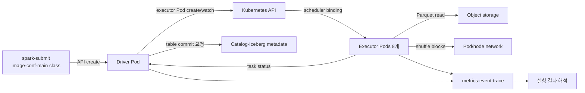
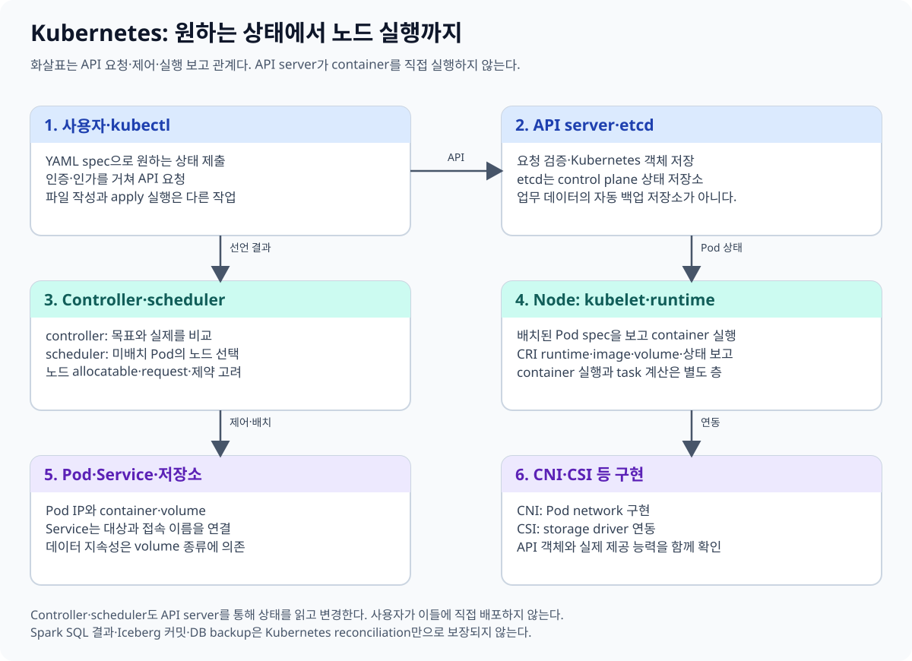
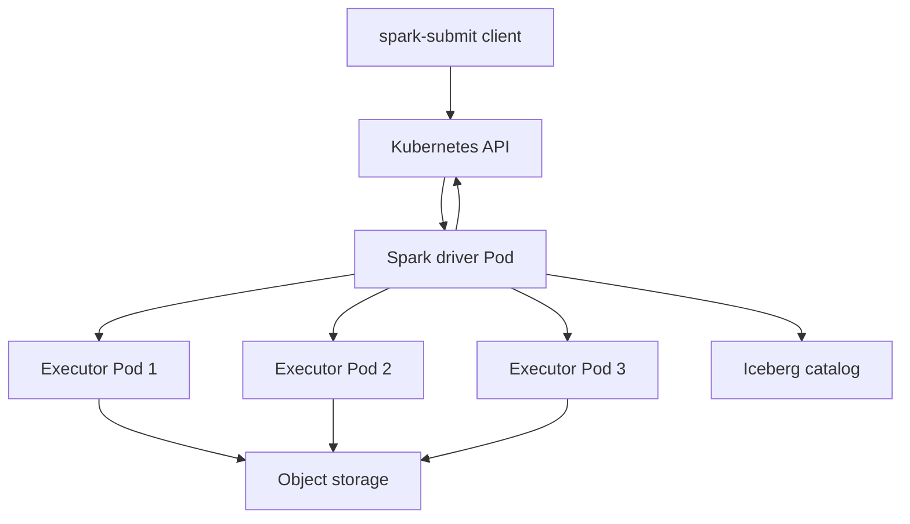
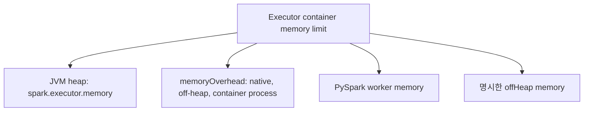
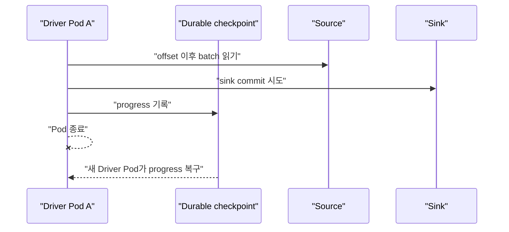
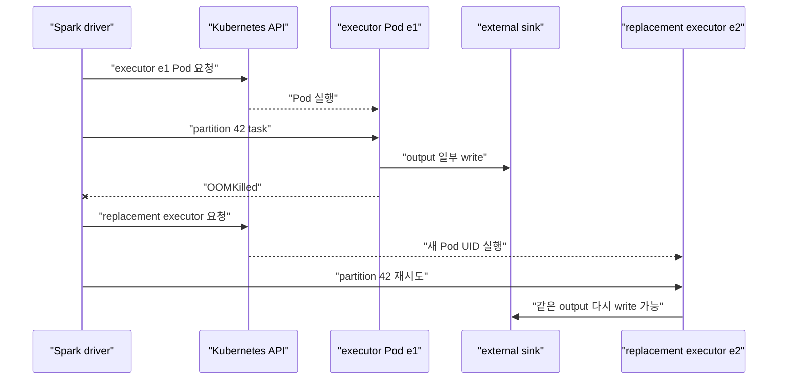

# 14. 연구용 Spark on Kubernetes 플랫폼

[이 책 목차](README.md) · [이전: 로컬 실습](13-local-labs.md) · [다음: 버전과 확장](15-versions-and-extensions.md)
## 한 실험을 제출에서 결과 해석까지 따라간다

이 장의 수치는 비교 방법을 설명하는 교육용 모형이며 실제 cluster benchmark 결과가 아니다. Spark job이 1TiB Parquet를 읽어 groupBy한 뒤 object storage에 결과를 쓴다고 하자. Driver 1개, executor 8개, executor마다 CPU 4·memory 16Gi·GPU 1개를 요청한다.

**Driver**는 Spark application의 계획과 executor 상태를 관리하는 process다. Cluster deploy mode에서는 Pod 안에서 실행된다. **Executor**는 stage의 task를 실행하고 shuffle block과 결과를 만든다. Kubernetes scheduler는 executor Pod의 request·affinity를 보고 node를 고르지만 Spark stage DAG, partition skew, GPU kernel duration을 직접 최적화하지 않는다.



Driver→API는 Kubernetes object 관리이고 executor→driver는 Spark RPC다. Executor→object storage와 shuffle은 data path다. Catalog commit은 Pod 성공과 다른 transaction 경계다.

## 완전 수치 trace

초기 데이터 1TiB, 8 executor, 각 128 partition을 처리한다고 단순화한다.

| 시각 | Kubernetes 상태 | Spark 상태 | 자원·관측 | 해석 |
|---:|---|---|---|---|
| 0s | Driver Pending | 제출됨 | GPU node 후보 4 | 아직 job 시작 전 |
| 8s | Driver Running | DAG 생성 | API 권한 정상 | executor 요청 시작 |
| 12s | Executor 8개 중 4 Pending | stage 0 대기 | GPU allocatable 부족 | Pod request가 병목 |
| 30s | 8개 Running | scan task 512개 | read 20GiB/s | warm-up |
| 70s | 1 executor CPU 100%, GPU 20% | skew partition | p99 task 40s | GPU 부족이 아닌 data skew |
| 95s | executor e5 OOMKilled | task retry | memory peak 17Gi | 같은 Pod container restart/실패 확인 |
| 130s | stage retry 완료 | shuffle fetch 증가 | network 80Gb/s 포화 | communication 병목 후보 |
| 180s | tasks complete | commit 시작 | output files 존재 | 아직 table commit 전 |
| 185s | Driver crash | application 실패 | metadata commit 불명 | orphan file·commit 상태 확인 |

Pod가 Running이었던 시간만 비교하면 Spark 작업 단계 차이를 놓친다. 제출→Pod scheduling, executor 준비, scan, shuffle, commit을 따로 측정한다. Driver crash 뒤 object file이 일부 존재해도 Iceberg table snapshot에 commit됐는지는 catalog metadata로 판단한다.

## 반복 실험 설계

독립 변수는 scheduler 정책 A/B, 종속 변수는 job completion time·p99 task time·GPU utilization·network bytes다. Dataset, image digest, Spark conf, executor 수, node pool, cache 조건을 통제한다. 같은 순서로 A만 여러 번 실행하면 시간대 변화가 섞일 수 있어 실행 순서를 randomize하거나 paired design을 검토한다.

각 반복의 raw 값이 `A: 180,176,310,179,181s`, `B: 168,171,170,169,172s`라면 A 평균은 outlier에 크게 흔들린다. Median, p95, 실패율과 310초의 event·trace를 함께 남긴다. Outlier를 이유 없이 삭제하지 않는다.

## GPU scheduling 연구를 읽는 경계

IWQoS 2024 GPU sharing scheduling 연구는 특정 GPU sharing model, workload trace, 목적 함수와 baseline에서 정책을 평가한다. 논문의 평균 completion time 개선을 “Kubernetes에서 GPU request를 쓰면 자동 적용”으로 해석하지 않는다. 구현 scheduler/plugin, device sharing mechanism, preemption 비용, fairness metric이 실제 환경과 같은지 확인한다.

반례는 workload가 GPU memory를 거의 가득 사용해 sharing할 수 없거나 kernel이 동시에 실행될 때 interference가 더 커지는 경우다. Throughput이 늘어도 개별 job tail latency와 fairness가 나빠질 수 있다. 평균 하나가 아니라 per-job slowdown과 deadline miss를 본다.

## PeRF와 RDMA 조건

PeRF 계열 연구의 성능 관측 방법과 RDMA를 사용하는 실험은 kernel/network bypass, NIC queue, memory registration, topology 같은 조건에 민감하다. 일반 TCP CNI 결과를 RDMA 결과로 바꾸어 말하지 않는다. RDMA device plugin과 network attachment가 있다고 collective 성능이 자동 보장되지 않는다.

GPU와 NIC의 PCIe/NUMA 근접성, GPUDirect 지원, switch oversubscription, message size를 기록한다. Small message latency가 중요한 workload와 large all-reduce bandwidth workload의 최적 placement가 다를 수 있다. Kubernetes 기본 scheduler의 node 선택과 연구 scheduler의 topology-aware objective를 분리한다.

## 실패 반례

Executor Pod Pending을 Spark code 오류로 보면 안 된다. FailedScheduling event에서 GPU·CPU·taint를 본다. Executor Running인데 task p99가 길면 data skew, GC, network, storage, GPU utilization을 본다. Driver Pod Succeeded여도 external sink transaction이 정확한지는 application commit log를 확인한다.

## 문제와 유도 해설 보강

1. Executor 8개 중 4개가 Pending이면 stage 시간이 긴 원인을 어디서 시작하는가? **Scheduler event와 GPU allocatable/request를 먼저 본다.**
2. GPU utilization 20%, CPU 100%면 GPU를 더 배정하면 해결되는가? **CPU decode·data skew 병목이면 해결되지 않는다.** Profile이 필요하다.
3. Output file이 존재하면 Iceberg commit 성공인가? **아니다.** Catalog의 새 snapshot metadata commit을 확인한다.
4. A 평균이 B보다 느린데 A의 한 outlier만 크다. 무엇을 보고할까? **모든 raw 반복, median/tail/failure와 outlier 원인을 함께 보고한다.**
5. GPU sharing 논문 개선율을 기본 scheduler에 적용해도 되는가? **아니다.** Sharing 구현, workload, topology, metric 조건이 같은지 검증한다.

Spark를 Kubernetes에서 실행하면 driver와 executor가 Pod가 된다. Kubernetes는 Pod 배치와 재시작 기반을 제공하지만 Spark job의 commit, streaming source·sink correctness, Iceberg catalog 계약을 대신하지 않는다.



## 1. Process 배치



Cluster deploy mode에서 제출 client가 driver Pod 생성을 요청하고 driver가 executor Pod를 생성·관찰한다. Executor는 task를 수행하고 driver에 상태와 결과를 보낸다. 공식 [Spark on Kubernetes](https://spark.apache.org/docs/4.0.4/running-on-kubernetes.html)를 기준으로 한다.

## 2. ServiceAccount와 API 권한

Driver는 자기 namespace에서 executor Pod와 관련 resource를 만들고 감시·삭제할 권한이 필요하다. 전용 ServiceAccount와 namespace Role을 사용하고 `cluster-admin`을 주지 않는다.

```text
spark.kubernetes.authenticate.driver.serviceAccountName=spark-driver
spark.kubernetes.namespace=spark-lab
```

필요 verb는 Spark version, executor allocation, Service·ConfigMap 사용에 따라 달라진다. [10장](10-security-rbac.md)의 baseline을 실제 API audit와 공식 문서로 보정한다. Executor application code가 Kubernetes API를 쓸 필요가 없다면 token automount를 제한한다.

## 3. Executor 수와 Pod 수

정적 allocation에서 executor 4개라면 기본 Spark application Pod는 driver 1개와 executor 4개로 약 5개다.

```text
spark.executor.instances=4
spark.executor.cores=2
→ executor task slot 기준 약 8개
```

Dynamic allocation을 사용하면 executor Pod 수가 변한다. Pod 수와 CPU slot, 실제 parallelism은 input partition, shuffle partition, scheduler backlog의 영향을 함께 받는다.

## 4. JVM heap와 container memory



`spark.executor.memory=6g`는 container 전체 limit 6Gi와 같은 뜻이 아니다. 대략 heap + overhead + off-heap + PySpark memory를 담을 공간이 필요하다.

```text
--conf spark.executor.memory=6g
--conf spark.executor.memoryOverhead=1g
--conf spark.executor.cores=2
--conf spark.kubernetes.executor.limit.cores=2
```

이 설정 조각은 `lab13/spark-lab` 격리 실습 예시이며 제출하지 않았다. CPU limit이 task slot보다 너무 낮으면 throttling되고 memory overhead가 작으면 heap 밖 사용 때문에 OOMKilled될 수 있다.

## 5. 실행 가능한 제출 형태

```text
spark-submit \
  --master k8s://https://kubernetes.default.svc \
  --deploy-mode cluster \
  --name research-etl \
  --conf spark.kubernetes.namespace=spark-lab \
  --conf spark.kubernetes.authenticate.driver.serviceAccountName=spark-driver \
  --conf spark.kubernetes.container.image=registry.example/spark:4.0.4 \
  --conf spark.executor.instances=4 \
  local:///opt/spark/jobs/etl.py
```

문법 예시일 뿐 image와 job은 실제 존재하지 않으며 이 문서에서는 실행하지 않는다. External production cluster에는 적용하지 않는다.

## 6. Streaming checkpoint

Driver Pod filesystem이나 `emptyDir`에 checkpoint를 두면 Pod 교체 때 잃을 수 있다. 여러 재시작에서 같은 URI를 읽을 수 있는 지속 storage를 사용한다.

```text
checkpointLocation=s3a://research-lake/checkpoints/events-v1
```

Checkpoint 지속성만으로 exactly-once가 완성되지 않는다. Source offset semantics, sink commit/idempotency, query 변경 호환성, credential과 object-store consistency를 함께 검증한다. Pod 재시작은 외부 sink의 중복 write를 자동 취소하지 않는다. [Structured Streaming recovery semantics](https://spark.apache.org/docs/4.0.4/streaming/apis-on-dataframes-and-datasets.html#recovery-semantics-after-changes-in-a-streaming-query)를 참고한다.



Sink commit 성공 뒤 checkpoint 응답을 잃은 구간 같은 failure를 실제 connector 계약으로 시험한다.

## 7. Iceberg catalog와 object storage

개발 laptop의 local filesystem HadoopCatalog 성공은 Kubernetes 다중 writer 계약을 검증하지 않는다. Driver와 executor가 서로 다른 node에서 같은 local path를 본다고 가정할 수 없다.

연구 cluster에서는 다음을 분리한다.

- Catalog: table 이름과 current metadata commit 경계
- Object storage: data, manifest, metadata file byte 저장
- Spark integration: SQL plan, reader/writer와 Iceberg runtime
- IAM: driver·executor의 catalog/storage 권한

Object storage가 있다고 atomic Iceberg catalog commit이 생기는 것도 아니며, catalog가 있다고 모든 executor의 object access가 보장되는 것도 아니다. [Iceberg 통합 장](../apache-spark/09-iceberg-integration.md)을 함께 본다.

## 8. 읽기 전용 진단

```text
kubectl get pods -n spark-lab -l spark-app-name=research-etl
kubectl logs -n spark-lab <driver-pod> --tail=200
kubectl get events -n spark-lab --sort-by=.metadata.creationTimestamp
kubectl auth can-i create pods --as=system:serviceaccount:spark-lab:spark-driver -n spark-lab
```

위 명령은 `lab13/spark-lab` 예시이며 실행하지 않았다. Driver log, executor log, Spark UI event, object-store/catalog log를 application ID와 시간으로 연결한다.

## 9. Driver와 executor 실패를 Kubernetes retry로만 읽지 않는다

Kubernetes가 executor Pod를 다시 만들 수 있는지와 Spark가 stage task를 재시도할 수 있는지는 서로 다른 control loop다. Driver가 살아 있으면 잃은 executor를 감지해 새 executor를 요청하고 task를 다시 schedule할 수 있다. Driver가 사라지면 application 전체 복구는 submit 방식, restart policy, operator, checkpoint에 따라 달라진다.



Spark의 task retry가 output commit protocol과 함께 안전한지 확인해야 한다. 단순 REST 호출, email, 임의 database insert를 task 안에서 수행하면 speculative execution이나 retry로 중복될 수 있다. Partition ID와 application attempt를 idempotency key로 쓰거나 transaction·commit protocol이 있는 sink를 사용한다.

## 10. 한 application의 자원 계산

Driver request 1 CPU/2Gi, executor 4개가 각각 2 CPU/8Gi를 요청하면 scheduler가 보는 합은 대략 9 CPU/34Gi다. Executor memory 설정만 더한 값이 아니다.

```text
driver:    1 × (1 CPU, 2Gi) = 1 CPU, 2Gi
executors: 4 × (2 CPU, 8Gi) = 8 CPU, 32Gi
합계 request                 = 9 CPU, 34Gi
```

세 node에 각각 남은 자원이 4 CPU/12Gi라면 합계는 충분해 보여도 executor 하나가 들어갈 node별 연속 공간과 driver placement를 순서대로 봐야 한다. Pod anti-affinity, taint, zone-bound PVC가 있으면 후보는 더 줄어든다. Dynamic allocation의 최대 executor를 기준으로 namespace quota와 downstream connection 한도도 계산한다.

## 11. 실패 시간표를 여러 log로 맞추기

```text
11:00:00 Spark UI: stage 8, task partition=42 시작
11:00:18 executor log: native allocation 1.2Gi
11:00:20 Pod status: lastState.reason=OOMKilled, exitCode=137
11:00:21 Kubernetes event: BackOff 또는 executor Pod 종료 관찰
11:00:23 driver log: executor lost, task 42 재시도
11:00:40 sink log: partition 42 write request 두 번 관찰
```

Driver log만 보면 “executor lost”이고 Kubernetes status만 보면 “OOMKilled”이며 sink log만 보면 “duplicate write”다. Application ID, stage/task attempt, Pod UID, executor ID, output partition을 함께 남겨야 하나의 사건으로 연결된다. Executor limit만 올리기 전에 skew된 partition, heap 밖 memory, Python worker, shuffle fetch와 retry side effect를 구분한다.

## 12. 문제와 해설

1. Executor 4개면 기본 Pod 수는? **Driver 포함 약 5개**다.
2. `executor.memory=6g`면 container limit도 6Gi인가? **아니다.** overhead 등을 포함해야 한다.
3. Durable checkpoint만 있으면 임의 sink가 exactly-once인가? **아니다.** source·sink 계약이 필요하다.
4. Local HadoopCatalog 성공이 다중 node object storage commit을 증명하는가? **아니다.** 서로 다른 storage·catalog 계약이다.

다음 장에서는 Kubernetes version, API lifecycle, feature gate와 extension의 성숙도를 읽는다.
