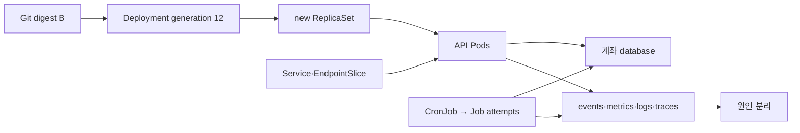
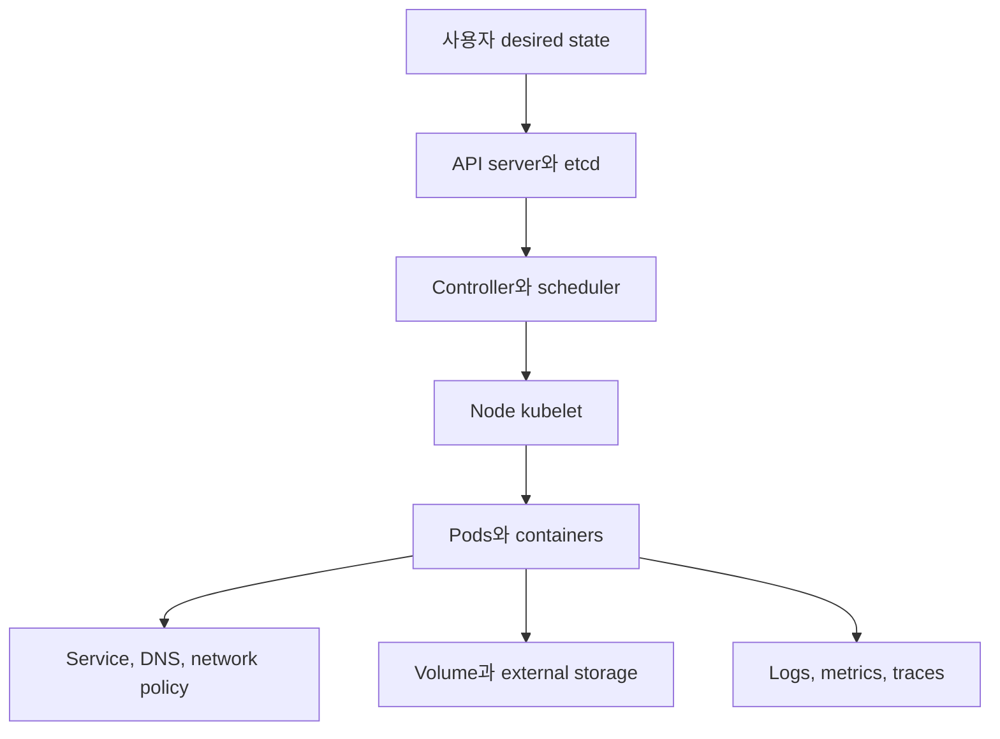
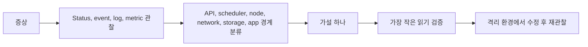

# 16. 종합 문제와 용어집

[이 책 목차](README.md) · [이전: Version, API와 extension](15-versions-and-extensions.md)
## 종합 사례: 은행 API rollout과 batch 중복

이 수치는 추론 훈련용이며 실제 cluster 결과가 아니다. 은행 잔액 API Deployment replicas=4가 digest A로 실행 중이고, 매일 이자 계산 CronJob이 계좌 DB를 갱신한다. API를 digest B로 rollout한 시각에 database latency가 증가하고 batch Pod 하나가 재시도됐다.

Git→Deployment는 desired state 변경이다. Deployment→Pod는 controller 조정이다. Service는 Ready endpoint를 선택한다. Job→DB는 Kubernetes가 rollback할 수 없는 업무 side effect다.

### 사건 시간표

| 시각 | API workload | Batch | 관측 | 해석 후보 |
|---:|---|---|---|---|
| 01:55 | A Ready 4 | 없음 | p99 180ms | 기준 |
| 02:00 | B Pod 1 Running/Ready false | attempt-1 시작 | DB CPU 70% | 두 변화 겹침 |
| 02:02 | A4+B1 | 이자 10,000계좌 중 7,000 commit | p99 1.5s | DB 부하 |
| 02:03 | B readiness 503 | attempt-1 node 장애 | Job 성공 status 없음 | API B는 traffic 제외 |
| 02:04 | A4 유지 | attempt-2 시작 | 같은 job key | 중복 위험 |
| 02:06 | 일부 계좌 unique key 충돌 | attempt-2 계속 | error 4% | idempotency가 일부 보호 |
| 02:10 | Batch 완료 | Complete | DB p99 회복 | B 문제 재평가 |
| 02:12 | B readiness 성공 | 없음 | API p99 220ms | rollout 계속 |

이 사례에서 B image가 느리다고 먼저 단정하면 안 된다. B는 Ready가 아니어서 일반 새 Service traffic을 받지 않았고 database batch가 같은 시각에 부하를 만들었다. Trace의 DB span, EndpointSlice, Job log와 transaction key를 연결한다.

Job attempt-1이 7,000계좌를 commit한 뒤 status 전에 죽었으므로 attempt-2가 같은 계좌를 다시 처리할 수 있다. Kubernetes retry는 정확히 한 번 업무 실행을 보장하지 않는다. `(job_date, account_id)` unique key와 transaction으로 이미 적용된 이자를 판정해야 한다.

## 수치 종합 문제 1: Scheduling

Node A allocatable 8 CPU·32Gi, 기존 request 6 CPU·20Gi다. Node B는 4 CPU·16Gi, 기존 request 2 CPU·12Gi다. 새 Pod request 1500m·6Gi는 어디에 가능한가?

**해설:** A의 남은 자원은 2 CPU·12Gi라 새 Pod 뒤 7.5 CPU·26Gi로 가능하다. B는 CPU 2가 남지만 memory는 4Gi만 남아 6Gi를 수용하지 못한다. 실제 사용량이 낮아도 scheduler request 계산은 이 결과다.

## 수치 종합 문제 2: HPA

현재 replicas 4, 관찰 CPU utilization 90%, target 60%다. 단순 비율은?

**해설:** `ceil(4×90/60)=6`이다. 그러나 missing metric, 초기화 중 Pod, tolerance, stabilization, scale policy 때문에 실제 desired가 다를 수 있다. CPU request가 없으면 utilization 기반 계산도 성립하지 않는다.

## 수치 종합 문제 3: Rollout

Replicas=4, maxSurge=1, maxUnavailable=0이다. Old Ready 4, New Running 1/Ready 0일 때 old를 줄일 수 있는가?

**해설:** Available 4를 유지해야 하므로 readiness가 없는 new를 근거로 old를 줄이지 않는다. 전체 Pod 5는 surge 한도다. New readiness 실패 원인을 probe와 app log에서 찾는다.

## 수치 종합 문제 4: SLO

28일 99.9% 성공 SLO이고 유효 요청이 2,000,000건이면 error budget은?

**해설:** 실패 허용률 0.1%=0.001이므로 2,000건이다. 10분에 500건을 소비했다면 기간 budget의 25%를 매우 짧게 사용한 것이므로 burn rate alert를 검토한다.

## 수치 종합 문제 5: Histogram

10,000 요청의 누적 bucket이 0.25s=9,700, 0.5s=9,880, 1s=9,950이다. p99 위치는 어디인가?

**해설:** 9,900번째이므로 0.5s bucket까지는 부족하고 1s bucket 안에 있다. P99는 0.5~1s 구간에서 추정된다. 정확한 raw 9,900번째 값을 안다는 뜻이 아니다.

## 실패 반례를 고치는 다섯 문장

1. **“Running이면 정상이다”는 틀리다.** Ready, EndpointSlice, SLI와 업무 결과를 별도로 본다.
2. **“StatefulSet이면 DB 복제가 된다”는 틀리다.** Ordinal·PVC identity만 제공하고 quorum·WAL·backup은 application 책임이다.
3. **“Secret base64면 암호화다”는 틀리다.** Encoding이며 RBAC·etcd encryption·log 통제가 필요하다.
4. **“Job Complete면 side effect가 한 번이다”는 틀리다.** Retry 전 commit이 가능하므로 idempotency key가 필요하다.
5. **“ResourceClaim이면 GPU 성능이 보장된다”는 틀리다.** Device allocation과 sharing·topology·network 성능은 별도다.

## 연구 결과를 운영 결론으로 바꾸기 전 질문

IWQoS GPU sharing 결과를 읽을 때 sharing mechanism, workload trace, fairness와 preemption cost를 확인한다. PeRF/RDMA 조건을 읽을 때 NIC, kernel bypass, memory registration, NUMA·PCIe topology, message size를 기록한다. 논문 평균 개선율을 기본 Kubernetes scheduler나 모든 CNI의 결과로 일반화하지 않는다.

비교 모형은 baseline과 새 정책에 같은 dataset·image·node pool을 사용하고 실행 순서를 섞으며 raw 반복값을 보존한다. Job completion time만 아니라 pending time, task p99, 실패율, GPU utilization, network bytes, SLO impact를 함께 본다.

## 추가 완전 문제

### 문제 6
PVC Bound인데 Pod가 ContainerCreating이다. 다음 상태는?

**해설:** Claim-PV 연결은 끝났지만 CSI attach, stage/publish mount가 남았다. VolumeAttachment와 kubelet·CSI event를 본다.

### 문제 7
HTTP readiness body가 `ready:false`지만 status 200이다. 결과는?

**해설:** Kubelet HTTP probe는 200~399를 성공으로 본다. Body를 해석하지 않으므로 app가 실패 status를 반환해야 한다.

### 문제 8
Gateway HTTPRoute Accepted=True, ResolvedRefs=False다. 의미는?

**해설:** Parent attachment는 수락됐지만 backend Service/port 또는 cross-namespace permission을 해결하지 못했다. ReferenceGrant와 Service를 본다.

### 문제 9
ConfigMap volume file은 debug인데 process는 info다. 원인은?

**해설:** Kubelet projection은 갱신됐지만 application reload가 없을 수 있다. SubPath면 file 자체도 갱신되지 않을 수 있다.

### 문제 10
CRD가 있는데 custom resource status가 비어 있다. 왜?

**해설:** CRD는 schema와 storage를 제공할 뿐 controller 동작은 아니다. Operator가 없거나 watch/RBAC/reconcile이 실패했는지 본다.

이 장은 Kubernetes object 이름을 외우는 시험이 아니다. 원하는 상태, 실제 상태, 책임 경계, 실패 뒤 재시도를 연결해 판단하는 연습이다. 먼저 문제를 풀고 바로 아래 해설에서 빠진 계층을 확인한다.

## 1. 전체 지도

## 2. 종합 문제 12개와 해설

### 문제 1 — Controller 선택

Web API replica 4개를 rolling update하고 Pod 이름은 영구적일 필요가 없다. 무엇을 쓰는가?

**해설:** Deployment를 쓴다. Deployment가 ReplicaSet revision과 Pod 수를 관리한다. 직접 Pod나 ReplicaSet을 운영하면 rollout 추상화가 부족하다.

### 문제 2 — Stateful workload

Broker 세 개가 각각 안정적인 ordinal과 별도 PVC를 요구한다. StatefulSet만 쓰면 복제가 안전한가?

**해설:** StatefulSet이 적합하지만 replication, quorum, backup은 broker 또는 operator가 구현해야 한다. PVC도 backup 자체가 아니다.

### 문제 3 — Service 장애

Service DNS는 해석되지만 connection이 거부된다. 확인 순서를 적어라.

**해설:** Service selector와 port→Pod label→readiness→EndpointSlice→container listen port→NetworkPolicy 순서로 본다. DNS 성공은 ready backend 존재를 보장하지 않는다.

### 문제 4 — CPU 계산

Allocatable 8 CPU node에 request 합 6500m가 있다. 새 Pod request가 2 CPU면 fit하는가?

**해설:** `6500m + 2000m = 8500m`이므로 fit하지 않는다. 순간 실제 사용이 낮아도 scheduler는 request를 기준으로 판단한다.

### 문제 5 — Memory 실패

Pod phase는 Running인데 container restart가 늘고 last reason이 OOMKilled다. 무엇을 구분하는가?

**해설:** Application heap, native/off-heap, sidecar 사용과 container memory limit을 본다. Running은 Ready나 무재시작을 뜻하지 않는다.

### 문제 6 — Probe

Database가 5초 느려질 때마다 API liveness가 실패해 모든 replica가 재시작된다. 어떻게 고치는가?

**해설:** Liveness를 process 자체의 복구 불능 상태에 좁힌다. Dependency 장애는 readiness와 application retry로 다루고 startup probe로 긴 초기화를 분리한다.

### 문제 7 — Storage

PVC reclaim policy가 Retain이다. Backup 요구를 충족하는가?

**해설:** 아니다. Backing volume 하나를 남길 뿐 독립 failure domain의 복사, consistency, retention, restore 검증이 없다.

### 문제 8 — Secret

Secret `data`가 base64이므로 Git에 commit해도 안전하다는 주장에 답하라.

**해설:** Base64는 암호화가 아니다. 실제 값을 Git에 넣지 말고 RBAC, TLS, at-rest encryption, rotation과 external secret workflow를 사용한다.

### 문제 9 — RBAC

Spark driver가 executor Pod를 만들지 못한다. 빠른 해결로 cluster-admin을 줘도 되는가?

**해설:** 전용 namespace의 ServiceAccount와 최소 Role을 사용한다. `kubectl auth can-i`와 audit로 필요한 resource·verb를 확인한다.

### 문제 10 — Rollback

Deployment image를 undo하면 database migration도 자동 복구되는가?

**해설:** 아니다. Pod template revision만 돌아간다. Expand/contract migration, backup·restore와 data repair를 별도로 설계한다.

### 문제 11 — Spark streaming

Driver Pod가 재시작되고 durable checkpoint를 읽었다. Sink exactly-once가 증명되었는가?

**해설:** 아니다. Source offset과 sink commit/idempotency, 실패 구간을 함께 검증해야 한다. Pod 재시작은 transaction protocol이 아니다.

### 문제 12 — Version upgrade

CRD가 새 API server에서 저장되므로 operator도 호환된다고 결론 내려도 되는가?

**해설:** 아니다. CRD schema, conversion webhook, controller binary, RBAC, dependent API 제거와 data migration을 모두 확인한다.

## 3. 용어집 45개

| 용어 | 뜻 |
| --- | --- |
| Pod | Scheduler가 한 node에 배치하는 최소 실행 단위 |
| Node | kubelet과 runtime이 Pod를 실행하는 machine |
| Cluster | Control plane과 worker node의 관리 범위 |
| Control plane | API와 cluster desired state 결정을 관리하는 component 집합 |
| kube-apiserver | Kubernetes API의 인증·인가·admission·저장 입구 |
| etcd | API state를 보관하는 consistent key-value store |
| Scheduler | 미배치 Pod에 적합한 node를 선택하는 component |
| Controller | Desired와 actual state 차이를 반복 조정하는 process |
| Reconciliation | 관찰·비교·행동·재관찰을 반복하는 조정 과정 |
| kubelet | Node에서 배정된 Pod 실행과 상태 보고를 담당하는 agent |
| Container runtime | Image pull과 container lifecycle을 수행하는 software |
| OCI | Image·runtime·distribution 공통 specification |
| CRI | kubelet과 container runtime 사이 interface |
| CNI | Pod network 연결을 구성하는 interface·plugin 생태계 |
| CSI | Kubernetes와 storage driver 사이 interface |
| Namespace | Namespaced API object의 이름·정책 범위 |
| Label | Object 선택과 grouping에 쓰는 key/value metadata |
| Selector | Label 조건으로 object 집합을 고르는 표현 |
| Annotation | 선택보다 부가 정보를 위한 metadata |
| Deployment | Stateless replica와 rolling update를 관리하는 controller |
| ReplicaSet | 같은 template의 Pod 수를 맞추는 controller |
| StatefulSet | Stable ordinal·Pod별 storage가 필요한 workload controller |
| DaemonSet | 선택된 node마다 Pod를 유지하는 controller |
| Job | 성공 완료를 목표로 유한 작업을 실행하는 controller |
| CronJob | Schedule마다 Job을 만드는 controller |
| Service | 변하는 backend Pod에 안정적인 network endpoint를 제공하는 API |
| EndpointSlice | Service backend 주소와 condition을 나눈 object |
| Ingress | HTTP(S) route를 선언하는 frozen API |
| Gateway API | Infrastructure와 route 역할을 나눈 traffic API |
| NetworkPolicy | Pod ingress·egress 허용 범위를 선언하는 API |
| PV | Cluster가 제공하는 persistent storage resource 표현 |
| PVC | Namespace 사용자의 storage 요청 object |
| StorageClass | Dynamic provisioning과 storage class 정책 정의 |
| ConfigMap | 민감하지 않은 설정 key/file object |
| Secret | 민감 값을 전달하는 API object; base64는 암호화 아님 |
| Request | Scheduler 배치와 resource reservation 기준 |
| Limit | Container가 사용할 수 있는 자원 상한과 관련된 값 |
| Allocatable | Node capacity에서 system 예약 등을 뺀 배치 가능 자원 |
| QoS | Resource 설정에 따른 Pod service class |
| Probe | Startup, readiness, liveness 상태 검사 |
| PDB | 자발적 disruption에서 healthy Pod 감소를 제한하는 budget |
| HPA | Metric을 보고 replica 수를 조정하는 autoscaler |
| CRD | Kubernetes API에 custom resource schema를 추가하는 정의 |
| Operator | Application 운영 지식을 controller로 구현하는 pattern |
| GitOps | Git desired state를 controller가 pull·reconcile하는 운영 방식 |

## 4. 공식 자료 색인

| 주제 | 공식 자료 |
| --- | --- |
| 기본 개념·component | [Concepts](https://kubernetes.io/docs/concepts/), [Components](https://kubernetes.io/docs/concepts/overview/components/) |
| Pod·workload | [Pods](https://kubernetes.io/docs/concepts/workloads/pods/), [Workloads](https://kubernetes.io/docs/concepts/workloads/controllers/) |
| Network | [Services](https://kubernetes.io/docs/concepts/services-networking/service/), [NetworkPolicy](https://kubernetes.io/docs/concepts/services-networking/network-policies/) |
| Storage | [Persistent Volumes](https://kubernetes.io/docs/concepts/storage/persistent-volumes/), [Volumes](https://kubernetes.io/docs/concepts/storage/volumes/) |
| Config·Secret | [ConfigMaps](https://kubernetes.io/docs/concepts/configuration/configmap/), [Secrets](https://kubernetes.io/docs/concepts/configuration/secret/) |
| Resource·scheduler | [Resource Management](https://kubernetes.io/docs/concepts/configuration/manage-resources-containers/), [Scheduling](https://kubernetes.io/docs/concepts/scheduling-eviction/) |
| 보안 | [RBAC](https://kubernetes.io/docs/reference/access-authn-authz/rbac/), [Pod Security Standards](https://kubernetes.io/docs/concepts/security/pod-security-standards/) |
| API·version | [API Concepts](https://kubernetes.io/docs/reference/using-api/api-concepts/), [Version Skew](https://kubernetes.io/releases/version-skew-policy/) |
| Helm·Kustomize | [Helm docs](https://helm.sh/docs/), [Kustomize task](https://kubernetes.io/docs/tasks/manage-kubernetes-objects/kustomization/) |
| Spark | [Spark on Kubernetes 4.0.4](https://spark.apache.org/docs/4.0.4/running-on-kubernetes.html) |

이제 object 이름보다 경계를 먼저 묻는다. 누가 desired state를 썼는지, 어느 controller가 조정하는지, data와 side effect를 누가 책임지는지 설명할 수 있으면 실제 cluster 문서를 읽을 기반이 갖춰진다.
