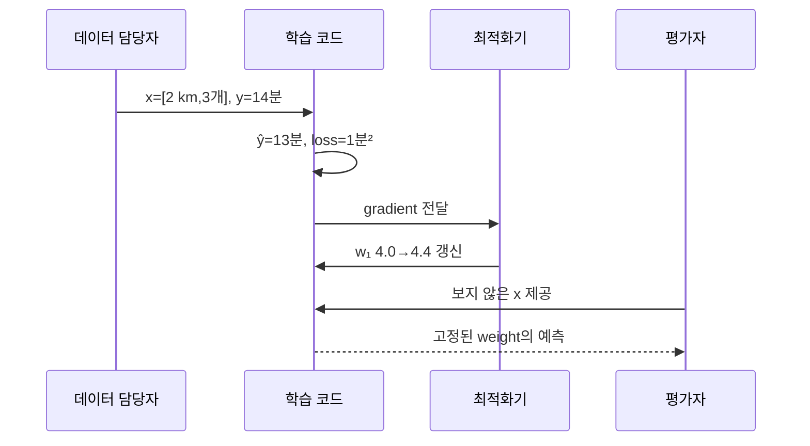

# 00. 학습과 연구 지도

[← 이전](README.md) · [목차](README.md) · [다음 →](01-vectors-matrices-and-probability.md)

머신러닝은 data에서 규칙을 추정해 새 입력의 결과를 예측하는 방법이다.

이 장은 문제 정의에서 독립 평가까지의 전체 지도를 만든다.

## 질문에서 학습 문제까지: 무엇을 예측하고 언제 답해야 하는가

**problem definition(문제 정의)**은 “AI를 써 보자”를 계산 가능한 질문으로 바꾸는 일이다. 예를 들어 “배송이 늦을까?”라는 질문에는 예측 대상, 판단 시각, 사용할 수 있는 정보가 빠져 있다. 이를 “주문 접수 시각에 알고 있는 거리와 물품 수로 배송 시간을 분 단위로 예측한다”로 고치면 입력과 정답의 경계가 생긴다. 접수 뒤에 기록된 실제 도착 시각을 입력으로 넣으면 답을 미리 보여 주는 누수가 된다.

**input(입력)**은 예측 순간 모델이 받는 값이다. 한 주문을 `x=[거리 km, 물품 수]`로 적고 `x=[2,3]`이라 하면 shape는 `(2,)`인 벡터다. 두 숫자는 단위가 다르므로 값 2와 3이 비슷해 보여도 같은 뜻이 아니다. **label(정답)** `y=14분`은 나중에 관측한 실제 배송 시간이다. 데이터를 만드는 담당자는 주문 ID와 시각을 이용해 입력 행과 정답을 결합하며, 학습 코드는 그 결합을 임의로 바꾸지 않는다.

**model(모델)**은 입력에서 예측을 계산하는 규칙이다. 단순 모델 `ŷ=w₁x₁+w₂x₂+b`에서 `w₁`은 거리 1 km가 예측 분에 미치는 양, `w₂`는 물품 하나의 영향, `b`는 입력이 0일 때의 기준값이다. 모자 기호가 붙은 `ŷ`는 관측 정답 `y`가 아니라 모델이 낸 **prediction(예측값)**이다. `w=[4,1]`, `b=2`이면 `ŷ=4×2+1×3+2=13분`이다.

**loss(손실)**은 예측과 정답의 차이를 학습 코드가 줄일 수 있는 한 숫자로 만든 것이다. 위 주문의 잔차를 `ŷ-y=13-14=-1분`으로 정의하면 제곱손실은 `(-1)²=1분²`이다. 제곱하면서 부호는 사라지고 단위는 분²가 된다. 오차 2분은 손실 4, 오차 3분은 손실 9이므로 큰 오차를 더 강하게 벌한다. 어떤 손실을 골랐는지가 곧 실제 목표 전체를 뜻하지는 않는다.

**update(갱신)**는 손실이 줄어드는 방향을 계산해 parameter를 바꾸는 단계다. 데이터를 수집하는 담당자나 모델 사용자가 weight를 직접 매 요청마다 고치는 것이 아니라 optimizer가 training 단계에서 바꾼다. 학습률이 0.1이고 계산된 `∂L/∂w₁=-4`라면 `w₁←4-0.1×(-4)=4.4`다. inference 단계에서는 이 값을 고정하고 새 입력만 통과시킨다.

**evaluation(평가)**은 갱신에 쓰지 않은 사례에 모델을 적용해 주장 범위를 재는 일이다. 평균 오차 2분이라는 값만으로 모든 주문이 안전하다고 말할 수 없다. 늦은 밤, 장거리, 폭우 주문의 오차와 p95 지연도 따로 봐야 한다. 평가자는 모델 학습 주체와 데이터 선택 결정을 기록하여, 결과를 본 뒤 유리한 부분집합만 남기지 못하게 한다.

## 하나의 데이터셋을 끝까지 추적한다

세 주문의 거리만 쓰는 모델 `ŷ=wx+b`를 생각하자. 입력은 `[1,2,3] km`, 정답은 `[2,4,5]분`, 시작값은 `w=1분/km`, `b=0분`이다. 예측은 `[1,2,3]분`, 잔차 `ŷ-y`는 `[-1,-2,-2]분`이다. 평균제곱오차는 `(1+4+4)/3=3분²`이다.

`(1/2)MSE`를 쓰면 weight 기울기는 `(1/3)Σ(ŷ-y)x`다. 항별 값은 `-1×1=-1`, `-2×2=-4`, `-2×3=-6`이므로 합 -11, 평균 `-11/3≈-3.667`이다. bias 기울기는 잔차 평균 `(-1-2-2)/3=-1.667`이다. 학습률 0.1이면 `w=1.3667`, `b=0.1667`이 된다.

새 예측은 약 `[1.5334,2.9001,4.2668]`, 새 잔차는 `[-0.4666,-1.0999,-0.7332]`이다. 새 MSE는 `(0.2177+1.2098+0.5376)/3≈0.655`로 줄었다. 이 한 번의 감소는 다음 step이나 보지 않은 주문에서도 반드시 줄어든다는 증명이 아니다. 학습률을 너무 크게 하면 손실을 지나쳐 커질 수 있다.

## 두 번째 추적: 선택과 독립 평가

전체 100개를 시간순으로 train 60, validation 20, test 20으로 나눈다. 후보 A와 B의 validation 오차가 각각 3.0분과 2.5분이면 B를 고른다. 이 순간 validation은 선택에 사용되었으므로 더 이상 완전히 새로운 자료가 아니다. B를 고정한 뒤 test 오차가 3.4분이라면 최종 보고값은 3.4분이다.

Test에서 A=2.7분, B=3.4분이라는 결과를 보고 A로 바꾸고 다시 test 2.7분을 최종값이라 부르면 test를 선택에 사용한 것이다. 새 독립 test가 없으면 2.7분은 선택 편향을 포함한다. “가장 낮은 숫자”와 “정직한 일반화 추정”은 같은 말이 아니다.

## 조건을 바꾸면 결론도 바뀐다

정답이 사람의 주관적 등급이라면 label noise를 측정해야 한다. 미래의 폭우 지역으로 배포한다면 과거 맑은 날의 무작위 행 분할은 배포 조건을 흉내 내지 못한다. 비용이 큰 오차가 과소 예측에만 몰린다면 대칭 MSE 대신 비대칭 비용이나 별도 안전 규칙이 필요하다. 문제 정의가 달라졌는데 같은 accuracy를 그대로 비교하면 숫자의 의미가 달라진다.

## 다섯 문제를 단계별로 푼다

**문제 1.** 주문 접수 때 예측하는 모델에 실제 도착 시각을 feature로 넣을 수 있는가?

**해설.** 예측 시각에는 실제 도착이 아직 일어나지 않았다. 학습 표에는 존재하더라도 운영 입력으로 얻을 수 없으므로 시간 누수다. 접수 전에 확정된 거리와 물품 수만 사용해야 한다.

**문제 2.** `x=[3 km,2개]`, `w=[4분/km,1분/개]`, `b=2분`의 예측은?

**해설.** 거리 항은 12분, 물품 항은 2분, 기준은 2분이다. 합은 16분이며 각 곱의 단위가 분으로 맞는다.

**문제 3.** 정답 18분이면 잔차 `ŷ-y`와 제곱손실은?

**해설.** 잔차는 `16-18=-2분`, 제곱손실은 `4분²`다. 음수는 과소 예측을 뜻하지만 제곱 후 방향은 사라진다.

**문제 4.** validation이 A 2.1, B 1.9분이고 test가 A 1.8, B 2.3분이면 무엇을 보고하는가?

**해설.** validation으로 B를 선택한 뒤 B의 test 2.3분을 보고한다. test를 보고 A로 교체하면 독립 평가 경계를 어긴다.

**문제 5.** training loss가 0.2분²이면 현장 배송 오차도 작다고 결론 내려도 되는가?

**해설.** 아니다. 학습 자료를 외운 결과일 수 있고 계절·지역이 달라질 수 있다. 독립 test와 운영 지연, 부분집합, 실패율을 함께 측정해야 한다.

작은 계산이 맞는 것과 실제 환경에서 유용한 것은 다른 주장이다.

## 이 장의 목표

1. 새 용어와 수학 기호를 말로 설명한다.
2. 입력이 중간 숫자를 거쳐 결과가 되는 과정을 계산한다.
3. 계산 모형과 실제 성능 주장을 구분한다.

## 기본 단어와 기호

**data**는 관측하거나 만든 값의 모음이다.

**sample**는 데이터 한 행 또는 한 사례이다.

**feature**는 예측 입력으로 쓰는 값이다.

**label**는 맞히려는 정답이다.

**model**는 입력을 출력으로 바꾸는 함수이다.

**parameter**는 학습으로 바뀌는 모델 내부 숫자이다.

**loss**는 예측 오차를 하나의 숫자로 나타낸 값이다.

**training**는 loss를 줄이도록 parameter를 바꾸는 과정이다.

**inference**는 학습된 모델로 새 입력을 예측하는 과정이다.

**validation**는 모델과 설정을 고르는 평가이다.

**test**는 선택이 끝난 뒤 한 번 쓰는 독립 평가이다.

**baseline**는 비교 대상인 단순 규칙이나 기존 방법이다.

기호를 읽을 때 이름, shape, 단위, 생성 주체를 함께 적는다.

## 왜 필요한가

- 문제 문장을 입력과 결과로 바꾸지 않으면 모델이 무엇을 배워야 하는지 정할 수 없다.
- 정확도 하나만 보면 드문 위험 사례를 놓칠 수 있다.
- 데이터 생성 시각과 배포 시각이 다르면 미래 정보 누수가 생길 수 있다.
- 연구 질문은 바꾼 조건과 비교 기준을 함께 적어야 한다.

## 입력에서 결과까지

1. 사용자가 해결할 현상을 한 문장으로 정의한다.
2. 측정 주체가 원시 데이터를 수집한다.
3. 데이터 담당자가 feature와 label의 단위·시각을 고정한다.
4. 분할 담당자가 training, validation, test를 분리한다.
5. 학습 code가 training loss로 parameter를 바꾼다.
6. 연구자가 validation으로 후보를 선택한다.
7. 선택을 끝낸 뒤 test를 한 번 평가한다.
8. 운영자는 latency, power, QoS와 drift를 관측한다.

## 작은 숫자로 한 번 계산하기

기준 규칙은 10개 중 6개를 맞혔다.

후보 A는 validation 10개 중 8개를 맞혔다.

후보 B는 validation 10개 중 9개를 맞혔다.

Validation 선택은 후보 B다.

독립 test 20개에서 B는 15개를 맞혔다.

Test accuracy = 15/20 = 0.75 = 75%.

Validation 90%를 최종 성능으로 보고하면 선택 편향을 숨긴다.

표본 20개는 작으므로 uncertainty도 함께 적는다.

| 구분 | 값 또는 책임 |
|---|---|
| 입력 | 원시 sample 100개 |
| 중간 | train 60, validation 20, test 20 |
| 주체 | 학습 code와 평가자 |
| 결과 | 선택된 모델의 독립 test 결과 |

## 계산을 거꾸로 점검하기

결과가 이상하면 마지막 값만 보지 않는다.

입력의 단위와 shape가 맞는지 먼저 확인한다.

중간값을 손으로 다시 계산한다.

Training 중 바뀌는 parameter와 고정된 data를 구별한다.

평가 data가 선택 과정에 들어갔는지 확인한다.

숫자의 분모와 평균 범위를 적는다.

## 실제 시스템으로 확장할 때

작은 예제는 원리를 고립시켜 보여 준다.

실제 system은 noise, queue, concurrency, finite precision을 포함한다.

Data 수집과 label 생성 지연도 성능에 포함한다.

Version, seed, split, metric 정의를 기록한다.

평균과 tail, subgroup 결과를 함께 본다.

실패와 timeout을 결과에서 지우지 않는다.

## 흔한 오해와 반례

- Training loss가 낮다고 새 데이터 성능이 자동으로 좋지 않다.
- 모델이 복잡할수록 항상 우수하지 않다.
- Test를 반복해 고르면 test도 validation처럼 오염된다.
- 작은 Python 계산은 현장 성능 검증이 아니다.

## 확인 문제와 해설

### 문제 1

Feature와 label의 차이는?

**해설:** Feature는 예측 시 알 수 있는 입력이고 label은 맞히려는 목표다.

### 문제 2

Validation과 test를 왜 나누는가?

**해설:** Validation은 선택에 사용되어 그 선택에 적응한다. Test는 선택 뒤의 독립 평가를 위해 남긴다.

### 문제 3

Baseline이 필요한 이유는?

**해설:** 복잡한 모델의 추가 비용이 단순 규칙보다 실제로 나은지 확인하기 위해서다.

## 학습 체크리스트

- 모든 약어를 첫 등장에 풀어 썼는가?
- 수학 기호가 가리키는 값과 단위가 명확한가?
- 입력과 label의 시각 경계가 명확한가?
- Parameter를 바꾸는 주체를 설명했는가?
- Validation과 test의 책임을 나눴는가?
- Baseline과 실패 조건을 기록했는가?

## 공식 자료

- [ISLP 2023](https://www.statlearning.com/home)
- [Dive into Deep Learning: Generalization](https://d2l.ai/chapter_linear-regression/generalization.html)

공식 근거 확인일: **2026-10-11**.

[← 이전](README.md) · [목차](README.md) · [다음 →](01-vectors-matrices-and-probability.md)
