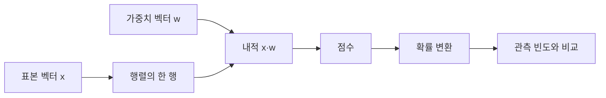

# 01. 벡터·행렬·확률

[← 이전](00-learning-and-research-map.md) · [목차](README.md) · [다음 →](02-linear-regression-and-loss.md)

모델의 입력과 parameter는 숫자 묶음으로 표현된다.

벡터와 행렬은 그 숫자의 모양과 계산 규칙을 나타낸다.

확률은 불확실한 결과의 비율을 0과 1 사이로 표현한다.

## 이 장의 목표

1. 새 용어와 수학 기호를 말로 설명한다.
2. 입력이 중간 숫자를 거쳐 결과가 되는 과정을 계산한다.
3. 계산 모형과 실제 성능 주장을 구분한다.

## 기본 단어와 기호

**scalar**는 숫자 하나이다.

**vector**는 순서가 있는 숫자 한 줄이다.

**matrix**는 행과 열을 가진 숫자 표이다.

**shape**는 각 축의 길이이다.

**dimension**는 벡터가 가진 성분 수이다.

**transpose**는 행과 열을 바꾸는 연산이다.

**dot product**는 같은 위치를 곱해 더한 값이다.

**mean**는 합을 개수로 나눈 평균이다.

**variance**는 평균에서 떨어진 거리 제곱의 평균이다.

**probability**는 0에서 1 사이의 가능성이다.

**event**는 관심 있는 결과의 집합이다.

**conditional probability**는 다른 조건이 주어졌을 때의 확률이다.

기호를 읽을 때 이름, shape, 단위, 생성 주체를 함께 적는다.

## 왜 필요한가

- Shape를 모르면 곱할 수 있는 행렬인지 판단할 수 없다.
- 단위가 다른 feature를 그대로 비교하면 큰 단위가 결과를 지배할 수 있다.
- 확률은 장기 비율이나 믿음의 정도로 해석하되 calibration을 확인한다.
- 상관관계는 원인 관계의 증명이 아니다.

## 입력에서 결과까지

1. Sample 한 행을 vector로 쓴다.
2. 여러 sample을 matrix의 행으로 쌓는다.
3. Parameter vector와 dot product를 계산한다.
4. Bias를 더해 score를 만든다.
5. 여러 score를 확률로 바꿀 수 있다.
6. 관측 빈도로 경험 확률을 계산한다.
7. 평균과 분산으로 분포 위치와 퍼짐을 요약한다.
8. 새 sample의 shape와 단위를 검사한다.

## 작은 숫자로 한 번 계산하기

x=[2,3], w=[4,-1]이라고 하자.

Dot product는 2×4 + 3×(-1)이다.

8-3=5다.

Bias b=2를 더하면 score=7이다.

관측 10번 중 성공 7번이면 경험 확률은 7/10=0.7이다.

값 [1,3]의 평균은 (1+3)/2=2다.

분산은 ((1-2)^2+(3-2)^2)/2=1이다.

표준편차는 sqrt(1)=1이다.

| 구분 | 값 또는 책임 |
|---|---|
| x shape | (2,) |
| w shape | (2,) |
| dot 결과 | scalar 5 |
| bias 뒤 score | 7 |

## 계산을 거꾸로 점검하기

결과가 이상하면 마지막 값만 보지 않는다.

입력의 단위와 shape가 맞는지 먼저 확인한다.

중간값을 손으로 다시 계산한다.

Training 중 바뀌는 parameter와 고정된 data를 구별한다.

평가 data가 선택 과정에 들어갔는지 확인한다.

숫자의 분모와 평균 범위를 적는다.

## 실제 시스템으로 확장할 때

작은 예제는 원리를 고립시켜 보여 준다.

실제 system은 noise, queue, concurrency, finite precision을 포함한다.

Data 수집과 label 생성 지연도 성능에 포함한다.

Version, seed, split, metric 정의를 기록한다.

평균과 tail, subgroup 결과를 함께 본다.

실패와 timeout을 결과에서 지우지 않는다.

## 흔한 오해와 반례

- 벡터 방향과 단위는 숫자만 같아도 자동으로 같지 않다.
- 확률 0.8은 이번 사건이 80%만큼 발생한다는 물리량이 아니다.
- 평균이 같아도 분산은 다를 수 있다.
- 행렬곱은 원소별 곱과 다르다.

## 확인 문제와 해설

### 문제 1

[1,2]·[3,4]는?

**해설:** 1×3+2×4=11이다.

### 문제 2

확률의 범위는?

**해설:** 0 이상 1 이하다. 0은 불가능, 1은 확실을 뜻하는 이상적 경계다.

### 문제 3

분산이 필요한 이유는?

**해설:** 평균만으로 보이지 않는 값의 퍼짐을 나타내기 위해서다.

## 학습 체크리스트

- 모든 약어를 첫 등장에 풀어 썼는가?
- 수학 기호가 가리키는 값과 단위가 명확한가?
- 입력과 label의 시각 경계가 명확한가?
- Parameter를 바꾸는 주체를 설명했는가?
- Validation과 test의 책임을 나눴는가?
- Baseline과 실패 조건을 기록했는가?

## 공식 자료

- [ISLP 2023](https://www.statlearning.com/home)
- [Dive into Deep Learning: Generalization](https://d2l.ai/chapter_linear-regression/generalization.html)

공식 근거 확인일: **2026-10-11**.

[← 이전](00-learning-and-research-map.md) · [목차](README.md) · [다음 →](02-linear-regression-and-loss.md)
