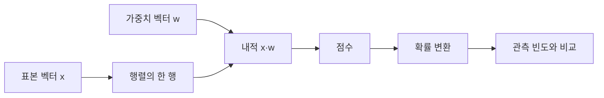

# 01. 벡터·행렬·확률

[← 이전](00-learning-and-research-map.md) · [목차](README.md) · [다음 →](02-linear-regression-and-loss.md)

모델의 입력과 parameter는 숫자 묶음으로 표현된다.

벡터와 행렬은 그 숫자의 모양과 계산 규칙을 나타낸다.

확률은 불확실한 결과의 비율을 0과 1 사이로 표현한다.

## 이 장의 목표

1. 새 용어와 수학 기호를 말로 설명한다.
2. 입력이 중간 숫자를 거쳐 결과가 되는 과정을 계산한다.
3. 계산 모형과 실제 성능 주장을 구분한다.


## 기본 단어와 기호

**scalar**는 숫자 하나이다.

**vector**는 순서가 있는 숫자 한 줄이다.

**matrix**는 행과 열을 가진 숫자 표이다.

**shape**는 각 축의 길이이다.

**dimension**는 벡터가 가진 성분 수이다.

**transpose**는 행과 열을 바꾸는 연산이다.

**dot product**는 같은 위치를 곱해 더한 값이다.

**mean**는 합을 개수로 나눈 평균이다.

**variance**는 평균에서 떨어진 거리 제곱의 평균이다.

**probability**는 0에서 1 사이의 가능성이다.

**event**는 관심 있는 결과의 집합이다.

**conditional probability**는 다른 조건이 주어졌을 때의 확률이다.

기호를 읽을 때 이름, shape, 단위, 생성 주체를 함께 적는다.

## 왜 필요한가

- Shape를 모르면 곱할 수 있는 행렬인지 판단할 수 없다.
- 단위가 다른 feature를 그대로 비교하면 큰 단위가 결과를 지배할 수 있다.
- 확률은 장기 비율이나 믿음의 정도로 해석하되 calibration을 확인한다.
- 상관관계는 원인 관계의 증명이 아니다.

## 입력에서 결과까지

1. Sample 한 행을 vector로 쓴다.
2. 여러 sample을 matrix의 행으로 쌓는다.
3. Parameter vector와 dot product를 계산한다.
4. Bias를 더해 score를 만든다.
5. 여러 score를 확률로 바꿀 수 있다.
6. 관측 빈도로 경험 확률을 계산한다.
7. 평균과 분산으로 분포 위치와 퍼짐을 요약한다.
8. 새 sample의 shape와 단위를 검사한다.



## 작은 숫자로 한 번 계산하기

x=[2,3], w=[4,-1]이라고 하자.

Dot product는 2×4 + 3×(-1)이다.

8-3=5다.

Bias b=2를 더하면 score=7이다.

관측 10번 중 성공 7번이면 경험 확률은 7/10=0.7이다.

값 [1,3]의 평균은 (1+3)/2=2다.

분산은 ((1-2)^2+(3-2)^2)/2=1이다.

표준편차는 sqrt(1)=1이다.

## 숫자 하나에서 tensor까지: 모양이 필요한 이유

**스칼라(scalar)**는 축이 없는 숫자 하나다. 온도 `20°C`, 손실 `0.5`, 확률 `0.7`처럼 한 대상의 한 값을 나타낸다. 숫자만 쓰면 단위를 잃기 쉬우므로 `20`이 온도인지 거리인지 항상 함께 기록한다.

**벡터(vector)**는 순서가 있는 스칼라 묶음이다. 배송 세 건의 거리 `[1,2,3] km`는 길이 3인 벡터다. 첫째 위치는 첫 배송, 둘째 위치는 둘째 배송이라는 대응이 있으므로 `[1,2,3]`과 `[3,2,1]`은 같은 숫자를 포함해도 같은 데이터가 아니다.

**행렬(matrix)**은 벡터를 행과 열로 배치한 2차원 표다. 행을 표본, 열을 특징으로 약속하면 행렬의 한 행은 배송 한 건이고 한 열은 거리나 정류장 수 같은 한 종류의 측정이다.

**텐서(tensor)**는 이 생각을 더 많은 축으로 일반화한 숫자 배열이다. 스칼라를 0축 tensor, 벡터를 1축 tensor, 행렬을 2축 tensor로 볼 수 있다. 영상 batch는 `(표본, 높이, 너비, 색상)`처럼 4축일 수 있다.

**축(axis)**은 배열을 세는 방향이다. `(3,2)` 행렬에서 axis 0의 길이는 표본 세 개, axis 1의 길이는 특징 두 개다. **형상(shape)**은 각 축 길이를 순서대로 쓴 것이다. Shape는 단순 장식이 아니라 어떤 원소가 어떤 의미로 곱해지는지 정하는 계약이다.

```text
X = [[1, 1],
     [2, 1],
     [3, 1]]

shape = (3행, 2열)
첫 열 = 거리 km
둘째 열 = 모든 행이 1인 편향용 열
```

## 특징, 정답, 가중치가 놓이는 위치

**특징(feature)**은 예측 시점에 모델이 입력으로 받는 측정값이다. 여기서는 거리 `x=[1,2,3] km`다. **정답(label 또는 target)**은 맞히려는 값으로 배송 시간 `y=[2,4,5] min`이다. 미래 배송 시간을 예측하면서 배송이 끝난 뒤 알게 되는 값을 feature로 넣으면 안 된다.

**가중치(weight)**는 특징 한 단위가 예측을 얼마나 바꾸는지 학습하는 숫자다. 거리 가중치가 `1 min/km`라면 거리가 1 km 늘 때 예측 시간이 1분 늘어나는 선형 관계를 나타낸다. **편향(bias)**은 모든 특징이 0일 때도 남는 기준값이다. 포장과 출발 준비에 1분이 든다는 식으로 해석할 수 있지만, 학습된 수치를 언제나 실제 원인으로 단정해서는 안 된다.

가중치와 편향을 `θ=[w,b]=[1,1]`이라는 벡터로 묶으면 행렬곱 하나로 세 예측을 동시에 쓸 수 있다.

```text
X shape = (3,2)
θ shape = (2,)
Xθ shape = (3,)

행 1: 1×1 + 1×1 = 2
행 2: 2×1 + 1×1 = 3
행 3: 3×1 + 1×1 = 4

예측 ŷ = [2,3,4] min
```

**내적(dot product)**은 같은 위치끼리 곱한 뒤 더하는 연산이다. 첫 행 `[1,1]`과 `θ=[1,1]`의 내적이 `2`다. 두 벡터 길이가 같아야 같은 위치를 짝지을 수 있다.

**행렬곱(matrix multiplication)**은 이 내적을 여러 행과 열에 반복한다. `(m,k)` 행렬과 `(k,n)` 행렬을 곱하면 `(m,n)`이 된다. 가운데 길이 `k`가 같아야 한다. 원소별 곱은 shape와 결과 의미가 다르므로 `Xθ`와 `X*θ`를 같은 연산으로 읽지 않는다.

## Σ 기호를 말로 읽기

그리스 문자 큰 시그마 `Σ`는 “정해진 범위의 값을 모두 더하라”는 뜻이다.

```text
Σ(i=1..3) x_i = x_1 + x_2 + x_3
               = 1 + 2 + 3
               = 6
```

아래 첨자 `i`는 표본 번호다. `x_i`는 i번째 입력, `y_i`는 i번째 정답이다. Σ는 새로운 model이 아니라 반복되는 덧셈을 짧게 적는 표기다.

## 확률변수, 기댓값, 분산

**확률변수(random variable)**는 우연한 결과를 숫자에 대응시키는 규칙이다. “다음 배송 시간 Y”는 아직 관측 전이라 여러 값이 가능하다. 대문자 `Y`는 확률변수, 소문자 `y=4`는 실제로 관측한 한 값처럼 구분해 쓰기도 한다.

**기댓값(expectation)**은 같은 조건을 매우 많이 반복했을 때 확률로 가중한 장기 평균이다. 세 시간 `2,4,5`가 각각 같은 확률 `1/3`이라고 단순 가정하면 다음과 같다.

```text
E[Y] = 2×(1/3) + 4×(1/3) + 5×(1/3)
     = 11/3
     ≈ 3.667 min
```

기댓값 3.667분이라는 배송이 실제로 존재해야 하는 것은 아니다. 가능한 결과의 중심을 나타내는 요약이다.

**분산(variance)**은 각 값이 평균에서 얼마나 떨어지는지 제곱해 평균한 값이다.

```text
평균 μ = 11/3
Var(Y) = [(2-μ)² + (4-μ)² + (5-μ)²] / 3
       = 14/9
       ≈ 1.556 min²
```

분산 단위가 `min²`인 이유는 차이를 제곱했기 때문이다. 제곱근을 취한 표준편차는 약 `1.247 min`으로 원래 단위에 돌아온다. 표본분산에서는 분모를 `n-1`로 쓰는 경우가 있으므로 어떤 정의인지 표시한다.

## 조건부확률과 독립 가정

**조건부확률** `P(Late|Rain)`은 비가 온 배송만 골랐을 때 지연될 비율이다. 전체 100건 중 비가 온 20건, 그중 지연 8건이면 `8/20=0.4`다. 전체 지연이 10건이라고 `8/10`으로 나누지 않는다. 조건 뒤의 집합이 분모다.

두 사건이 **독립(independent)**이라는 것은 한 사건을 알아도 다른 사건의 확률이 바뀌지 않는다는 뜻이다. 즉 `P(Late|Rain)=P(Late)`여야 한다. 전체 지연률이 `10/100=0.1`인데 비가 올 때 `0.4`라면 이 데이터에서 독립 가정은 맞지 않는다.

독립은 “서로 다른 열”이나 “서로 다른 배송 ID”라는 뜻이 아니다. 같은 날 교통 정체를 겪은 배송들은 서로 영향을 받을 수 있다. 학습과 시험 데이터를 무작위 행으로만 나눌 때 같은 날 정보가 양쪽에 섞이면 독립 평가가 약해질 수 있다.

## 조건을 바꾼 반례

거리 벡터 `[1,2,3]`의 단위를 km에서 m로 바꾸면 `[1000,2000,3000]`이다. 물리적 거리는 같지만 같은 가중치 `1`을 곱하면 예측이 천 배가 된다. 가중치 단위도 `min/km`에서 `min/m`로 바꾸거나 입력을 표준화해야 한다.

Shape가 `(3,)`인 거리와 `(3,)`인 배송 시간이 같다는 사실도 원소별로 곱해도 된다는 의미 보장은 아니다. Shape는 계산 가능성을 말하지만 축의 의미까지 자동 검증하지 않는다.

## 추가 문제 5개와 전체 해설

### 문제 1

`[2,3]·[4,-1]`을 계산하고 결과 shape를 말하라.

**해설:** 같은 위치를 곱해 `2×4+3×(-1)=5`다. 두 벡터의 내적 결과는 숫자 하나인 스칼라이므로 shape를 빈 축 `()`로 볼 수 있다.

### 문제 2

`A` shape `(4,3)`, `B` shape `(3,2)`이면 결과 shape는 무엇인가?

**해설:** 가운데 길이 3이 같아 각 행과 열의 내적을 계산할 수 있다. 바깥 길이가 남아 `(4,2)`다.

### 문제 3

값 `[2,4,6]`의 평균과 모집단 분산을 구하라.

**해설:** 평균은 `12/3=4`다. 평균과 차이는 `[-2,0,2]`, 제곱은 `[4,0,4]`, 분산은 `8/3≈2.667`이다.

### 문제 4

비 온 날 30건 중 지연 12건이면 `P(지연|비)`는?

**해설:** 조건이 비이므로 분모는 비 온 날 30건이다. `12/30=0.4`다.

### 문제 5

전체 지연률 0.2이고 비 온 날 지연률 0.2라면 독립이 증명됐는가?

**해설:** 이 한 비율은 독립과 일치하지만 완전한 증명은 아니다. 표본 오차, 다른 조건, 반대 조건의 비율과 데이터 생성 방식을 함께 확인해야 한다.

| 구분 | 값 또는 책임 |
|---|---|
| x shape | (2,) |
| w shape | (2,) |
| dot 결과 | scalar 5 |
| bias 뒤 score | 7 |

## 계산을 거꾸로 점검하기

결과가 이상하면 마지막 값만 보지 않는다.

입력의 단위와 shape가 맞는지 먼저 확인한다.

중간값을 손으로 다시 계산한다.

Training 중 바뀌는 parameter와 고정된 data를 구별한다.

평가 data가 선택 과정에 들어갔는지 확인한다.

숫자의 분모와 평균 범위를 적는다.

## 실제 시스템으로 확장할 때

작은 예제는 원리를 고립시켜 보여 준다.

실제 system은 noise, queue, concurrency, finite precision을 포함한다.

Data 수집과 label 생성 지연도 성능에 포함한다.

Version, seed, split, metric 정의를 기록한다.

평균과 tail, subgroup 결과를 함께 본다.

실패와 timeout을 결과에서 지우지 않는다.

## 흔한 오해와 반례

- 벡터 방향과 단위는 숫자만 같아도 자동으로 같지 않다.
- 확률 0.8은 이번 사건이 80%만큼 발생한다는 물리량이 아니다.
- 평균이 같아도 분산은 다를 수 있다.
- 행렬곱은 원소별 곱과 다르다.

## 확인 문제와 해설

### 문제 1

[1,2]·[3,4]는?

**해설:** 1×3+2×4=11이다.

### 문제 2

확률의 범위는?

**해설:** 0 이상 1 이하다. 0은 불가능, 1은 확실을 뜻하는 이상적 경계다.

### 문제 3

분산이 필요한 이유는?

**해설:** 평균만으로 보이지 않는 값의 퍼짐을 나타내기 위해서다.

## 학습 체크리스트

- 모든 약어를 첫 등장에 풀어 썼는가?
- 수학 기호가 가리키는 값과 단위가 명확한가?
- 입력과 label의 시각 경계가 명확한가?
- Parameter를 바꾸는 주체를 설명했는가?
- Validation과 test의 책임을 나눴는가?
- Baseline과 실패 조건을 기록했는가?

## 공식 자료

- [ISLP 2023](https://www.statlearning.com/home)
- [Dive into Deep Learning: Generalization](https://d2l.ai/chapter_linear-regression/generalization.html)

공식 근거 확인일: **2026-10-11**.

[← 이전](00-learning-and-research-map.md) · [목차](README.md) · [다음 →](02-linear-regression-and-loss.md)
