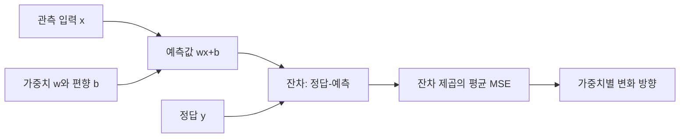

# 02. 선형회귀와 손실

[← 이전](01-vectors-matrices-and-probability.md) · [목차](README.md) · [다음 →](03-gradients-and-optimization.md)

회귀는 연속적인 숫자를 예측하는 문제다.

선형회귀는 입력의 가중합으로 예측을 만든다.

손실은 예측과 정답의 차이를 학습 가능한 숫자로 바꾼다.

## 이 장의 목표

1. 새 용어와 수학 기호를 말로 설명한다.
2. 입력이 중간 숫자를 거쳐 결과가 되는 과정을 계산한다.
3. 계산 모형과 실제 성능 주장을 구분한다.


## 기본 단어와 기호

**regression**는 연속값 예측이다.

**linear model**는 입력의 가중합 모델이다.

**weight**는 feature 영향의 크기와 방향이다.

**bias**는 입력이 0일 때 더하는 기준값이다.

**prediction**는 모델 출력 ŷ이다.

**target**는 실제 정답 y이다.

**error**는 예측-정답이다.

**squared error**는 오차 제곱이다.

**MSE**는 제곱오차의 평균이다.

**residual**는 관측값과 fitted 값의 차이이다.

**fit**는 data에 parameter를 맞추는 일이다.

**unit**는 숫자가 나타내는 측정 단위이다.

기호를 읽을 때 이름, shape, 단위, 생성 주체를 함께 적는다.

## 왜 필요한가

- 예측 오차의 방향과 크기를 알아야 parameter를 고칠 수 있다.
- 제곱은 양·음 오차가 상쇄되는 것을 막고 큰 오차를 더 크게 벌준다.
- 손실 선택은 어떤 오류를 중요하게 보는지 정한다.
- 좋은 training fit과 새 data generalization은 다르다.

## 입력에서 결과까지

1. 입력 x와 target y를 읽는다.
2. 모델이 ŷ=wx+b를 계산한다.
3. Evaluator가 error=ŷ-y를 계산한다.
4. Loss 함수가 0.5×error²를 만든다.
5. Gradient 계산이 w와 b의 민감도를 구한다.
6. Optimizer가 learning rate만큼 parameter를 바꾼다.
7. 새 parameter로 다시 예측한다.
8. 독립 data에서 오차를 평가한다.



## 작은 숫자로 한 번 계산하기

x=2, y=5, w=1, b=0이다.

예측 ŷ=1×2+0=2다.

Error=2-5=-3이다.

Loss=0.5×(-3)²=4.5다.

w gradient=error×x=-3×2=-6이다.

b gradient=error=-3이다.

학습률 0.1이면 새 w=1-0.1×(-6)=1.6이다.

새 b=0-0.1×(-3)=0.3이다.

새 예측=1.6×2+0.3=3.5다.

새 loss=0.5×(3.5-5)²=1.125다.

| 구분 | 값 또는 책임 |
|---|---|
| 입력 | x=2 |
| 정답 | y=5 |
| 처음 loss | 4.5 |
| 한 step 뒤 loss | 1.125 |

## 여러 관측값에서 평균제곱오차 계산하기

한 점의 손실만 줄이면 그 점에는 가까워져도 다른 점에서 멀어질 수 있다.

따라서 여러 관측을 함께 계산해 보자.

입력은 `x=[1,2,3]`, 정답은 `y=[2,4,5]`다.

현재 가중치 `w=1`, 편향 `b=1`이다.

예측은 다음과 같다.

```text
x=1: 예측=1×1+1=2, 정답=2, 예측-정답=0
x=2: 예측=1×2+1=3, 정답=4, 예측-정답=-1
x=3: 예측=1×3+1=4, 정답=5, 예측-정답=-1
```

제곱오차는 `[0,1,1]`이다.

평균제곱오차는 `(0+1+1)/3=2/3≈0.667`이다.

`0.5×평균제곱오차`를 손실로 정의하면 약 `0.333`이다.

앞의 `0.5`는 최적 위치를 바꾸지 않는다.

미분할 때 제곱의 2와 약분되어 식을 간단하게 만들기 위해 자주 사용한다.

문서와 code가 MSE를 쓰는지 half-MSE를 쓰는지 확인해야 숫자를 직접 비교할 수 있다.

정답 단위가 섭씨 온도라면 잔차 단위는 `°C`, 제곱오차 단위는 `°C²`다.

제곱 손실 값 자체를 원래 온도 오차처럼 읽으면 안 된다.

## 왜 가중치 기울기가 오차 곱하기 입력인가

예측식 `ŷ=wx+b`에서 w를 아주 조금 `Δw`만큼 늘리면 예측은 `x×Δw`만큼 변한다.

입력 x가 2이면 w를 0.01 늘릴 때 예측은 0.02 늘어난다.

Half squared loss는 `0.5(ŷ-y)²`다.

예측이 조금 변할 때 손실 변화율은 `ŷ-y`, 즉 예측-정답 오차다.

두 변화율을 연쇄법칙으로 곱하면 다음과 같다.

```text
dL/dw = dL/dŷ × dŷ/dw
      = (ŷ-y) × x
```

앞 예제에서 오차가 -3이고 x=2이므로 기울기는 -6이다.

음수 기울기는 w를 조금 키우면 이 지점의 손실이 줄어드는 방향임을 뜻한다.

## 한 점의 손실만 줄이는 반례

두 관측 `(x=1,y=10)`, `(x=10,y=0)`을 생각하자.

첫 점만 보고 w를 크게 키우면 첫 예측은 10에 가까워질 수 있다.

그러나 둘째 입력은 10배이므로 예측이 크게 증가해 둘째 손실이 폭발할 수 있다.

Mini-batch 한 점의 gradient는 전체 dataset gradient의 noisy estimate다.

한 step의 sample loss 감소와 전체 training loss 감소를 구분해야 한다.

## 계산을 거꾸로 점검하기

결과가 이상하면 마지막 값만 보지 않는다.

입력의 단위와 shape가 맞는지 먼저 확인한다.

중간값을 손으로 다시 계산한다.

Training 중 바뀌는 parameter와 고정된 data를 구별한다.

평가 data가 선택 과정에 들어갔는지 확인한다.

숫자의 분모와 평균 범위를 적는다.

## 실제 시스템으로 확장할 때

작은 예제는 원리를 고립시켜 보여 준다.

실제 system은 noise, queue, concurrency, finite precision을 포함한다.

Data 수집과 label 생성 지연도 성능에 포함한다.

Version, seed, split, metric 정의를 기록한다.

평균과 tail, subgroup 결과를 함께 본다.

실패와 timeout을 결과에서 지우지 않는다.

## 흔한 오해와 반례

- 선형은 입력 하나만 쓴다는 뜻이 아니다.
- Loss 0이 실제 세계의 완전한 모델을 뜻하지 않는다.
- MSE는 outlier에 민감하다.
- 상관관계로 학습한 weight를 인과효과라고 단정하지 않는다.

## 확인 문제와 해설

### 문제 1

w=2,b=1,x=3의 예측은?

**해설:** 2×3+1=7이다.

### 문제 2

오차 -3의 제곱은?

**해설:** 9다. 부호는 사라지고 크기가 남는다.

### 문제 3

Training loss가 줄면 test도 반드시 줄까?

**해설:** 아니다. 과적합이나 distribution 차이로 test loss는 커질 수 있다.

## 학습 체크리스트

- 모든 약어를 첫 등장에 풀어 썼는가?
- 수학 기호가 가리키는 값과 단위가 명확한가?
- 입력과 label의 시각 경계가 명확한가?
- Parameter를 바꾸는 주체를 설명했는가?
- Validation과 test의 책임을 나눴는가?
- Baseline과 실패 조건을 기록했는가?

## 공식 자료

- [ISLP 2023](https://www.statlearning.com/home)
- [Dive into Deep Learning: Generalization](https://d2l.ai/chapter_linear-regression/generalization.html)

공식 근거 확인일: **2026-10-11**.

[← 이전](01-vectors-matrices-and-probability.md) · [목차](README.md) · [다음 →](03-gradients-and-optimization.md)
