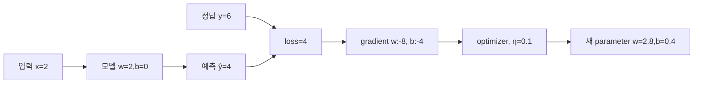

# 03. Gradient와 최적화


[← 이전](02-linear-regression-and-loss.md) · [목차](README.md) · [다음 →](04-classification-and-probabilities.md)
## 문제에서 시작한다: 손실은 알지만 무엇을 바꿀까

**표본(sample)**은 입력과 정답 한 쌍이다. 집 크기 2와 실제 가격 6이 표본 하나라면, 크기 2는 모델에 넣는 **특징(feature)**이고 가격 6은 맞혀야 할 정답이다. 여러 표본을 한 번의 계산에 함께 넣은 묶음이 **배치(batch)**다. 이 장에서는 먼저 표본 하나로 숫자를 추적한 뒤 여러 표본의 배치로 확장한다.

집값 예측 모델이 `ŷ = wx + b`라고 하자. `x`는 집 크기라는 입력 숫자, `w`는 크기 한 단위가 예측에 미치는 정도를 담은 **가중치(weight)**, `b`는 입력이 0일 때 기본 예측을 옮기는 **편향(bias)**, `ŷ`는 모델의 예측값이다. 여기서 편향은 데이터의 사회적 편향이 아니라 수식의 절편이라는 뜻이다. **매개변수(parameter)**는 학습 과정이 값을 바꾸는 모델 내부 숫자이며, 이 식에서는 `w`와 `b`가 매개변수다.

정답 `y`와 예측 `ŷ`의 차이를 하나의 숫자로 줄인 것이 **손실(loss)**이다. 손실은 모델이 얼마나 틀렸는지를 최적화가 읽을 수 있는 숫자로 만든다. 평균제곱오차 `L=(ŷ-y)^2`에서 예측 4, 정답 6이면 손실은 `(4-6)^2=4`다. 손실 4만 보면 `w`를 올려야 할지 내려야 할지는 모른다. 그 방향과 민감도를 주는 것이 미분과 gradient다.

**미분(derivative)**은 입력을 아주 조금 바꿀 때 출력이 얼마나 변하는지 나타내는 순간 변화율이다. 매개변수가 여러 개일 때 한 숫자만 바꾸고 나머지 숫자는 고정해 구한 미분을 **편미분(partial derivative)**이라고 한다. `w`의 편미분은 `b`를 고정하고 `w`만 움직이며 손실 변화를 보는 값이다.

**기울기(gradient)**는 모든 매개변수의 편미분을 같은 순서로 묶은 벡터다. 벡터는 순서가 있는 숫자 묶음이다. 매개변수 순서가 `[w,b]`이고 편미분이 각각 `[-8,-4]`이면 기울기는 `[-8,-4]`다. 각 성분의 부호는 그 매개변수를 늘릴 때 손실이 어느 방향으로 변하는지, 크기는 현재 지점의 민감도를 나타낸다.

**연쇄법칙(chain rule)**은 매개변수가 중간 변수를 거쳐 결과에 영향을 줄 때 각 구간의 민감도를 곱하는 규칙이다. `w → ŷ → L` 경로에서 `∂L/∂w=(∂L/∂ŷ)(∂ŷ/∂w)`다. `L(w)=(2w-6)^2`에서 `w=2`이면 `∂L/∂ŷ=-4`, `∂ŷ/∂w=2`라서 `∂L/∂w=-8`이다. 음수 기울기는 `w`를 조금 키우면 손실이 내려간다는 뜻이다.

**벡터(vector)**는 순서가 있는 숫자 묶음이다. 매개변수가 `w1,w2,b` 세 개면 기울기도 `[∂L/∂w1, ∂L/∂w2, ∂L/∂b]` 세 숫자다. **행렬(matrix)**은 같은 길이의 숫자 행을 직사각형으로 모은 것이다. 배치의 입력을 행렬 `X`로, 여러 특징의 가중치를 벡터 `w`로 놓으면 여러 예측을 `Xw+b`로 한 번에 계산할 수 있다. **모양(shape)**은 각 축의 길이다. `X`가 4×2이면 표본 4개가 각각 특징 2개를 가진다는 뜻이다.

**최적화 알고리즘(optimizer)**은 계산된 기울기를 읽고 매개변수 값을 실제로 바꾸는 절차다. **학습률(learning rate)**은 기울기 중 얼마만큼을 한 번의 갱신에 반영할지 정하는 비율이다. 기울기가 -8이고 학습률이 0.1이면 변화량은 `-0.1×(-8)=+0.8`이다. **단계(step)**는 배치 하나로 예측·손실·기울기를 계산하고 최적화 알고리즘이 한 번 갱신하는 전체 묶음이다.

## 한 단계를 숫자로 끝까지 계산한다

초기 `w=2`, `b=0`, 입력 `x=2`, 정답 `y=6`을 사용한다.

| 단계 | 계산 주체 | 식 | 값 |
| --- | --- | --- | ---: |
| 순전파 | 모델 | `ŷ=wx+b` | 4 |
| 오차 | loss 함수 | `e=ŷ-y` | -2 |
| 손실 | loss 함수 | `L=e²` | 4 |
| 예측 미분 | 미분 규칙 | `∂L/∂ŷ=2e` | -4 |
| weight gradient | 연쇄법칙 | `∂L/∂w=(∂L/∂ŷ)x` | -8 |
| bias gradient | 연쇄법칙 | `∂L/∂b=(∂L/∂ŷ)1` | -4 |
| 갱신 | optimizer | `w←w-η∂L/∂w` | η=0.1이면 2.8 |
| 갱신 | optimizer | `b←b-η∂L/∂b` | 0.4 |

**학습률(learning rate)** `η`는 gradient를 parameter 변화량으로 바꾸는 비율이다. optimizer는 gradient를 읽어 실제 parameter를 갱신하는 알고리즘이다. 위 한 step 뒤 새 예측은 `2.8×2+0.4=6`, 손실은 0이다. 이 예제는 우연히 한 번에 맞았지만 실제 여러 sample은 서로 다른 방향의 gradient를 내므로 반복이 필요하다.



각 화살표는 메모리에 새 숫자를 만든다. optimizer가 입력 데이터나 label을 직접 고치는 것이 아니라 parameter tensor를 갱신한다.

## Batch, epoch, SGD를 실제 반복으로 읽는다

**Sample**은 입력과 정답 한 쌍이다. **Batch**는 한 번의 gradient 계산에 함께 넣는 sample 묶음이다. sample 100개에서 batch size가 20이면 모든 sample을 한 번 사용하는 데 5 step이 필요하다. **Epoch**는 학습 data 전체를 한 번 사용한 구간이다. 10 epoch이면 단순 계산으로 50 optimizer step이다.

**SGD**, Stochastic Gradient Descent는 전체 dataset 대신 한 sample이나 작은 batch의 gradient로 갱신한다. stochastic은 어떤 batch를 뽑느냐에 따라 gradient가 흔들린다는 뜻이다. 전체 gradient가 `[2, -4]`인데 batch A가 `[5,-1]`, batch B가 `[-1,-7]`일 수 있다. 평균 방향은 유용해도 step 하나는 loss를 올릴 수 있다.

Batch가 너무 작으면 gradient noise가 커지고, 너무 크면 메모리를 많이 쓰며 update 횟수가 줄어든다. batch size를 두 배로 바꿀 때 learning rate를 무조건 두 배로 해야 한다는 법칙은 없다. optimizer, normalization, data 분포와 안정성을 함께 실험한다.

## Momentum과 Adam은 무엇을 저장하는가

**Momentum**은 이전 gradient 방향의 이동 평균을 optimizer state로 저장한다. 현재 gradient가 조금 흔들려도 누적된 방향으로 계속 움직여 좁은 골짜기의 진동을 줄일 수 있다. `v_t=0.9v_{t-1}+g_t`, `w←w-ηv_t` 같은 형태다. `v`는 모델 parameter와 별도로 optimizer가 가진 숫자다.

**Adam**은 gradient의 1차 moment와 제곱 gradient의 2차 moment를 저장해 parameter별 step 크기를 조정한다. 1차 moment는 방향의 이동 평균, 2차 moment는 크기 제곱의 이동 평균이다. Adam이 모든 문제에서 최적이라는 뜻은 아니다. learning rate, weight decay, epsilon과 dataset에 따라 결과가 달라진다. checkpoint를 저장할 때 optimizer state를 빼면 재시작 뒤 같은 학습 궤적을 재현하지 못할 수 있다.

## 왜 실패하는가

Learning rate가 너무 크면 최솟값을 건너뛰며 loss가 4→9→25처럼 발산할 수 있다. 너무 작으면 loss가 줄지만 필요한 시간이 지나치게 길다. gradient가 매우 작아지는 **vanishing gradient**는 앞쪽 layer가 거의 학습되지 않게 하고, 매우 커지는 **exploding gradient**는 수치 overflow와 불안정을 만든다.

Gradient가 0이라고 최솟값이라고 단정할 수 없다. `L(w)=-w²`의 `w=0`도 gradient 0이지만 최댓값이다. 여러 변수에서는 한 방향은 아래로, 다른 방향은 위로 휘는 saddle point도 있다. 현재 loss, 주변 변화, validation 결과를 함께 본다.

**Gradient clipping**은 gradient norm이 문턱을 넘으면 크기를 줄이는 기법이다. norm은 vector 전체 크기를 하나의 숫자로 요약한 값이다. clipping은 폭주를 막을 수 있지만 너무 낮게 잡으면 실제 학습 신호도 지운다. 원인인 잘못된 입력 scale이나 learning rate를 숨기는 용도로 쓰지 않는다.

## 연구 결과와 연결할 때

Optimizer 논문은 정해진 model, dataset, budget, tuning 범위에서 비교한다. Adam이 한 benchmark에서 빨리 loss를 줄였다는 결과를 모든 task의 최종 generalization 우위로 바꾸어 읽지 않는다. 비교할 때 같은 data split, step 수 또는 compute budget, learning-rate search 범위, random seed를 기록한다.

Training loss 감소는 parameter가 training sample에 맞아 간다는 증거다. 새로운 sample에 잘 맞는지는 validation loss로 본다. optimizer 속도와 일반화는 관련될 수 있지만 같은 개념은 아니다.

## 추가 완전 풀이 문제

### 문제 4

`w=1`, `b=0`, `x=3`, `y=9`, `L=(ŷ-y)²`, learning rate 0.05다. 한 step 뒤 `w`는?

**해설:** 예측은 3, 오차는 -6이다. `∂L/∂ŷ=-12`, `∂ŷ/∂w=3`이므로 gradient는 -36이다. `w←1-0.05×(-36)=2.8`이다. 새 예측과 다음 loss는 다시 순전파해야 한다.

### 문제 5

Sample 240개, batch size 30, epoch 5면 optimizer step은 몇 개인가?

**해설:** 한 epoch에 `240/30=8` step, 5 epoch에 40 step이다. 마지막 불완전 batch와 drop 정책이 없다는 조건이다.

### 문제 6

Gradient가 `[3,4]`일 때 L2 norm은 얼마인가?

**해설:** `sqrt(3²+4²)=5`다. clipping threshold가 2.5라면 방향은 유지하고 전체 크기를 절반으로 줄이는 방식을 쓸 수 있다.

### 문제 7

Training loss는 계속 줄고 validation loss는 5 epoch 뒤부터 오른다. optimizer가 고장인가?

**해설:** 반드시 아니다. training data에 과도하게 맞는 overfitting 신호일 수 있다. epoch 선택, regularization, data 분포를 검토한다. training loss 하나만으로 optimizer 성공을 판정하지 않는다.

Gradient는 parameter를 조금 바꿀 때 loss가 어느 방향으로 얼마나 변하는지 나타낸다.

미분은 순간 변화율을 계산하는 방법이다.

Optimizer는 gradient를 읽어 parameter를 실제로 갱신한다.

## 입력에서 결과까지

1. Forward가 현재 parameter의 loss를 만든다.
2. 미분 규칙이 local derivative를 구한다.
3. Chain rule이 경로의 derivative를 곱한다.
4. 여러 경로의 gradient를 더한다.
5. Optimizer가 gradient buffer를 읽는다.
6. Learning rate와 optimizer state를 적용한다.
7. Parameter를 새 값으로 쓴다.
8. 다음 step에서 새 loss를 관찰한다.

```mermaid
flowchart LR
    W[현재 가중치 w] --> L[손실 L(w)]
    L --> N[작은 변화로 수치 미분]
    L --> D[식으로 도함수 계산]
    N --> G[기울기 비교]
    D --> G
    G --> U[학습률을 곱해 새 w]
```

## 작은 숫자로 한 번 계산하기

L(w)=(w-3)²라고 하자.

Derivative dL/dw=2(w-3)이다.

w=1이면 gradient=2×(-2)=-4다.

Learning rate 0.25를 쓴다.

새 w=1-0.25×(-4)=2다.

처음 loss=(1-3)²=4다.

새 loss=(2-3)²=1이다.

Gradient가 음수였으므로 w를 키우는 update가 일어났다.

| 구분 | 값 또는 책임 |
|---|---|
| w | 1 |
| gradient | -4 |
| learning rate | 0.25 |
| new w | 2 |

## 수치 미분에서 도함수로 가기

미분을 처음 볼 때는 실제로 값을 조금 바꿔 보는 방법이 도움이 된다.

`L(w)=(w-3)²`, 현재 `w=1`이라고 하자.

작은 변화 `h=0.001`을 사용한다.

```text
L(1)=4
L(1.001)=(1.001-3)²=3.996001
앞쪽 차분=(3.996001-4)/0.001=-3.999
```

`h`를 충분히 작게 했을 때 변화율은 약 -4다.

식으로 미분한 도함수 `2(w-3)`에 w=1을 넣어도 -4다.

수치 미분은 구현의 gradient를 점검하는 데 유용하다.

하지만 h가 너무 크면 곡선의 한 점 기울기를 잘 근사하지 못한다.

h가 지나치게 작으면 floating point 반올림 오차가 커질 수 있다.

## 스칼라 미분에서 벡터 기울기로

Parameter가 `w1`, `w2` 두 개면 각각을 따로 조금 바꾼 변화율을 구한다.

```text
L(w1,w2)=(w1-1)²+(w2+2)²
∂L/∂w1=2(w1-1)
∂L/∂w2=2(w2+2)
```

`w1=0`, `w2=0`이면 gradient vector는 `[-2,4]`다.

학습률 0.1의 update는 다음과 같다.

```text
new w1=0-0.1×(-2)=0.2
new w2=0-0.1×4=-0.4
```

## 학습률이 너무 커 최소점을 지나치는 예

다시 `L(w)=(w-3)²`, w=1, gradient=-4를 사용한다.

학습률 0.25면 새 w=2이고 loss는 1로 줄어든다.

학습률 2면 새 w=1-2×(-4)=9다.

새 loss는 `(9-3)²=36`이다.

처음 loss 4보다 아홉 배 크다.

기울기 방향이 맞아도 이동 거리가 너무 크면 최소점 3을 지나 반대편 멀리 간다.

그래서 학습률 schedule, gradient clipping, loss curve 관찰이 필요하다.

## 미분, 편미분, 기울기를 구분하기

**미분(derivative)**은 입력 하나를 아주 조금 바꿀 때 출력이 얼마나 변하는지 나타내는 순간 변화율이다. 직선의 일정한 기울기와 달리 곡선은 위치마다 변화율이 달라서 “어느 점에서”를 함께 말해야 한다.

Parameter가 여러 개이면 한 숫자만 바꿔 보는 **편미분(partial derivative)**을 사용한다. `∂J/∂w`는 b를 고정하고 w만 바꿀 때 손실 J의 변화율, `∂J/∂b`는 w를 고정하고 b만 바꿀 때 변화율이다.

**기울기(gradient)**는 모든 편미분을 parameter와 같은 순서로 모은 벡터다.

```text
θ=[w,b]
∇J=[∂J/∂w, ∂J/∂b]
```

기울기는 현재 위치에서 손실이 가장 빠르게 증가하는 국소 방향을 가리킨다. 그래서 gradient descent는 반대 방향 `-∇J`로 이동한다. “국소”이므로 큰 폭으로 이동한 뒤에도 손실이 줄어든다는 보장은 없다.

**Step**은 gradient 계산과 parameter 갱신 한 번의 단위다. **학습률(learning rate)**은 gradient를 얼마만큼 parameter 변화로 바꿀지 정하는 계수다. Gradient 단위와 parameter 단위가 다르므로 학습률도 식 전체의 단위를 맞추는 역할을 한다.

## 같은 배송 데이터의 전체 gradient 유도

02장의 데이터와 목적함수를 그대로 쓴다.

```text
x=[1,2,3]
y=[2,4,5]
w=1, b=1
J=(1/(2n)) Σ(wx_i+b-y_i)²
n=3
```

현재 예측은 `[2,3,4]`, 오차 `e=ŷ-y=[0,-1,-1]`이다.

한 표본에서 w를 `Δw`만큼 바꾸면 예측은 `x_iΔw`만큼 바뀐다. Half squared error의 예측에 대한 변화율은 `e_i`다. 연쇄법칙을 적용하면 표본 i의 w 기여는 `e_ix_i`다.

평균 목적함수이므로 모든 표본 기여를 더해 n으로 나눈다.

```text
∂J/∂w = (1/n) Σ e_i x_i
       = [0×1 + (-1)×2 + (-1)×3] / 3
       = -5/3
       ≈ -1.6667
```

Bias b를 조금 바꾸면 모든 예측이 같은 양만큼 바뀌므로 `∂ŷ_i/∂b=1`이다.

```text
∂J/∂b = (1/n) Σ e_i
       = [0 + (-1) + (-1)] / 3
       = -2/3
       ≈ -0.6667
```

따라서 gradient는 `[-1.6667,-0.6667]`이다. 둘 다 음수이므로 작은 양의 학습률에서는 w와 b가 증가한다.

## 한 step 갱신과 새 평균 손실

학습률 `η=0.1`을 사용한다. 그리스 문자 eta를 학습률 기호로 자주 쓴다.

```text
new w = 1 - 0.1×(-5/3) = 7/6 ≈ 1.1667
new b = 1 - 0.1×(-2/3) = 16/15 ≈ 1.0667
```

새 parameter로 세 예측을 모두 다시 계산한다.

| x | y | 새 예측 | 새 오차 | 오차² |
|---:|---:|---:|---:|---:|
| 1 | 2 | 2.2333 | 0.2333 | 0.0544 |
| 2 | 4 | 3.4000 | -0.6000 | 0.3600 |
| 3 | 5 | 4.5667 | -0.4333 | 0.1878 |

제곱합은 약 `0.6022`다. 새 MSE는 `0.6022/3≈0.2007`, 새 J는 절반인 약 `0.1004`다. 이전 MSE `0.6667`, J `0.3333`보다 모두 줄었다.

이 한 step은 계산 원리의 확인이다. 실제 학습 성능이나 새 데이터 일반화의 증거가 아니다.

## 수치 미분으로 두 편미분 점검하기

Analytic 식이 맞는지 parameter 하나씩 `h=0.001` 바꿔 확인할 수 있다.

```text
w 방향 근사 = [J(w+h,b)-J(w,b)]/h
b 방향 근사 = [J(w,b+h)-J(w,b)]/h
```

각 계산에서 다른 parameter는 고정한다. 이 근사값이 각각 약 `-1.6667`, `-0.6667`에 가까워야 한다. 차이가 크면 평균 분모, 오차 부호, bias broadcast, 구현 indexing을 확인한다.

수치 미분은 느려서 큰 모델 학습에 직접 쓰지 않는다. 작은 모형의 gradient 검사에 사용한다.

## Batch, step, epoch의 위치

**Batch**는 한 번의 gradient 계산에 함께 쓰는 표본 묶음이다. 위 세 배송을 모두 쓰면 full batch다. 한 건씩 쓰면 각 gradient가 크게 흔들릴 수 있지만 계산이 가볍다.

**Step**은 batch 하나로 gradient를 계산해 parameter를 한 번 갱신하는 일이다. **Epoch**는 training 데이터 전체를 한 번 읽은 범위다. 표본 300개, batch size 30이면 drop 조건이 없을 때 epoch당 10 step이다.

Optimizer는 model parameter를 바꾸는 주체다. Backward 또는 미분 계산은 gradient를 만들 뿐이다. Gradient buffer를 읽기 전에 유한값 검사, clipping, 분산 평균이 끼어들 수 있다.

## 조건을 바꾼 반례: 특징 scale

거리를 km 대신 m로 입력하면 x는 천 배 커진다. 같은 물리 관계에서 w는 천 분의 일이 되어야 하지만 초기 w와 학습률을 그대로 쓰면 `e_ix_i` gradient가 매우 커질 수 있다.

따라서 feature 표준화나 feature별 scale을 고려한다. “같은 학습률 0.1”은 입력 표현이 달라져도 같은 이동을 뜻하지 않는다.

Momentum과 Adam은 이전 gradient 통계를 사용해 update를 바꾼다. 그래도 현재 gradient 계산, optimizer state, parameter update를 구분해야 한다. Optimizer 이름은 좋은 최솟값이나 일반화를 보장하지 않는다.

## 추가 문제 5개와 전체 해설

### 문제 1

`L(w)=(w-4)²`, w=2에서 도함수와 감소 방향을 구하라.

**해설:** `dL/dw=2(w-4)=-4`다. Gradient descent는 음의 gradient 반대인 양의 방향으로 w를 키운다.

### 문제 2

위 문제에서 학습률 0.5의 새 w와 loss는?

**해설:** `new w=2-0.5×(-4)=4`, 새 loss는 0이다. 이 단순 이차함수와 시작점에서 정확히 최소점에 도착한 경우다.

### 문제 3

`J(w,b)=(w-1)²+(b+1)²`, `(w,b)=(0,0)`의 gradient는?

**해설:** 편미분은 `2(w-1)=-2`, `2(b+1)=2`다. Gradient vector는 `[-2,2]`다.

### 문제 4

Gradient가 맞아도 학습률 때문에 loss가 커질 수 있는가?

**해설:** 가능하다. `L=(w-3)²`, w=1, gradient=-4에서 학습률 2면 w=9, loss=36으로 증가한다. 방향은 국소 정보이고 이동량이 너무 컸다.

### 문제 5

세 표본 중 한 표본 gradient만 사용해 loss가 줄었다. 전체 최적화 성공인가?

**해설:** 아니다. 다른 표본의 loss가 커질 수 있다. 전체 training 평균, validation, 독립 test를 단계별로 확인해야 한다.

## 흔한 오해와 반례

- Gradient와 parameter update는 같은 연산이 아니다.
- Learning rate를 크게 하면 항상 빨리 수렴하지 않는다.
- Loss가 한 step 줄었다고 계속 줄어든다는 보장은 없다.
- Optimizer 이름만으로 좋은 결과가 보장되지 않는다.

## 확인 문제와 해설

### 문제 1

Gradient가 +5면 SGD는 어느 방향인가?

**해설:** 양의 learning rate에서 parameter를 줄이는 방향이다.

### 문제 2

Chain rule이 왜 필요한가?

**해설:** Parameter가 여러 중간 연산을 거쳐 loss에 영향을 주기 때문이다.

### 문제 3

Gradient 0의 가능한 의미는?

**해설:** 최솟값, 최댓값, 평평한 지점 등일 수 있어 추가 판단이 필요하다.

## 공식 자료

- [ISLP 2023](https://www.statlearning.com/home)
- [Dive into Deep Learning: Generalization](https://d2l.ai/chapter_linear-regression/generalization.html)

공식 근거 확인일: **2026-10-11**.

[← 이전](02-linear-regression-and-loss.md) · [목차](README.md) · [다음 →](04-classification-and-probabilities.md)
