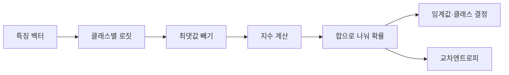

# 04. 분류와 확률

## 점수에서 확률과 결정이 되는 길

**분류(classification)**는 연속 숫자 대신 class를 고르는 문제다. Spam 여부처럼 두 class면 binary classification, 고양이·개·새처럼 하나를 셋 이상에서 고르면 multiclass, 사진 한 장에 사람과 자동차가 함께 있다는 식으로 여러 label이 동시에 참이면 multilabel이다. Multiclass는 class들이 서로 배타적이라는 가정이 있지만 multilabel은 label마다 별도 yes/no 판단이 필요하다.

모델은 먼저 **로짓(logit)**이라는 제한 없는 실수 점수를 만든다. 로짓 `2`는 확률 200%가 아니다. Weight와 feature의 내적에서 나온 비교용 위치다. Binary에서는 sigmoid, multiclass에서는 softmax를 써 확률 모양으로 바꾼다.

**Sigmoid**는 `σ(z)=1/(1+exp(-z))`다. z=0이면 0.5, 큰 양수면 1에 가까워지고 큰 음수면 0에 가까워진다. Multilabel에서는 label마다 sigmoid를 적용하므로 확률 합이 1일 필요가 없다.

**Softmax**는 각 로짓의 지수를 전체 지수 합으로 나눈다. `[2,1,0]`에서 overflow를 줄이려고 최대 2를 먼저 뺀다.

```text
shifted=[0,-1,-2]
exp≈[1,0.3679,0.1353]
sum≈1.5032
probability≈[0.6652,0.2447,0.0900]
```

합은 1이다. 모든 로짓에 같은 100을 더해도 최대값을 빼면 같은 확률이 된다. Softmax는 절대 크기보다 class 사이 차이를 사용한다.

**로그(logarithm)**는 지수의 역연산이다. 자연로그 `log(p)`는 p가 1이면 0이고 p가 0에 가까워질수록 큰 음수가 된다. **Likelihood**는 관측한 정답을 모델이 얼마나 가능하게 보았는지 나타낸다. 정답 class 확률이 0.6652면 한 표본 likelihood는 0.6652다.

**교차엔트로피(cross-entropy)**는 정답 class 확률의 음의 로그다. 정답이 첫 class면 `-log(0.6652)≈0.4076`이다. 정답에 0.01만 주면 `-log(0.01)≈4.605`로 크게 벌준다. 여러 독립 표본의 likelihood를 곱하는 대신 log-likelihood를 더하면 수치 계산과 최적화가 쉬워진다.

Binary 예로 로짓 z=log(3)≈1.0986이면 sigmoid는 `3/(1+3)=0.75`다. 정답 y=1의 binary cross-entropy는 `-log(0.75)≈0.2877`, y=0이면 `-log(0.25)≈1.3863`이다.

**임계값(threshold)**은 확률을 업무 결정으로 바꾸는 경계다. Fraud 확률 0.7에서 threshold 0.5면 차단, 0.8이면 통과다. 같은 모델이라도 false positive와 false negative 비용에 따라 threshold가 달라진다.

반례로 `[1000,999]`를 그대로 exp하면 overflow할 수 있다. `[0,-1]`로 옮긴 뒤 계산하면 약 `[0.7311,0.2689]`다. 수치 안정화는 확률 의미를 바꾸지 않는다.

## 유도 문제 5개

1. 로짓 0의 sigmoid는? **해설:** exp(0)=1이므로 1/(1+1)=0.5다.
2. Softmax `[1,1]`은? **해설:** 같은 지수 두 개이므로 `[0.5,0.5]`다.
3. 정답 확률 0.25의 교차엔트로피는? **해설:** `-log(0.25)=log(4)≈1.3863`이다.
4. Multilabel 확률 `[0.8,0.7]` 합이 1.5면 오류인가? **해설:** label별 sigmoid라 동시에 참일 수 있어 합 1 조건이 없다.
5. Accuracy가 높아도 threshold를 검토해야 하는가? **해설:** class 불균형과 오류 비용이 다르면 precision·recall과 비용 기준으로 정해야 한다.

[← 이전](03-gradients-and-optimization.md) · [목차](README.md) · [다음 →](05-training-validation-and-generalization.md)

분류는 입력을 category로 나누는 문제다.

모델은 먼저 logit이라는 제한 없는 score를 만들 수 있다.

Softmax나 sigmoid가 score를 확률 모양으로 바꾼다.

## 이 장의 목표

1. 새 용어와 수학 기호를 말로 설명한다.
2. 입력이 중간 숫자를 거쳐 결과가 되는 과정을 계산한다.
3. 계산 모형과 실제 성능 주장을 구분한다.


## 기본 단어와 기호

**class**는 예측할 범주이다.

**binary classification**는 두 class 분류이다.

**multiclass**는 셋 이상 class 분류이다.

**logit**는 확률 변환 전의 실수 score이다.

**sigmoid**는 한 logit을 0~1로 변환이다.

**softmax**는 여러 score를 합 1인 값으로 변환이다.

**cross-entropy**는 정답 확률의 음의 log 손실이다.

**threshold**는 class 결정을 가르는 기준이다.

**precision**는 양성 예측 중 실제 양성 비율이다.

**recall**는 실제 양성 중 찾아낸 비율이다.

**confusion matrix**는 예측과 정답 조합 표이다.

**calibration**는 예측 확률과 실제 빈도의 일치이다.

기호를 읽을 때 이름, shape, 단위, 생성 주체를 함께 적는다.

## 왜 필요한가

- Logit은 음수나 1보다 큰 값도 가능하므로 확률이 아니다.
- Softmax는 상대 score를 비교해 합이 1인 값을 만든다.
- Log는 작은 정답 확률을 큰 손실로 벌준다.
- Threshold는 false positive와 false negative의 비용에 맞춘다.

## 입력에서 결과까지

1. Model이 class별 logit을 계산한다.
2. 수치 안정화를 위해 최댓값을 뺀다.
3. Exponential을 계산한다.
4. 합으로 나눠 softmax 확률을 만든다.
5. 정답 class 확률의 -log를 loss로 쓴다.
6. Training이 logit parameter를 갱신한다.
7. Validation에서 threshold를 고른다.
8. Test에서 precision, recall, calibration을 평가한다.



## 작은 숫자로 한 번 계산하기

Logit=[2,1]이라고 하자.

안정화를 위해 max 2를 빼 [0,-1]로 만든다.

exp 값은 [1,0.3679]다.

합은 1.3679다.

확률은 [0.7311,0.2689]다.

정답이 첫 class면 loss=-log(0.7311)≈0.3133이다.

Logit 2 자체는 200% 확률이 아니다.

두 확률의 합은 1이다.

| 구분 | 값 또는 책임 |
|---|---|
| 실제 양성·예측 양성 | TP |
| 실제 음성·예측 양성 | FP |
| 실제 양성·예측 음성 | FN |
| 실제 음성·예측 음성 | TN |

## 계산을 거꾸로 점검하기

결과가 이상하면 마지막 값만 보지 않는다.

입력의 단위와 shape가 맞는지 먼저 확인한다.

중간값을 손으로 다시 계산한다.

Training 중 바뀌는 parameter와 고정된 data를 구별한다.

평가 data가 선택 과정에 들어갔는지 확인한다.

숫자의 분모와 평균 범위를 적는다.

## 실제 시스템으로 확장할 때

작은 예제는 원리를 고립시켜 보여 준다.

실제 system은 noise, queue, concurrency, finite precision을 포함한다.

Data 수집과 label 생성 지연도 성능에 포함한다.

Version, seed, split, metric 정의를 기록한다.

평균과 tail, subgroup 결과를 함께 본다.

실패와 timeout을 결과에서 지우지 않는다.

## 흔한 오해와 반례

- 가장 큰 logit은 확률값이 아니다.
- Softmax 0.9가 항상 90% calibration을 뜻하지 않는다.
- Accuracy는 불균형 data에서 오해를 부를 수 있다.
- Threshold 0.5가 모든 비용 구조에 최적은 아니다.

## 확인 문제와 해설

### 문제 1

Logit [-1,3]의 합이 1이어야 하는가?

**해설:** 아니다. Logit은 제한 없는 score다.

### 문제 2

Precision 식은?

**해설:** TP/(TP+FP)다.

### 문제 3

Recall을 높이면 어떤 trade-off가 가능한가?

**해설:** Threshold를 낮추면 더 많이 찾지만 false positive가 늘 수 있다.

## 학습 체크리스트

- 모든 약어를 첫 등장에 풀어 썼는가?
- 수학 기호가 가리키는 값과 단위가 명확한가?
- 입력과 label의 시각 경계가 명확한가?
- Parameter를 바꾸는 주체를 설명했는가?
- Validation과 test의 책임을 나눴는가?
- Baseline과 실패 조건을 기록했는가?

## 공식 자료

- [ISLP 2023](https://www.statlearning.com/home)
- [Dive into Deep Learning: Generalization](https://d2l.ai/chapter_linear-regression/generalization.html)

공식 근거 확인일: **2026-10-11**.

[← 이전](03-gradients-and-optimization.md) · [목차](README.md) · [다음 →](05-training-validation-and-generalization.md)
