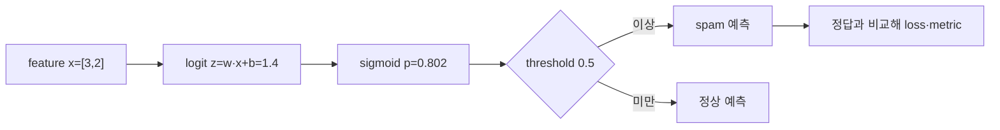
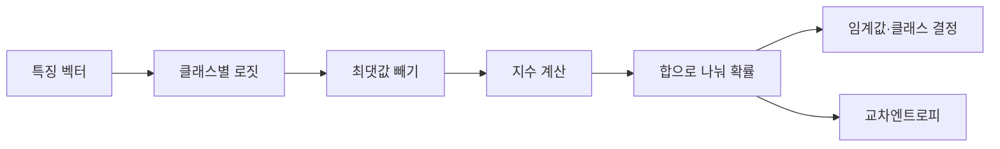

# 04. 분류와 확률
## 문제부터 시작한다: 점수 2는 왜 확률 2가 아닌가


**분류(classification)**는 입력을 미리 정한 범주 가운데 하나 이상에 배정하는 문제다. **범주(class)**는 가능한 답의 종류다. Spam 분류에서는 `spam`과 `정상`이 두 범주이고, 맞히려는 범주를 숫자로 기록한 것이 **정답 표지(label)**다. **특징(feature)**은 모델이 예측에 사용하는 입력 속성이다. 메일 한 통에서 링크 수 3과 특정 단어 수 2를 특징으로 쓰면 입력은 `x=[3,2]`다. 이렇게 숫자를 순서대로 묶은 것이 **벡터(vector)**다.

**가중치(weight)**는 각 특징이 점수에 미치는 크기와 방향을 담은 모델 내부 숫자다. 가중치가 `w=[0.8,0.5]`이면 링크 수에는 0.8, 단어 수에는 0.5를 곱한다. **내적(dot product)**은 두 벡터에서 같은 위치의 숫자끼리 곱한 뒤 모두 더하는 연산이다. 따라서 `w·x=0.8×3+0.5×2=2.4+1=3.4`다. **편향(bias)**은 입력 특징이 모두 0일 때도 점수를 옮길 수 있는 절편 매개변수다. 편향 `b=-2`를 더하면 `z=3.4-2=1.4`다.

이 `z`가 **로짓(logit)**이다. 로짓은 확률로 제한되기 전의 실수 점수라 음수, 0, 큰 양수가 모두 가능하다. binary classification에서는 로짓이 두 class의 log-odds를 나타내도록 학습한다. **Odds**는 사건 확률 `p`와 실패 확률 `1-p`의 비 `p/(1-p)`이고, log-odds는 그 비의 자연로그다. 로짓 0은 odds 1, 즉 확률 0.5에 해당한다.

가중치와 편향은 학습이 바꾸는 **매개변수(parameter)**다. 이 문맥의 편향은 사회적 편향이 아니라 수식의 절편이다. 학습은 정답과 예측의 차이에서 매개변수별 변화 방향을 계산하고, 그 숫자를 이용해 가중치와 편향을 갱신한다.

## Sigmoid를 한 숫자로 계산한다

**Sigmoid**는 임의의 로짓 `z`를 0과 1 사이로 바꾸는 함수다.

`p=1/(1+e^{-z})`

여기서 `e`는 약 2.71828인 자연상수다. 자연스러운 연속 증가와 감소를 표현하는 지수함수의 밑으로 쓰며, `e^{-1.4}`는 `e`의 -1.4제곱이다. `z=1.4`이면 `e^{-1.4}≈0.2466`, 따라서 `p≈1/1.2466≈0.8022`다. 모델은 이 메일이 양성 class, 여기서는 spam일 확률을 약 0.802로 표현한다. 이 값은 학습 자료와 모델 가정 아래의 출력이지 현실의 보장된 빈도가 아니다.

**Threshold**는 확률을 class 결정으로 바꾸는 문턱이다. threshold 0.5면 0.802는 spam, threshold 0.9면 정상으로 분류한다. 모델 parameter를 바꾸지 않고 문턱값만 바꾸면 **정밀도(precision)**와 **재현율(recall)** 사이의 균형이 달라진다. 정밀도는 양성이라고 예측한 사례 중 실제 양성의 비율, 재현율은 실제 양성 중 찾아낸 비율이다. 문턱을 높이면 엄격히 골라 양성 예측 수가 줄지만 놓치는 양성이 늘 수 있다. 뒤에서 실제 건수로 두 비율을 계산한다.



## Softmax는 여러 class를 어떻게 비교하는가

**Multiclass classification**은 서로 배타적인 class 중 하나를 고르는 문제다. 모델이 고양이·개·새 로짓 `[2,1,0]`을 냈다고 하자. **Softmax**는 각 지수값을 전체 합으로 나눠 합이 1인 확률 vector를 만든다.

수치 overflow를 막기 위해 최대 로짓 2를 모두에서 빼 `[0,-1,-2]`로 만든다. 지수는 `[1,0.3679,0.1353]`, 합은 1.5032, 확률은 `[0.6652,0.2447,0.0900]`이다. 모든 로짓에 100을 더해도 차이는 같아 확률은 변하지 않는다.

**Multilabel classification**은 label 여러 개가 동시에 참일 수 있는 문제다. 사진에 사람과 자동차가 모두 있을 수 있다. 각 label에 sigmoid를 따로 적용하므로 확률 합이 1일 필요가 없다. 이 문제에 softmax를 쓰면 서로 배타적이라는 잘못된 제약을 넣는다.

## Cross-entropy가 틀린 자신감을 크게 벌주는 이유

정답 class 확률 `p_y`에 대해 **cross-entropy loss**는 `-log(p_y)`다. 자연로그 `log`는 지수함수의 역함수다. 정답 확률이 0.8이면 loss는 약 0.223, 0.1이면 약 2.303, 0.001이면 약 6.908이다. 틀린데 매우 자신 있는 예측을 크게 벌한다.

Binary에서 label `y∈{0,1}`이면 `L=-[y log p +(1-y)log(1-p)]`다. `y=1,p=0.8`이면 `-log(0.8)=0.223`이다. `y=0,p=0.8`이면 `-log(0.2)=1.609`다. 같은 확률이라도 정답에 따라 loss가 달라진다.

실제 구현은 `log(0)`와 overflow를 피하려고 로짓에서 직접 안정적인 loss를 계산한다. sigmoid나 softmax를 먼저 계산한 뒤 log를 취하는 순진한 코드는 큰 로짓에서 0이나 1로 반올림되어 무한대 loss를 만들 수 있다.

## Gradient가 로짓과 parameter를 바꾸는 과정

**편미분(partial derivative)**은 여러 매개변수 중 하나만 바꾸고 나머지는 고정했을 때 손실이 변하는 비율이다. **기울기(gradient)**는 모든 매개변수의 편미분을 같은 순서로 묶은 벡터다. 벡터는 순서가 있는 숫자 묶음이다. Binary cross-entropy와 sigmoid를 함께 쓰면 로짓에 대한 손실의 미분이 `∂L/∂z=p-y`로 단순해진다. `p=0.802,y=1`이면 그 값은 -0.198이다. 입력 `x=[3,2]`이므로 가중치 기울기는 `(p-y)x=[-0.594,-0.396]`, 편향 기울기는 -0.198이다.

Learning rate 0.1인 gradient descent는 `w←w-ηg`를 적용한다. 첫 weight는 `0.8-0.1×(-0.594)=0.8594`, 둘째는 0.5396, bias는 -1.9802가 된다. 같은 positive sample에 대한 새 로짓은 올라가고 sigmoid 확률도 1에 가까워진다.

**표본(sample)**은 입력 특징과 정답 label 한 쌍이다. **배치(batch)**는 한 번에 기울기를 계산하는 표본 묶음이다. Spam 표본 하나만 반복하면 정상 메일을 잘못 분류할 수 있으므로 여러 label과 특징 분포를 포함한 배치 평균 기울기를 쓴다. **최적화 알고리즘(optimizer)**은 이 기울기를 읽어 가중치와 편향을 실제로 갱신하는 절차다. **학습률(learning rate)**은 기울기 중 얼마만큼을 한 번의 갱신에 반영할지 정하는 비율이다.

## Confusion matrix를 실제 count로 읽는다

Test sample 100개 중 실제 positive 20개, negative 80개라고 하자. 모델이 positive 25개를 예측했고 그중 15개가 실제 positive다.

- **TP, True Positive**: 실제 positive를 positive로 맞춘 15개
- **FP, False Positive**: 실제 negative를 positive로 잘못 분류한 10개
- **FN, False Negative**: 실제 positive를 놓친 5개
- **TN, True Negative**: 실제 negative를 맞춘 70개

Accuracy는 `(TP+TN)/100=85%`다. Precision은 `TP/(TP+FP)=15/25=60%`, recall은 `TP/(TP+FN)=15/20=75%`다. **F1 score**는 precision과 recall의 조화평균으로 `2PR/(P+R)≈66.7%`다.

불균형 data에서 accuracy는 속일 수 있다. Positive가 1%인데 모두 negative라고 예측하면 accuracy 99%지만 recall은 0이다. 질병 screening처럼 놓치면 위험한 문제와 spam filter처럼 정상 메일 차단 비용이 큰 문제는 threshold 선택이 다르다.

## ROC, PR curve와 calibration

**ROC curve**는 threshold를 바꾸며 false positive rate와 true positive rate를 그린다. **PR curve**는 precision과 recall을 그린다. Positive가 매우 드문 문제에서는 PR curve가 positive 성능을 더 직접 보여 줄 수 있다. AUC는 curve 아래 면적이지만 실제 운영 threshold의 비용을 대신 결정하지 않는다.

**Calibration**은 “0.8이라고 예측한 사례들 중 실제로 약 80%가 positive인가”를 묻는다. 정확도와 calibration은 다르다. 순위를 잘 매겨 AUC가 높아도 확률이 과신될 수 있다. Temperature scaling 같은 보정은 validation data로 parameter를 고정한 뒤 독립 test에서 평가한다.

## 실패와 반례

Data leakage가 있으면 classification metric이 비현실적으로 높아진다. 예측 시점 뒤에 생긴 환불 여부를 feature로 쓰면 미래 정보를 사용한 것이다. Train과 test에 같은 사용자의 거의 같은 행이 섞이면 사용자 identity를 외울 수 있다.

Class weight나 oversampling은 드문 class 학습을 돕지만 운영의 실제 prevalence를 바꾼 듯한 calibration 왜곡을 만들 수 있다. Training distribution의 50% positive와 운영의 1% positive는 threshold와 probability 해석이 다르다.

Logit 크기가 큰 것을 설명 가능성이나 인과로 읽지 않는다. Weight는 feature scale과 상관관계에 의존한다. 모델이 특정 단어에 높은 weight를 줬어도 그 단어가 spam의 원인이라는 뜻은 아니다.

## 연구 결과를 읽는 법

새 분류법의 AUC가 높다는 논문을 볼 때 dataset split, class prevalence, 중복 제거, threshold, confidence interval을 확인한다. 같은 test를 반복 보며 model을 고르면 test에 overfit한다. Benchmark 숫자는 해당 dataset과 protocol의 근거이며 실제 population 성능 보장이 아니다.

## 추가 완전 풀이 문제

### 문제 4

Logit 0의 sigmoid 확률은?

**해설:** `e^0=1`이므로 `1/(1+1)=0.5`다. Threshold가 0.5 이상을 positive로 정했다면 positive가 되지만 tie 규칙을 명시해야 한다.

### 문제 5

정답 확률이 0.9와 0.1일 때 cross-entropy는 각각 얼마인가?

**해설:** `-log(0.9)≈0.105`, `-log(0.1)≈2.303`이다. 틀린 자신감에 훨씬 큰 손실을 준다.

### 문제 6

TP=40, FP=10, FN=20이면 precision과 recall은?

**해설:** Precision은 `40/(40+10)=0.8`, recall은 `40/(40+20)=2/3≈0.667`이다. 두 metric의 분모가 다르다.

### 문제 7

AUC가 올랐지만 운영 threshold에서 FP가 두 배가 됐다. 개선인가?

**해설:** 자동으로 그렇지 않다. AUC는 전체 threshold 순위 요약이다. 운영 비용은 선택 threshold의 confusion matrix와 class prevalence로 판단한다.

## 점수에서 확률과 결정이 되는 길

**분류(classification)**는 연속 숫자 대신 class를 고르는 문제다. Spam 여부처럼 두 class면 binary classification, 고양이·개·새처럼 하나를 셋 이상에서 고르면 multiclass, 사진 한 장에 사람과 자동차가 함께 있다는 식으로 여러 label이 동시에 참이면 multilabel이다. Multiclass는 class들이 서로 배타적이라는 가정이 있지만 multilabel은 label마다 별도 yes/no 판단이 필요하다.

모델은 먼저 **로짓(logit)**이라는 제한 없는 실수 점수를 만든다. 로짓 `2`는 확률 200%가 아니다. Weight와 feature의 내적에서 나온 비교용 위치다. Binary에서는 sigmoid, multiclass에서는 softmax를 써 확률 모양으로 바꾼다.

**Sigmoid**는 `σ(z)=1/(1+exp(-z))`다. z=0이면 0.5, 큰 양수면 1에 가까워지고 큰 음수면 0에 가까워진다. Multilabel에서는 label마다 sigmoid를 적용하므로 확률 합이 1일 필요가 없다.

**Softmax**는 각 로짓의 지수를 전체 지수 합으로 나눈다. `[2,1,0]`에서 overflow를 줄이려고 최대 2를 먼저 뺀다.

```text
shifted=[0,-1,-2]
exp≈[1,0.3679,0.1353]
sum≈1.5032
probability≈[0.6652,0.2447,0.0900]
```

합은 1이다. 모든 로짓에 같은 100을 더해도 최대값을 빼면 같은 확률이 된다. Softmax는 절대 크기보다 class 사이 차이를 사용한다.

**로그(logarithm)**는 지수의 역연산이다. 자연로그 `log(p)`는 p가 1이면 0이고 p가 0에 가까워질수록 큰 음수가 된다. **Likelihood**는 관측한 정답을 모델이 얼마나 가능하게 보았는지 나타낸다. 정답 class 확률이 0.6652면 한 표본 likelihood는 0.6652다.

**교차엔트로피(cross-entropy)**는 정답 class 확률의 음의 로그다. 정답이 첫 class면 `-log(0.6652)≈0.4076`이다. 정답에 0.01만 주면 `-log(0.01)≈4.605`로 크게 벌준다. 여러 독립 표본의 likelihood를 곱하는 대신 log-likelihood를 더하면 수치 계산과 최적화가 쉬워진다.

Binary 예로 로짓 z=log(3)≈1.0986이면 sigmoid는 `3/(1+3)=0.75`다. 정답 y=1의 binary cross-entropy는 `-log(0.75)≈0.2877`, y=0이면 `-log(0.25)≈1.3863`이다.

**임계값(threshold)**은 확률을 업무 결정으로 바꾸는 경계다. Fraud 확률 0.7에서 threshold 0.5면 차단, 0.8이면 통과다. 같은 모델이라도 false positive와 false negative 비용에 따라 threshold가 달라진다.

반례로 `[1000,999]`를 그대로 exp하면 overflow할 수 있다. `[0,-1]`로 옮긴 뒤 계산하면 약 `[0.7311,0.2689]`다. 수치 안정화는 확률 의미를 바꾸지 않는다.

## 유도 문제 5개

1. 로짓 0의 sigmoid는? **해설:** exp(0)=1이므로 1/(1+1)=0.5다.
2. Softmax `[1,1]`은? **해설:** 같은 지수 두 개이므로 `[0.5,0.5]`다.
3. 정답 확률 0.25의 교차엔트로피는? **해설:** `-log(0.25)=log(4)≈1.3863`이다.
4. Multilabel 확률 `[0.8,0.7]` 합이 1.5면 오류인가? **해설:** label별 sigmoid라 동시에 참일 수 있어 합 1 조건이 없다.
5. Accuracy가 높아도 threshold를 검토해야 하는가? **해설:** class 불균형과 오류 비용이 다르면 precision·recall과 비용 기준으로 정해야 한다.

[← 이전](03-gradients-and-optimization.md) · [목차](README.md) · [다음 →](05-training-validation-and-generalization.md)

분류는 입력을 category로 나누는 문제다.

모델은 먼저 logit이라는 제한 없는 score를 만들 수 있다.

Softmax나 sigmoid가 score를 확률 모양으로 바꾼다.

## 입력에서 결과까지

1. Model이 class별 logit을 계산한다.
2. 수치 안정화를 위해 최댓값을 뺀다.
3. Exponential을 계산한다.
4. 합으로 나눠 softmax 확률을 만든다.
5. 정답 class 확률의 -log를 loss로 쓴다.
6. Training이 logit parameter를 갱신한다.
7. Validation에서 threshold를 고른다.
8. Test에서 precision, recall, calibration을 평가한다.



## 작은 숫자로 한 번 계산하기

Logit=[2,1]이라고 하자.

안정화를 위해 max 2를 빼 [0,-1]로 만든다.

exp 값은 [1,0.3679]다.

합은 1.3679다.

확률은 [0.7311,0.2689]다.

정답이 첫 class면 loss=-log(0.7311)≈0.3133이다.

Logit 2 자체는 200% 확률이 아니다.

두 확률의 합은 1이다.

| 구분 | 값 또는 책임 |
|---|---|
| 실제 양성·예측 양성 | TP |
| 실제 음성·예측 양성 | FP |
| 실제 양성·예측 음성 | FN |
| 실제 음성·예측 음성 | TN |

## 흔한 오해와 반례

- 가장 큰 logit은 확률값이 아니다.
- Softmax 0.9가 항상 90% calibration을 뜻하지 않는다.
- Accuracy는 불균형 data에서 오해를 부를 수 있다.
- Threshold 0.5가 모든 비용 구조에 최적은 아니다.

## 확인 문제와 해설

### 문제 1

Logit [-1,3]의 합이 1이어야 하는가?

**해설:** 아니다. Logit은 제한 없는 score다.

### 문제 2

Precision 식은?

**해설:** TP/(TP+FP)다.

### 문제 3

Recall을 높이면 어떤 trade-off가 가능한가?

**해설:** Threshold를 낮추면 더 많이 찾지만 false positive가 늘 수 있다.

## 공식 자료

- [ISLP 2023](https://www.statlearning.com/home)
- [Dive into Deep Learning: Generalization](https://d2l.ai/chapter_linear-regression/generalization.html)

공식 근거 확인일: **2026-10-11**.

[← 이전](03-gradients-and-optimization.md) · [목차](README.md) · [다음 →](05-training-validation-and-generalization.md)
