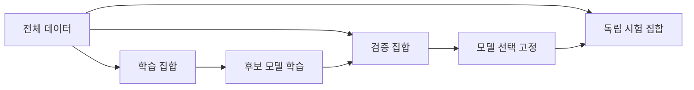

# 05. 학습·검증·일반화

[← 이전](04-classification-and-probabilities.md) · [목차](README.md) · [다음 →](06-regularization-and-data-quality.md)

일반화는 training에서 보지 않은 data에도 유용한 예측을 하는 능력이다.

Validation은 선택에 쓰고 test는 선택이 끝난 뒤 쓴다.

시간과 대상이 겹치면 data leakage가 생길 수 있다.

## 이 장의 목표

1. 새 용어와 수학 기호를 말로 설명한다.
2. 입력이 중간 숫자를 거쳐 결과가 되는 과정을 계산한다.
3. 계산 모형과 실제 성능 주장을 구분한다.

## 기본 단어와 기호

**generalization**는 새 data에서의 성능이다.

**training set**는 parameter 학습용 data이다.

**validation set**는 모델·설정 선택용 data이다.

**test set**는 최종 독립 평가용 data이다.

**hyperparameter**는 학습 전에 고르는 설정이다.

**epoch**는 training data를 한 번 도는 단위이다.

**overfitting**는 training에는 맞지만 새 data에 약한 상태이다.

**underfitting**는 training 관계도 충분히 못 배운 상태이다.

**leakage**는 예측 때 모를 정보가 학습·선택에 들어감이다.

**distribution shift**는 운영 분포가 평가 분포와 다름이다.

**cross-validation**는 여러 fold로 선택 안정성을 보는 방법이다.

**early stopping**는 validation 악화 전에 학습을 멈추는 방법이다.

기호를 읽을 때 이름, shape, 단위, 생성 주체를 함께 적는다.

## 왜 필요한가

- 같은 data로 학습과 평가를 하면 암기를 실력으로 착각한다.
- Validation을 여러 번 보며 설정을 고르면 validation에도 적응한다.
- Test를 반복 선택에 쓰면 독립성이 사라진다.
- 시간 series와 cell data는 무작위 행 분할이 누수를 만들 수 있다.

## 입력에서 결과까지

1. 전체 data의 생성 단위와 시간을 확인한다.
2. 같은 사람·cell·시간 window가 split을 넘지 않게 묶는다.
3. Training으로 parameter를 학습한다.
4. Validation으로 model과 hyperparameter를 선택한다.
5. 선택 기록을 고정한다.
6. Test를 한 번 실행한다.
7. Confidence interval과 subgroup 결과를 계산한다.
8. 운영 drift를 별도로 관측한다.

## 작은 숫자로 한 번 계산하기

후보 simple의 validation error=0.20이다.

Medium은 0.15다.

Complex는 0.17이다.

Validation 선택은 medium이다.

Medium의 독립 test error=0.19다.

Complex test error=0.14를 보고 complex로 바꾸면 test를 선택에 쓴 것이다.

그 뒤 0.14는 독립 평가가 아니다.

새 test나 nested 절차가 필요하다.

| 구분 | 값 또는 책임 |
|---|---|
| Training | parameter 변경 |
| Validation | 후보 선택 |
| Test | 최종 보고 |
| 운영 | drift와 실제 비용 |

## 계산을 거꾸로 점검하기

결과가 이상하면 마지막 값만 보지 않는다.

입력의 단위와 shape가 맞는지 먼저 확인한다.

중간값을 손으로 다시 계산한다.

Training 중 바뀌는 parameter와 고정된 data를 구별한다.

평가 data가 선택 과정에 들어갔는지 확인한다.

숫자의 분모와 평균 범위를 적는다.

## 실제 시스템으로 확장할 때

작은 예제는 원리를 고립시켜 보여 준다.

실제 system은 noise, queue, concurrency, finite precision을 포함한다.

Data 수집과 label 생성 지연도 성능에 포함한다.

Version, seed, split, metric 정의를 기록한다.

평균과 tail, subgroup 결과를 함께 본다.

실패와 timeout을 결과에서 지우지 않는다.

## 흔한 오해와 반례

- Data가 많아도 중복이면 독립 표본이 아니다.
- Cross-validation 뒤에도 최종 test가 필요할 수 있다.
- Test 점수가 가장 좋은 후보를 고르는 것은 test 누수다.
- Random split이 모든 data에 안전하지 않다.

## 확인 문제와 해설

### 문제 1

Validation을 왜 학습에 직접 쓰지 않는가?

**해설:** 선택 기준으로 남겨 새 설정의 비교에 사용하기 위해서다.

### 문제 2

같은 사용자의 행이 train/test에 섞이면?

**해설:** 개인 고유 패턴을 외워 성능이 부풀 수 있다.

### 문제 3

독립 test의 사용 시점은?

**해설:** 모든 모델·설정 선택을 끝내고 고정한 뒤다.

## 학습 체크리스트

- 모든 약어를 첫 등장에 풀어 썼는가?
- 수학 기호가 가리키는 값과 단위가 명확한가?
- 입력과 label의 시각 경계가 명확한가?
- Parameter를 바꾸는 주체를 설명했는가?
- Validation과 test의 책임을 나눴는가?
- Baseline과 실패 조건을 기록했는가?

## 공식 자료

- [ISLP 2023](https://www.statlearning.com/home)
- [Dive into Deep Learning: Generalization](https://d2l.ai/chapter_linear-regression/generalization.html)

공식 근거 확인일: **2026-10-11**.

[← 이전](04-classification-and-probabilities.md) · [목차](README.md) · [다음 →](06-regularization-and-data-quality.md)
