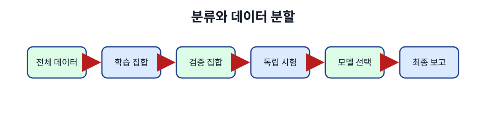
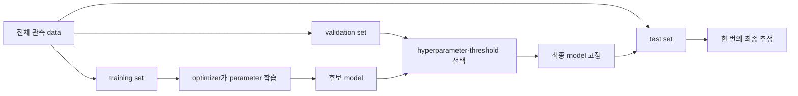
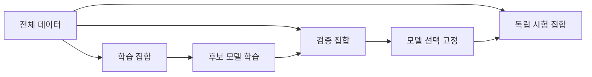

# 05. 학습·검증·일반화
## 문제부터 시작한다: 학습 점수 99%는 무엇을 말하는가



**자료(data)**는 관측해 기록한 값의 모음이다. **표본(sample)**은 예측에 넣을 특징과 맞혀야 할 정답을 한 쌍으로 묶은 한 사례다. 배송 한 건의 거리·요일이 특징이고 실제 지연 여부가 정답이라면 그것이 표본 하나다. 여러 표본을 모아 학습에 사용하는 부분이 **학습 자료(training data)**다.

**모델(model)**은 입력 특징을 받아 예측을 만드는 계산 규칙과 그 안의 학습된 숫자를 합친 대상이다. **정확도(accuracy)**는 전체 평가 표본 중 정답을 맞힌 비율이다. 배송 지연을 예측하는 모델이 학습 자료 100건 중 99건을 맞혀 정확도 99%를 냈다고 하자. 이 숫자는 모델이 이미 본 표본에 잘 맞는다는 뜻이다. 내일의 배송, 새 지역, 새 계절에도 잘 맞는지는 말하지 않는다. 보지 않은 사례에서 유용한 성능을 내는 능력이 **일반화(generalization)**다.

**모집단(population)**은 우리가 궁극적으로 예측하려는 모든 가능한 사례다. 실제로 전부 모을 수 없으므로 관측한 표본으로 학습한다. **특징(feature)**은 예측 시점에 사용할 입력 속성이고, **label**은 맞히려는 정답이다. 예측 시점 뒤에만 알 수 있는 값을 특징으로 넣으면 미래 정보를 훔친다.

**자료집(dataset)**은 표본의 모음이다. **학습 집합(training set)**은 모델 내부 숫자를 바꾸는 데 쓰고, **검증 집합(validation set)**은 학습률, 모델 크기, 문턱값 같은 설정 선택에 쓰며, **시험 집합(test set)**은 모든 선택을 끝낸 뒤 최종 성능을 추정한다. 같은 시험 결과를 보고 설정을 다시 바꾸면 그 시험 집합도 선택에 사용됐으므로 더 이상 독립 평가가 아니다.

## Parameter와 hyperparameter의 차이

**매개변수(parameter)**는 가중치와 편향처럼 학습 과정이 바꾸는 모델 내부 숫자다. **기울기(gradient)**는 각 매개변수를 조금 바꿀 때 손실이 얼마나 변하는지 나타내는 편미분을 한 묶음으로 모은 값이다. **최적화 알고리즘(optimizer)**은 기울기를 읽어 매개변수를 실제로 갱신한다.

**초매개변수(hyperparameter)**는 최적화 알고리즘이 직접 학습하지 않고 사람이 정하거나 탐색 절차가 고르는 설정이다. **학습률(learning rate)**은 기울기의 얼마를 한 번의 갱신에 반영할지 정하는 비율이다. **배치 크기(batch size)**는 한 번의 기울기 계산에 함께 넣는 표본 수다. **에폭(epoch)**은 학습 집합 전체를 한 번 사용한 구간이다. 정규화 강도와 모델 크기도 초매개변수다.

Training sample 600개, batch size 50, epoch 10이면 한 epoch에 12 step, 전체 120 optimizer step이다. 각 step에서 모델이 예측하고 loss를 계산하며 gradient를 만든 뒤 optimizer가 parameter를 갱신한다. Validation에서는 parameter를 갱신하지 않고 현재 후보의 성능을 비교한다.

**Loss**는 sample 예측 오류를 학습 가능한 숫자로 만든 함수다. Training loss는 optimizer가 직접 줄이는 목표다. Accuracy나 F1 같은 metric은 사람이 의미를 해석하는 평가량이며 미분 가능하지 않아도 된다. Training loss와 운영 metric이 서로 다른 이유를 기록해야 한다.



## 무작위 분할이 항상 옳지 않은 이유

100일 시계열에서 day 1–60을 training, 61–80을 validation, 81–100을 test로 두면 과거로 미래를 예측하는 시간 방향을 지킨다. 행을 무작위로 섞으면 day 90과 거의 같은 day 89가 training에 들어가 미래 변화가 이미 보인 듯한 결과가 날 수 있다.

사용자 예측도 group 경계가 필요하다. 같은 사용자의 10개 행 중 8개를 train, 2개를 test에 두면 모델이 사용자 고유 패턴을 외워 “새 사용자 일반화”처럼 보일 수 있다. 새 사용자 성능이 목표라면 사용자 ID 단위로 분할한다.

**Data leakage**는 평가 시점에 이용할 수 없는 정보가 training 또는 feature에 들어가는 현상이다. 중복 행, 미래 label에서 파생한 feature, 전체 dataset으로 미리 계산한 평균·표준편차도 leakage가 될 수 있다. 전처리 평균은 training set에서 계산하고 validation/test에는 그 고정값을 적용한다.

예를 들어 전체 100개 평균이 50이고 training 60개 평균이 40이면 전체 평균으로 정규화하는 순간 test 분포 정보가 training에 들어간다. 수치 차이가 작아 보여도 평가 절차의 독립성을 깨뜨린다.

## Underfitting과 overfitting을 곡선으로 읽는다

**Underfitting**은 model이 너무 단순하거나 학습이 부족해 training과 validation 모두 나쁜 상태다. **Overfitting**은 training에는 계속 좋아지지만 validation에서 나빠지는 상태다. 이를 bias–variance 관점으로 설명할 수 있다.

여기서 **bias**는 수식의 절편이 아니라 model 가정이 너무 단순해 생기는 체계적 오차다. **Variance**는 training sample이 조금 바뀔 때 model 결과가 크게 흔들리는 성질이다. 같은 단어 bias가 다른 대상을 뜻하므로 문맥을 밝혀야 한다.

| epoch | training loss | validation loss |
| ---: | ---: | ---: |
| 1 | 0.90 | 0.95 |
| 3 | 0.55 | 0.62 |
| 5 | 0.35 | 0.48 |
| 8 | 0.20 | 0.56 |
| 12 | 0.10 | 0.75 |

Epoch 5 뒤 training loss는 줄지만 validation loss는 오른다. Validation 기준으로 epoch 5 checkpoint를 선택하는 **early stopping**을 고려할 수 있다. Test는 이 선택에 사용하지 않는다. Early stopping도 hyperparameter 선택이므로 validation protocol에 포함한다.

## 교차검증을 수치로 이해한다

**K-fold cross-validation**은 training 영역을 K개 fold로 나눠 K번 학습하는 방법이다. 5-fold에서는 매번 4개 fold로 학습하고 1개로 validation한다. Validation accuracy가 `[0.80,0.84,0.78,0.83,0.75]`이면 평균은 0.80이고 범위는 0.75–0.84다. 평균 하나보다 split에 따른 흔들림을 함께 본다.

시간 data에는 미래 fold로 학습해 과거를 검증하는 일반 무작위 K-fold가 부적절할 수 있다. 과거 window로 다음 window를 예측하는 rolling validation을 쓴다. Group data는 같은 사용자가 train/validation에 동시에 들어가지 않도록 group fold를 쓴다.

Cross-validation으로 hyperparameter를 고른 뒤 최종 model을 전체 training 영역에서 다시 학습할 수 있다. 독립 test는 마지막 한 번 평가한다. 계산 budget이 K배 가까이 늘 수 있으므로 후보 수와 search 범위를 기록한다.

## Distribution shift와 운영 성능

**Distribution**은 값이 얼마나 자주 어떤 범위에 나타나는지를 나타낸다. Training과 운영 data의 분포가 달라지는 현상이 **distribution shift**다. 계절, 정책, sensor 교체, 사용자 행동 변화가 원인일 수 있다.

Training에서 지연 배송 비율 10%, 운영에서 30%로 바뀌면 class prevalence가 달라진다. 같은 classifier라도 precision이 변할 수 있다. Feature 범위가 training의 0–100에서 운영 0–500으로 바뀌면 extrapolation 오류가 커질 수 있다.

운영에서는 label이 늦게 도착할 수 있다. 예측 score 분포, feature missing rate, latency는 즉시 감시하고, 실제 성능은 label이 도착한 뒤 계산한다. Drift alert가 곧 model 실패를 뜻하지 않지만 재평가 신호다.

## Baseline과 confidence interval

**Baseline**은 새 model과 비교하는 단순 기준이다. 이전 값 유지, 전체 평균, 다수 class 예측이 예다. 복잡한 model이 baseline보다 조금 좋다면 운영 비용과 불확실성을 함께 본다.

Test accuracy가 1,000개 중 820개면 점 추정은 82%다. 표본이 바뀌면 숫자도 변한다. **Confidence interval**은 이 추정 불확실성을 범위로 표현한다. 서로 겹치는 interval만으로 차이가 없다고 단정하거나, 아주 작은 차이를 큰 표본 때문에 실질 개선이라고 과장하지 않는다. 효과 크기와 운영 비용을 함께 본다.

Random seed는 data 순서와 parameter 초기화 같은 난수 결과를 재현하는 시작값이다. Seed 하나에서의 승리를 일반 법칙으로 쓰지 않고 여러 seed의 평균과 분산을 보고한다.

## 실패 반례

Validation을 매 epoch 수백 번 보며 model 구조를 계속 바꾸면 validation set에도 overfit한다. 별도 final test가 필요한 이유다. Test 성능이 나빴다고 test에 맞춰 threshold를 고치면 새 test가 필요하다.

Data가 적다고 train/test 중복을 허용하면 표본 수는 늘어 보이지만 독립성은 사라진다. Data augmentation으로 만든 거의 같은 이미지도 원본 기준으로 같은 split에 묶어야 한다.

Training loss가 낮다고 label quality가 좋다는 뜻은 아니다. 잘못된 label을 model이 외울 수도 있다. Subgroup별 오류를 보지 않으면 평균 성능 뒤에 특정 지역·장비·사용자의 실패가 숨는다.

## 연구 결과와 연결하기

논문의 최고 test score만 읽지 않는다. Dataset 수집 방식, split 단위, preprocessing fit 범위, hyperparameter search budget, seed 수, baseline, confidence interval을 확인한다. Benchmark test가 공개돼 연구자가 반복 조정했다면 사실상 validation 역할을 했을 가능성도 논의한다.

새 RAN traffic model이 한 cell split에서 좋았다는 결과는 새 cell, 새 계절, 새 장비로 자동 일반화되지 않는다. 연구 질문에 맞는 시간·group·domain split을 다시 설계한다.

## 추가 완전 풀이 문제

### 문제 4

Sample 600개, batch size 50, epoch 8이면 step은 몇 개인가?

**해설:** 한 epoch에 12 step, 8 epoch에 96 step이다. 마지막 batch가 정확히 나뉜다는 조건이다.

### 문제 5

Epoch별 validation loss가 0.8, 0.6, 0.5, 0.55, 0.7이면 단순 최소 기준 선택 epoch는?

**해설:** 세 번째 epoch다. Test를 보지 않고 validation 규칙을 사전에 정했다는 조건이 필요하다.

### 문제 6

같은 환자의 방문 기록이 train과 test 양쪽에 있으면 어떤 성능을 측정할 수 있는가?

**해설:** 새 환자 일반화보다 이미 본 환자의 다른 방문을 예측하는 성능에 가깝다. 목표가 새 환자라면 환자 ID 단위로 분할한다.

### 문제 7

Cross-validation 평균 accuracy가 0.90인데 독립 test는 0.78이다. 가능한 원인은?

**해설:** Hyperparameter가 validation folds에 과적합됐거나 test 분포가 다르거나 leakage가 있었을 수 있다. Split 생성, 중복, preprocessing, distribution을 조사하며 test에 맞춰 다시 고치지 않는다.

## 모집단에서 표본을 뽑아 새 사례를 예측한다는 뜻

**모집단(population)**은 관심 있는 모든 가능한 사례다. 앞으로 들어올 모든 배송, 모든 cell의 미래 traffic처럼 실제로 전부 볼 수 없는 대상이다. **표본(sample)**은 그중 관측해 데이터로 가진 일부다. 학습 목표는 표본을 암기하는 것이 아니라 같은 목적의 모집단에서 새로 온 사례에 유용한 예측을 하는 **일반화(generalization)**다.

Training set은 parameter를 바꾸고, validation set은 모델 구조·학습률·epoch 같은 선택에 쓰며, test set은 선택을 끝낸 뒤 최종 추정에 쓴다. Test를 보고 설정을 바꾸면 그 test도 선택에 사용됐으므로 독립 test가 아니다.

100일 데이터를 다음처럼 나눈다고 하자.

```text
day 1~60   training: parameter 학습
day 61~80  validation: 후보 A/B와 threshold 선택
day 81~100 test: 선택을 고정한 뒤 한 번 평가
```

시간 예측에서 행을 무작위로 섞으면 day 90과 거의 같은 day 89가 training에 들어갈 수 있다. 미래 분포를 예측하려면 과거→미래 방향을 보존한다.

사용자나 cell도 경계다. 같은 cell A의 연속 window가 train/test 양쪽에 있으면 cell 고유 패턴을 외운 성능이 “새 cell 일반화”처럼 보일 수 있다. 시간 일반화와 대상 일반화를 각각 평가한다.

**교차검증(cross-validation)**은 training 영역을 여러 fold로 나눠 번갈아 validation으로 쓰는 방법이다. 5-fold에서 각 표본은 네 번 학습, 한 번 validation에 쓰인다. 후보 선택 안정성을 보는 데 유용하지만 최종 test를 대체한다고 자동 결론 내리지 않는다.

```text
fold1 validate, fold2~5 train
fold2 validate, 나머지 train
...
5개 validation score 평균
```

시간 series는 일반 K-fold보다 rolling split이 자연스럽다. `train day1~30→validate31~40`, `train1~40→validate41~50`처럼 항상 과거로 미래를 평가한다.

**데이터 누수**는 예측 시점에 알 수 없는 정보가 feature·전처리·선택에 들어가는 일이다. 전체 100일의 평균과 표준편차로 먼저 정규화한 뒤 split하면 test 분포가 training 변환에 들어간다. Training에서 변환 parameter를 fit하고 validation/test에는 그대로 적용한다.

후보 20개를 validation에서 고르면 최고 score에는 우연한 이득도 섞인다. 최종 test는 이 선택 전체의 일반화를 평가한다. Test를 반복 확인하며 후보를 바꾸면 새로운 독립 holdout이나 nested 평가가 필요하다.

## 수치 시간표

후보 A/B의 validation error가 0.18/0.15여서 B를 고정했다. Test 200건에서 34건 오류면 test error는 17%다. Validation 15%를 최종 성능으로 보고하지 않는다. Test 17%도 유한 표본 추정이며 모집단의 정확한 상수가 아니다.

반례로 random split 90% 성능, 시간 split 70%라면 모델이 미래 변화에 약하다는 증거다. 편한 split만 선택하지 않는다.

## 유도 문제 5개

1. Validation으로 parameter를 직접 학습하면? **해설:** 선택 경계가 흐려져 validation 성능이 낙관적이 된다.
2. Test를 세 번 보고 모델을 바꾸면? **해설:** Test가 선택 data가 됐다. 새 독립 평가가 필요하다.
3. 같은 환자의 행이 양쪽 split에 있으면? **해설:** 개인 패턴 누수로 새 환자 성능이 부풀 수 있다.
4. 시간 series에 random K-fold가 위험한 이유는? **해설:** 미래 정보와 인접 window가 과거 학습에 들어갈 수 있다.
5. Population과 sample 차이는? **해설:** 모집단은 결론을 내리고 싶은 전체, 표본은 실제 관측한 일부다.

[← 이전](04-classification-and-probabilities.md) · [목차](README.md) · [다음 →](06-regularization-and-data-quality.md)

일반화는 training에서 보지 않은 data에도 유용한 예측을 하는 능력이다.

Validation은 선택에 쓰고 test는 선택이 끝난 뒤 쓴다.

시간과 대상이 겹치면 data leakage가 생길 수 있다.

## 입력에서 결과까지

1. 전체 data의 생성 단위와 시간을 확인한다.
2. 같은 사람·cell·시간 window가 split을 넘지 않게 묶는다.
3. Training으로 parameter를 학습한다.
4. Validation으로 model과 hyperparameter를 선택한다.
5. 선택 기록을 고정한다.
6. Test를 한 번 실행한다.
7. Confidence interval과 subgroup 결과를 계산한다.
8. 운영 drift를 별도로 관측한다.



## 작은 숫자로 한 번 계산하기

후보 simple의 validation error=0.20이다.

Medium은 0.15다.

Complex는 0.17이다.

Validation 선택은 medium이다.

Medium의 독립 test error=0.19다.

Complex test error=0.14를 보고 complex로 바꾸면 test를 선택에 쓴 것이다.

그 뒤 0.14는 독립 평가가 아니다.

새 test나 nested 절차가 필요하다.

| 구분 | 값 또는 책임 |
|---|---|
| Training | parameter 변경 |
| Validation | 후보 선택 |
| Test | 최종 보고 |
| 운영 | drift와 실제 비용 |

## 흔한 오해와 반례

- Data가 많아도 중복이면 독립 표본이 아니다.
- Cross-validation 뒤에도 최종 test가 필요할 수 있다.
- Test 점수가 가장 좋은 후보를 고르는 것은 test 누수다.
- Random split이 모든 data에 안전하지 않다.

## 확인 문제와 해설

### 문제 1

Validation을 왜 학습에 직접 쓰지 않는가?

**해설:** 선택 기준으로 남겨 새 설정의 비교에 사용하기 위해서다.

### 문제 2

같은 사용자의 행이 train/test에 섞이면?

**해설:** 개인 고유 패턴을 외워 성능이 부풀 수 있다.

### 문제 3

독립 test의 사용 시점은?

**해설:** 모든 모델·설정 선택을 끝내고 고정한 뒤다.

## 공식 자료

- [ISLP 2023](https://www.statlearning.com/home)
- [Dive into Deep Learning: Generalization](https://d2l.ai/chapter_linear-regression/generalization.html)

공식 근거 확인일: **2026-10-11**.

[← 이전](04-classification-and-probabilities.md) · [목차](README.md) · [다음 →](06-regularization-and-data-quality.md)
