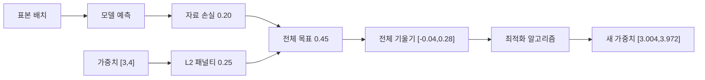
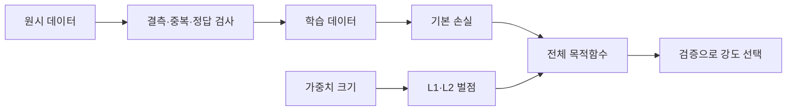

# 06. 정규화와 데이터 품질
## 문제부터 시작한다: 작은 학습 오차가 왜 새 자료에서 실패하는가


**자료(data)**는 관측해 기록한 값의 모음이고, **표본(sample)**은 입력 특징과 정답 한 쌍이다. 모델이 학습 표본을 거의 외우면 학습 손실은 매우 작아질 수 있다. 그러나 보지 않은 표본에서 오류가 커지는 **과적합(overfitting)**이 생길 수 있다. 정규화는 이 문제를 줄이기 위해 모델이 지나치게 복잡한 해를 선택하는 데 비용을 붙인다.

**모델(model)**은 입력을 예측으로 바꾸는 계산 규칙과 내부 숫자를 합친 대상이다. **매개변수(parameter)**는 학습이 바꾸는 내부 숫자이며 가중치와 편향이 예다. **손실(loss)**은 예측과 정답의 차이를 학습 가능한 한 숫자로 만든다. **기울기(gradient)**는 각 매개변수를 조금 바꿀 때 손실이 어느 방향으로 얼마나 변하는지 나타내는 숫자 묶음이다. 다른 숫자는 고정하고 하나만 바꿔 계산한 변화율을 편미분이라고 하며, 이 편미분들을 순서대로 묶으면 기울기다. **최적화 알고리즘(optimizer)**은 기울기를 읽어 매개변수를 갱신한다.

여기서 **정규화(regularization)**는 복잡도에 비용을 붙이는 뜻이다. 입력 평균을 0, 표준편차를 1로 바꾸는 **정규화(normalization)**와 한국어 번역이 같지만 실제 동작은 다르다. 이 장에서는 영어 표기를 괄호에 붙여 둘을 구분한다.

## L2 정규화를 한 단계 계산한다

선형 모델 `ŷ=w1x1+w2x2+b`에서 현재 가중치가 `[3,4]`, 편향은 0이라고 하자. 학습 자료의 평균제곱오차가 0.20이고 L2 강도 `λ=0.01`이다. **L2 패널티**는 가중치 제곱합에 λ를 곱한다.

`penalty=0.01(3²+4²)=0.01×25=0.25`

학습 목표는 원래 손실과 패널티를 더한 `0.20+0.25=0.45`다. 가중치에 대한 패널티 기울기는 `2λw`이므로 `[0.06,0.08]`이다. 원래 자료 손실의 기울기가 `[-0.10,0.20]`이면 전체 기울기는 `[-0.04,0.28]`이다. 학습률 0.1에서 새 가중치는 `[3.004,3.972]`다.



L2가 모든 가중치를 무조건 줄이는 것은 아니다. 위 첫 가중치는 자료 기울기가 증가 방향으로 더 강해 3에서 3.004로 조금 늘었다. 패널티는 0 쪽 힘을 더하지만 최종 방향은 자료 손실과 합친 기울기로 결정된다.

## L1 정규화와 희소성

**L1 패널티**는 가중치 절댓값 합 `λΣ|wj|`이다. `[3,4]`와 λ=0.01이면 `0.07`이다. 0이 아닌 가중치의 패널티 기울기는 부호에 따라 `+λ` 또는 `-λ`다. 0에서는 매끄러운 미분 하나가 없고 subgradient 같은 규칙을 사용한다.

**희소성(sparsity)**은 많은 가중치가 정확히 0인 상태다. L1은 0 근처에서도 일정한 크기로 밀어 일부 가중치를 0으로 만들 수 있다. 그러나 0이 된 특징이 인과적으로 불필요하다는 뜻은 아니다. 강하게 상관된 두 특징 중 하나만 임의로 남을 수 있다.

L1과 L2 숫자를 그대로 비교해 어느 쪽이 강하다고 말하지 않는다. 손실의 단위, 표본 평균/합, λ 정의가 다르면 같은 0.01의 의미도 달라진다. λ는 검증 집합으로 선택하고 시험 집합은 최종 평가에 남긴다.

## Dropout과 학습·평가 모드

**Dropout**은 학습할 때 중간 활성값 일부를 확률적으로 0으로 만드는 방법이다. 활성값은 신경망 층이 만든 중간 숫자다. 유지 확률 0.5에서 `[2,4]` 중 첫 값을 남기고 둘째를 버렸다면 inverted dropout은 남은 값을 0.5로 나눠 `[4,0]`으로 만든다. 반복 평균을 원래 크기와 맞추기 위해서다.

학습 모드에서는 난수 mask를 만들지만 평가 모드에서는 dropout을 끈다. 평가에서도 dropout을 켜면 같은 입력의 예측이 매번 달라질 수 있다. 반대로 학습에서 꺼 두면 기대한 정규화 효과가 없다. 코드의 `train`과 `eval` 상태가 실제 어떤 층을 바꾸는지 확인한다.

## 자료 품질은 정규화로 고칠 수 없다

**결측값(missing value)**은 기록돼야 할 값이 비어 있는 상태다. 0은 실제 측정값일 수 있으므로 결측과 구분한다. **이상값(outlier)**은 일반 범위에서 멀리 떨어진 관측이다. Sensor 고장일 수도 있고 드문 중요 장애일 수도 있다. 무조건 삭제하면 가장 중요한 실패 사례를 지울 수 있다.

**Label noise**는 정답 표지가 틀리거나 모호한 상태다. L2를 강하게 해도 잘못된 정답이 올바른 정보로 바뀌지는 않는다. Label 생성 규칙, annotator 일치도, 시간 기준을 조사해야 한다.

중복 표본이 train과 test에 걸치면 leakage가 생긴다. 복사본 100개를 추가하면 sample 수는 늘어도 독립 정보가 늘지 않는다. 정규화는 이 평가 오염을 해결하지 못한다.

## 특징 척도와 normalization

특징 `거리`가 0–1000이고 `요일`이 0–6이면 같은 learning rate에서 거리 가중치의 기울기가 훨씬 클 수 있다. **표준화(standardization)**는 training 평균 μ와 표준편차 σ로 `(x-μ)/σ`를 계산한다. Training 거리 평균 500, 표준편차 200에서 값 700은 1이 된다.

검증·시험 자료 자체 평균을 각각 계산하면 미래 정보를 사용한다. Training에서 μ와 σ를 계산해 고정하고 validation/test/운영에 그대로 적용한다. 운영 분포가 변해 값이 5σ 밖으로 자주 나가면 model과 전처리 가정이 깨졌다는 신호다.

## 자료 변환과 augmentation

**자료 증강(data augmentation)**은 label 의미를 보존한다고 가정하는 변환으로 training 표본을 다양하게 만드는 방법이다. 사진의 작은 이동은 class를 유지할 수 있지만 숫자 6을 뒤집어 9가 되면 label이 바뀐다. Domain 지식 없이 모든 변환을 안전하다고 할 수 없다.

원본과 증강 복사본은 같은 split에 둔다. 원본은 train, 거의 같은 변환본은 test에 놓으면 test 독립성이 깨진다. 증강 강도도 hyperparameter이므로 validation으로 선택한다.

## 전체 파이프라인의 수명

1. 원시 자료를 수집하고 schema, 단위, 시간대를 기록한다.
2. 중복·결측·label 규칙을 training/validation/test 분할 전에 설계한다.
3. 사람·장비·시간 같은 누출 경계를 기준으로 split한다.
4. Training 자료에서만 normalization 통계를 fit한다.
5. 정규화 강도와 dropout 비율을 validation으로 선택한다.
6. 모든 선택을 고정한 뒤 test를 한 번 평가한다.
7. 운영에서 feature range, missing rate, score와 늦게 도착한 label 성능을 감시한다.

자료 정제 code, split seed, 통계와 model checkpoint를 함께 보존해야 재현할 수 있다. Checkpoint는 가중치 파일이며 raw data를 대신하지 않는다.

## 실패 반례와 연구 연결

Training loss가 낮고 L2 weight norm이 작아도 새 지역에서 실패할 수 있다. Distribution shift와 label 정의가 다르면 복잡도 감소만으로 해결되지 않는다. Dropout이 한 model에서 좋았다는 연구를 모든 구조에 같은 비율로 적용하지 않는다.

연구 결과를 비교할 때 정규화 종류, λ 탐색 범위, preprocessing fit 범위, split 단위, augmentation, random seed를 확인한다. Test를 보며 λ를 고르면 test에 과적합한다. 작은 metric 차이는 여러 seed와 confidence interval로 검증한다.

## 정규화 실험을 숫자로 설계한다

후보 λ를 0, 0.001, 0.01, 0.1 네 개로 두고 같은 training split과 초기화 seed에서 비교한다고 하자. Training MSE가 `[0.10,0.11,0.15,0.40]`, validation MSE가 `[0.35,0.25,0.20,0.45]`이면 validation 최소는 λ=0.01이다. λ=0은 학습 자료에 너무 맞고, 0.1은 제약이 너무 강해 training과 validation 모두 나쁘다. 이 표에서 test MSE를 미리 보고 λ를 고르면 안 된다.

| λ | training MSE | validation MSE | 해석 |
| ---: | ---: | ---: | --- |
| 0 | 0.10 | 0.35 | 과적합 후보 |
| 0.001 | 0.11 | 0.25 | 개선 |
| 0.01 | 0.15 | 0.20 | 선택 후보 |
| 0.1 | 0.40 | 0.45 | 과소적합 후보 |

λ=0.01을 고른 뒤 training과 validation을 합쳐 다시 학습할 수 있지만, 이 절차도 사전에 정한다. 마지막 test는 선택된 전체 pipeline을 한 번 평가한다. λ만이 아니라 normalization 통계, 결측 처리, augmentation도 pipeline 일부다.

자료 품질 보고서는 행 수만 쓰지 않는다. 원시 10,000행에서 중복 800, label 누락 300, 물리적으로 불가능한 센서 값 50을 발견했다면 각 처리 근거와 남은 수를 기록한다. 중복을 제거한 뒤 같은 장비·시간 window가 split을 가로지르지 않는지 다시 확인한다. 삭제된 50행이 실제 rare failure인지 별도 검토 집합으로 보존할 수 있다.

운영에서 missing rate가 training 1%에서 20%로 올랐다면 model weight decay를 조절하기 전에 data pipeline을 본다. Sensor 연결, schema version, 기본값 치환이 원인일 수 있다. 정규화는 모델 복잡도 제약이고 수집 장애 복구 장치가 아니다.

## 결측값 처리의 수치 반례

온도 특징이 `[20,22,결측,24]`이고 training에서 관측값 평균 22를 사용해 결측을 채운다고 하자. 변환 결과는 `[20,22,22,24]`다. 동시에 `temperature_missing` 표시를 `[0,0,1,0]`으로 추가하면 모델은 값 22가 실제 측정인지 대체값인지 구분할 수 있다. 평균 대체가 항상 좋은 것은 아니지만 결측을 0으로 바꿔 실제 0도와 섞는 것보다 가정을 명시한다.

운영에서 결측 90%인 표본에도 평균 22가 들어가면 모델은 정상 입력처럼 예측할 수 있다. 따라서 결측률 문턱을 정해 예측을 거부하거나 별도 fallback을 쓸 수 있다. 이는 모델 정규화가 아니라 입력 계약과 운영 정책이다.

Training에서 category가 `A,B,C`였는데 운영에 `D`가 나타나면 encoding 규칙이 필요하다. 오류로 중단할지 unknown 범주로 보낼지 사전에 정한다. Unknown이 급증하면 schema나 population 변화 신호다. Test에서 처음 본 D를 training 통계에 몰래 추가하면 평가 독립성이 깨진다.

자료 품질 metric에는 중복률, 결측률, 범위 위반, label 지연, class 비율을 포함할 수 있다. 평균값만 보면 특정 subgroup의 결측 80%가 전체 2%에 숨을 수 있으므로 장비·지역·시간별로 나눠 본다. 다만 label 조합을 너무 세분하면 표본 수가 작아 불확실성이 커지므로 count도 함께 표시한다.

## 추가 완전 풀이 문제

### 문제 4

가중치 `[2,-3]`, λ=0.1일 때 L2 패널티와 그 기울기는?

**해설:** 패널티는 `0.1(4+9)=1.3`이다. 기울기는 `2λw=[0.4,-0.6]`이다.

### 문제 5

가중치 `[2,-3]`, λ=0.1일 때 L1 패널티는?

**해설:** `0.1(|2|+|-3|)=0.5`다. 0이 아닌 두 성분의 패널티 방향은 `[+0.1,-0.1]`이다.

### 문제 6

Training 평균 10, 표준편차 2일 때 validation 값 14의 표준화 값은?

**해설:** `(14-10)/2=2`다. Validation 평균을 새로 계산하지 않는다.

### 문제 7

이상값을 모두 삭제한 뒤 장애 탐지 recall이 떨어졌다. 왜 가능한가?

**해설:** 멀리 떨어진 값이 sensor 오류가 아니라 실제 장애였을 수 있다. 원인 분류 없이 삭제해 positive 사례를 지웠다. 데이터 provenance와 label을 확인해야 한다.

## 복잡도를 줄이는 일과 데이터를 고치는 일을 구분하기

**정규화(regularization)**는 training loss만 줄이는 대신 모델 복잡도에 비용을 붙여 새 데이터 성능을 돕는 방법이다. 한국어에서 normalization도 정규화라고 번역되지만, 입력 scale을 맞추는 normalization과 complexity penalty인 regularization은 다른 개념이다.

**L2 penalty**는 weight 제곱합 `λΣw_j²`을 loss에 더한다. Weight `[3,4]`, λ=0.01이면 penalty는 `0.01×25=0.25`다. 큰 weight를 더 강하게 벌주어 0 쪽으로 부드럽게 **축소(shrinkage)**한다.

**L1 penalty**는 절댓값합 `λΣ|w_j|`이다. 같은 weight에서 `0.01×7=0.07`이다. 0 근처에서도 일정한 방향의 힘을 주어 일부 weight가 정확히 0이 되는 sparse 해를 만들 수 있다. L1과 L2의 수치가 작다고 어느 쪽이 항상 약한 것은 아니다. λ scale과 loss 정의가 다르다.

Training MSE가 0.20인 두 후보를 보자.

```text
A weights=[3,4], L2 objective=0.20+0.25=0.45
B weights=[1,1], L2 objective=0.20+0.02=0.22
```

Regularized objective는 B를 선호한다. 그러나 validation에서 실제 새 데이터 오류를 비교해 λ를 고른다. Weight가 작은 것이 자동으로 인과적으로 옳다는 뜻은 아니다.

**Outlier**는 일반 범위에서 멀리 떨어진 관측이다. Sensor 오류일 수도 있고 중요한 rare failure일 수도 있다. 무조건 삭제하면 안전 사건을 지운다. 출처, 측정 한계, 업무 의미를 확인한다.

**데이터 품질**은 결측, 중복, label 오류, 단위 불일치, sampling bias, 시간 정렬을 포함한다. Regularization은 km와 m가 섞인 열이나 잘못된 label을 고치지 않는다.

**Domain shift**는 운영 입력 분포가 training과 달라지는 상태다. 새 지역, 새 sensor, software 변경으로 생긴다. Covariate shift, label 관계 변화, class 비율 변화는 대응이 다르다.

반례: 드문 고장 10건을 outlier로 삭제하면 전체 accuracy는 올라가도 고장 recall은 0이 될 수 있다. 또 L2를 너무 크게 하면 모든 weight가 0 근처로 축소돼 underfitting이 생긴다.

AI-RAN 같은 multi-task learning에서는 여러 task를 함께 학습해 data를 공유할 수 있지만 gradient가 충돌하면 negative transfer가 생긴다. 2024 AI-RAN MTL preprint는 uncertainty weighting과 federation을 연구하지만, 특정 cell·hardware 조건의 결과를 보편 이득으로 일반화하지 않는다. Baseline 단일-task, 같은 data budget, latency·QoS를 함께 비교해야 한다.

## 유도 문제 5개

1. `[3,4]`의 L1/L2 제곱합은? **해설:** L1 합은 7, L2 제곱합은 25다. λ를 곱하기 전 값이다.
2. λ가 너무 크면? **해설:** Weight가 과도하게 줄어 training 관계도 못 배우는 underfitting이 가능하다.
3. Outlier를 언제 삭제하는가? **해설:** 오류 근거와 정책이 있을 때다. 멀다는 이유만으로 지우지 않는다.
4. Regularization이 label 오류를 고치는가? **해설:** 아니다. 복잡도를 제한할 뿐 정답의 의미를 복구하지 않는다.
5. Domain shift를 어떻게 발견하는가? **해설:** 운영 feature·label·오류 분포를 training 기준과 시간·subgroup별로 비교한다.

[← 이전](05-training-validation-and-generalization.md) · [목차](README.md) · [다음 →](07-computation-graphs-and-autograd.md)

정규화는 모델이 training data의 우연한 세부에 과도하게 맞는 것을 줄이는 방법이다.

데이터 품질 문제는 모델 기법만으로 고칠 수 없다.

결측, 중복, label 오류, 표본 편향을 먼저 조사한다.

## 입력에서 결과까지

1. Data source와 consent를 기록한다.
2. 중복 단위를 정의해 train/test 중복을 찾는다.
3. 결측값의 원인과 비율을 조사한다.
4. Label 작성 기준과 disagreement를 측정한다.
5. Baseline과 regularized 후보를 만든다.
6. Validation으로 penalty 강도를 고른다.
7. Evaluation에서 dropout을 끄고 일관된 동작을 쓴다.
8. Subgroup와 rare class 오류를 보고한다.



## 작은 숫자로 한 번 계산하기

Training loss=0.20인 모델의 weight가 [3,4]다.

L2 penalty 계수 λ=0.01이다.

제곱합=3²+4²=25다.

Penalty=0.01×25=0.25다.

전체 목적함수=0.20+0.25=0.45다.

Weight [0,5]도 제곱합 25라 L2 penalty는 같다.

L1은 [3,4]에서 0.01×7=0.07이다.

Penalty의 단위와 평균 기준을 구현과 맞춘다.

| 구분 | 값 또는 책임 |
|---|---|
| 문제 | 첫 확인 |
| 결측 | 발생 주체·비율 |
| 중복 | split 간 identity |
| label 오류 | 작성 기준·합의도 |

## 흔한 오해와 반례

- Regularization은 data 오류를 자동 수정하지 않는다.
- Dropout을 evaluation에서도 무작위로 켜면 결과가 흔들린다.
- Class weight는 새 minority sample을 만들지 않는다.
- Outlier를 무조건 삭제하면 중요한 rare event를 잃을 수 있다.

## 확인 문제와 해설

### 문제 1

L2가 큰 weight에 더 큰 벌을 주는 이유는?

**해설:** 제곱하므로 크기가 커질수록 penalty가 빠르게 증가한다.

### 문제 2

Dropout의 train/eval 차이는?

**해설:** Training은 일부 activation을 무작위로 끄고 evaluation은 보통 모두 사용하도록 동작을 전환한다.

### 문제 3

Provenance가 필요한 이유는?

**해설:** 오류·권한·변경 원인을 추적하고 재현하기 위해서다.

## 공식 자료

- [ISLP 2023](https://www.statlearning.com/home)
- [Dive into Deep Learning: Generalization](https://d2l.ai/chapter_linear-regression/generalization.html)

공식 근거 확인일: **2026-10-11**.

[← 이전](05-training-validation-and-generalization.md) · [목차](README.md) · [다음 →](07-computation-graphs-and-autograd.md)
