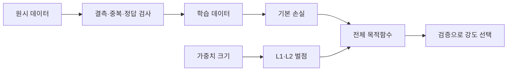

# 06. 정규화와 데이터 품질

## 복잡도를 줄이는 일과 데이터를 고치는 일을 구분하기

**정규화(regularization)**는 training loss만 줄이는 대신 모델 복잡도에 비용을 붙여 새 데이터 성능을 돕는 방법이다. 한국어에서 normalization도 정규화라고 번역되지만, 입력 scale을 맞추는 normalization과 complexity penalty인 regularization은 다른 개념이다.

**L2 penalty**는 weight 제곱합 `λΣw_j²`을 loss에 더한다. Weight `[3,4]`, λ=0.01이면 penalty는 `0.01×25=0.25`다. 큰 weight를 더 강하게 벌주어 0 쪽으로 부드럽게 **축소(shrinkage)**한다.

**L1 penalty**는 절댓값합 `λΣ|w_j|`이다. 같은 weight에서 `0.01×7=0.07`이다. 0 근처에서도 일정한 방향의 힘을 주어 일부 weight가 정확히 0이 되는 sparse 해를 만들 수 있다. L1과 L2의 수치가 작다고 어느 쪽이 항상 약한 것은 아니다. λ scale과 loss 정의가 다르다.

Training MSE가 0.20인 두 후보를 보자.

```text
A weights=[3,4], L2 objective=0.20+0.25=0.45
B weights=[1,1], L2 objective=0.20+0.02=0.22
```

Regularized objective는 B를 선호한다. 그러나 validation에서 실제 새 데이터 오류를 비교해 λ를 고른다. Weight가 작은 것이 자동으로 인과적으로 옳다는 뜻은 아니다.

**Outlier**는 일반 범위에서 멀리 떨어진 관측이다. Sensor 오류일 수도 있고 중요한 rare failure일 수도 있다. 무조건 삭제하면 안전 사건을 지운다. 출처, 측정 한계, 업무 의미를 확인한다.

**데이터 품질**은 결측, 중복, label 오류, 단위 불일치, sampling bias, 시간 정렬을 포함한다. Regularization은 km와 m가 섞인 열이나 잘못된 label을 고치지 않는다.

**Domain shift**는 운영 입력 분포가 training과 달라지는 상태다. 새 지역, 새 sensor, software 변경으로 생긴다. Covariate shift, label 관계 변화, class 비율 변화는 대응이 다르다.

반례: 드문 고장 10건을 outlier로 삭제하면 전체 accuracy는 올라가도 고장 recall은 0이 될 수 있다. 또 L2를 너무 크게 하면 모든 weight가 0 근처로 축소돼 underfitting이 생긴다.

AI-RAN 같은 multi-task learning에서는 여러 task를 함께 학습해 data를 공유할 수 있지만 gradient가 충돌하면 negative transfer가 생긴다. 2024 AI-RAN MTL preprint는 uncertainty weighting과 federation을 연구하지만, 특정 cell·hardware 조건의 결과를 보편 이득으로 일반화하지 않는다. Baseline 단일-task, 같은 data budget, latency·QoS를 함께 비교해야 한다.

## 유도 문제 5개

1. `[3,4]`의 L1/L2 제곱합은? **해설:** L1 합은 7, L2 제곱합은 25다. λ를 곱하기 전 값이다.
2. λ가 너무 크면? **해설:** Weight가 과도하게 줄어 training 관계도 못 배우는 underfitting이 가능하다.
3. Outlier를 언제 삭제하는가? **해설:** 오류 근거와 정책이 있을 때다. 멀다는 이유만으로 지우지 않는다.
4. Regularization이 label 오류를 고치는가? **해설:** 아니다. 복잡도를 제한할 뿐 정답의 의미를 복구하지 않는다.
5. Domain shift를 어떻게 발견하는가? **해설:** 운영 feature·label·오류 분포를 training 기준과 시간·subgroup별로 비교한다.

[← 이전](05-training-validation-and-generalization.md) · [목차](README.md) · [다음 →](07-computation-graphs-and-autograd.md)

정규화는 모델이 training data의 우연한 세부에 과도하게 맞는 것을 줄이는 방법이다.

데이터 품질 문제는 모델 기법만으로 고칠 수 없다.

결측, 중복, label 오류, 표본 편향을 먼저 조사한다.

## 이 장의 목표

1. 새 용어와 수학 기호를 말로 설명한다.
2. 입력이 중간 숫자를 거쳐 결과가 되는 과정을 계산한다.
3. 계산 모형과 실제 성능 주장을 구분한다.


## 기본 단어와 기호

**regularization**는 복잡도나 parameter 크기를 제한하는 방법이다.

**L1**는 절댓값 penalty이다.

**L2**는 제곱 penalty이다.

**weight decay**는 parameter를 0 쪽으로 줄이는 update이다.

**dropout**는 training 중 activation 일부를 확률적으로 0으로 함이다.

**augmentation**는 의미를 보존하는 data 변형이다.

**missing value**는 관측되지 않은 값이다.

**outlier**는 일반 범위에서 크게 벗어난 값이다.

**duplicate**는 같거나 매우 유사한 반복 sample이다.

**label noise**는 잘못되거나 애매한 정답이다.

**class imbalance**는 class 빈도 차이가 큰 상태이다.

**data provenance**는 data 출처와 처리 이력이다.

기호를 읽을 때 이름, shape, 단위, 생성 주체를 함께 적는다.

## 왜 필요한가

- 복잡한 모델은 noise까지 외울 수 있다.
- L1과 L2는 같은 penalty가 아니다.
- Dropout은 training과 evaluation 동작이 다르다.
- 나쁜 label을 더 오래 학습하면 오류를 더 잘 외울 수 있다.

## 입력에서 결과까지

1. Data source와 consent를 기록한다.
2. 중복 단위를 정의해 train/test 중복을 찾는다.
3. 결측값의 원인과 비율을 조사한다.
4. Label 작성 기준과 disagreement를 측정한다.
5. Baseline과 regularized 후보를 만든다.
6. Validation으로 penalty 강도를 고른다.
7. Evaluation에서 dropout을 끄고 일관된 동작을 쓴다.
8. Subgroup와 rare class 오류를 보고한다.



## 작은 숫자로 한 번 계산하기

Training loss=0.20인 모델의 weight가 [3,4]다.

L2 penalty 계수 λ=0.01이다.

제곱합=3²+4²=25다.

Penalty=0.01×25=0.25다.

전체 목적함수=0.20+0.25=0.45다.

Weight [0,5]도 제곱합 25라 L2 penalty는 같다.

L1은 [3,4]에서 0.01×7=0.07이다.

Penalty의 단위와 평균 기준을 구현과 맞춘다.

| 구분 | 값 또는 책임 |
|---|---|
| 문제 | 첫 확인 |
| 결측 | 발생 주체·비율 |
| 중복 | split 간 identity |
| label 오류 | 작성 기준·합의도 |

## 계산을 거꾸로 점검하기

결과가 이상하면 마지막 값만 보지 않는다.

입력의 단위와 shape가 맞는지 먼저 확인한다.

중간값을 손으로 다시 계산한다.

Training 중 바뀌는 parameter와 고정된 data를 구별한다.

평가 data가 선택 과정에 들어갔는지 확인한다.

숫자의 분모와 평균 범위를 적는다.

## 실제 시스템으로 확장할 때

작은 예제는 원리를 고립시켜 보여 준다.

실제 system은 noise, queue, concurrency, finite precision을 포함한다.

Data 수집과 label 생성 지연도 성능에 포함한다.

Version, seed, split, metric 정의를 기록한다.

평균과 tail, subgroup 결과를 함께 본다.

실패와 timeout을 결과에서 지우지 않는다.

## 흔한 오해와 반례

- Regularization은 data 오류를 자동 수정하지 않는다.
- Dropout을 evaluation에서도 무작위로 켜면 결과가 흔들린다.
- Class weight는 새 minority sample을 만들지 않는다.
- Outlier를 무조건 삭제하면 중요한 rare event를 잃을 수 있다.

## 확인 문제와 해설

### 문제 1

L2가 큰 weight에 더 큰 벌을 주는 이유는?

**해설:** 제곱하므로 크기가 커질수록 penalty가 빠르게 증가한다.

### 문제 2

Dropout의 train/eval 차이는?

**해설:** Training은 일부 activation을 무작위로 끄고 evaluation은 보통 모두 사용하도록 동작을 전환한다.

### 문제 3

Provenance가 필요한 이유는?

**해설:** 오류·권한·변경 원인을 추적하고 재현하기 위해서다.

## 학습 체크리스트

- 모든 약어를 첫 등장에 풀어 썼는가?
- 수학 기호가 가리키는 값과 단위가 명확한가?
- 입력과 label의 시각 경계가 명확한가?
- Parameter를 바꾸는 주체를 설명했는가?
- Validation과 test의 책임을 나눴는가?
- Baseline과 실패 조건을 기록했는가?

## 공식 자료

- [ISLP 2023](https://www.statlearning.com/home)
- [Dive into Deep Learning: Generalization](https://d2l.ai/chapter_linear-regression/generalization.html)

공식 근거 확인일: **2026-10-11**.

[← 이전](05-training-validation-and-generalization.md) · [목차](README.md) · [다음 →](07-computation-graphs-and-autograd.md)
