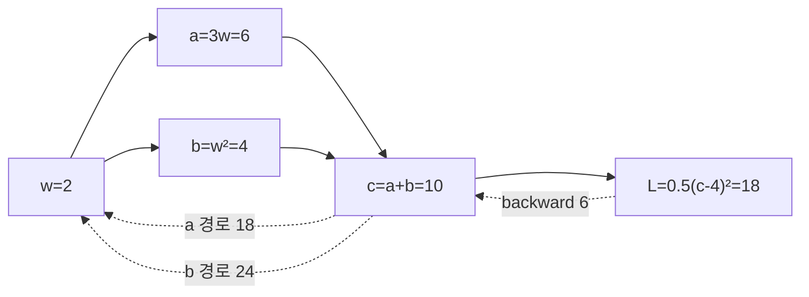
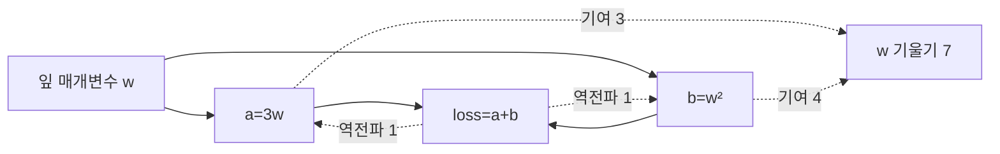

# 07. 계산 graph와 자동미분
## 먼저 실제 대상을 정의한다


**Tensor**는 숫자를 여러 축으로 배열한 메모리 객체다. 숫자 하나는 0차원 tensor, `[2,3]`은 1차원 tensor, 표본 4개와 특징 3개를 담은 표는 shape `(4,3)`인 2차원 tensor다. **Shape**는 각 축의 길이다. Tensor는 값뿐 아니라 자료형, 장치 위치, 기울기 추적 여부를 가진다.

**계산 그래프(computation graph)**는 tensor를 만든 연산과 의존 관계를 기록한 구조다. 여기서 graph는 점과 화살표의 수학 구조이며 그림 파일이 아니다. **Node**는 tensor나 연산, **edge**는 한 연산의 출력이 다음 연산의 입력이 되는 의존 관계다. 컴퓨터 통신망도 network라고 부르지만 이 장의 **신경망(neural network)**은 숫자 변환 층을 연결한 모델이며 packet을 전달하는 통신망과 다르다.

**자동미분(autograd)**은 입력에서 출력으로 진행하는 **순전파(forward)** 때 필요한 연산 관계를 기록하고, 출력의 미분에서 입력 방향으로 거슬러 가는 **역전파(backward)** 때 미분을 자동 계산하는 기능이다. 자동미분은 수식의 의미를 이해하는 인공지능이 아니라, 각 연산의 바로 앞 입력에 대한 변화율인 **국소 미분(local derivative)**과 경로별 변화율을 연결하는 **연쇄법칙(chain rule)**을 기계적으로 적용한다. 아래에서 갈라지는 경로까지 숫자로 계산한다.

## 미분, 편미분, 기울기, 연쇄법칙

**미분(derivative)**은 입력을 아주 조금 바꿀 때 출력이 얼마나 변하는지 나타내는 순간 변화율이다. 여러 입력 중 하나만 바꾸고 나머지를 고정한 미분이 **편미분(partial derivative)**다. **기울기(gradient)**는 모든 매개변수의 편미분을 같은 순서로 묶은 tensor다.

**국소 미분(local derivative)**은 한 연산이 바로 앞 입력에 대해 갖는 변화율이다. **연쇄법칙(chain rule)**은 먼 매개변수의 영향을 구할 때 경로를 따라 국소 미분을 곱하는 규칙이다. `w→a→L`에서 `∂L/∂w=(∂L/∂a)(∂a/∂w)`다. 하나의 값이 여러 경로로 갈라졌다 다시 합쳐지면 각 경로의 기여를 더한다.

## 갈라지는 그래프를 전부 계산한다

매개변수 `w=2`에서 다음 계산을 보자.

```text
a = 3w = 6
b = w² = 4
c = a+b = 10
L = 0.5(c-4)² = 18
```

**Forward pass**, 즉 순전파는 입력과 매개변수에서 중간값과 손실을 계산하는 과정이다. 메모리에는 w=2, a=6, b=4, c=10, L=18과 각 값을 만든 연산 관계가 남는다.

**Backward pass**, 즉 역전파는 손실에서 시작해 연쇄법칙을 반대 방향으로 적용하는 과정이다. `∂L/∂L=1`에서 시작한다.

| 역방향 단계 | 국소 미분 | 들어온 기울기 | 앞 값으로 보낼 기여 |
| --- | ---: | ---: | ---: |
| `L=0.5(c-4)²` | `∂L/∂c=c-4=6` | 1 | 6 |
| `c=a+b`의 a 경로 | `∂c/∂a=1` | 6 | 6 |
| `c=a+b`의 b 경로 | `∂c/∂b=1` | 6 | 6 |
| `a=3w` | `∂a/∂w=3` | 6 | 18 |
| `b=w²` | `∂b/∂w=2w=4` | 6 | 24 |
| w에 합산 | 두 경로 합 | 18,24 | 42 |

따라서 `w.grad=42`다. **Gradient buffer**는 이 숫자를 저장하는 tensor 공간이다. 역전파는 w 값을 바꾸지 않는다. 학습률 0.01인 최적화 알고리즘이 `w←2-0.01×42=1.58`을 실행해야 갱신된다.



## 작은 신경망의 모든 중간값과 기울기

**Neuron**, 즉 인공 뉴런은 입력의 가중합에 편향을 더하고 활성 함수를 적용해 출력 하나를 만드는 계산 단위다. **Layer**, 즉 층은 여러 뉴런을 나란히 묶어 vector를 vector로 바꾸는 단계다. **활성 함수(activation function)**는 선형 점수를 비선형으로 바꿔 여러 층이 굽은 경계를 표현하게 한다.

입력 `x=2`, 정답 `y=1`인 한 표본을 사용한다. 첫 가중치 `w1=0.5`, 편향 `b1=0`, 출력 가중치 `w2=1`, 편향 `b2=0`이다. 활성 함수는 ReLU `h=max(0,z1)`, 출력은 `ŷ=w2h+b2`, 손실은 `L=0.5(ŷ-y)²`다.

순전파:
- `z1=w1x+b1=0.5×2+0=1`
- `h=ReLU(1)=1`
- `ŷ=1×1+0=1`
- `L=0.5(1-1)²=0`

이 경우 기울기가 모두 0이라 갱신을 배우기 어렵다. 정답을 `y=3`으로 바꿔 같은 계산을 한다.

- `z1=1`, `h=1`, `ŷ=1`, `L=0.5(1-3)²=2`
- `∂L/∂ŷ=ŷ-y=-2`
- `∂L/∂w2=(∂L/∂ŷ)h=-2`
- `∂L/∂b2=-2`
- `∂L/∂h=(∂L/∂ŷ)w2=-2`
- ReLU 입력 z1이 양수라 `∂h/∂z1=1`
- `∂L/∂z1=-2`
- `∂L/∂w1=(∂L/∂z1)x=-4`
- `∂L/∂b1=-2`

학습률 0.1이면 `w2=1.2`, `b2=0.2`, `w1=0.9`, `b1=0.2`가 된다. 새 순전파는 `z1=2.0`, `h=2.0`, `ŷ=2.6`, `L=0.5(2.6-3)²=0.08`이다. 손실이 2에서 0.08로 줄었다.

## 저장된 tensor와 version

Backward 계산에는 forward 당시 값이 필요하다. `w²`의 미분은 `2w`이므로 당시 w를 저장해야 한다. ReLU backward는 당시 입력이 양수였는지 알아야 한다. Autograd engine은 필요한 tensor 또는 metadata를 graph에 보존한다.

Forward 뒤 같은 tensor를 제자리에서 바꾸는 **in-place operation**은 저장된 값과 현재 값의 관계를 깨뜨릴 수 있다. Framework는 version counter로 변경을 감지해 오류를 내기도 한다. 오류를 피하려고 무조건 복사하면 메모리는 늘어난다. 어떤 값이 backward에 필요한지 이해해야 한다.

## 기울기 누적과 초기화

많은 framework는 backward를 호출할 때 기존 gradient buffer에 더한다. 첫 microbatch 기울기 42, 둘째 -10이면 buffer는 32가 된다. **Microbatch**는 메모리 때문에 큰 batch를 나눈 작은 묶음이다. 의도한 gradient accumulation이면 여러 microbatch의 합 또는 평균을 한 optimizer step에 사용한다.

새 step인데 buffer를 0으로 만들지 않으면 이전 step 기울기가 섞인다. 반대로 accumulation 중간에 0으로 만들면 큰 batch 효과가 사라진다. Loss를 microbatch 수로 나눌지, optimizer 직전에 평균낼지 규칙을 일관되게 정한다.

## Detach와 no-grad

**Detach**는 tensor 값을 공유하되 이전 graph로 기울기가 흐르지 않는 새 관점을 만든다. **No-grad**는 그 범위에서 gradient graph 기록을 끄는 실행 모드다. 평가에서 graph를 만들 필요가 없으면 메모리를 줄일 수 있다.

Detach를 잘못 쓰면 학습해야 할 경로가 끊겨 gradient가 None 또는 0이 된다. Metric 계산에만 필요한 tensor를 분리하는 것과 model output 자체를 분리하는 것을 구분한다.

## 수치 gradient check

자동미분을 검증하려면 작은 문제에서 finite difference를 쓸 수 있다. `f(w)`의 미분을 `(f(w+ε)-f(w-ε))/(2ε)`로 근사한다. 위 `L(w)`에서 ε=0.0001로 계산한 값이 42에 가까워야 한다.

ε가 너무 크면 근사 오차, 너무 작으면 floating-point 반올림 오차가 커진다. Gradient check는 작은 double precision 예제에 유용하지만 큰 network 전체 training을 대신하지 않는다.

## 실패 반례와 연구 연결

Graph가 연결돼 있다고 parameter가 optimizer 목록에 자동 포함된다고 가정하지 않는다. Parameter가 graph에서 gradient를 받아도 optimizer가 참조하지 않으면 갱신되지 않는다. 반대로 optimizer에 있어도 forward에 사용되지 않으면 gradient가 없다.

`w.grad=0`은 최솟값, ReLU의 0 영역, 경로 단절, 상쇄 등 여러 원인이 가능하다. Autograd 성공은 model이 올바른 목적을 학습한다는 뜻이 아니다. 잘못된 label이나 leakage도 정확히 미분한다.

새 autograd 시스템 연구는 연산 지원 범위, graph capture 비용, backward throughput, memory, numerical correctness 조건을 함께 본다. 작은 benchmark 속도를 모든 model에 일반화하지 않는다.

## 벡터 출력과 Jacobian

출력이 숫자 하나가 아니라 vector이면 각 출력이 각 입력에 얼마나 민감한지를 표로 모을 수 있다. 이를 **Jacobian**이라고 한다. `y1=x1+x2`, `y2=x1x2`에서 x=[2,3]이면 Jacobian은 `[[1,1],[3,2]]`다. 첫 행은 y1의 두 편미분, 둘째 행은 y2의 두 편미분이다.

학습의 loss는 보통 scalar 하나이므로 backward는 loss에서 각 parameter로 가는 vector-Jacobian product를 효율적으로 계산한다. 전체 Jacobian 행렬을 메모리에 만들 필요가 없다. Autograd가 빠른 이유를 “미분 공식이 사라졌다”가 아니라 필요한 곱을 graph 역순으로 계산하기 때문이라고 이해한다.

## 동적 graph와 제어 흐름

입력 값에 따라 if branch나 loop 횟수가 달라지면 실행된 연산 graph도 달라질 수 있다. **동적 graph**는 실제 실행 경로에서 graph를 기록한다. 첫 표본은 ReLU 양수 경로, 둘째는 음수 경로를 타면 backward에 남는 연산과 gradient가 다르다.

Graph compile이나 capture는 반복되는 구조를 최적화할 수 있지만 data-dependent Python 동작, in-place 수정, 지원되지 않는 operation이 graph break를 만들 수 있다. Compile 성공은 수치 결과가 맞다는 보장이 아니므로 eager 실행과 forward·gradient를 비교한다.

## 메모리 수명과 checkpointing

Forward 중간 tensor를 모두 저장하면 backward는 빠르지만 메모리를 많이 쓴다. **Activation checkpointing**은 일부 중간값을 버리고 backward 때 forward 일부를 다시 계산해 메모리를 줄이는 기법이다. 이름이 model weight를 저장하는 checkpoint와 같지만 대상이 다르다.

Forward 4개 구간이 각각 활성값 2 GiB를 저장하면 단순 합은 8 GiB다. 두 구간만 저장하고 나머지를 재계산하면 저장 메모리는 줄지만 계산 시간이 늘어난다. Random dropout과 stateful operation은 재계산 때 같은 결과를 내도록 RNG 상태를 관리해야 한다.

Graph를 필요 이상 오래 참조하면 saved tensor도 해제되지 않아 메모리 누수가 생길 수 있다. Log 목록에 loss tensor 자체를 계속 넣는 대신 숫자 값만 꺼내 보존하는 이유다.

## 자동미분이 놓치지 못하는 의미 오류

자동미분은 실행된 수식의 미분을 계산할 뿐, 그 수식이 연구 질문에 맞는지는 판단하지 않는다. 정답을 잘못 한 칸 이동해 입력과 다른 시점 label을 연결해도 graph와 gradient는 정상 생성된다. 손실이 줄어도 목표 정의가 틀릴 수 있다.

또한 integer index, 비교 연산, argmax처럼 매끄럽게 미분되지 않는 선택을 경로 중간에 넣으면 그 선택 자체를 gradient로 학습할 수 없다. 연속 relaxation이나 다른 estimator가 필요할 수 있으며, 이를 썼다면 근사 가정과 bias를 기록한다.

분산 학습에서는 각 process가 계산한 gradient를 통신으로 합칠 수 있다. Autograd graph 계산과 network all-reduce는 다른 단계다. 한 process의 graph가 맞아도 통신 누락, scale 오류, parameter 순서 불일치로 전체 update가 달라질 수 있다.

## 추가 완전 풀이 문제

### 문제 4

`u=2w`, `v=u²`, `L=3v`, w=1일 때 `dL/dw`는?

**해설:** `dL/dv=3`, `dv/du=2u=4`, `du/dw=2`다. 곱하면 `3×4×2=24`다.

### 문제 5

한 w가 두 경로에서 5와 -2를 받으면 최종 gradient는?

**해설:** 갈라진 경로 기여를 더해 3이다. 하나만 고르면 chain rule graph 계산이 틀린다.

### 문제 6

첫 microbatch gradient 6, 둘째 10을 평균내 한 step에 쓰려면 값은?

**해설:** `(6+10)/2=8`이다. Loss를 미리 절반씩 scale했다면 buffer 합이 이미 8이므로 다시 나누지 않는다.

### 문제 7

Forward 뒤 parameter를 in-place로 바꿨더니 backward 오류가 났다. 왜?

**해설:** backward가 forward 당시 값을 필요로 하는데 tensor version이 달라졌다. 저장값과 수정 시점을 확인하고 안전한 갱신은 no-grad optimizer 단계에서 수행한다.

## 갈라졌다 합쳐지는 graph를 순서대로 역전파하기

**Node**는 tensor 값이나 연산을 나타내고 **edge**는 한 값이 다음 연산의 입력이 되는 의존 관계다. **Local derivative**는 한 연산이 자기 입력을 조금 바꿨을 때 출력을 얼마나 바꾸는지 나타낸다. **Chain rule**은 경로의 local derivative를 곱해 먼 parameter가 loss에 미치는 영향을 구한다.

```text
w=2
a=3w=6
b=w²=4
c=a+b=10
loss=0.5(c-4)²=18
```

Backward는 loss에서 1로 시작한다. `dL/dc=c-4=6`이다. 덧셈 c=a+b의 local derivative는 두 입력 모두 1이므로 `dL/da=6`, `dL/db=6`이다.

a=3w 경로는 `da/dw=3`이므로 w에 `6×3=18`을 보낸다. b=w² 경로는 `db/dw=2w=4`이므로 `6×4=24`를 보낸다. 같은 leaf w로 온 두 기여를 더해 `w.grad=42`다.

**Gradient buffer**는 이 42를 저장하는 공간이다. Backward가 끝나도 w 값은 아직 2다. Optimizer가 학습률 0.01로 `w←w-0.01×42=1.58`을 수행해야 parameter가 바뀐다.

여러 microbatch에서 backward를 호출하면 framework는 기본적으로 같은 buffer에 더할 수 있다. 첫 batch gradient 42, 둘째 -10이면 buffer는 32다. 의도한 accumulation이면 평균·분모를 맞추고, 새 step이면 먼저 buffer를 0으로 만든다.

Forward 때 b=w²의 backward에는 당시 w가 필요하다. Autograd는 필요한 값을 saved tensor나 context에 보관할 수 있다. Backward 전 w를 제자리 수정하면 version 불일치나 잘못된 gradient 위험이 있다.

`requires_grad`가 켜진 입력이 기록 가능한 연산을 지나야 grad_fn 관계가 생긴다. No-grad 영역이나 gradient가 필요 없는 입력에서는 graph가 기록되지 않을 수 있다. PyTorch main 문서는 개발 문서이므로 특정 출시 version의 고정 API라고 단정하지 않는다.

반례로 autograd가 42를 정확히 계산해도 모델 식, label, loss가 잘못됐으면 학습은 잘못된다. Autograd는 기록된 graph의 미분을 수행하지 연구 문제의 타당성을 보장하지 않는다.

## 유도 문제 5개

1. 두 경로가 w에 5와 -2를 보내면? **해설:** 같은 leaf gradient는 더해져 3이다.
2. Backward 직후 w는 바뀌는가? **해설:** 아니다. Buffer만 채우고 optimizer update가 별도다.
3. 두 batch gradient 4와 6을 평균 누적하면? **해설:** 합 10을 batch 수 2로 나눠 5를 optimizer에 사용한다.
4. Saved tensor가 필요한 이유는? **해설:** local derivative가 forward 당시 입력·출력을 필요로 할 수 있다.
5. Gradient가 정확하면 모델도 옳은가? **해설:** 아니다. 식과 data 의미가 잘못돼도 그 graph의 미분은 정확할 수 있다.

[← 이전](06-regularization-and-data-quality.md) · [목차](README.md) · [다음 →](08-neural-networks-and-activations.md)

계산 graph는 값이 어떤 연산을 거쳐 loss가 되었는지 나타낸다.

자동미분은 기록된 연산의 미분 규칙과 chain rule로 gradient를 계산한다.

Optimizer는 그 gradient를 읽어 parameter를 갱신하는 별도 단계다.

## 입력에서 결과까지

1. Parameter가 requires-grad 상태로 forward에 들어간다.
2. 연산이 결과와 backward 관계를 기록한다.
3. Loss scalar를 계산한다.
4. Backward가 loss gradient 1에서 시작한다.
5. 각 node가 local derivative를 적용한다.
6. Chain rule로 upstream gradient를 전달한다.
7. 같은 leaf로 오는 gradient를 합한다.
8. Optimizer가 leaf gradient를 읽어 parameter를 갱신한다.



## 작은 숫자로 한 번 계산하기

w=2, a=3w, b=w², loss=a+b다.

Forward에서 a=6, b=4, loss=10이다.

a 경로의 dloss/dw=3이다.

b 경로의 dloss/dw=2w=4다.

두 경로를 더해 w gradient=7이다.

학습률 0.1이면 SGD 새 w=2-0.1×7=1.3이다.

Backward만 호출한 시점에는 w는 아직 2다.

Optimizer step이 실행돼야 1.3으로 바뀐다.

| 구분 | 값 또는 책임 |
|---|---|
| Forward | 값과 graph 생성 |
| Backward | gradient 계산 |
| Optimizer | parameter 갱신 |
| Zero-grad | 이전 gradient 정리 |

## 흔한 오해와 반례

- grad_fn이 있다는 사실은 모델이 올바르다는 보장이 아니다.
- Backward가 parameter를 자동 갱신한다고 생각하면 안 된다.
- Gradient buffer를 비우지 않으면 의도치 않게 누적될 수 있다.
- PyTorch main 개발 문서를 특정 출시 version의 고정 동작이라고 주장하지 않는다.

## 확인 문제와 해설

### 문제 1

두 경로 gradient 3과 4가 만나면?

**해설:** 같은 parameter에 대한 총 gradient는 7로 더해진다.

### 문제 2

Backward 뒤 optimizer 전 parameter는?

**해설:** 아직 기존 값이다. Gradient buffer만 계산됐다.

### 문제 3

saved tensor가 필요한 이유는?

**해설:** Backward 미분에 forward 당시 값이 필요할 수 있기 때문이다.

## 공식 자료

- [ISLP 2023](https://www.statlearning.com/home)
- [Dive into Deep Learning: Generalization](https://d2l.ai/chapter_linear-regression/generalization.html)
- [PyTorch Autograd](https://docs.pytorch.org/docs/main/autograd.html) — main 개발 문서이며 특정 출시 version으로 단정하지 않는다.

공식 근거 확인일: **2026-10-11**.

[← 이전](06-regularization-and-data-quality.md) · [목차](README.md) · [다음 →](08-neural-networks-and-activations.md)
