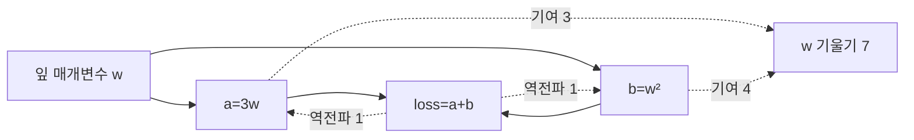

# 07. 계산 graph와 자동미분

## 갈라졌다 합쳐지는 graph를 순서대로 역전파하기

**Node**는 tensor 값이나 연산을 나타내고 **edge**는 한 값이 다음 연산의 입력이 되는 의존 관계다. **Local derivative**는 한 연산이 자기 입력을 조금 바꿨을 때 출력을 얼마나 바꾸는지 나타낸다. **Chain rule**은 경로의 local derivative를 곱해 먼 parameter가 loss에 미치는 영향을 구한다.

```text
w=2
a=3w=6
b=w²=4
c=a+b=10
loss=0.5(c-4)²=18
```

Backward는 loss에서 1로 시작한다. `dL/dc=c-4=6`이다. 덧셈 c=a+b의 local derivative는 두 입력 모두 1이므로 `dL/da=6`, `dL/db=6`이다.

a=3w 경로는 `da/dw=3`이므로 w에 `6×3=18`을 보낸다. b=w² 경로는 `db/dw=2w=4`이므로 `6×4=24`를 보낸다. 같은 leaf w로 온 두 기여를 더해 `w.grad=42`다.

**Gradient buffer**는 이 42를 저장하는 공간이다. Backward가 끝나도 w 값은 아직 2다. Optimizer가 학습률 0.01로 `w←w-0.01×42=1.58`을 수행해야 parameter가 바뀐다.

여러 microbatch에서 backward를 호출하면 framework는 기본적으로 같은 buffer에 더할 수 있다. 첫 batch gradient 42, 둘째 -10이면 buffer는 32다. 의도한 accumulation이면 평균·분모를 맞추고, 새 step이면 먼저 buffer를 0으로 만든다.

Forward 때 b=w²의 backward에는 당시 w가 필요하다. Autograd는 필요한 값을 saved tensor나 context에 보관할 수 있다. Backward 전 w를 제자리 수정하면 version 불일치나 잘못된 gradient 위험이 있다.

`requires_grad`가 켜진 입력이 기록 가능한 연산을 지나야 grad_fn 관계가 생긴다. No-grad 영역이나 gradient가 필요 없는 입력에서는 graph가 기록되지 않을 수 있다. PyTorch main 문서는 개발 문서이므로 특정 출시 version의 고정 API라고 단정하지 않는다.

반례로 autograd가 42를 정확히 계산해도 모델 식, label, loss가 잘못됐으면 학습은 잘못된다. Autograd는 기록된 graph의 미분을 수행하지 연구 문제의 타당성을 보장하지 않는다.

## 유도 문제 5개

1. 두 경로가 w에 5와 -2를 보내면? **해설:** 같은 leaf gradient는 더해져 3이다.
2. Backward 직후 w는 바뀌는가? **해설:** 아니다. Buffer만 채우고 optimizer update가 별도다.
3. 두 batch gradient 4와 6을 평균 누적하면? **해설:** 합 10을 batch 수 2로 나눠 5를 optimizer에 사용한다.
4. Saved tensor가 필요한 이유는? **해설:** local derivative가 forward 당시 입력·출력을 필요로 할 수 있다.
5. Gradient가 정확하면 모델도 옳은가? **해설:** 아니다. 식과 data 의미가 잘못돼도 그 graph의 미분은 정확할 수 있다.

[← 이전](06-regularization-and-data-quality.md) · [목차](README.md) · [다음 →](08-neural-networks-and-activations.md)

계산 graph는 값이 어떤 연산을 거쳐 loss가 되었는지 나타낸다.

자동미분은 기록된 연산의 미분 규칙과 chain rule로 gradient를 계산한다.

Optimizer는 그 gradient를 읽어 parameter를 갱신하는 별도 단계다.

## 이 장의 목표

1. 새 용어와 수학 기호를 말로 설명한다.
2. 입력이 중간 숫자를 거쳐 결과가 되는 과정을 계산한다.
3. 계산 모형과 실제 성능 주장을 구분한다.


## 기본 단어와 기호

**node**는 값 또는 연산을 나타내는 지점이다.

**edge**는 값의 의존 관계이다.

**forward**는 입력에서 출력·loss로 계산이다.

**backward**는 loss에서 parameter 방향으로 gradient 계산이다.

**autograd**는 자동미분 engine이다.

**grad_fn**는 기록된 연산과 연결된 backward 정보이다.

**leaf tensor**는 사용자가 만든 parameter 같은 graph 시작 값이다.

**requires_grad**는 gradient 기록 요청이다.

**saved tensor**는 backward에 필요한 forward 값이다.

**chain rule**는 연결된 미분을 곱하는 규칙이다.

**gradient accumulation**는 여러 경로의 gradient를 더함이다.

**optimizer**는 gradient로 parameter를 갱신하는 규칙이다.

기호를 읽을 때 이름, shape, 단위, 생성 주체를 함께 적는다.

## 왜 필요한가

- 중간값을 알아야 일부 backward를 계산할 수 있다.
- 같은 parameter가 두 경로에 쓰이면 gradient 기여를 더한다.
- Autograd가 계산한 gradient가 곧 parameter update는 아니다.
- 기록 조건과 no-grad context에 따라 grad_fn이 생기지 않을 수 있다.

## 입력에서 결과까지

1. Parameter가 requires-grad 상태로 forward에 들어간다.
2. 연산이 결과와 backward 관계를 기록한다.
3. Loss scalar를 계산한다.
4. Backward가 loss gradient 1에서 시작한다.
5. 각 node가 local derivative를 적용한다.
6. Chain rule로 upstream gradient를 전달한다.
7. 같은 leaf로 오는 gradient를 합한다.
8. Optimizer가 leaf gradient를 읽어 parameter를 갱신한다.



## 작은 숫자로 한 번 계산하기

w=2, a=3w, b=w², loss=a+b다.

Forward에서 a=6, b=4, loss=10이다.

a 경로의 dloss/dw=3이다.

b 경로의 dloss/dw=2w=4다.

두 경로를 더해 w gradient=7이다.

학습률 0.1이면 SGD 새 w=2-0.1×7=1.3이다.

Backward만 호출한 시점에는 w는 아직 2다.

Optimizer step이 실행돼야 1.3으로 바뀐다.

| 구분 | 값 또는 책임 |
|---|---|
| Forward | 값과 graph 생성 |
| Backward | gradient 계산 |
| Optimizer | parameter 갱신 |
| Zero-grad | 이전 gradient 정리 |

## 계산을 거꾸로 점검하기

결과가 이상하면 마지막 값만 보지 않는다.

입력의 단위와 shape가 맞는지 먼저 확인한다.

중간값을 손으로 다시 계산한다.

Training 중 바뀌는 parameter와 고정된 data를 구별한다.

평가 data가 선택 과정에 들어갔는지 확인한다.

숫자의 분모와 평균 범위를 적는다.

## 실제 시스템으로 확장할 때

작은 예제는 원리를 고립시켜 보여 준다.

실제 system은 noise, queue, concurrency, finite precision을 포함한다.

Data 수집과 label 생성 지연도 성능에 포함한다.

Version, seed, split, metric 정의를 기록한다.

평균과 tail, subgroup 결과를 함께 본다.

실패와 timeout을 결과에서 지우지 않는다.

## 흔한 오해와 반례

- grad_fn이 있다는 사실은 모델이 올바르다는 보장이 아니다.
- Backward가 parameter를 자동 갱신한다고 생각하면 안 된다.
- Gradient buffer를 비우지 않으면 의도치 않게 누적될 수 있다.
- PyTorch main 개발 문서를 특정 출시 version의 고정 동작이라고 주장하지 않는다.

## 확인 문제와 해설

### 문제 1

두 경로 gradient 3과 4가 만나면?

**해설:** 같은 parameter에 대한 총 gradient는 7로 더해진다.

### 문제 2

Backward 뒤 optimizer 전 parameter는?

**해설:** 아직 기존 값이다. Gradient buffer만 계산됐다.

### 문제 3

saved tensor가 필요한 이유는?

**해설:** Backward 미분에 forward 당시 값이 필요할 수 있기 때문이다.

## 학습 체크리스트

- 모든 약어를 첫 등장에 풀어 썼는가?
- 수학 기호가 가리키는 값과 단위가 명확한가?
- 입력과 label의 시각 경계가 명확한가?
- Parameter를 바꾸는 주체를 설명했는가?
- Validation과 test의 책임을 나눴는가?
- Baseline과 실패 조건을 기록했는가?

## 공식 자료

- [ISLP 2023](https://www.statlearning.com/home)
- [Dive into Deep Learning: Generalization](https://d2l.ai/chapter_linear-regression/generalization.html)
- [PyTorch Autograd](https://docs.pytorch.org/docs/main/autograd.html) — main 개발 문서이며 특정 출시 version으로 단정하지 않는다.

공식 근거 확인일: **2026-10-11**.

[← 이전](06-regularization-and-data-quality.md) · [목차](README.md) · [다음 →](08-neural-networks-and-activations.md)
