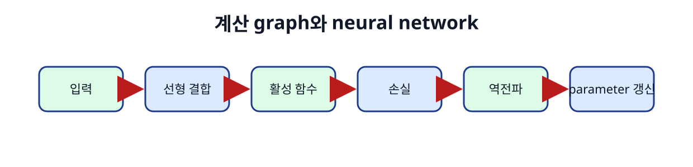
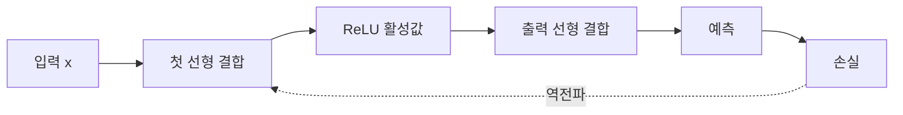

# 08. 신경망과 활성 함수

[← 이전](07-computation-graphs-and-autograd.md) · [목차](README.md) · [다음 →](09-convolutions-and-sequence-models.md)

신경망은 선형 변환과 비선형 활성 함수를 여러 층 연결한 모델이다.

Neuron은 입력의 가중합을 만들고 activation을 적용하는 계산 단위다.

깊은 모델의 표현력은 층 수만 아니라 data, optimization, 구조에 달려 있다.

## 이 장의 목표

1. 처음 나오는 단어와 기호를 설명한다.
2. 작은 입력의 모든 중간값을 계산한다.
3. 계산 결과와 실제 system 주장을 구분한다.

## 기본 단어와 기호

**neuron**는 가중합과 activation 계산 단위이다.

**layer**는 여러 neuron 계산 묶음이다.

**input layer**는 외부 feature가 들어오는 자리이다.

**hidden layer**는 중간 표현을 만드는 층이다.

**output layer**는 예측을 만드는 마지막 층이다.

**activation**는 선형 결합에 비선형성을 더하는 함수이다.

**ReLU**는 max(0,x) 함수이다.

**sigmoid**는 값을 0~1로 압축이다.

**tanh**는 값을 -1~1로 압축이다.

**parameter count**는 학습되는 weight와 bias 수이다.

**width**는 층의 neuron 수이다.

**depth**는 연결된 층 수이다.

## 왜 필요한가

- Activation이 없으면 여러 선형층도 하나의 선형 변환으로 합쳐진다.
- ReLU는 양수 gradient 전달이 단순하지만 음수 영역이 0이다.
- Sigmoid는 큰 절댓값에서 gradient가 작아질 수 있다.
- Parameter 수는 memory와 과적합 가능성에 영향을 준다.

## 입력에서 결과까지

1. 입력 vector를 읽는다.
2. 첫 linear layer가 weighted sum을 계산한다.
3. Activation이 hidden representation을 만든다.
4. 다음 layer가 hidden 값을 다시 결합한다.
5. Output layer가 logit 또는 회귀값을 만든다.
6. Loss가 target과 비교한다.
7. Backward가 각 layer gradient를 계산한다.
8. Optimizer가 모든 parameter를 갱신한다.

## 작은 숫자로 한 번 계산하기

x=[2,-1]이다.

첫 neuron weight=[1,3], bias=0이다.

z=2×1+(-1)×3=-1이다.

ReLU(z)=max(0,-1)=0이다.

둘째 neuron weight=[2,-1], bias=1이다.

z2=2×2+(-1)×(-1)+1=6이다.

ReLU(z2)=6이다.

Hidden=[0,6]이다.

Output weight=[0.5,0.25]면 output=1.5다.

| 구분 | 값 또는 책임 |
|---|---|
| 입력 shape | (2,) |
| hidden width | 2 |
| 첫 층 parameter | 2×2+2=6 |
| hidden 결과 | [0,6] |

## Shape·단위·시각 점검

입력 shape를 적는다.

각 축이 sample, channel, sequence 중 무엇인지 적는다.

숫자의 단위가 dB, ms, byte, 무차원 중 무엇인지 적는다.

Model이 값을 읽는 시각에 실제로 알 수 있었는지 확인한다.

평균의 분모가 sample인지 token인지 요청인지 적는다.

Parameter와 관측값을 구분한다.

## 구현에서 달라지는 것

Library는 여러 연산을 합쳐 실행할 수 있다.

Memory allocator와 queue가 추가 지연을 만든다.

Finite precision 때문에 손계산과 마지막 자리에서 다를 수 있다.

Version이 바뀌면 API 기본값이 달라질 수 있다.

따라서 식, code, 실행 환경을 함께 기록한다.

## 흔한 오해와 반례

- Neuron은 생물학 neuron의 완전한 복제가 아니다.
- 깊을수록 항상 좋지 않다.
- ReLU는 모든 입력에서 미분값 1이 아니다.
- Activation output을 확률로 자동 해석하지 않는다.

## 확인 문제와 해설

### 문제 1

ReLU(-3)은?

**해설:** 0이다.

### 문제 2

입력 3, 출력 4인 linear layer parameter 수는?

**해설:** Weight 12개와 bias 4개로 16개다.

### 문제 3

Activation이 필요한 이유는?

**해설:** 비선형 관계를 여러 층에서 표현할 수 있게 하기 위해서다.

## 학습 체크리스트

- 용어를 자신의 말로 설명할 수 있는가?
- 중간 숫자를 계산할 수 있는가?
- 누가 값을 바꾸는지 말할 수 있는가?
- 반례와 실패 조건을 말할 수 있는가?
- 독립 test와 운영 평가를 구분하는가?

## 공식 자료

- [ISLP 2023](https://www.statlearning.com/home)
- [Dive into Deep Learning](https://d2l.ai/)
- [Dive into Deep Learning: Multilayer Perceptrons](https://d2l.ai/chapter_multilayer-perceptrons/index.html)

공식 근거 확인일: **2026-10-11**.

[← 이전](07-computation-graphs-and-autograd.md) · [목차](README.md) · [다음 →](09-convolutions-and-sequence-models.md)
