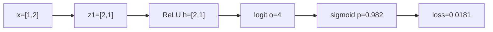
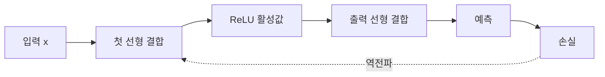

# 08. 신경망과 활성 함수
## 컴퓨터 통신망과 신경망을 먼저 구분한다


**신경망(neural network)**은 입력 숫자를 여러 계산 단계로 바꾸어 예측을 만드는 모델이다. 컴퓨터 **통신망(network)**은 장비 사이에서 packet을 전달하는 시스템이다. 같은 network라는 영어를 쓰지만 이 장에서는 학습되는 숫자 함수인 신경망을 뜻한다.

**인공 뉴런(neuron)**은 입력마다 가중치를 곱해 더하고 편향을 더한 뒤 **활성 함수(activation function)**를 적용해 출력 하나를 만드는 계산 단위다. 가중치는 각 입력에 곱하는 숫자이고, 편향은 입력과 무관하게 더하는 기본 오프셋이다. 활성 함수는 이 합을 다시 변환한다. 꺾이거나 굽은 비선형 변환을 넣어야 단순한 직선으로 표현하지 못하는 관계도 학습할 수 있다. **층(layer)**은 여러 뉴런을 나란히 모은 단계다. 층은 실행 중 메모리에 입력 숫자, 가중치와 편향, 출력 숫자를 저장한다. 이 값들을 여러 축의 배열로 표현하는 것이 다음에 설명할 텐서다.

**Tensor**는 숫자를 여러 축으로 배열한 메모리 객체다. **벡터(vector)**는 1차원 tensor, **행렬(matrix)**은 행과 열을 가진 2차원 tensor다. Shape는 각 축 길이다. 입력 `X` shape가 `(배치 2, 특징 3)`이면 표본 두 개가 각각 특징 세 개를 가진다.

## 선형층의 모든 곱을 계산한다

입력 한 개 `x=[2,-1]`, 가중치 행렬과 편향을 다음처럼 두자.

```text
W = [[1, 2],
     [3,-1]]
b = [0,1]
```

**행렬 곱**은 출력 위치마다 입력과 해당 열의 같은 위치 숫자를 곱해 더한다. 첫 출력은 `2×1+(-1)×3=-1`, 둘째는 `2×2+(-1)×(-1)=5`다. 편향을 더해 `z=[-1,6]`이다.

**선형층(linear layer)**은 바로 이 `xW+b` 계산이다. 가중치가 입력 특징과 출력 뉴런의 연결 강도를, 편향이 입력이 0일 때 출력 위치를 정한다. 선형층만 두 개 연결하면 행렬 곱이 합쳐져 결국 하나의 선형 변환이 된다. 굽은 결정 경계를 만들려면 비선형 활성 함수가 필요하다.

## 활성 함수와 미분

**활성 함수(activation function)**는 뉴런의 선형 점수 `z`를 다음 층에 보낼 값으로 바꾸는 비선형 함수다. ReLU는 `max(0,z)`다. `[-1,6]`은 `[0,6]`이 된다. 양수 영역 미분은 1, 음수 영역은 0이다. z=0의 미분은 하나로 정해지지 않아 framework가 관례를 선택한다.

Sigmoid는 `1/(1+e^{-z})`로 값을 0과 1 사이로 바꾼다. 여기서 e는 약 2.71828인 자연상수다. Tanh는 -1과 1 사이로 바꾼다. Sigmoid와 tanh는 큰 양수·음수에서 미분이 작아져 깊은 층의 기울기가 사라질 수 있다.

ReLU도 모든 문제를 해결하지 않는다. 뉴런 입력이 계속 음수면 출력과 미분이 0이라 가중치가 갱신되지 않는 **dead ReLU**가 될 수 있다. Leaky ReLU는 음수 쪽에 작은 기울기를 남기지만 그 값도 hyperparameter다.

## 작은 신경망을 손으로 순전파한다

입력 `x=[1,2]`, hidden 뉴런 두 개, 출력 하나인 신경망을 쓴다.

```text
W1 = [[1, -1],
      [0.5, 1]]
b1 = [0,0]
W2 = [[1],
      [2]]
b2 = [0]
y = 1
```

**순전파(forward pass)**는 입력에서 중간값과 예측, 손실을 계산하는 과정이다.

1. Hidden 선형값 `z1=xW1+b1`
2. 첫 성분: `1×1+2×0.5=2`
3. 둘째 성분: `1×(-1)+2×1=1`
4. ReLU 활성값 `h=[2,1]`
5. 출력 로짓 `o=hW2+b2=2×1+1×2=4`
6. Sigmoid 확률 `p=1/(1+e^-4)≈0.9820`
7. Binary cross-entropy 손실 `L=-log(p)≈0.0181`

**로짓(logit)**은 확률로 제한하기 전의 실수 점수다. **교차엔트로피(cross-entropy)**는 정답 확률이 작을수록 큰 값을 주는 손실이다. 자연로그 log는 지수함수의 역함수이며 p가 1에 가까우면 `-log(p)`는 0에 가깝다.



## 같은 신경망을 끝까지 역전파한다

**역전파(backpropagation)**는 손실에서 시작해 각 연산의 국소 미분을 거꾸로 곱하여 모든 매개변수의 기울기를 구하는 절차다. **연쇄법칙(chain rule)**은 중간 변수 경로의 민감도를 곱하는 규칙이다.

Sigmoid와 binary cross-entropy를 함께 쓰면 `∂L/∂o=p-y=0.9820-1=-0.0180`이다.

출력층:
- `∂L/∂W2 = hᵀ(∂L/∂o)=[-0.0360,-0.0180]`
- `∂L/∂b2=-0.0180`
- `∂L/∂h=(∂L/∂o)W2ᵀ=[-0.0180,-0.0360]`

두 hidden 선형값이 모두 양수였으므로 ReLU 미분은 `[1,1]`, 따라서 `∂L/∂z1=[-0.0180,-0.0360]`이다.

첫 층:
- `∂L/∂W1 = xᵀ(∂L/∂z1)`
- 첫 행은 `1×[-0.0180,-0.0360]=[-0.0180,-0.0360]`
- 둘째 행은 `2×[-0.0180,-0.0360]=[-0.0360,-0.0720]`
- `∂L/∂b1=[-0.0180,-0.0360]`

**기울기(gradient)**는 이 모든 매개변수 편미분의 묶음이다. 학습률 0.1인 **최적화 알고리즘(optimizer)**은 각 매개변수에서 `0.1×기울기`를 뺀다. 예를 들어 W2는 `[1.0036,2.0018]`, b2는 0.0018이 된다. 갱신 후 새 손실은 다시 순전파해 확인한다.

## 배치와 broadcasting

**표본(sample)**은 입력과 정답 한 쌍이고, **배치(batch)**는 한 번에 처리하는 표본 묶음이다. 표본 두 개의 입력 행렬 X shape가 `(2,2)`, W1이 `(2,2)`이면 결과는 `(2,2)`다. Bias `(2,)`는 두 행에 같은 값으로 더해진다. 이를 **broadcasting**이라고 한다.

Broadcasting은 실제로 bias 복사본을 저장하지 않고 호환되는 축에 같은 값을 적용할 수 있다. Shape가 우연히 맞아 잘못된 축으로 더해지는 버그도 있으므로 각 축 의미를 표기한다.

## 깊이·폭·표현력과 실패

**깊이(depth)**는 연속 변환 단계 수, **폭(width)**은 한 hidden layer의 뉴런 수다. 깊이와 폭을 늘리면 더 복잡한 함수를 표현할 수 있지만 항상 학습이나 일반화가 좋아지는 것은 아니다. 매개변수 수, data 양, optimizer와 regularization이 필요하다.

초기 가중치가 모두 같으면 hidden 뉴런이 같은 gradient를 받아 계속 같은 기능을 배울 수 있다. 이를 symmetry 문제라고 한다. Random initialization은 이 대칭을 깨지만 scale이 너무 크면 활성값과 gradient가 폭주하고 너무 작으면 신호가 사라진다.

Training loss는 낮지만 validation loss가 오르면 overfitting일 수 있다. Dropout, weight decay, early stopping은 도움을 줄 수 있지만 잘못된 split이나 label noise를 고치지는 않는다.

## Attention을 신경망 층의 예로 계산한다

**Token**은 문장이나 신호를 모델이 처리하는 단위다. `"나는 간다"`를 `["나는","간다"]`처럼 나눌 수 있다. **Embedding**은 token을 고정 길이 숫자 벡터로 바꾼 값이다. 세 token의 2차원 embedding을 `x1=[1,0]`, `x2=[0,1]`, `x3=[1,1]`이라 하자.

**Attention**은 각 token이 다른 token의 정보를 얼마나 섞을지 점수로 정하는 신경망 연산이다. Query(Q)는 “내가 무엇을 찾는가”, Key(K)는 “내가 어떤 특징을 제공하는가”, Value(V)는 “선택되면 전달할 내용”을 담는 벡터다. 교육용으로 Q=K=V=X, 즉 별도 가중치 행렬이 identity라고 둔다.

모든 QK 내적은 다음과 같다.

```text
QKᵀ =
[[1,0,1],
 [0,1,1],
 [1,1,2]]
```

**Scaling**은 내적을 `sqrt(d)`로 나눠 차원이 커질 때 점수가 지나치게 커지는 것을 줄인다. d=2이므로 약 1.414로 나눈다. 첫 행 점수는 `[0.707,0,0.707]`이다. Softmax를 적용하면 지수값 약 `[2.028,1,2.028]`, 합 5.056, weight는 `[0.401,0.198,0.401]`이다. 첫 token 출력은 V의 가중합이다.

`0.401[1,0]+0.198[0,1]+0.401[1,1]=[0.802,0.599]`

둘째 행 `[0,0.707,0.707]`의 softmax는 `[0.198,0.401,0.401]`, 출력은 `[0.599,0.802]`다. 셋째 행 `[0.707,0.707,1.414]`의 지수는 약 `[2.028,2.028,4.113]`, 합 8.169, weight는 `[0.248,0.248,0.503]`, 출력은 `[0.752,0.752]`다.

**Mask**는 보지 말아야 할 위치의 attention 점수를 softmax 전에 매우 작은 값으로 바꾸는 규칙이다. Causal mask는 미래 token을 보지 못하게 한다. 첫 token이 자기 자신만 볼 수 있으면 첫 행 weight는 `[1,0,0]`, 출력은 `[1,0]`이다. 둘째 token이 1·2번만 보면 원래 점수 `[0,0.707]`의 softmax가 약 `[0.330,0.670]`, 출력은 `[0.330,0.670]`이다. Mask를 softmax 뒤 단순히 0으로 만들고 다시 정규화하지 않으면 weight 합이 1이 아니게 된다.

Attention도 선형 변환, softmax, 가중합으로 이루어진 계산 그래프이므로 역전파로 Q/K/V projection 가중치를 학습한다. 이 작은 계산은 실제 Transformer의 multi-head, position, residual, normalization을 모두 포함하지 않는 교육 모형이다.

## Residual 연결과 normalization

**Residual 연결**은 층의 변환 `F(x)`에 원래 입력 `x`를 더해 `y=F(x)+x`로 만드는 경로다. Backward에서 F 경로뿐 아니라 더하기의 직접 경로로도 기울기 1이 전달된다. 깊은 network의 학습을 돕지만 shape가 같아야 더할 수 있다.

예를 들어 x=[1,2], F(x)=[0.5,-1]이면 y=[1.5,1]이다. 뒤에서 기울기 `[3,4]`가 오면 직접 경로는 x에 `[3,4]`를 보낸다. F 경로의 기여도 별도로 계산해 합친다. Residual이 gradient vanishing을 완전히 없앤다는 보장은 아니다.

**Layer normalization**은 한 표본의 hidden feature들 평균과 분산으로 값을 정규화한 뒤 학습 가능한 scale과 shift를 적용한다. `[1,3]`의 평균은 2, 분산은 1이므로 epsilon을 무시한 표준화 값은 `[-1,1]`이다. 이 normalization은 L2 regularization과 다른 연산이다.

Batch normalization은 training batch 통계를 사용하고 running 통계를 저장해 평가에서 사용한다. 작은 batch나 분포 shift에서는 통계가 불안정할 수 있다. Train/eval 모드를 잘못 두면 같은 입력도 다른 결과를 낸다.

## Attention의 매개변수와 shape

앞의 Q=K=V=X 계산은 원리를 보이기 위해 projection을 생략했다. 실제 attention 층은 embedding 행렬 X에 `WQ`, `WK`, `WV`를 곱해 Q, K, V를 만든다. Token 3개, embedding 폭 2, 각 projection 폭 2라면 X shape는 `(3,2)`, 세 weight는 `(2,2)`, Q/K/V는 각각 `(3,2)`다. 점수 `QKᵀ` shape는 `(3,3)`이고 각 행은 한 query가 세 key를 보는 점수다.

Mask는 이 3×3 점수 행렬에서 허용되지 않은 위치를 softmax 전에 제외한다. Softmax는 각 행별로 적용하므로 각 query의 weight 합이 1이다. V와 곱한 결과 shape는 `(3,2)`로 token마다 새 표현 하나가 나온다.

Multi-head attention은 서로 다른 projection을 여러 묶음으로 계산해 합친다. Head 수가 늘었다고 정보나 성능이 자동 증가하지 않는다. 같은 model dimension을 여러 head로 나누면 head별 폭은 줄어든다.

## 연구 결과와 반례

신경망이 넓고 깊으면 모든 문제에서 좋다는 주장은 틀리다. Data가 적거나 shift가 크면 단순 baseline이 더 안정적일 수 있다. Attention weight를 곧바로 인과적 설명으로 읽지 않는다. 높은 weight는 현재 parameter 아래의 정보 혼합 계수다.

활성 함수와 architecture 연구를 비교할 때 parameter 수, training budget, optimizer, initialization, dataset split을 맞춘다. 한 benchmark 개선을 모든 domain에 일반화하지 않는다.

## 추가 완전 풀이 문제

### 문제 4

`x=[2,1]`, weight `[3,-1]`, bias 2인 뉴런의 선형값은?

**해설:** 같은 위치를 곱해 `2×3+1×(-1)=5`, bias를 더해 7이다. ReLU 출력도 7이다.

### 문제 5

ReLU 입력이 -3이고 뒤에서 기울기 5가 왔다. 앞에 보내는 기울기는?

**해설:** 음수 영역 ReLU 미분은 0이므로 `5×0=0`이다. 이 표본에서는 앞 매개변수로 학습 신호가 가지 않는다.

### 문제 6

Q=[1,0], K1=[1,0], K2=[0,1]이고 scaling을 생략할 때 softmax weight는?

**해설:** 내적은 `[1,0]`, 지수는 `[e,1]`이므로 weight는 `[e/(e+1),1/(e+1)]≈[0.731,0.269]`이다.

### 문제 7

Causal mask를 softmax 뒤 적용했더니 weight 합이 0.7이다. 무엇이 잘못됐는가?

**해설:** Mask된 위치도 softmax 분모에 들어간 뒤 값만 0으로 지웠다. 점수 단계에서 mask한 뒤 허용 위치끼리 softmax해야 합이 1이다.

## 선형층만 여러 개 쌓아도 비선형 문제가 풀리지 않는 이유

**선형층(linear layer)**은 입력 벡터 x에 weight 행렬 W를 곱하고 bias b를 더해 `z=xW+b`를 만든다. Batch 2, 입력 특징 3, 출력 폭 4라면 x shape `(2,3)`, W `(3,4)`, b `(4,)`, z `(2,4)`다. Bias는 두 행에 같은 값으로 더해진다.

두 선형층을 activation 없이 연결하면 `(xW1+b1)W2+b2 = x(W1W2)+(b1W2+b2)`로 다시 하나의 선형층이다. 깊이를 늘려도 직선·평면 경계만 만든다.

**활성 함수(activation)**는 z를 비선형으로 바꾼다. ReLU는 `max(0,z)`다. z가 `[-2,0.5,3]`이면 `[0,0.5,3]`이다. 음수 영역 local derivative는 0, 양수는 1이며 0에서 매끄럽지 않다. 구현은 0의 derivative convention을 정한다.

**MLP(Multi-Layer Perceptron)**는 선형층과 activation을 연결한 network다. **층 폭(width)**은 hidden unit 수, **깊이(depth)**는 연속 변환 단계 수다. Width가 4인 hidden은 sample마다 숫자 4개의 중간 표현을 만든다.

XOR은 `(0,0),(1,1)`은 0, `(0,1),(1,0)`은 1인 문제다. 한 직선으로 두 종류를 나눌 수 없다. Hidden ReLU unit들이 여러 경계를 조합하면 표현할 수 있다. 이것은 neural network가 항상 XOR을 학습한다는 보장이 아니라 비선형 표현 능력이 생긴다는 뜻이다.

작은 trace:

```text
x=[2,-1]
W=[[1,2],[3,-1]], b=[0,1]
z=[2×1+(-1)×3, 2×2+(-1)×(-1)+1]=[-1,6]
h=ReLU(z)=[0,6]
output weight=[0.5,0.25]
ŷ=0×0.5+6×0.25=1.5
```

Backward에서 첫 hidden z=-1은 ReLU derivative 0이라 그 경로 gradient가 막힌다. 계속 음수만 받는 unit은 죽은 ReLU가 될 수 있다. Learning rate, bias 초기화, Leaky ReLU 같은 선택이 관련되지만 각각 trade-off가 있다.

Sigmoid는 0~1 출력이 필요할 때 유용하지만 큰 절댓값에서 derivative가 작아 깊은 graph의 gradient가 약해질 수 있다. Activation 선택은 “최신 함수” 이름이 아니라 출력 범위, gradient, 계산 비용을 함께 본다.

## 유도 문제 5개

1. 입력 3, 출력 4 linear layer parameter 수는? **해설:** W 12개와 bias 4개로 16개다.
2. ReLU[-3,2]는? **해설:** `[0,2]`다.
3. 선형층 두 개만으로 비선형 경계가 생기는가? **해설:** 합성해도 하나의 선형 변환이라 생기지 않는다.
4. XOR이 한 직선으로 안 나뉘는 이유는? **해설:** 대각선의 같은 class를 한 half-plane에 함께 둘 수 없다.
5. ReLU 음수 경로 gradient는? **해설:** local derivative 0이므로 upstream gradient가 0이 된다.

[← 이전](07-computation-graphs-and-autograd.md) · [목차](README.md) · [다음 →](09-convolutions-and-sequence-models.md)

신경망은 선형 변환과 비선형 활성 함수를 여러 층 연결한 모델이다.

Neuron은 입력의 가중합을 만들고 activation을 적용하는 계산 단위다.

깊은 모델의 표현력은 층 수만 아니라 data, optimization, 구조에 달려 있다.

## 입력에서 결과까지

1. 입력 vector를 읽는다.
2. 첫 linear layer가 weighted sum을 계산한다.
3. Activation이 hidden representation을 만든다.
4. 다음 layer가 hidden 값을 다시 결합한다.
5. Output layer가 logit 또는 회귀값을 만든다.
6. Loss가 target과 비교한다.
7. Backward가 각 layer gradient를 계산한다.
8. Optimizer가 모든 parameter를 갱신한다.



## 작은 숫자로 한 번 계산하기

x=[2,-1]이다.

첫 neuron weight=[1,3], bias=0이다.

z=2×1+(-1)×3=-1이다.

ReLU(z)=max(0,-1)=0이다.

둘째 neuron weight=[2,-1], bias=1이다.

z2=2×2+(-1)×(-1)+1=6이다.

ReLU(z2)=6이다.

Hidden=[0,6]이다.

Output weight=[0.5,0.25]면 output=1.5다.

| 구분 | 값 또는 책임 |
|---|---|
| 입력 shape | (2,) |
| hidden width | 2 |
| 첫 층 parameter | 2×2+2=6 |
| hidden 결과 | [0,6] |

## Shape·단위·시각 점검

입력 shape를 적는다.

각 축이 sample, channel, sequence 중 무엇인지 적는다.

숫자의 단위가 dB, ms, byte, 무차원 중 무엇인지 적는다.

Model이 값을 읽는 시각에 실제로 알 수 있었는지 확인한다.

평균의 분모가 sample인지 token인지 요청인지 적는다.

Parameter와 관측값을 구분한다.

## 구현에서 달라지는 것

Library는 여러 연산을 합쳐 실행할 수 있다.

Memory allocator와 queue가 추가 지연을 만든다.

Finite precision 때문에 손계산과 마지막 자리에서 다를 수 있다.

Version이 바뀌면 API 기본값이 달라질 수 있다.

따라서 식, code, 실행 환경을 함께 기록한다.

## 흔한 오해와 반례

- Neuron은 생물학 neuron의 완전한 복제가 아니다.
- 깊을수록 항상 좋지 않다.
- ReLU는 모든 입력에서 미분값 1이 아니다.
- Activation output을 확률로 자동 해석하지 않는다.

## 확인 문제와 해설

### 문제 1

ReLU(-3)은?

**해설:** 0이다.

### 문제 2

입력 3, 출력 4인 linear layer parameter 수는?

**해설:** Weight 12개와 bias 4개로 16개다.

### 문제 3

Activation이 필요한 이유는?

**해설:** 비선형 관계를 여러 층에서 표현할 수 있게 하기 위해서다.

## 공식 자료

- [ISLP 2023](https://www.statlearning.com/home)
- [Dive into Deep Learning](https://d2l.ai/)
- [Dive into Deep Learning: Multilayer Perceptrons](https://d2l.ai/chapter_multilayer-perceptrons/index.html)

공식 근거 확인일: **2026-10-11**.

[← 이전](07-computation-graphs-and-autograd.md) · [목차](README.md) · [다음 →](09-convolutions-and-sequence-models.md)
