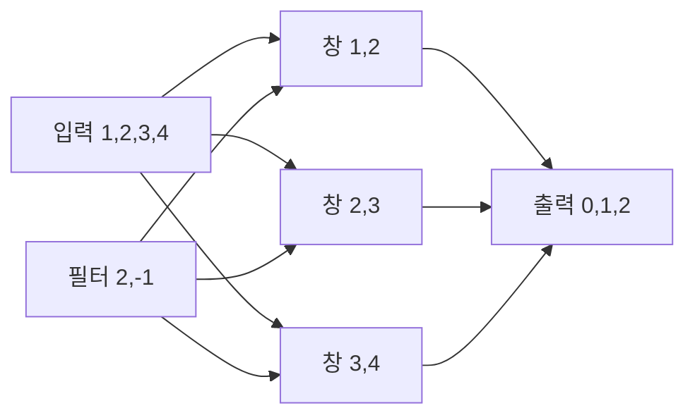

# 09. Convolution과 sequence model

[← 이전](08-neural-networks-and-activations.md) · [목차](README.md) · [다음 →](10-attention-and-transformers.md)

Convolution은 작은 filter를 위치마다 공유해 local pattern을 찾는다.

Sequence model은 순서가 있는 입력에서 이전 위치와 현재 위치의 관계를 다룬다.

Image와 text는 shape와 순서 의미가 다르므로 같은 숫자 배열도 다르게 해석한다.

## 이 장의 목표

1. 처음 나오는 단어와 기호를 설명한다.
2. 작은 입력의 모든 중간값을 계산한다.
3. 계산 결과와 실제 system 주장을 구분한다.

## 기본 단어와 기호

**convolution**는 filter를 이동하며 곱해 더하는 연산이다.

**kernel/filter**는 공유되는 작은 weight 묶음이다.

**stride**는 filter 이동 간격이다.

**padding**는 경계에 값을 추가하는 방법이다.

**channel**는 입력 특징 축이다.

**feature map**는 filter 결과 배열이다.

**receptive field**는 출력 하나가 보는 입력 범위이다.

**sequence**는 순서가 있는 값 묶음이다.

**time step**는 sequence 한 위치이다.

**hidden state**는 이전 정보를 요약한 중간 상태이다.

**RNN**는 hidden state를 반복 갱신하는 network이다.

**causal**는 미래 위치를 보지 않는 조건이다.

## 왜 필요한가

- Weight sharing은 위치마다 별도 parameter를 두는 것보다 작다.
- Stride와 padding은 output shape를 바꾼다.
- RNN state는 긴 sequence에서 정보와 gradient를 잃을 수 있다.
- Causal 예측에서 미래 token을 입력에 넣으면 leakage다.

## 입력에서 결과까지

1. 입력 window를 선택한다.
2. Filter와 원소별로 곱한다.
3. 곱한 값을 더해 output 한 칸을 만든다.
4. Stride만큼 filter를 이동한다.
5. 모든 위치에서 feature map을 만든다.
6. Sequence model은 현재 입력과 이전 state를 읽는다.
7. 새 hidden state를 만든다.
8. Output과 target을 비교한다.

## 작은 숫자로 한 번 계산하기

입력=[1,2,3,4], filter=[2,-1]이다.

첫 위치=1×2+2×(-1)=0이다.

둘째=2×2+3×(-1)=1이다.

셋째=3×2+4×(-1)=2이다.

Stride 1, padding 없음이면 output=[0,1,2]다.

입력 길이 4, filter 2이므로 길이는 3이다.

RNN 모형 h_t=x_t+h_(t-1)로 둔다.

x=[1,2,3], h0=0이면 h=[1,3,6]이다.

| 구분 | 값 또는 책임 |
|---|---|
| 입력 길이 | 4 |
| filter 길이 | 2 |
| stride | 1 |
| output 길이 | 3 |

## Shape·단위·시각 점검

입력 shape를 적는다.

각 축이 sample, channel, sequence 중 무엇인지 적는다.

숫자의 단위가 dB, ms, byte, 무차원 중 무엇인지 적는다.

Model이 값을 읽는 시각에 실제로 알 수 있었는지 확인한다.

평균의 분모가 sample인지 token인지 요청인지 적는다.

Parameter와 관측값을 구분한다.

## 구현에서 달라지는 것

Library는 여러 연산을 합쳐 실행할 수 있다.

Memory allocator와 queue가 추가 지연을 만든다.

Finite precision 때문에 손계산과 마지막 자리에서 다를 수 있다.

Version이 바뀌면 API 기본값이 달라질 수 있다.

따라서 식, code, 실행 환경을 함께 기록한다.

## 흔한 오해와 반례

- Convolution filter는 사람이 정한 edge detector로만 제한되지 않는다.
- Padding을 추가해도 새 실제 관측이 생기는 것은 아니다.
- RNN hidden state가 과거 전체를 손실 없이 저장하지 않는다.
- Sequence random split은 미래 누수를 만들 수 있다.

## 확인 문제와 해설

### 문제 1

입력 길이 5, filter 3, stride1, padding0 output 길이는?

**해설:** 5-3+1=3이다.

### 문제 2

Weight sharing의 이점은?

**해설:** Parameter 수를 줄이고 같은 local pattern을 여러 위치에서 찾게 한다.

### 문제 3

Causal mask가 필요한 이유는?

**해설:** 현재 위치 예측이 미래 정보를 보지 못하게 하기 위해서다.

## 학습 체크리스트

- 용어를 자신의 말로 설명할 수 있는가?
- 중간 숫자를 계산할 수 있는가?
- 누가 값을 바꾸는지 말할 수 있는가?
- 반례와 실패 조건을 말할 수 있는가?
- 독립 test와 운영 평가를 구분하는가?

## 공식 자료

- [ISLP 2023](https://www.statlearning.com/home)
- [Dive into Deep Learning](https://d2l.ai/)
- [Dive into Deep Learning: Convolutional Neural Networks](https://d2l.ai/chapter_convolutional-neural-networks/index.html)

공식 근거 확인일: **2026-10-11**.

[← 이전](08-neural-networks-and-activations.md) · [목차](README.md) · [다음 →](10-attention-and-transformers.md)
