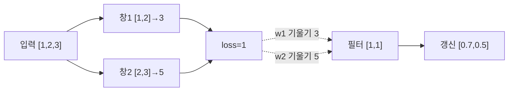
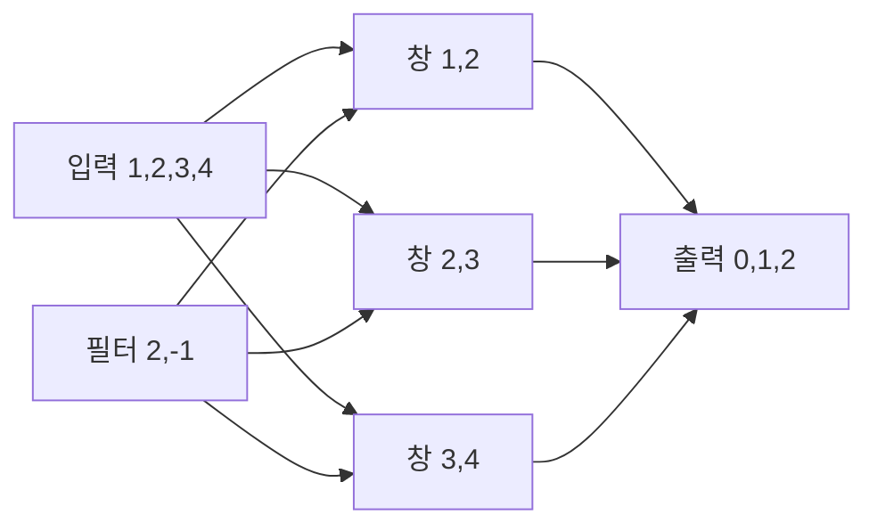

# 09. Convolution과 sequence model

[← 이전](08-neural-networks-and-activations.md) · [목차](README.md) · [다음 →](10-attention-and-transformers.md)

**합성곱 신경망(CNN, Convolutional Neural Network)**은 작은 가중치 창을 입력의 여러 위치에 반복 적용하는 신경망이다. 컴퓨터 통신 network와 달리 여기서 network는 학습되는 숫자 함수다. **시퀀스(sequence)**는 시간, 문장, 센서 기록처럼 순서가 의미를 갖는 값의 나열이다. 이 장은 위치를 공유하는 합성곱과 이전 단계 상태를 전달하는 순환 신경망을 숫자로 계산한다.


## 1. 1차원 합성곱의 모든 위치 계산

**커널(kernel)** 또는 **필터(filter)**는 입력의 작은 구간과 곱할 학습 가능한 가중치 묶음이다. 운영체제 kernel과 같은 단어지만 여기서는 `[2,-1]` 같은 숫자 창이다. **합성곱(convolution)**은 이 창을 입력 위로 이동하면서 같은 위치끼리 곱해 더하는 연산이다. 딥러닝 구현은 수학의 엄밀한 kernel 뒤집기보다 cross-correlation 형태를 흔히 쓰지만 관례상 convolution이라 부른다.

입력 `[1,2,3,4]`, 필터 `[2,-1]`에서 첫 창 `[1,2]`의 출력은 `1×2+2×(-1)=0`이다. 둘째 `[2,3]`은 `4-3=1`, 셋째 `[3,4]`는 `6-4=2`다. 출력은 `[0,1,2]`이다. 같은 필터 두 숫자를 세 위치에서 재사용하는 것이 **가중치 공유(weight sharing)**다. 위치마다 별도 필터를 쓰는 것보다 매개변수가 적고 같은 국소 pattern을 어디서나 찾는다.

**보폭(stride)**은 필터 시작 위치를 몇 칸씩 옮기는지다. 보폭 2면 입력 `[1,2,3,4,5]`에서 시작 위치 0과 2를 사용해 `[0,2]`가 나온다. **패딩(padding)**은 경계 바깥에 값을 덧붙이는 규칙이다. 0 패딩 1은 `[1,2,3]`을 `[0,1,2,3,0]`처럼 다룬다. 패딩은 새 관측을 만든 것이 아니라 출력 모양과 경계 계산을 정하는 가정이다.

출력 길이는 `floor((입력길이+2P-K)/S)+1`이다. 길이 7, 필터 3, 패딩 1, 보폭 2면 `floor((7+2-3)/2)+1=4`다. 나누어떨어지지 않는 마지막 위치는 floor 때문에 버려진다.

## 2. 채널과 2차원 CNN 모양

**채널(channel)**은 같은 위치에서 서로 다른 종류의 값을 담는 축이다. RGB 영상은 빨강·초록·파랑 3채널이다. 입력 shape `(배치 2, 채널 3, 높이 5, 너비 5)`는 영상 두 장을 뜻한다. **배치(batch)**는 한 번에 계산하는 표본 묶음이다.

출력 채널 하나를 만드는 필터는 모든 입력 채널을 본다. 출력 채널 4개, 입력 채널 3개, 필터 3×3이면 weight shape는 `(4,3,3,3)`, 매개변수는 `4×3×3×3=108`, bias 4개를 더해 112개다. 패딩 1, 보폭 1이면 공간 크기 5×5가 유지되어 출력 shape `(2,4,5,5)`다.

위치 하나의 출력은 3개 입력 채널×3×3 위치, 총 27개 곱을 더하고 bias를 더한 값이다. 출력 채널마다 다른 필터를 사용하므로 같은 입력 위치에서도 네 종류의 특징을 만든다.

**Pooling**은 작은 구간을 하나의 요약값으로 줄이는 연산이다. Max pooling은 최댓값, average pooling은 평균을 쓴다. `[1,3,2,4]`에 창 2, 보폭 2 max pooling을 적용하면 `[3,4]`다. Pooling에는 학습 weight가 없을 수 있지만 정보가 사라진다. 작은 위치 변화에 덜 민감해질 수 있으나 정확한 위치가 중요한 분할 문제에는 손해가 될 수 있다.

## 3. 역전파로 필터를 갱신한다

입력 `[1,2,3]`, 필터 `[w1,w2]=[1,1]`, 보폭 1에서 출력은 `[3,5]`다. 목표 출력 `[2,4]`, 손실을 `0.5Σ(예측-목표)²`로 두면 두 오차는 `[1,1]`, 손실은 1이다.

출력 기울기는 `[1,1]`이다. w1은 첫 창의 1과 둘째 창의 2에 곱해졌으므로 `∂L/∂w1=1×1+1×2=3`이다. w2는 2와 3에 곱해져 `∂L/∂w2=1×2+1×3=5`다. 학습률 0.1이면 새 필터는 `[0.7,0.5]`다. 공유된 필터는 모든 위치에서 온 기울기를 합친다.

입력 기울기도 겹친다. 첫 입력은 첫 창 w1에서 1, 둘째 입력은 첫 창 w2와 둘째 창 w1에서 2, 셋째는 둘째 창 w2에서 1을 받아 `[1,2,1]`이다. 깊은 CNN은 이 겹침을 층마다 연쇄법칙으로 전파한다.



## 4. 수용영역과 dilation

**수용영역(receptive field)**은 출력 하나에 영향을 줄 수 있는 원래 입력 범위다. 필터 3, 보폭 1인 층 하나는 3개 위치를 본다. 같은 층 두 개를 쌓으면 두 번째 출력은 원래 입력 5개 위치를 본다. 세 층이면 7개다.

**팽창(dilation)**은 필터 원소 사이를 띄워 더 넓은 범위를 보는 설정이다. 필터 3, dilation 2는 입력 위치 `i,i+2,i+4`를 보므로 유효 범위 5다. 계산 수를 크게 늘리지 않고 범위를 넓히지만 촘촘한 국소 정보를 건너뛸 수 있다.

## 5. 순서 자료와 RNN

**순환 신경망(RNN, Recurrent Neural Network)**은 현재 입력과 이전 상태를 함께 써 새 상태를 만드는 모델이다. **은닉상태(hidden state)**는 앞 단계 정보를 다음 단계로 전달하는 메모리 벡터다. Dataset 파일의 영구 저장물이 아니라 한 sequence를 처리하는 동안 생기는 tensor다.

교육용 식 `h_t=0.5h_{t-1}+x_t`, 초기 `h0=0`, 입력 `[2,0,1]`을 계산한다.

| 단계 | 이전 상태 | 입력 | 새 상태 |
| ---: | ---: | ---: | ---: |
| 1 | 0 | 2 | 2 |
| 2 | 2 | 0 | 1 |
| 3 | 1 | 1 | 1.5 |

마지막 상태 1.5로 분류하거나 각 단계 상태를 모두 출력할 수 있다. Batch의 sequence 길이가 다르면 padding과 실제 길이 mask가 필요하다. Padding 값을 실제 입력으로 상태에 반영하면 결과가 오염된다.

## 6. 시간 역전파와 기울기 소실

**시간 역전파(BPTT, Backpropagation Through Time)**는 RNN을 시간 단계별 graph로 펼쳐 마지막 손실에서 이전 상태로 기울기를 보내는 방법이다. 위 식에서 한 단계 뒤로 갈 때마다 상태 미분 0.5가 곱해진다. h3에서 h1로 가는 계수는 `0.5²=0.25`다. 10단계면 `0.5^9≈0.00195`로 작아진다. 이것이 **기울기 소실(vanishing gradient)**이다.

계수가 2라면 10단계에 `2^9=512`로 커져 **기울기 폭주(exploding gradient)**가 된다. Gradient clipping은 전체 기울기 크기를 문턱 이하로 줄일 수 있지만 긴 기억 문제를 근본적으로 해결하지는 않는다.

**Truncated BPTT**는 긴 sequence를 일정 구간으로 잘라 역전파한다. 메모리와 계산량은 줄지만 구간보다 먼 의존성의 기울기가 끊긴다. Hidden state 값을 다음 구간으로 넘기는 것과 graph까지 연결하는 것은 다르다.

## 7. LSTM gate를 숫자로 읽는다

**LSTM**, Long Short-Term Memory는 cell state와 gate로 정보 보존·삭제를 조절하는 RNN 구조다. **Gate**는 sigmoid로 0과 1 사이 값을 만들어 얼마나 통과시킬지 정한다. Forget gate f, input gate i, output gate o가 있다.

이전 cell `c_{t-1}=2`, forget gate `f=0.8`, input gate `i=0.3`, 새 후보 `g=1`, output gate `o=0.5`라 하자. 새 cell은 `c_t=f c_{t-1}+ig=0.8×2+0.3×1=1.9`다. Hidden은 `h_t=o tanh(c_t)≈0.5×0.956=0.478`이다.

Forget gate가 1에 가까우면 이전 cell을 보존하고 0이면 지운다. LSTM이 무한 기억을 보장하지 않는다. Gate saturation, 최적화, data와 sequence 길이에 따라 실패할 수 있다.

## 8. CNN과 sequence를 결합할 때

1차원 CNN은 시계열의 짧은 국소 pattern을 병렬로 찾는다. RNN은 순서대로 상태를 갱신한다. CNN 출력 sequence를 RNN 입력으로 넣을 수 있다. 예를 들어 길이 8에 필터 3, 보폭 2를 쓰면 길이 3 출력이 되고 RNN은 세 단계를 처리한다. Downsampling으로 계산은 줄지만 짧은 사건을 잃을 수 있다.

Causal convolution은 현재 출력이 현재와 과거 입력만 보게 padding을 설계한다. 미래 예측에서 대칭 padding을 쓰면 미래 정보 leakage가 생긴다. Offline 분류와 online forecasting의 경계를 명시한다.

## 9. 실패 반례와 연구 조건

영상에서 channel 순서를 RGB 대신 BGR로 넣으면 shape는 맞아도 의미가 틀린다. Sensor sequence를 무작위로 섞으면 RNN은 시간 관계를 배울 수 없다. Padding mask를 빼면 길이 차이를 실제 신호처럼 학습할 수 있다.

CNN 또는 LSTM 연구 결과를 읽을 때 입력 sampling rate, sequence 길이, receptive field, parameter 수, split 단위와 baseline을 확인한다. 더 깊은 model의 향상을 architecture 하나의 효과로 단정하지 않는다.

## 위치를 공유하는 filter와 시간을 전달하는 hidden state

**Convolution kernel/filter**는 작은 weight 창이다. 입력 `[1,2,3,4]`, kernel `[2,-1]`, stride 1, padding 0이면 창별 내적은 `[0,1,2]`다. 같은 kernel을 모든 위치에 써 **weight sharing**을 한다.

**Stride**는 창 이동 간격이다. Stride 2면 시작 위치 0,2처럼 건너뛰어 출력이 짧아진다. **Padding**은 경계에 값을 추가한다. Zero padding 1은 실제 관측을 새로 만드는 것이 아니라 shape와 경계 처리를 위한 가정이다.

1차원 출력 길이는 `floor((입력+2padding-kernel)/stride)+1`이다. 길이 7, kernel 3, padding 1, stride 2면 `floor((7+2-3)/2)+1=4`다.

**Receptive field**는 출력 하나가 영향을 받는 입력 범위다. Kernel 3인 층 하나는 세 위치를 본다. Stride 1의 kernel 3 층을 두 개 쌓으면 두 번째 출력 하나는 원래 입력 다섯 위치에 영향을 받을 수 있다. 층이 깊어질수록 범위가 넓어지지만 실제 유효 영향은 weight와 activation에 달린다.

영상에서는 입력 shape를 `(batch,channel,height,width)`처럼 쓴다. Kernel은 input channel을 모두 합쳐 output channel을 만든다. Channel과 height를 바꿔도 숫자 개수는 같을 수 있으므로 shape 의미를 명시한다.

**Sequence model**은 순서가 있는 입력을 처리한다. RNN은 현재 입력 x_t와 이전 hidden state h_(t-1)로 새 h_t를 만든다. 단순식 `h_t=0.5h_(t-1)+x_t`, x=[2,0,1], h0=0이면 h1=2, h2=1, h3=1.5다.

**BPTT(Backpropagation Through Time)**는 펼친 time step graph를 뒤에서 미분한다. h3는 h2, h2는 h1에 의존하므로 먼 step gradient에는 0.5가 반복 곱해진다. 세 step이면 0.5²처럼 작아질 수 있어 vanishing gradient가 생긴다. 계수가 2처럼 크면 exploding gradient가 가능하다.

Causal sequence 예측에서 t의 label을 예측할 때 t+1 입력을 feature에 넣으면 미래 누수다. Random window split도 겹치는 token이 train/test 양쪽에 들어갈 수 있다.

## 유도 문제 5개

1. 길이5,kernel3,stride1,padding0 출력 길이는? **해설:** `(5-3)+1=3`이다.
2. Stride를 2로 늘리면 무엇이 바뀌나? **해설:** 창 수가 줄고 위치 해상도가 낮아진다.
3. Padding 1은 실제 data인가? **해설:** 아니다. 경계 계산을 위해 추가한 값이다.
4. 위 RNN의 h2는? **해설:** `0.5×2+0=1`이다.
5. BPTT가 긴 sequence에서 어려운 이유는? **해설:** Jacobian이 반복 곱해져 gradient가 사라지거나 폭발할 수 있다.


Convolution은 작은 filter를 위치마다 공유해 local pattern을 찾는다.

Sequence model은 순서가 있는 입력에서 이전 위치와 현재 위치의 관계를 다룬다.

Image와 text는 shape와 순서 의미가 다르므로 같은 숫자 배열도 다르게 해석한다.

## 입력에서 결과까지

1. 입력 window를 선택한다.
2. Filter와 원소별로 곱한다.
3. 곱한 값을 더해 output 한 칸을 만든다.
4. Stride만큼 filter를 이동한다.
5. 모든 위치에서 feature map을 만든다.
6. Sequence model은 현재 입력과 이전 state를 읽는다.
7. 새 hidden state를 만든다.
8. Output과 target을 비교한다.



## 작은 숫자로 한 번 계산하기

입력=[1,2,3,4], filter=[2,-1]이다.

첫 위치=1×2+2×(-1)=0이다.

둘째=2×2+3×(-1)=1이다.

셋째=3×2+4×(-1)=2이다.

Stride 1, padding 없음이면 output=[0,1,2]다.

입력 길이 4, filter 2이므로 길이는 3이다.

RNN 모형 h_t=x_t+h_(t-1)로 둔다.

x=[1,2,3], h0=0이면 h=[1,3,6]이다.

| 구분 | 값 또는 책임 |
|---|---|
| 입력 길이 | 4 |
| filter 길이 | 2 |
| stride | 1 |
| output 길이 | 3 |

## Shape·단위·시각 점검

입력 shape를 적는다.

각 축이 sample, channel, sequence 중 무엇인지 적는다.

숫자의 단위가 dB, ms, byte, 무차원 중 무엇인지 적는다.

Model이 값을 읽는 시각에 실제로 알 수 있었는지 확인한다.

평균의 분모가 sample인지 token인지 요청인지 적는다.

Parameter와 관측값을 구분한다.

## 구현에서 달라지는 것

Library는 여러 연산을 합쳐 실행할 수 있다.

Memory allocator와 queue가 추가 지연을 만든다.

Finite precision 때문에 손계산과 마지막 자리에서 다를 수 있다.

Version이 바뀌면 API 기본값이 달라질 수 있다.

따라서 식, code, 실행 환경을 함께 기록한다.

## 흔한 오해와 반례

- Convolution filter는 사람이 정한 edge detector로만 제한되지 않는다.
- Padding을 추가해도 새 실제 관측이 생기는 것은 아니다.
- RNN hidden state가 과거 전체를 손실 없이 저장하지 않는다.
- Sequence random split은 미래 누수를 만들 수 있다.

## 확인 문제와 해설

### 문제 1

입력 길이 5, filter 3, stride1, padding0 output 길이는?

**해설:** 5-3+1=3이다.

### 문제 2

Weight sharing의 이점은?

**해설:** Parameter 수를 줄이고 같은 local pattern을 여러 위치에서 찾게 한다.

### 문제 3

Causal mask가 필요한 이유는?

**해설:** 현재 위치 예측이 미래 정보를 보지 못하게 하기 위해서다.


+## 11. Sequence 출력, teacher forcing, state 수명

Sequence 분류는 마지막 hidden state 하나로 전체 label을 예측할 수 있지만, 각 시점마다 label이 필요한 tagging 문제는 모든 `h_t`에서 출력을 만든다. 입력 길이 3에서 출력 logit도 세 개이고 loss는 실제 token 위치만 평균낸다. Padding 두 칸을 loss 분모에 넣으면 짧은 sequence의 gradient scale이 달라진다.

Language model RNN에서 **teacher forcing**은 training 때 이전 정답 token을 다음 입력으로 넣는 방법이다. Inference에서는 이전 model 예측을 넣으므로 training과 실행 조건이 다르다. 첫 예측 오류가 뒤 상태를 바꿔 오류가 누적될 수 있다. Teacher forcing 비율을 바꾸는 기법도 실험 조건과 validation 결과를 기록한다.

Hidden state의 수명도 정한다. 서로 독립인 두 문장을 batch에서 처리할 때 첫 문장 마지막 state를 둘째 문장에 넘기면 관계없는 정보가 섞인다. Streaming sensor처럼 연속된 구간이면 state를 넘길 수 있지만, 장비 ID가 바뀌거나 gap이 길면 reset 정책이 필요하다.

## 12. Bidirectional RNN과 미래 leakage

**양방향 RNN(bidirectional RNN)**은 sequence를 앞에서 뒤로 읽는 state와 뒤에서 앞으로 읽는 state를 합친다. 문장 전체가 이미 주어진 offline tagging에는 양쪽 문맥이 유용하다. 그러나 실시간 미래 예측에서 backward 방향은 아직 오지 않은 입력을 보므로 leakage다.

시각 t=3의 장애를 예측하는데 t=4,5 센서값을 backward state가 사용했다면 높은 test 점수는 실제 online 조건을 나타내지 않는다. Architecture의 이름보다 예측 시점에 이용 가능한 입력 경계를 먼저 정한다.

## 13. GRU gate와 LSTM 비교

**GRU**, Gated Recurrent Unit은 update gate와 reset gate로 이전 state와 새 후보를 섞는 순환 구조다. 교육용으로 update gate z=0.25, 이전 state 4, 새 후보 0이라면 `h_t=(1-z)h_{t-1}+z·candidate=0.75×4+0=3`이다. 구현 문헌에 따라 z가 어느 항에 붙는지 표기 관례가 다를 수 있어 사용한 식을 명시한다.

LSTM은 cell state와 hidden state를 분리하고 세 gate를 쓰며, GRU는 보통 하나의 hidden state로 더 단순하다. 매개변수가 적다고 항상 빠르거나 정확한 것은 아니다. Sequence 길이, hardware kernel, batch와 task에서 비교한다.

## 14. CNN sequence model의 causal 계산

미래를 보지 않는 1차원 causal convolution에서 filter 길이 3인 현재 출력 `y_t`는 `x_t,x_{t-1},x_{t-2}`만 사용한다. 입력 `[1,2,3,4]`, filter `[0.5,1,-0.5]`를 오래된 값부터 곱하고 왼쪽 0 padding을 쓰면 다음과 같다.

```text
t1: [0,0,1]·[0.5,1,-0.5] = -0.5
t2: [0,1,2]·[0.5,1,-0.5] = 0
t3: [1,2,3]·[0.5,1,-0.5] = 1
t4: [2,3,4]·[0.5,1,-0.5] = 2
```

Filter 순서 관례를 바꾸면 값이 달라지므로 code와 수식을 맞춘다. 대칭 padding을 쓰면 t 위치 출력이 미래 입력을 볼 수 있어 forecasting 평가가 오염된다.

## 15. 추가 완전 풀이

8. 길이 5 sequence 두 개를 batch로 만들었는데 실제 길이는 5와 3이다. Padding mask에서 유효 수는?
   **해설:** 첫 sequence 5, 둘째 3으로 총 8개다. Loss 평균 분모도 유효 token 8을 써야 한다.

9. 양방향 RNN을 실시간 한-step-ahead 예측에 그대로 쓰면 어떤 문제가 생기는가?
   **해설:** backward state가 미래 관측을 사용해 leakage가 된다. 실행 시점에 가능한 과거 방향만 써야 한다.

10. GRU update gate 0.5, 이전 state 2, 후보 6에서 위 식의 새 state는?
    **해설:** `0.5×2+0.5×6=4`다.

## 10. 완전 풀이 문제

1. 길이 8, 필터 3, 패딩 1, 보폭 2의 출력 길이는?
   **해설:** `floor((8+2-3)/2)+1=floor(7/2)+1=4`다.

2. 입력 `[2,1,0]`, 필터 `[1,-2]`의 출력은?
   **해설:** 첫 창 `2-2=0`, 둘째 `1-0=1`, 따라서 `[0,1]`이다.

3. 입력채널 3, 출력채널 8, 필터 3×3의 weight 수는?
   **해설:** `8×3×3×3=216`이다. Bias까지면 224다.

4. `[1,5,2,4]`에 창2·보폭2 average pooling 결과는?
   **해설:** `(1+5)/2=3`, `(2+4)/2=3`, 따라서 `[3,3]`이다.

5. `h_t=0.5h_{t-1}+x_t`, x=[1,1,1], h0=0의 상태는?
   **해설:** h1=1, h2=1.5, h3=1.75다.

6. 6단계 전에 대한 상태 기울기 계수가 매번 0.5면 전체 계수는?
   **해설:** 다섯 경계를 지나 `0.5^5=0.03125`다.

7. LSTM에서 이전 cell 4, f=0.25, i=0.5, g=2면 새 cell은?
   **해설:** `0.25×4+0.5×2=1+1=2`다. Output gate 전 cell 값이다.

## 공식 자료

- [ISLP 2023](https://www.statlearning.com/home)
- [Dive into Deep Learning](https://d2l.ai/)
- [Dive into Deep Learning: Convolutional Neural Networks](https://d2l.ai/chapter_convolutional-neural-networks/index.html)

공식 근거 확인일: **2026-10-11**.

[← 이전](08-neural-networks-and-activations.md) · [목차](README.md) · [다음 →](10-attention-and-transformers.md)
