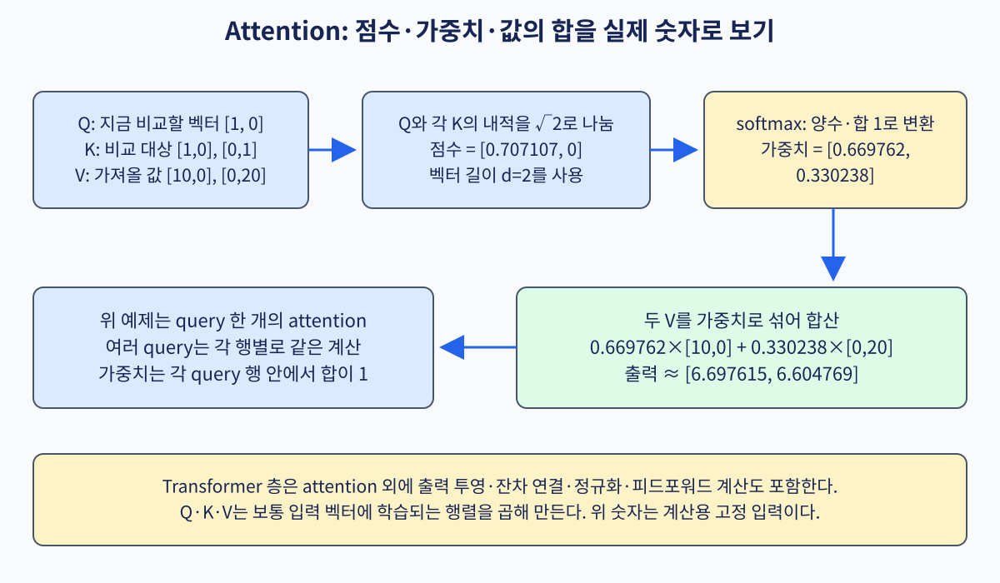
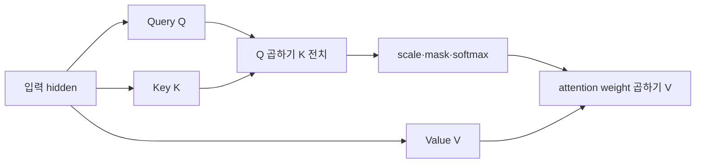

# 10. Attention과 Transformer

## Embedding에서 Transformer block 출력까지

**Embedding**은 token ID를 실수 벡터로 바꾸는 lookup table이다. ID 7 자체의 크기 7은 의미 거리가 아니며, 학습된 row vector가 token 표현이다.

Hidden H shape가 `(sequence=2,embedding=2)`이고 단순화를 위해 projection 뒤 Q,K,V가 다음이라고 하자.

```text
Q=[[1,0],[1,1]]
K=[[1,0],[0,1]]
V=[[10,0],[0,20]]
```

**Query**는 현재 위치가 찾는 특징, **Key**는 각 위치의 비교 표지, **Value**는 선택 비율로 섞을 내용이다. 같은 H에 서로 다른 W_Q,W_K,W_V를 곱해 만들 수 있다.

`QK^T`는 `[[1,0],[1,1]]`이다. Head dimension d=2이므로 `sqrt(2)`로 나눠 `[[0.707,0],[0.707,0.707]]`을 얻는다. 첫 행 softmax는 `[0.670,0.330]`, 둘째는 `[0.5,0.5]`다. 이를 V와 곱하면 output은 약 `[[6.70,6.60],[5,10]]`이다.

**Mask**는 보지 못할 위치 score에 매우 작은 값을 더해 softmax weight를 0에 가깝게 만든다. Causal mask에서 첫 token은 미래 둘째 token을 못 보므로 첫 행 output은 V1 `[10,0]`이 된다. Padding mask와 causal mask는 제외 이유가 다르다.

**Attention head**는 자기 projection과 score 계산을 가진 한 묶음이다. Multi-head는 여러 subspace 결과를 이어 붙이고 output projection한다. Head 수를 늘렸다고 독립 의미가 자동으로 생기지 않는다.

Transformer block은 attention 하나가 아니다. Normalization은 hidden scale을 조정하고, residual은 `input+transformation` 경로를 만들며, MLP는 각 token 위치에서 비선형 변환을 한다. Shape가 같아야 residual add가 가능하다.

FlashAttention-3 2024 preprint는 Hopper의 비동기 TMA, Tensor Core, warp specialization을 활용해 attention 실행을 연구한다. 위 수학적 QK·softmax·V 의미를 바꾸기보다 data movement와 overlap을 다룬다. 평가 hardware가 Hopper라는 조건을 다른 GPU에 그대로 일반화하면 안 된다.

PagedAttention(SOSP 2023)은 LLM serving의 KV cache를 block 단위로 관리해 fragmentation과 sharing을 다룬다. OS paging 비유는 logical-to-physical mapping 이해에 유용하지만 CPU virtual memory와 동일한 mechanism은 아니다. 당시 baseline과 workload 조건을 확인한다.

FlashInfer(MLSys 2025)는 KV layout, JIT, dynamic request와 CUDA Graph 조건을 다루는 inference library 연구다. Dynamic batch에서는 request shape 변화와 graph 재사용 조건이 중요하다. Kernel benchmark와 end-to-end scheduler latency를 분리 비교한다.

## 유도 문제 5개

1. Q `(3,4)`, K `(5,4)`면 score shape는? **해설:** `QK^T`이므로 `(3,5)`다.
2. 같은 score 두 개의 softmax는? **해설:** 각각 0.5다.
3. Causal mask 목적은? **해설:** 현재 token이 미래 token 정보를 보지 못하게 한다.
4. Transformer가 attention 하나인가? **해설:** 아니다. Residual, normalization, MLP와 projection이 포함된다.
5. FlashAttention speedup을 모든 GPU에 적용 가능한가? **해설:** 아니다. Hardware, dtype, shape와 비교 baseline을 맞춰야 한다.

[← 이전](09-convolutions-and-sequence-models.md) · [목차](README.md) · [다음 →](11-training-systems-and-numerical-precision.md)

Attention은 한 위치가 다른 위치의 정보를 얼마나 섞을지 계산한다.

Query, Key, Value는 같은 hidden에서 다른 projection으로 만들 수 있다.

Transformer block은 attention만이 아니라 residual, normalization, MLP를 포함한다.

## 이 장의 목표

1. 처음 나오는 단어와 기호를 설명한다.
2. 작은 입력의 모든 중간값을 계산한다.
3. 계산 결과와 실제 system 주장을 구분한다.



## 기본 단어와 기호

**token**는 sequence의 이산 단위이다.

**embedding**는 token을 나타내는 실수 vector이다.

**query**는 현재 위치가 찾는 특징이다.

**key**는 각 위치의 비교 표지이다.

**value**는 가중합할 내용이다.

**score**는 query와 key의 유사도이다.

**scaled dot-product**는 dot product를 차원 제곱근으로 나눈 값이다.

**mask**는 보지 못할 위치를 제외이다.

**softmax**는 score를 합 1인 weight로 변환이다.

**head**는 독립 projection과 attention 묶음이다.

**residual**는 입력을 변환 결과에 더하는 연결이다.

**MLP**는 위치별 비선형 feed-forward network이다.

## 왜 필요한가

- Q와 K score만으로는 가져올 내용이 없으므로 V가 필요하다.
- Scaling은 차원이 커질 때 score가 커져 softmax가 포화되는 것을 완화한다.
- Softmax 전에 최댓값을 빼면 overflow를 줄인다.
- Causal mask는 생성 model이 미래 token을 보지 못하게 한다.

## 입력에서 결과까지

1. Hidden에서 Q, K, V를 계산한다.
2. 각 query와 key의 dot product를 구한다.
3. sqrt(head dimension)으로 나눈다.
4. Causal 또는 padding mask를 적용한다.
5. 안정화 softmax로 attention weight를 만든다.
6. Weight와 V를 곱해 더한다.
7. Head 결과를 합치고 projection한다.
8. Residual, normalization, MLP를 통과한다.



## 작은 숫자로 한 번 계산하기

Q=[1,0], K1=[1,0], K2=[0,1]이다.

D=2이므로 scale=sqrt(2)≈1.414다.

Score1=1/1.414≈0.7071이다.

Score2=0/1.414=0이다.

안정화 후 score=[0,-0.7071]이다.

Softmax≈[0.6698,0.3302]다.

V1=[10,0], V2=[0,20]이다.

Output≈0.6698V1+0.3302V2다.

결과≈[6.698,6.604]다.

| 구분 | 값 또는 책임 |
|---|---|
| Q shape | (1,2) |
| K shape | (2,2) |
| score shape | (1,2) |
| output shape | (1,2) |

## 두 token의 전체 행렬곱

Token 두 개가 있고 각 vector 길이가 2라고 하자.

교육을 단순화해 projection 뒤 행렬을 직접 준다.

```text
Q = [[1,0],
     [1,1]]

K = [[1,0],
     [0,1]]

V = [[10,0],
     [0,20]]
```

Q의 각 행은 질문하는 token, K의 각 행은 비교 대상 token이다.

Score 행렬은 `Q @ K^T`다.

| 계산 | K1=[1,0] | K2=[0,1] |
|---|---:|---:|
| Q1=[1,0] | 1×1+0×0=1 | 1×0+0×1=0 |
| Q2=[1,1] | 1×1+1×0=1 | 1×0+1×1=1 |

따라서 raw score는 `[[1,0],[1,1]]`이다.

Head dimension d=2이므로 각 값을 `sqrt(2)≈1.414`로 나눈다.

Scaled score는 약 `[[0.707,0],[0.707,0.707]]`이다.

첫 행 softmax는 안정화를 위해 0.707을 뺀 `[0,-0.707]`에서 계산한다.

지수값은 약 `[1,0.493]`, 합은 1.493이다.

첫 행 weight는 약 `[0.670,0.330]`이다.

둘째 행은 두 score가 같으므로 weight `[0.5,0.5]`다.

이제 각 행의 weight로 V를 가중합한다.

```text
token 1 output=0.670×[10,0]+0.330×[0,20]
              ≈[6.70,6.60]

token 2 output=0.5×[10,0]+0.5×[0,20]
              =[5,10]
```

최종 attention output 행렬은 약 `[[6.70,6.60],[5,10]]`이다.

Causal self-attention에서 둘째 token은 첫째와 자신을 볼 수 있지만 첫째 token은 미래인 둘째를 보면 안 된다.

그 경우 첫 행의 둘째 score에 매우 작은 값을 더해 softmax weight를 0으로 만든다.

첫 token output은 V1=[10,0]만 남는다.

## Shape·단위·시각 점검

입력 shape를 적는다.

각 축이 sample, channel, sequence 중 무엇인지 적는다.

숫자의 단위가 dB, ms, byte, 무차원 중 무엇인지 적는다.

Model이 값을 읽는 시각에 실제로 알 수 있었는지 확인한다.

평균의 분모가 sample인지 token인지 요청인지 적는다.

Parameter와 관측값을 구분한다.

## 구현에서 달라지는 것

Library는 여러 연산을 합쳐 실행할 수 있다.

Memory allocator와 queue가 추가 지연을 만든다.

Finite precision 때문에 손계산과 마지막 자리에서 다를 수 있다.

Version이 바뀌면 API 기본값이 달라질 수 있다.

따라서 식, code, 실행 환경을 함께 기록한다.

## 흔한 오해와 반례

- Q, K, V는 반드시 서로 다른 원본 data가 아니다.
- Attention weight가 인간 설명과 항상 일치하지 않는다.
- Transformer는 attention 한 연산만을 뜻하지 않는다.
- Softmax 안정화는 결과 수학을 바꾸려는 것이 아니다.

## 확인 문제와 해설

### 문제 1

왜 sqrt(D)로 나누는가?

**해설:** 차원이 커질 때 dot product 크기가 커져 softmax가 극단화되는 것을 완화한다.

### 문제 2

Weight 합은?

**해설:** Softmax를 썼다면 선택된 축에서 1이다.

### 문제 3

Causal mask의 효과는?

**해설:** 현재 token이 뒤의 미래 token을 참고하지 못하게 한다.

## 학습 체크리스트

- 용어를 자신의 말로 설명할 수 있는가?
- 중간 숫자를 계산할 수 있는가?
- 누가 값을 바꾸는지 말할 수 있는가?
- 반례와 실패 조건을 말할 수 있는가?
- 독립 test와 운영 평가를 구분하는가?

## 공식 자료

- [ISLP 2023](https://www.statlearning.com/home)
- [Dive into Deep Learning](https://d2l.ai/)
- [Attention Is All You Need](https://arxiv.org/abs/1706.03762)

공식 근거 확인일: **2026-10-11**.

[← 이전](09-convolutions-and-sequence-models.md) · [목차](README.md) · [다음 →](11-training-systems-and-numerical-precision.md)
