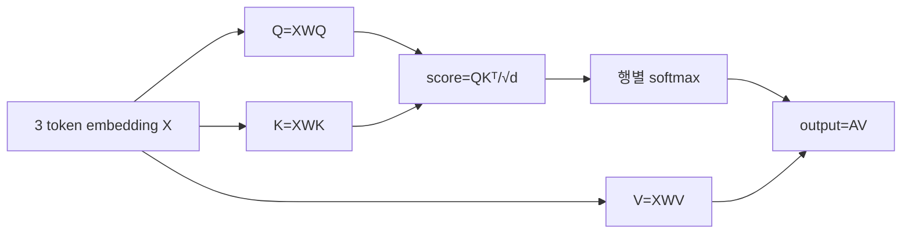
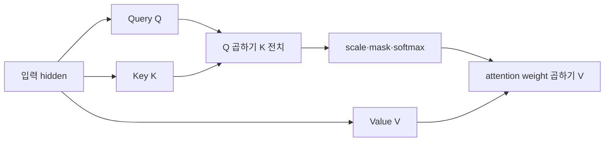

# 10. Attention과 Transformer

[← 이전](09-convolutions-and-sequence-models.md) · [목차](README.md) · [다음 →](11-training-systems-and-numerical-precision.md)

**토큰(token)**은 문장이나 신호를 모델이 처리하는 단위다. 단어 전체, 단어 조각, 문자 등이 될 수 있다. **어휘집(vocabulary)**은 사용할 수 있는 토큰과 정수 ID의 대응표다. ID 7은 일곱 번째 항목이라는 식별자일 뿐 의미 크기 7이 아니다.

**임베딩(embedding)**은 각 토큰 ID를 고정 길이 실수 벡터로 바꾸는 학습 가능한 표다. 어휘 10,000개, 폭 512면 표 shape는 `(10000,512)`이고 token 하나를 읽으면 한 행이 나온다. Token이 sequence에서 사라지면 그 실행의 hidden tensor는 해제되지만 embedding weight는 model checkpoint에 남는다.

**위치 표현(position encoding/embedding)**은 같은 토큰이라도 순서가 다름을 나타내는 숫자다. Attention 자체는 입력 행 순서를 바꾸면 출력도 같은 방식으로 바뀌는 구조이므로 위치 정보가 필요하다. 학습 위치 embedding, sinusoidal encoding, rotary 방식은 동작과 길이 일반화 조건이 다르다.


## 1. Q, K, V는 실제로 무엇인가

**Attention**은 각 token 위치가 다른 위치의 정보를 어느 비율로 섞을지 계산하는 층이다. **Query(Q)**는 현재 위치가 찾는 특징, **Key(K)**는 각 위치가 제공하는 비교 표지, **Value(V)**는 선택되면 실제로 전달할 내용이다.

Hidden matrix X에 서로 다른 weight matrix `WQ,WK,WV`를 곱해 Q,K,V를 만든다. 이 weight는 training 동안 optimizer가 바꾸고 checkpoint에 저장된다. 한 forward의 Q/K/V tensor는 해당 batch의 중간값이며 일반적으로 forward/backward 수명 동안 존재한다.

Token 3개의 embedding을 `x1=[1,0]`, `x2=[0,1]`, `x3=[1,1]`로 둔다. 모든 계산을 보이기 위해 `WQ=WK=WV=I`, 즉 identity라 두어 Q=K=V=X로 만든다.

## 2. 세 token의 모든 score를 계산한다

**내적(dot product)**은 같은 위치 숫자끼리 곱해 더한다. Q1·K1=`1×1+0×0=1`, Q1·K2=0, Q1·K3=1이다. 같은 방식으로 전체 9개 score는 다음과 같다.

```text
QKᵀ =
[[1,0,1],
 [0,1,1],
 [1,1,2]]
```

Key 폭 d=2이므로 `sqrt(2)≈1.414`로 나눈다. **Scaling**은 차원이 커질수록 내적 크기가 커져 softmax가 거의 0/1로 포화되는 것을 완화한다.

```text
scaled =
[[0.707,0,0.707],
 [0,0.707,0.707],
 [0.707,0.707,1.414]]
```

**소프트맥스(softmax)**는 한 행의 각 점수에 자연상수 e의 지수를 취하고 합으로 나눠 양수이면서 합이 1인 weight를 만든다. 첫 행 지수는 `[2.028,1,2.028]`, 합 5.056, 확률은 `[0.401,0.198,0.401]`이다. 둘째는 `[0.198,0.401,0.401]`이다. 셋째 지수 `[2.028,2.028,4.113]`, 합 8.169, 확률은 `[0.248,0.248,0.503]`이다.

## 3. V 가중합을 전부 계산한다

첫 출력은 `0.401V1+0.198V2+0.401V3`이다.

- 첫 성분: `0.401×1+0.198×0+0.401×1=0.802`
- 둘째 성분: `0.401×0+0.198×1+0.401×1=0.599`

둘째 출력은 `[0.599,0.802]`, 셋째는 `[0.751,0.751]` 정도다. 반올림 때문에 마지막 자리와 weight 합이 조금 달라질 수 있다.



## 4. Mask 전후 계산

**Mask**는 보지 못할 위치를 score 단계에서 제외하는 규칙이다. **Causal mask**는 현재 token이 미래 token을 보지 못하게 한다. Autoregressive language model에서 다음 token 정답을 미리 보는 leakage를 막는다.

첫 token은 1번만 볼 수 있어 weight `[1,0,0]`, 출력 `[1,0]`이다. 둘째 token은 1·2번 score `[0,0.707]`만 softmax한다. 지수 `[1,2.028]`, 합 3.028, weight `[0.330,0.670,0]`, 출력 `[0.330,0.670]`이다. 셋째는 미래가 없어 기존 `[0.248,0.248,0.503]`을 쓴다.

**Padding mask**는 길이를 맞추려고 넣은 빈 token을 제외한다. Causal mask는 시간 방향, padding mask는 가짜 위치라는 이유로 제외한다. Softmax 뒤 weight를 0으로만 만들면 남은 합이 1이 아니므로 score 전에 매우 작은 값, 개념적으로 `-∞`를 넣는다.

## 5. Head와 multi-head

**Attention head**는 자기 Q/K/V projection과 score·가중합을 가진 한 묶음이다. **Multi-head attention**은 여러 head가 다른 projection 공간에서 계산한 출력을 이어 붙이고 output projection을 적용한다.

Model 폭 8, head 2면 head별 폭 4로 나눌 수 있다. Batch 2, token 3에서 Q shape를 `(2,2,3,4)`로 볼 수 있다. Score는 `(2,2,3,3)`, output을 합치면 `(2,3,8)`이다. Head 수를 늘려도 model 폭이 고정이면 head별 폭은 줄어든다. Head가 자동으로 문법이나 의미 역할을 하나씩 갖는다고 단정하지 않는다.

## 6. Residual과 normalization

**Residual 연결**은 변환 `F(x)`에 원래 입력을 더해 `y=x+F(x)`로 만드는 경로다. Shape가 같아야 더할 수 있다. Backward에는 F 경로와 직접 미분 1인 경로가 있어 깊은 network의 gradient 흐름을 돕는다.

**Layer normalization**은 token 하나의 hidden feature 평균과 분산을 이용해 값을 정규화하고 학습 가능한 scale과 shift를 적용한다. `[1,3]`의 평균 2, 분산 1이면 epsilon을 무시한 표준화는 `[-1,1]`이다. L2 regularization과 다른 연산이다.

Transformer block은 attention만이 아니라 normalization, residual, token별 MLP를 포함한다. Pre-norm과 post-norm은 normalization 위치가 달라 학습 안정성과 수식 경로가 다르다.

## 7. Autoregressive 생성

**자기회귀(autoregressive)** 생성은 이전 token들을 조건으로 다음 token 하나의 확률을 계산하고, 선택한 token을 다시 입력에 붙이는 방식이다. Vocabulary 크기 4의 다음-token logit `[2,1,0,-1]`을 softmax하면 최대 token이 가장 높은 확률을 갖는다. Greedy decoding은 최대 확률, sampling은 확률에 따라 뽑는다.

**Prefill**은 prompt token 전체를 한꺼번에 처리해 각 layer의 K/V를 만들고 첫 다음-token logit을 얻는 단계다. **Decode**는 새 token 하나씩 처리하는 반복 단계다. Prefill은 행렬 계산량이 크고 병렬성이 높으며 decode는 step마다 작은 계산과 memory 읽기가 반복된다.

## 8. KV cache의 객체와 수명

**KV cache**는 이미 처리한 token의 Key와 Value tensor를 layer별로 저장해 decode 때 다시 계산하지 않게 하는 메모리 객체다. Model weight가 아니라 요청별 실행 상태다. 요청이 끝나면 해제하며, 여러 사용자 요청 사이에 잘못 공유하면 정보 누출과 잘못된 출력이 생긴다.

Layer 2개, head 2개, head 폭 4, token 3개, element 2 bytes라면 K와 V cache payload는 `2 layers×2(K,V)×2 heads×3 tokens×4×2 bytes=192 bytes`다. 실제 model은 layer·head·폭·token이 훨씬 커 metadata와 allocator overhead도 있다.

세 token prefill 뒤 cache에는 K1–K3,V1–V3가 있다. 새 token4 embedding에서 Q4,K4,V4를 계산하고 K4,V4를 cache에 append한다. Q4는 cache의 K1–K4와 4개 score를 계산하고 weight로 V1–V4를 섞는다. 과거 token의 K/V는 다시 projection하지 않는다.

```text
prefill 후: cache length=3
token4 입력: K4,V4 생성
append 후: cache length=4
Q4×[K1,K2,K3,K4]^T
softmax → [a1,a2,a3,a4]
output4 = Σ ai Vi
```

Cache가 최대 context 길이를 넘으면 eviction, sliding window, request 종료 정책이 필요하다. Cache memory 부족은 model weight가 들어갔어도 decode 중 OOM을 만들 수 있다.

## 9. Training과 inference의 차이

Training은 정답 sequence를 한 번에 넣고 causal mask로 모든 위치 loss를 병렬 계산할 수 있다. Gradient를 위해 중간 activation을 저장한다. Inference는 gradient 없이 prefill과 반복 decode를 수행한다.

Teacher forcing training에서 model은 실제 이전 정답 token을 보지만 생성에서는 자기 예측을 본다. 이 차이가 오류 누적을 만들 수 있다. Causal mask를 썼다는 사실만으로 노출 편향이 사라지지 않는다.

## 10. 성능 연구와 한계

Attention score matrix는 token 수 N에 대해 N×N이라 기본 계산과 memory가 빠르게 늘어난다. FlashAttention류는 같은 attention 수학 결과를 목표로 GPU memory 이동과 연산 순서를 최적화한다. FlashAttention-3의 Hopper 조건과 kernel 결과를 모든 GPU·shape에 일반화하지 않는다.

KV cache quantization이나 paging은 memory를 줄일 수 있지만 정확도, 변환 비용, fragmentation을 측정한다. Throughput 상승과 single-request latency, batch fairness는 다른 metric이다.

## 11. 실패 반례

Position 정보를 빼면 `"개가 사람을 문다"`와 `"사람이 개를 문다"`의 순서를 attention만으로 구분하기 어렵다. Mask 축을 잘못 잡으면 미래 leakage 또는 모든 key 차단이 생긴다. Softmax를 전체 batch 축에 적용하면 서로 다른 문장의 weight가 섞인다.

Attention weight는 정보 혼합 계수이며 인과적 설명을 자동 제공하지 않는다. 높은 weight만 보고 token이 예측의 원인이라고 단정하지 않는다.

## Embedding에서 Transformer block 출력까지

**Embedding**은 token ID를 실수 벡터로 바꾸는 lookup table이다. ID 7 자체의 크기 7은 의미 거리가 아니며, 학습된 row vector가 token 표현이다.

Hidden H shape가 `(sequence=2,embedding=2)`이고 단순화를 위해 projection 뒤 Q,K,V가 다음이라고 하자.

```text
Q=[[1,0],[1,1]]
K=[[1,0],[0,1]]
V=[[10,0],[0,20]]
```

**Query**는 현재 위치가 찾는 특징, **Key**는 각 위치의 비교 표지, **Value**는 선택 비율로 섞을 내용이다. 같은 H에 서로 다른 W_Q,W_K,W_V를 곱해 만들 수 있다.

`QK^T`는 `[[1,0],[1,1]]`이다. Head dimension d=2이므로 `sqrt(2)`로 나눠 `[[0.707,0],[0.707,0.707]]`을 얻는다. 첫 행 softmax는 `[0.670,0.330]`, 둘째는 `[0.5,0.5]`다. 이를 V와 곱하면 output은 약 `[[6.70,6.60],[5,10]]`이다.

**Mask**는 보지 못할 위치 score에 매우 작은 값을 더해 softmax weight를 0에 가깝게 만든다. Causal mask에서 첫 token은 미래 둘째 token을 못 보므로 첫 행 output은 V1 `[10,0]`이 된다. Padding mask와 causal mask는 제외 이유가 다르다.

**Attention head**는 자기 projection과 score 계산을 가진 한 묶음이다. Multi-head는 여러 subspace 결과를 이어 붙이고 output projection한다. Head 수를 늘렸다고 독립 의미가 자동으로 생기지 않는다.

Transformer block은 attention 하나가 아니다. Normalization은 hidden scale을 조정하고, residual은 `input+transformation` 경로를 만들며, MLP는 각 token 위치에서 비선형 변환을 한다. Shape가 같아야 residual add가 가능하다.

FlashAttention-3 2024 preprint는 Hopper의 비동기 TMA, Tensor Core, warp specialization을 활용해 attention 실행을 연구한다. 위 수학적 QK·softmax·V 의미를 바꾸기보다 data movement와 overlap을 다룬다. 평가 hardware가 Hopper라는 조건을 다른 GPU에 그대로 일반화하면 안 된다.

PagedAttention(SOSP 2023)은 LLM serving의 KV cache를 block 단위로 관리해 fragmentation과 sharing을 다룬다. OS paging 비유는 logical-to-physical mapping 이해에 유용하지만 CPU virtual memory와 동일한 mechanism은 아니다. 당시 baseline과 workload 조건을 확인한다.

FlashInfer(MLSys 2025)는 KV layout, JIT, dynamic request와 CUDA Graph 조건을 다루는 inference library 연구다. Dynamic batch에서는 request shape 변화와 graph 재사용 조건이 중요하다. Kernel benchmark와 end-to-end scheduler latency를 분리 비교한다.

## 유도 문제 5개

1. Q `(3,4)`, K `(5,4)`면 score shape는? **해설:** `QK^T`이므로 `(3,5)`다.
2. 같은 score 두 개의 softmax는? **해설:** 각각 0.5다.
3. Causal mask 목적은? **해설:** 현재 token이 미래 token 정보를 보지 못하게 한다.
4. Transformer가 attention 하나인가? **해설:** 아니다. Residual, normalization, MLP와 projection이 포함된다.
5. FlashAttention speedup을 모든 GPU에 적용 가능한가? **해설:** 아니다. Hardware, dtype, shape와 비교 baseline을 맞춰야 한다.


Attention은 한 위치가 다른 위치의 정보를 얼마나 섞을지 계산한다.

Query, Key, Value는 같은 hidden에서 다른 projection으로 만들 수 있다.

Transformer block은 attention만이 아니라 residual, normalization, MLP를 포함한다.

## 입력에서 결과까지

1. Hidden에서 Q, K, V를 계산한다.
2. 각 query와 key의 dot product를 구한다.
3. sqrt(head dimension)으로 나눈다.
4. Causal 또는 padding mask를 적용한다.
5. 안정화 softmax로 attention weight를 만든다.
6. Weight와 V를 곱해 더한다.
7. Head 결과를 합치고 projection한다.
8. Residual, normalization, MLP를 통과한다.



## 작은 숫자로 한 번 계산하기

Q=[1,0], K1=[1,0], K2=[0,1]이다.

D=2이므로 scale=sqrt(2)≈1.414다.

Score1=1/1.414≈0.7071이다.

Score2=0/1.414=0이다.

안정화 후 score=[0,-0.7071]이다.

Softmax≈[0.6698,0.3302]다.

V1=[10,0], V2=[0,20]이다.

Output≈0.6698V1+0.3302V2다.

결과≈[6.698,6.604]다.

| 구분 | 값 또는 책임 |
|---|---|
| Q shape | (1,2) |
| K shape | (2,2) |
| score shape | (1,2) |
| output shape | (1,2) |

## 두 token의 전체 행렬곱

Token 두 개가 있고 각 vector 길이가 2라고 하자.

교육을 단순화해 projection 뒤 행렬을 직접 준다.

```text
Q = [[1,0],
     [1,1]]

K = [[1,0],
     [0,1]]

V = [[10,0],
     [0,20]]
```

Q의 각 행은 질문하는 token, K의 각 행은 비교 대상 token이다.

Score 행렬은 `Q @ K^T`다.

| 계산 | K1=[1,0] | K2=[0,1] |
|---|---:|---:|
| Q1=[1,0] | 1×1+0×0=1 | 1×0+0×1=0 |
| Q2=[1,1] | 1×1+1×0=1 | 1×0+1×1=1 |

따라서 raw score는 `[[1,0],[1,1]]`이다.

Head dimension d=2이므로 각 값을 `sqrt(2)≈1.414`로 나눈다.

Scaled score는 약 `[[0.707,0],[0.707,0.707]]`이다.

첫 행 softmax는 안정화를 위해 0.707을 뺀 `[0,-0.707]`에서 계산한다.

지수값은 약 `[1,0.493]`, 합은 1.493이다.

첫 행 weight는 약 `[0.670,0.330]`이다.

둘째 행은 두 score가 같으므로 weight `[0.5,0.5]`다.

이제 각 행의 weight로 V를 가중합한다.

```text
token 1 output=0.670×[10,0]+0.330×[0,20]
              ≈[6.70,6.60]

token 2 output=0.5×[10,0]+0.5×[0,20]
              =[5,10]
```

최종 attention output 행렬은 약 `[[6.70,6.60],[5,10]]`이다.

Causal self-attention에서 둘째 token은 첫째와 자신을 볼 수 있지만 첫째 token은 미래인 둘째를 보면 안 된다.

그 경우 첫 행의 둘째 score에 매우 작은 값을 더해 softmax weight를 0으로 만든다.

첫 token output은 V1=[10,0]만 남는다.

## Shape·단위·시각 점검

입력 shape를 적는다.

각 축이 sample, channel, sequence 중 무엇인지 적는다.

숫자의 단위가 dB, ms, byte, 무차원 중 무엇인지 적는다.

Model이 값을 읽는 시각에 실제로 알 수 있었는지 확인한다.

평균의 분모가 sample인지 token인지 요청인지 적는다.

Parameter와 관측값을 구분한다.

## 구현에서 달라지는 것

Library는 여러 연산을 합쳐 실행할 수 있다.

Memory allocator와 queue가 추가 지연을 만든다.

Finite precision 때문에 손계산과 마지막 자리에서 다를 수 있다.

Version이 바뀌면 API 기본값이 달라질 수 있다.

따라서 식, code, 실행 환경을 함께 기록한다.

## 흔한 오해와 반례

- Q, K, V는 반드시 서로 다른 원본 data가 아니다.
- Attention weight가 인간 설명과 항상 일치하지 않는다.
- Transformer는 attention 한 연산만을 뜻하지 않는다.
- Softmax 안정화는 결과 수학을 바꾸려는 것이 아니다.

## 확인 문제와 해설

### 문제 1

왜 sqrt(D)로 나누는가?

**해설:** 차원이 커질 때 dot product 크기가 커져 softmax가 극단화되는 것을 완화한다.

### 문제 2

Weight 합은?

**해설:** Softmax를 썼다면 선택된 축에서 1이다.

### 문제 3

Causal mask의 효과는?

**해설:** 현재 token이 뒤의 미래 token을 참고하지 못하게 한다.

## 12. 완전 풀이 문제

1. Q=[1,0], K1=[1,0], K2=[0,1]의 내적은?
   **해설:** `[1,0]`이다. 같은 위치 곱의 합이다.

2. Score `[0,ln 3]`의 softmax는?
   **해설:** 지수 `[1,3]`, 합 4이므로 `[0.25,0.75]`다.

3. Weight `[0.25,0.75]`, V1=[4,0], V2=[0,8]의 출력은?
   **해설:** `[1,6]`이다.

4. 첫 token causal mask 뒤 weight는?
   **해설:** 자기 자신만 허용되므로 `[1,0,...]`이다.

5. Token 5, head 4에서 score의 token 축 shape는?
   **해설:** head마다 5×5다. Batch를 포함하면 `(B,4,5,5)`다.

6. Cache length 10에서 token 하나를 append하면 새 query가 비교하는 key 수는?
   **해설:** 새 key까지 포함해 11개다.

7. KV cache가 model checkpoint와 다른 이유는?
   **해설:** Cache는 요청 token에서 생긴 임시 실행 상태이고, checkpoint는 학습된 weight를 지속 저장한다.

## 확인 문제와 해설

### 문제 1

왜 sqrt(D)로 나누는가?

**해설:** 차원이 커질 때 dot product 크기가 커져 softmax가 극단화되는 것을 완화한다.

### 문제 2

Weight 합은?

**해설:** Softmax를 썼다면 선택된 축에서 1이다.

### 문제 3

Causal mask의 효과는?

**해설:** 현재 token이 뒤의 미래 token을 참고하지 못하게 한다.

## 공식 자료

- [ISLP 2023](https://www.statlearning.com/home)
- [Dive into Deep Learning](https://d2l.ai/)
- [Attention Is All You Need](https://arxiv.org/abs/1706.03762)

공식 근거 확인일: **2026-10-11**.

[← 이전](09-convolutions-and-sequence-models.md) · [목차](README.md) · [다음 →](11-training-systems-and-numerical-precision.md)
